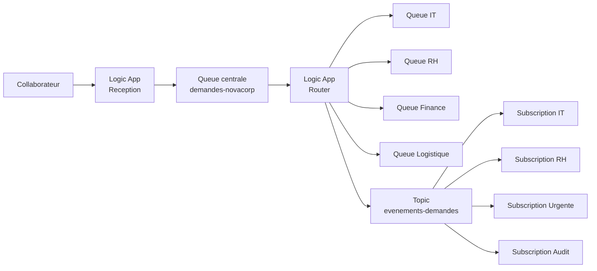
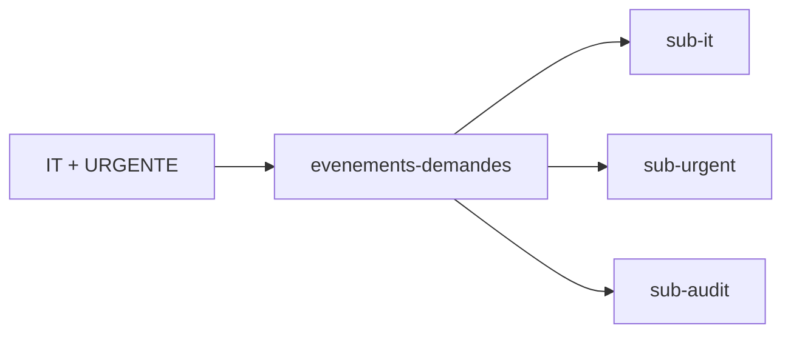
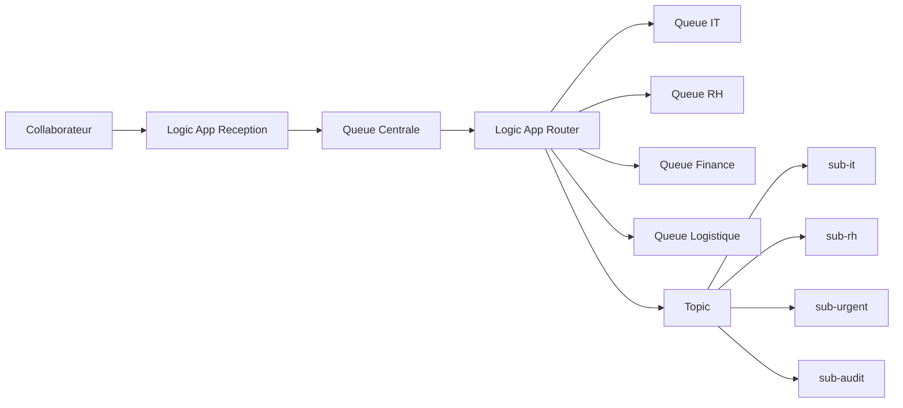

# Projet final - Mini système de gestion des demandes internes avec Azure Logic Apps et Service Bus - EPSI

## Projet de synthèse des TP1, TP2 et TP3 Azure

**Durée indicative :** *3 à 4 heures* 

**Travail :** *individuel ou en binôme selon consigne de l’enseignant*  

**Rendu obligatoire :** **rapport Markdown `.md` + captures d’écran**  

**Services autorisés :** **Azure Logic Apps** et **Azure Service Bus**  

**Portail Azure :** méthode principale  

**Azure CLI :** *facultative*

> Ce projet porte uniquement sur les notions des **TP1, TP2 et TP3 Azure**.

---

# 1. Objectif du projet

Vous devez construire un **mini système d’information événementiel** permettant de gérer des demandes internes d’entreprise.

Le système doit être capable de :

- recevoir une demande par HTTP ;
- contrôler et normaliser les données ;
- envoyer la demande dans une queue centrale ;
- router la demande vers une file métier ;
- publier un événement dans un Topic ;
- distribuer cet événement à plusieurs consommateurs grâce à des Subscriptions ;
- utiliser des filtres Service Bus ;
- démontrer un cas de **fan-out**.

---

# 2. Contexte métier

L’entreprise **NovaCorp** souhaite centraliser les demandes internes de ses collaborateurs.

Les demandes peuvent concerner :

```text
IT
RH
FINANCE
LOGISTIQUE
```

Chaque demande possède également une priorité :

```text
NORMALE
HAUTE
URGENTE
```

Le SI doit traiter les demandes différemment selon leur service, tout en diffusant certaines informations à plusieurs équipes.

---

# 3. Architecture générale attendue



---

# 4. Partie 1 - Réception HTTP

Créez une Logic App nommée :

```text
la-final-reception
```

Elle doit commencer par :

```text
When a HTTP request is received
```

---

# 5. Payload attendu

Exemple :

```json
{
  "requestId": "REQ-1001",
  "employee": "Alice Martin",
  "department": "IT",
  "priority": "URGENTE",
  "title": "VPN indisponible",
  "description": "Impossible de se connecter au VPN depuis ce matin."
}
```

---

# 6. Champs obligatoires

Votre workflow doit gérer au minimum :

```text
requestId
employee
department
priority
title
description
```

---

# 7. Normalisation

Avant envoi dans Service Bus, construisez un objet normalisé.

Exemple :

```json
{
  "requestId": "REQ-1001",
  "employee": "Alice Martin",
  "department": "IT",
  "priority": "URGENTE",
  "title": "VPN indisponible",
  "description": "Impossible de se connecter au VPN depuis ce matin.",
  "source": "NOVACORP_PORTAL",
  "receivedAt": "2026-10-09T08:00:00Z"
}
```

---

# 8. Règles de normalisation

Vous devez :

- appliquer `trim` sur les champs texte utiles ;
- convertir `department` en majuscules ;
- convertir `priority` en majuscules ;
- ajouter :

```text
source = NOVACORP_PORTAL
```

- ajouter :

```text
receivedAt = utcNow()
```

---

# 9. Queue centrale

Créez :

```text
demandes-novacorp
```

La Logic App de réception doit envoyer l’objet normalisé dans cette queue.

---

# 10. Réponse HTTP

Retournez une réponse cohérente.

Exemple :

```json
{
  "status": "ACCEPTED",
  "requestId": "REQ-1001"
}
```

---

# 11. Partie 2 - Routage métier

Créez une deuxième Logic App :

```text
la-final-router
```

Elle doit consommer les messages de :

```text
demandes-novacorp
```

---

# 12. Queues métier

Créez :

```text
demandes-it
demandes-rh
demandes-finance
demandes-logistique
```

---

# 13. Règles de routage

```text
IT
vers
demandes-it
```

```text
RH
vers
demandes-rh
```

```text
FINANCE
vers
demandes-finance
```

```text
LOGISTIQUE
vers
demandes-logistique
```

---

# 14. Construction du routage

Utilisez de préférence :

```text
Switch
```

sur :

```text
department
```

---

# 15. Cas Default

Une valeur inconnue ne doit pas être routée vers une queue métier.

Exemple :

```text
department = MARKETING
```

Le workflow doit produire une information claire :

```text
DEPARTMENT_UNKNOWN
```

---

# 16. Enrichissement après routage

Ajoutez au message :

```text
routedAt
```

avec :

```text
utcNow()
```

et :

```text
routedBy = la-final-router
```

---

# 17. Partie 3 - Topic Publish/Subscribe

Créez un Topic :

```text
evenements-demandes
```

---

# 18. Message publié

Après le routage, publiez également un événement dans le Topic.

Exemple :

```json
{
  "eventType": "REQUEST_ROUTED",
  "requestId": "REQ-1001",
  "department": "IT",
  "priority": "URGENTE",
  "title": "VPN indisponible"
}
```

---

# 19. Propriétés du message

Ajoutez les propriétés suivantes :

```text
department
priority
eventType
```

---

# 20. Subscriptions obligatoires

Créez :

```text
sub-it
sub-rh
sub-urgent
sub-audit
```

---

# 21. Filtre sub-it

Cette subscription doit recevoir uniquement :

```text
department = IT
```

---

# 22. Filtre sub-rh

Cette subscription doit recevoir uniquement :

```text
department = RH
```

---

# 23. Filtre sub-urgent

Cette subscription doit recevoir :

```text
priority = URGENTE
```

---

# 24. sub-audit

Cette subscription doit recevoir :

```text
tous les messages
```

---

# 25. Attention au filtre par défaut

Lorsque vous créez une Subscription, vérifiez si une règle par défaut existe.

Si une règle :

```text
TrueFilter
```

reste active en plus de votre filtre personnalisé, votre Subscription peut recevoir plus de messages que prévu.

---

# 26. Fan-out attendu

Une demande :

```text
department = IT
priority = URGENTE
```

doit être distribuée à :

```text
sub-it
sub-urgent
sub-audit
```

---

# 27. Exemple



---

# 28. Partie 4 - Jeux de tests obligatoires

Vous devez tester au minimum les scénarios suivants.

---

# 29. Test A - IT urgent

```json
{
  "requestId": "REQ-IT-001",
  "employee": "Alice Martin",
  "department": "IT",
  "priority": "URGENTE",
  "title": "VPN indisponible",
  "description": "Impossible de se connecter au VPN."
}
```

Attendu :

```text
Queue demandes-it
sub-it
sub-urgent
sub-audit
```

---

# 30. Test B - RH normal

```json
{
  "requestId": "REQ-RH-001",
  "employee": "Sophie Bernard",
  "department": "RH",
  "priority": "NORMALE",
  "title": "Attestation employeur",
  "description": "Demande d'une attestation employeur."
}
```

Attendu :

```text
Queue demandes-rh
sub-rh
sub-audit
```

---

# 31. Test C - Finance haute

```json
{
  "requestId": "REQ-FIN-001",
  "employee": "Marc Leroy",
  "department": "FINANCE",
  "priority": "HAUTE",
  "title": "Validation facture",
  "description": "Une facture nécessite une validation."
}
```

Attendu :

```text
Queue demandes-finance
sub-audit
```

---

# 32. Test D - Logistique urgente

```json
{
  "requestId": "REQ-LOG-001",
  "employee": "Julie Simon",
  "department": "LOGISTIQUE",
  "priority": "URGENTE",
  "title": "Livraison bloquée",
  "description": "Une livraison urgente est bloquée."
}
```

Attendu :

```text
Queue demandes-logistique
sub-urgent
sub-audit
```

---

# 33. Test E - Données à normaliser

```json
{
  "requestId": "REQ-NORM-001",
  "employee": " Paul Martin ",
  "department": " it ",
  "priority": " urgente ",
  "title": " Acces serveur ",
  "description": " Impossible d'acceder au serveur. "
}
```

Vous devez démontrer que :

```text
department = IT
priority = URGENTE
```

avant routage.

---

# 34. Test F - Département inconnu

```json
{
  "requestId": "REQ-UNKNOWN-001",
  "employee": "Anna Moreau",
  "department": "MARKETING",
  "priority": "NORMALE",
  "title": "Demande marketing",
  "description": "Test du cas Default."
}
```

Attendu :

```text
aucune queue métier
branche Default
DEPARTMENT_UNKNOWN
```

---

# 35. Partie 5 - Questions d’analyse

Répondez dans le rapport.

---

## Question 1

Pourquoi utiliser une **queue centrale** entre la Logic App de réception et la Logic App de routage ?

---

## Question 2

Pourquoi ne pas appeler directement la Logic App de routage depuis la Logic App de réception ?

---

## Question 3

Quelle différence faites-vous entre :

```text
demandes-it
```

et :

```text
sub-it
```

---

## Question 4

Pourquoi normaliser `department` avant le Switch ?

---

## Question 5

Pourquoi le Topic est-il plus adapté qu’une queue unique pour diffuser le même événement à plusieurs consommateurs ?

---

## Question 6

Expliquez le fan-out avec le cas :

```text
IT + URGENTE
```

---

## Question 7

Pourquoi les filtres sont-ils placés sur les **Subscriptions** ?

---

## Question 8

Quelle est l’utilité de :

```text
sub-audit
```

qui reçoit tous les événements ?

---

# 36. Partie 6 - Diagnostic

Répondez aux scénarios suivants.

---

# 37. Diagnostic A

Un message :

```text
department = IT
priority = URGENTE
```

arrive dans :

```text
sub-it
```

mais pas dans :

```text
sub-urgent
```

Donnez au moins **3 vérifications techniques**.

---

# 38. Diagnostic B

Une demande :

```text
department = " it "
```

arrive dans la queue centrale mais passe dans :

```text
Default
```

du Switch.

Expliquez :

- la cause probable ;
- la correction.

---

# 39. Diagnostic C

`sub-it` reçoit également des messages RH.

Donnez au moins **2 causes possibles**.

---

# 40. Diagnostic D

La queue :

```text
demandes-finance
```

reste vide alors que le Switch entre bien dans la branche FINANCE.

Donnez au moins **3 pistes de diagnostic**.

---

# 41. Rapport obligatoire

Le rapport doit s’appeler :

```text
NOM_PRENOM_PROJET_FINAL_AZURE.md
```

---

# 42. Structure du rapport

```markdown
# Projet final Azure Logic Apps et Service Bus

## 1. Informations
Nom :
Prénom :
Classe :

## 2. Contexte
Résumé du besoin métier.

## 3. Architecture
Diagramme Mermaid personnel + explication.

## 4. Ressources Azure créées
Liste des Logic Apps, queues, Topic et Subscriptions.

## 5. Réception HTTP
Explication + captures.

## 6. Normalisation
Expressions utilisées + exemple avant/après.

## 7. Queue centrale
Rôle et configuration.

## 8. Routage
Switch + queues métier + cas Default.

## 9. Topic
Message publié + propriétés.

## 10. Subscriptions et filtres
Filtres configurés + explications.

## 11. Fan-out
Démonstration du scénario IT + URGENTE.

## 12. Tests
Résultats des 6 tests obligatoires.

## 13. Questions d'analyse
Réponses aux 8 questions.

## 14. Diagnostic
Réponses aux 4 cas.

## 15. Conclusion
8 à 12 lignes maximum.
```

---

# 43. Captures minimales demandées

Ajoutez au minimum :

1. Logic App `la-final-reception` ;
2. trigger HTTP ;
3. étape de normalisation ;
4. action d’envoi vers la queue centrale ;
5. Logic App `la-final-router` ;
6. Switch ;
7. une branche métier ;
8. Topic ;
9. liste des Subscriptions ;
10. filtre de `sub-it` ;
11. filtre de `sub-rh` ;
12. filtre de `sub-urgent` ;
13. preuve du fan-out ;
14. résultat d’au moins 3 scénarios de tests.

---

# 44. Diagrammes Mermaid obligatoires

Le rapport doit contenir au moins :

## Diagramme 1

Architecture générale.

## Diagramme 2

Un diagramme centré sur le fan-out.

---

# 45. Exemple d’arborescence

```text
NOM_PRENOM_PROJET_FINAL_AZURE/
|
|-- NOM_PRENOM_PROJET_FINAL_AZURE.md
|
`-- images/
    |-- architecture.png
    |-- reception.png
    |-- normalisation.png
    |-- router.png
    |-- topic.png
    |-- subscriptions.png
    |-- filter-it.png
    |-- filter-rh.png
    |-- filter-urgent.png
    `-- fanout.png
```

---

# 46. Critères de réussite

Le projet est réussi si :

- la réception HTTP fonctionne ;
- les données sont normalisées ;
- la queue centrale reçoit les messages ;
- les quatre départements sont correctement routés ;
- le cas Default est géré ;
- le Topic reçoit un événement ;
- les filtres fonctionnent ;
- le fan-out est démontré ;
- les tests sont documentés ;
- le rapport est clair.

---

# 47. Bonus facultatif 1 - Subscription Finance

Ajoutez :

```text
sub-finance
```

Filtre :

```text
department = FINANCE
```

---

# 48. Bonus facultatif 2 - Priorité haute ou urgente

Créez :

```text
sub-priority
```

qui reçoit :

```text
HAUTE
```

ou :

```text
URGENTE
```

---

# 49. Bonus facultatif 3 - Deux critères

Créez une Subscription qui reçoit uniquement :

```text
department = FINANCE
ET
priority = URGENTE
```

---

# 50. Bonus facultatif 4 - Propriété eventType

Utilisez :

```text
eventType = REQUEST_ROUTED
```

dans les propriétés du Topic.

Créez un filtre supplémentaire basé sur :

```text
eventType
```

---

# 51. Bonus facultatif 5 - Réponse enrichie

La Logic App de réception peut retourner :

```json
{
  "status": "ACCEPTED",
  "requestId": "REQ-1001",
  "receivedAt": "..."
}
```

---

# 52. Ce qui n’est pas demandé

Le projet ne demande pas :

- DLQ ;
- Peek-Lock avancé ;
- Complete / Abandon ;
- idempotence ;
- concurrence avancée ;
- Table Storage ;
- Saga ;
- Sessions ;
- retry différé.

---

# 53. Estimation du temps

## 0 à 30 minutes

Créer :

```text
Service Bus Namespace
5 queues
Topic
4 subscriptions
```

---

## 30 à 70 minutes

Créer :

```text
la-final-reception
normalisation
queue centrale
```

---

## 70 à 120 minutes

Créer :

```text
la-final-router
Switch
4 queues
Topic
```

---

## 120 à 160 minutes

Configurer :

```text
subscriptions
filtres
tests
fan-out
```

---

## 160 à 210 minutes

Finaliser :

```text
captures
rapport
questions
diagnostic
```

---

# 54. Tableau de synthèse à compléter

| Département | Priorité | Queue métier | sub-it | sub-rh | sub-urgent | sub-audit |
|---|---|---|---|---|---|---|
| IT | NORMALE | ? | ? | ? | ? | ? |
| IT | URGENTE | ? | ? | ? | ? | ? |
| RH | NORMALE | ? | ? | ? | ? | ? |
| RH | URGENTE | ? | ? | ? | ? | ? |
| FINANCE | HAUTE | ? | ? | ? | ? | ? |
| FINANCE | URGENTE | ? | ? | ? | ? | ? |
| LOGISTIQUE | NORMALE | ? | ? | ? | ? | ? |
| LOGISTIQUE | URGENTE | ? | ? | ? | ? | ? |

---

# 55. Nettoyage

À la fin du projet :

- supprimez les messages de test ;
- désactivez les Logic Apps si nécessaire ;
- supprimez les ressources uniquement si l’environnement vous appartient ;
- ne supprimez jamais une ressource mutualisée fournie par EPSI.

---

# 56. Conclusion attendue

Votre conclusion doit répondre brièvement à :

```text
Qu'est-ce que cette architecture apporte par rapport à un enchaînement d'appels HTTP directs ?
```

Vous devez évoquer au moins :

- découplage ;
- routage ;
- diffusion ;
- extensibilité.

---

# 57. Résumé final



> **Le projet final doit démontrer que vous savez assembler les concepts des TP1, TP2 et TP3 dans un mini SI cohérent : réception, normalisation, queue, routage, Topic, Subscriptions, filtres et fan-out.**
