# TP 1 - Flux de données avec AWS Lambda, Amazon SQS et API Gateway - EPSI

**Niveau :** *débutant à intermédiaire*  

**Durée indicative :** *2 h 30 à 4 h*  

**Mode principal :** **Console AWS**  

**Mode secondaire :** *AWS CLI, uniquement en option et à titre de comparaison*  

**Architecture :** **Amazon API Gateway HTTP API**, **AWS Lambda**, **Amazon SQS Standard** et **AWS IAM**  

**Public visé :** *étudiants EPSI disposant d’un compte AWS personnel, d’un compte AWS Free Tier ou d’un environnement AWS fourni par l’établissement.*

---

# 1. Objectifs du TP

À la fin de ce TP, vous devez être capables de :

- créer une **Amazon SQS Standard queue** ;
- comprendre pourquoi une queue découple deux composants ;
- créer une fonction **AWS Lambda productrice** ;
- créer une fonction **AWS Lambda consommatrice** ;
- créer une **HTTP API** avec **Amazon API Gateway** ;
- créer et utiliser des **IAM execution roles** ;
- appliquer le principe du **Least Privilege** ;
- recevoir une requête HTTP ;
- valider un JSON ;
- construire un événement interne ;
- envoyer cet événement dans **Amazon SQS** ;
- répondre **`202 Accepted`** au client ;
- créer volontairement un **backlog** ;
- connecter une queue SQS à une Lambda avec un **Event Source Mapping** ;
- observer les invocations et les logs dans **Amazon CloudWatch** ;
- diagnostiquer les erreurs les plus fréquentes ;
- comprendre les différences entre :
  - API synchrone ;
  - messaging asynchrone ;
  - authentification ;
  - autorisation ;
  - queue ;
  - producteur ;
  - consommateur ;
  - *at-least-once delivery*.

---

# 2. Contexte métier

Dans ce TP, nous simulons un **système d’information d’école** dans un contexte EPSI.

Un portail étudiant permet à un apprenant d’envoyer une **demande de traitement étudiant**.

Nous voulons éviter que le portail dépende directement du composant qui traite la demande.

Le scénario est :

```text
1. Le portail étudiant envoie une demande HTTP.
2. Une fonction Lambda valide et transforme la demande.
3. La demande est stockée dans Amazon SQS.
4. Le client reçoit une réponse 202 Accepted.
5. Une seconde fonction Lambda traite le message plus tard.
```

Le traitement du consommateur ne doit donc pas être nécessaire pour répondre au client.

---

# 3. Architecture du TP

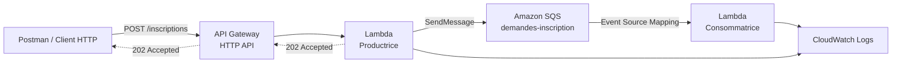

> **À retenir :** **Amazon SQS** n’exécute pas le traitement métier. Il sert ici de **tampon fiable entre deux composants**.

> **Tip EPSI :** lorsque vous analysez une architecture de SI, identifiez toujours **le producteur**, **le canal d’échange**, **le consommateur** et **le contrat de données**.

---

# 4. Correspondance avec la version Azure

| Concept | Azure | AWS |
|---|---|---|
| Endpoint HTTP | Logic App Request Trigger | API Gateway HTTP API |
| Producteur | Logic App productrice | Lambda productrice |
| Queue | Azure Service Bus Queue | Amazon SQS Standard Queue |
| Consommateur | Logic App consommatrice | Lambda consommatrice |
| Identité du service | Managed Identity | IAM Execution Role |
| Autorisation d’envoi | Data Sender | `sqs:SendMessage` |
| Autorisation de lecture | Data Receiver | `sqs:ReceiveMessage`, `sqs:DeleteMessage` |
| Historique / logs | Logic Apps Run History | CloudWatch Logs |
| Déclenchement depuis la queue | Service Bus trigger | Lambda Event Source Mapping |

> **Important :** les services ne sont pas strictement identiques. Le tableau montre les **rôles architecturaux équivalents dans ce TP**, pas une équivalence fonctionnelle parfaite entre les clouds.

---

# 5. Synchrone et asynchrone

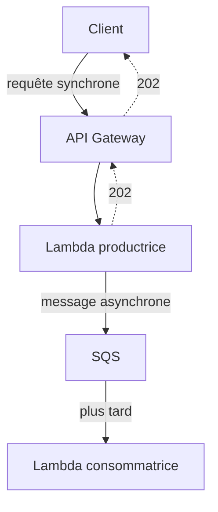

Le client peut recevoir **`202 Accepted`** alors que la **Lambda consommatrice** n’a encore rien traité.

**C’est le principe central du TP.**

---

# 6. Comptes AWS étudiants, Free Tier et comptes école

Les étudiants peuvent travailler avec :

- un **compte AWS personnel** ;
- un nouveau compte utilisant le **AWS Free Tier** ;
- un environnement de laboratoire fourni par l’école ;
- un compte géré par l’établissement avec des permissions limitées.

---

# 7. AWS Free Tier actuel

Depuis juillet 2025, AWS propose aux nouveaux clients une nouvelle formule Free Tier avec des **crédits AWS** et un **Free Plan de six mois**.

Au moment de la rédaction de ce TP, AWS annonce :

- **100 USD de crédits** à l’inscription ;
- jusqu’à **100 USD supplémentaires** en réalisant certaines activités ;
- un **Free Plan** disponible pendant six mois pour les nouveaux comptes concernés.

*Les offres peuvent évoluer : vérifiez toujours les informations affichées dans votre compte AWS.*

---

# 8. Services à faible coût utilisés dans ce TP

Nous utilisons :

- **AWS Lambda** ;
- **Amazon SQS** ;
- **Amazon API Gateway HTTP API** ;
- **Amazon CloudWatch Logs**.

Pour un TP avec quelques dizaines de requêtes, la consommation reste très faible.

AWS publie actuellement notamment :

- un Free Tier Lambda comprenant **1 million de requêtes** et **400 000 GB-secondes** de calcul par mois ;
- un Free Tier SQS comprenant **1 million de requêtes SQS par mois** ;
- un Free Tier API Gateway qui inclut des appels gratuits pour les nouveaux comptes éligibles.

> **Important :** *Free Tier* ne signifie pas que toutes les utilisations sont toujours gratuites. Les conditions dépendent du compte, de l’ancienneté et de l’offre active.

---

# 9. Comptes AWS fournis par l’école

Un compte de laboratoire peut appliquer :

- des **permissions boundaries** ;
- des politiques IAM limitées ;
- des restrictions d’organisation ;
- des rôles précréés.

Vous pouvez donc avoir le droit de créer :

```text
Lambda
SQS
API Gateway
```

mais ne pas avoir le droit de créer ou modifier librement :

```text
IAM Roles
IAM Policies
```

Si une action IAM est refusée :

**ne contournez pas les restrictions.**

L’enseignant doit alors fournir :

- un **IAM role précréé** ;
- ou un rôle de laboratoire autorisé ;
- ou les permissions nécessaires.

> **Tip EPSI :** dans un compte géré par l’école, un `AccessDenied` ne signifie pas forcément que votre architecture est mauvaise. Il peut s’agir d’une restriction volontaire du laboratoire.

---

# 10. Région AWS recommandée

Pour le TP, choisissez une seule région et gardez-la pendant toute la séance.

Par exemple :

```text
Europe (Paris)
eu-west-3
```

ou, si l’environnement école l’impose :

```text
Europe (Ireland)
eu-west-1
```

> **Erreur fréquente :** créer la queue dans une région et chercher ensuite la Lambda dans une autre région.

---

# 11. Vérifier la région dans la console

En haut à droite de la Console AWS, vérifiez la région active.

Exemple :

```text
Europe (Paris)
```

Toutes les ressources du TP doivent rester dans cette région.

---

## Équivalent AWS CLI - optionnel

Afficher la région configurée :

```bash
aws configure get region
```

Vérifier l’identité utilisée :

```bash
aws sts get-caller-identity
```

Définir la région pour une commande :

```bash
aws sqs list-queues \
  --region eu-west-3
```

---

# 12. Noms utilisés dans le TP

Nous utiliserons :

```text
Queue SQS
demandes-inscription

Lambda productrice
lambda-tp1-producteur

Lambda consommatrice
lambda-tp1-consommateur

API Gateway HTTP API
api-tp1-flux-epsi

Route
POST /inscriptions
```

Pour les rôles IAM :

```text
role-tp1-producteur
role-tp1-consommateur
```

*Si votre compte EPSI fournit déjà un rôle de laboratoire, utilisez le rôle indiqué par l’enseignant au lieu d’en créer un nouveau.*

---

# 13. Étape 1 - Créer la queue Amazon SQS

## Méthode principale - Console AWS

Dans la Console AWS, recherchez :

```text
SQS
```

Ouvrez :

```text
Simple Queue Service
```

Cliquez sur :

```text
Create queue
```

---

# 14. Choisir le type de queue

AWS propose notamment :

```text
Standard
FIFO
```

Choisissez :

```text
Standard
```

Nom :

```text
demandes-inscription
```

---

# 15. Pourquoi une Standard Queue ?

Une **SQS Standard Queue** est suffisante pour ce premier TP.

Elle fournit notamment :

- une forte capacité de traitement ;
- une livraison *at-least-once* ;
- un ordre de livraison en *best effort*.

Cela signifie qu’un message peut, exceptionnellement, être livré plus d’une fois.

Nous reviendrons sur cette notion avec l’**idempotence** dans un TP plus avancé.

> **À retenir :** dans une architecture distribuée, il ne faut pas toujours supposer qu’un message sera traité exactement une seule fois.

---

# 16. Paramètres de la queue

Pour le TP1, conservez des valeurs simples.

Vous pouvez garder notamment :

```text
Visibility timeout
30 seconds
```

```text
Message retention period
valeur par défaut
```

Ne configurez pas encore :

- de **Dead-Letter Queue** ;
- de chiffrement KMS personnalisé ;
- de FIFO ;
- de politique complexe.

Ces notions viendront plus tard.

Cliquez sur :

```text
Create queue
```

---

# 17. Pourquoi le Visibility Timeout existe-t-il ?

Lorsqu’un consommateur reçoit un message SQS, le message devient temporairement invisible.

Cela évite qu’un autre consommateur traite immédiatement le même message.

Conceptuellement :

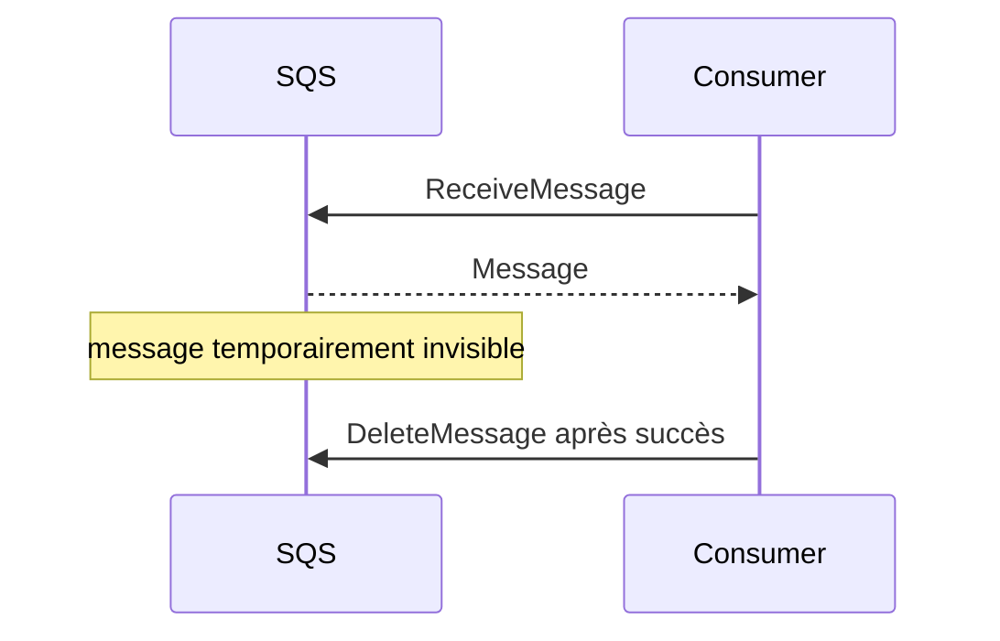

Si le traitement échoue et que le message n’est pas supprimé, il peut redevenir visible.

---

# 18. Vérifier la queue

Dans la console SQS, ouvrez :

```text
demandes-inscription
```

Repérez notamment :

- **Available messages** ;
- **Messages in flight**.

Au départ, les compteurs doivent être proches de zéro.

---

## Équivalent AWS CLI - optionnel

Créer la queue :

```bash
aws sqs create-queue \
  --queue-name demandes-inscription \
  --region eu-west-3
```

Récupérer son URL :

```bash
aws sqs get-queue-url \
  --queue-name demandes-inscription \
  --region eu-west-3
```

Afficher les attributs :

```bash
QUEUE_URL=$(aws sqs get-queue-url \
  --queue-name demandes-inscription \
  --region eu-west-3 \
  --query QueueUrl \
  --output text)

aws sqs get-queue-attributes \
  --queue-url "$QUEUE_URL" \
  --attribute-names All \
  --region eu-west-3
```

---

# 19. Architecture à ce stade

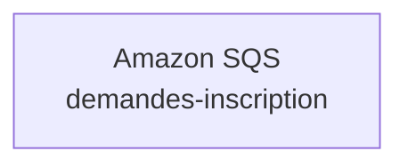

Nous n’avons encore :

- ni API ;
- ni Lambda productrice ;
- ni Lambda consommatrice.

---

# 20. Étape 2 - Créer le rôle IAM du producteur

La Lambda productrice doit pouvoir :

- écrire dans **CloudWatch Logs** ;
- envoyer des messages dans **SQS**.

Elle a donc besoin d’un **IAM execution role**.

---

# 21. Cas A - Compte personnel ou compte autorisé à gérer IAM

Dans la Console AWS, recherchez :

```text
IAM
```

Ouvrez :

```text
Roles
```

Cliquez :

```text
Create role
```

---

# 22. Trusted entity

Choisissez :

```text
AWS service
```

Use case :

```text
Lambda
```

Cela signifie que le service Lambda pourra assumer ce rôle.

---

# 23. Ajouter les permissions de logs

Ajoutez la politique gérée :

```text
AWSLambdaBasicExecutionRole
```

Elle donne à Lambda les permissions nécessaires pour écrire ses logs dans CloudWatch.

Nom du rôle :

```text
role-tp1-producteur
```

Créez le rôle.

---

# 24. Ajouter le droit SQS SendMessage

Ouvrez le rôle :

```text
role-tp1-producteur
```

Ajoutez une **inline policy**.

Choisissez l’éditeur JSON.

Le principe recherché est :

```json
{
  "Version": "2012-10-17",
  "Statement": [
    {
      "Effect": "Allow",
      "Action": "sqs:SendMessage",
      "Resource": "ARN_DE_LA_QUEUE"
    }
  ]
}
```

---

# 25. Récupérer l’ARN de la queue

Dans :

```text
SQS
demandes-inscription
```

repérez :

```text
ARN
```

Exemple :

```text
arn:aws:sqs:eu-west-3:123456789012:demandes-inscription
```

Copiez cet ARN dans la politique.

---

# 26. Pourquoi ne pas utiliser Resource `*` ?

Mauvaise pratique pédagogique :

```json
"Resource": "*"
```

Meilleure pratique :

```json
"Resource": "arn:aws:sqs:...:demandes-inscription"
```

Le producteur n’a besoin d’envoyer que dans **cette queue**.

C’est le principe du **Least Privilege**.

---

# 27. IAM : identité et autorisation

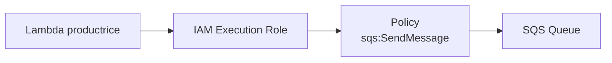

> **Mémo :**
>
> - **Execution Role** : rôle assumé par la Lambda ;
> - **IAM Policy** : actions autorisées pour ce rôle.

---

# 28. Cas B - Compte EPSI avec IAM restreint

Si vous ne pouvez pas créer de rôle :

utilisez le rôle fourni par l’enseignant.

Exemples possibles :

```text
LabRole
StudentRole
LambdaExecutionRole
```

*Le nom réel dépend de l’environnement EPSI.*

L’enseignant doit s’assurer que le rôle autorise au minimum :

```text
logs:CreateLogGroup
logs:CreateLogStream
logs:PutLogEvents
sqs:SendMessage
```

pour la Lambda productrice.

---

## Équivalent AWS CLI - optionnel

La création IAM complète est plus avancée.

Le principe est :

```bash
aws iam create-role \
  --role-name role-tp1-producteur \
  --assume-role-policy-document file://trust-lambda.json
```

Puis :

```bash
aws iam attach-role-policy \
  --role-name role-tp1-producteur \
  --policy-arn arn:aws:iam::aws:policy/service-role/AWSLambdaBasicExecutionRole
```

Puis une policy SQS ciblée.

> **Tip :** pour ce TP1, la **Console AWS** est volontairement privilégiée afin de comprendre visuellement les rôles avant d’automatiser IAM.

---

# 29. Étape 3 - Créer la Lambda productrice

Dans la Console AWS, recherchez :

```text
Lambda
```

Cliquez :

```text
Create function
```

Choisissez :

```text
Author from scratch
```

---

# 30. Paramètres de la Lambda productrice

Function name :

```text
lambda-tp1-producteur
```

Runtime :

```text
Python 3.x
```

Choisissez une version Python actuellement proposée par AWS.

Architecture :

```text
x86_64
```

ou :

```text
arm64
```

Pour ce TP, les deux conviennent.

---

# 31. Execution role

Dans la partie :

```text
Change default execution role
```

choisissez :

```text
Use an existing role
```

puis :

```text
role-tp1-producteur
```

ou le rôle fourni par l’école.

Cliquez ensuite sur :

```text
Create function
```

---

# 32. Ajouter une variable d’environnement QUEUE_URL

La Lambda doit connaître l’URL de la queue.

Dans la fonction :

```text
Configuration
Environment variables
```

Cliquez :

```text
Edit
```

Ajoutez :

```text
Key
QUEUE_URL
```

Value :

```text
URL de la queue SQS
```

Exemple :

```text
https://sqs.eu-west-3.amazonaws.com/123456789012/demandes-inscription
```

Sauvegardez.

---

# 33. Pourquoi utiliser une variable d’environnement ?

Évitez de coder ceci en dur :

```python
QUEUE_URL = "https://sqs..."
```

La variable d’environnement sépare :

- le **code** ;
- la **configuration de l’environnement AWS**.

> **Tip SI :** le code doit idéalement pouvoir être déployé dans plusieurs environnements sans modifier ses lignes métier.

---

# 34. Étape 4 - Écrire le code du producteur

Dans l’onglet **Code**, remplacez le code par :

```python
import json
import os
import uuid
from datetime import datetime, timezone

import boto3
from botocore.exceptions import ClientError


sqs = boto3.client("sqs")
QUEUE_URL = os.environ["QUEUE_URL"]

REQUIRED_FIELDS = {
    "studentId",
    "firstName",
    "lastName",
    "formation",
    "campus",
    "priority",
}

ALLOWED_PRIORITIES = {"normal", "urgent"}


def response(status_code, body):
    return {
        "statusCode": status_code,
        "headers": {
            "content-type": "application/json"
        },
        "body": json.dumps(body, ensure_ascii=False),
    }


def lambda_handler(event, context):
    try:
        raw_body = event.get("body") or "{}"
        body = json.loads(raw_body)
    except json.JSONDecodeError:
        return response(
            400,
            {
                "error": "INVALID_JSON"
            },
        )

    missing_fields = sorted(
        field
        for field in REQUIRED_FIELDS
        if not body.get(field)
    )

    if missing_fields:
        return response(
            400,
            {
                "error": "MISSING_REQUIRED_FIELDS",
                "fields": missing_fields,
            },
        )

    unknown_fields = sorted(
        set(body.keys()) - REQUIRED_FIELDS
    )

    if unknown_fields:
        return response(
            400,
            {
                "error": "UNKNOWN_FIELDS",
                "fields": unknown_fields,
            },
        )

    if body["priority"] not in ALLOWED_PRIORITIES:
        return response(
            400,
            {
                "error": "INVALID_PRIORITY",
                "allowed": sorted(ALLOWED_PRIORITIES),
            },
        )

    message_id = str(uuid.uuid4())

    internal_event = {
        "eventType": "StudentRegistrationRequested",
        "schemaVersion": 1,
        "messageId": message_id,
        "source": "epsi-student-portal",
        "requestedAt": datetime.now(timezone.utc).isoformat(),
        "data": {
            "studentId": body["studentId"],
            "firstName": body["firstName"],
            "lastName": body["lastName"],
            "formation": body["formation"],
            "campus": body["campus"],
            "priority": body["priority"],
        },
    }

    try:
        sqs.send_message(
            QueueUrl=QUEUE_URL,
            MessageBody=json.dumps(
                internal_event,
                ensure_ascii=False,
            ),
            MessageAttributes={
                "eventType": {
                    "DataType": "String",
                    "StringValue": internal_event["eventType"],
                },
                "priority": {
                    "DataType": "String",
                    "StringValue": body["priority"],
                },
            },
        )
    except ClientError as exc:
        print(
            json.dumps(
                {
                    "level": "ERROR",
                    "message": "SQS_SEND_FAILED",
                    "error": str(exc),
                }
            )
        )

        return response(
            502,
            {
                "status": "BROKER_ERROR"
            },
        )

    print(
        json.dumps(
            {
                "level": "INFO",
                "message": "MESSAGE_PUBLISHED",
                "messageId": message_id,
                "studentId": body["studentId"],
            }
        )
    )

    return response(
        202,
        {
            "status": "ACCEPTED",
            "messageId": message_id,
            "studentId": body["studentId"],
            "notice": "La demande a été placée dans SQS. Le traitement aval n'est pas encore confirmé.",
        },
    )
```

Cliquez ensuite sur :

```text
Deploy
```

---

# 35. Lecture du code - import boto3

```python
import boto3
```

**boto3** est le SDK AWS pour Python.

Dans l’environnement Lambda Python fourni par AWS, il permet d’appeler des services AWS.

Ici :

```python
sqs = boto3.client("sqs")
```

crée un client SQS.

---

# 36. Lecture du code - validation

Nous vérifions :

- que le body est du JSON ;
- que tous les champs obligatoires sont présents ;
- qu’aucun champ inconnu n’est fourni ;
- que `priority` vaut seulement :
  - `normal` ;
  - `urgent`.

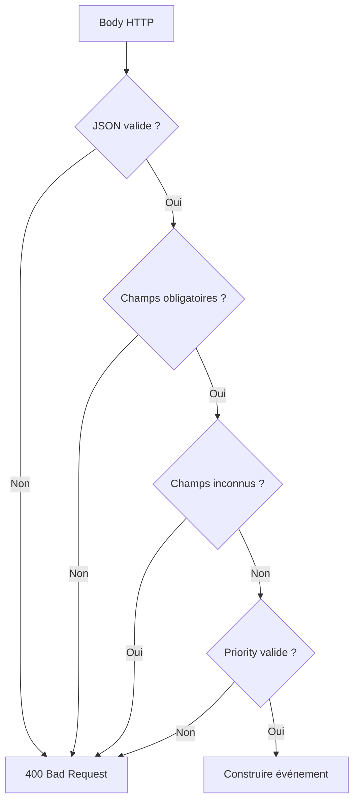

> **À retenir :** dans cette version AWS, la validation du body est explicitement effectuée dans la **Lambda productrice**.

---

# 37. Lecture du code - événement interne

Le client envoie :

```json
{
  "studentId": "...",
  "firstName": "...",
  "priority": "..."
}
```

La Lambda transforme cela en un événement interne :

```json
{
  "eventType": "StudentRegistrationRequested",
  "schemaVersion": 1,
  "messageId": "...",
  "source": "epsi-student-portal",
  "requestedAt": "...",
  "data": {
    "studentId": "...",
    "priority": "..."
  }
}
```

---

# 38. Pourquoi transformer le payload ?

Le contrat du client et le contrat interne du SI sont deux responsabilités différentes.

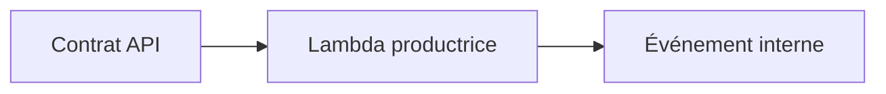

> **Tip SI :** dans un vrai SI, évitez de faire circuler partout le payload brut reçu du frontend.

---

# 39. Lecture du code - SendMessage

La ligne :

```python
sqs.send_message(...)
```

envoie le message vers Amazon SQS.

L’autorisation ne vient pas du code.

Elle vient du :

```text
IAM execution role
```

de la Lambda.

---

# 40. Authentification et autorisation AWS

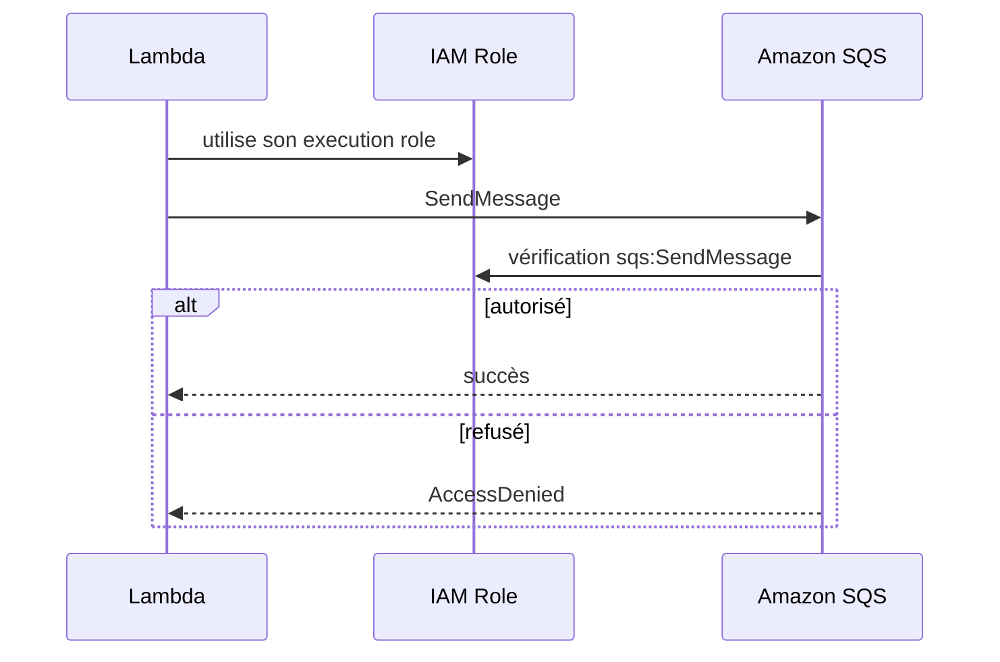

**IAM Role** :

*quelles permissions possède la fonction lorsqu’elle s’exécute ?*

---

# 41. Lecture du code - réponse 202

La Lambda renvoie :

```python
return response(
    202,
    {
        "status": "ACCEPTED",
        ...
    },
)
```

**`202 Accepted`** signifie :

*la demande a été acceptée pour traitement, mais le traitement aval peut ne pas être terminé.*

---

# 42. Lecture du code - erreur SQS

Si :

```python
sqs.send_message(...)
```

échoue, nous renvoyons :

```text
502
```

Pourquoi ?

Parce que nous ne voulons pas annoncer :

```text
ACCEPTED
```

si la demande n’a pas pu être déposée dans SQS.

---

# 43. Étape 5 - Tester la Lambda productrice sans API Gateway

Avant de créer API Gateway, testons directement la Lambda.

Dans la console Lambda, ouvrez :

```text
Test
```

Créez un nouvel événement de test.

Nom :

```text
test-valid
```

---

# 44. Événement de test Lambda

Comme API Gateway enverra le body sous forme de chaîne, utilisez :

```json
{
  "body": "{\"studentId\":\"ETU-001\",\"firstName\":\"Alice\",\"lastName\":\"Martin\",\"formation\":\"Formation EPSI\",\"campus\":\"EPSI\",\"priority\":\"normal\"}"
}
```

Lancez :

```text
Test
```

---

# 45. Résultat attendu

La réponse doit contenir approximativement :

```json
{
  "statusCode": 202
}
```

et le body doit indiquer :

```text
ACCEPTED
```

---

# 46. Vérifier la queue après le test

Retournez dans :

```text
SQS
demandes-inscription
```

Le nombre de messages disponibles doit augmenter.

> **Vérification rapide :** ne vous contentez pas de voir `202`. Vérifiez également que le message est réellement dans **SQS**.

---

# 47. Debug - test Lambda renvoie 502

Ouvrez :

```text
Monitor
View CloudWatch logs
```

Recherchez :

```text
SQS_SEND_FAILED
```

Cause probable :

- rôle IAM incorrect ;
- permission `sqs:SendMessage` absente ;
- mauvais ARN dans la policy ;
- mauvaise `QUEUE_URL` ;
- queue dans une autre région.

---

# 48. Debug - erreur AccessDenied

Si les logs montrent :

```text
AccessDenied
```

vérifiez le rôle IAM associé à :

```text
lambda-tp1-producteur
```

Il doit disposer de :

```text
sqs:SendMessage
```

sur l’ARN de :

```text
demandes-inscription
```

---

# 49. Debug - variable QUEUE_URL absente

Erreur possible :

```text
KeyError: 'QUEUE_URL'
```

Vérifiez :

```text
Configuration
Environment variables
```

La clé doit être exactement :

```text
QUEUE_URL
```

---

# 50. Étape 6 - Créer l’API Gateway HTTP API

Dans la Console AWS, recherchez :

```text
API Gateway
```

Cliquez :

```text
Create API
```

Dans la section :

```text
HTTP API
```

cliquez :

```text
Build
```

---

# 51. Pourquoi HTTP API et pas REST API ?

API Gateway propose notamment :

- **HTTP APIs** ;
- **REST APIs**.

Pour ce TP, choisissez **HTTP API**.

Les HTTP APIs proposent un ensemble de fonctionnalités plus simple et sont généralement moins coûteuses pour des APIs HTTP légères.

Elles suffisent largement pour :

```text
POST /inscriptions
```

vers une Lambda.

---

# 52. Ajouter l’intégration Lambda

Dans :

```text
Integrations
```

choisissez :

```text
Lambda
```

Sélectionnez :

```text
lambda-tp1-producteur
```

API name :

```text
api-tp1-flux-epsi
```

Cliquez :

```text
Next
```

---

# 53. Créer la route

Route :

```text
POST /inscriptions
```

Assurez-vous que cette route est intégrée à :

```text
lambda-tp1-producteur
```

---

# 54. Stage

Pour un TP1, vous pouvez utiliser :

```text
$default
```

avec :

```text
Auto-deploy
```

activé.

Cela évite de devoir effectuer manuellement un déploiement de stage à chaque modification.

---

# 55. Créer l’API

Vérifiez le résumé puis cliquez :

```text
Create
```

API Gateway vous fournit une :

```text
Invoke URL
```

Exemple :

```text
https://abc123.execute-api.eu-west-3.amazonaws.com
```

L’endpoint complet est :

```text
https://abc123.execute-api.eu-west-3.amazonaws.com/inscriptions
```

---

# 56. Permission API Gateway vers Lambda

Lorsqu’une intégration Lambda est créée depuis la console API Gateway, AWS configure généralement la permission basée sur la ressource permettant à API Gateway d’invoquer la Lambda.

Conceptuellement :

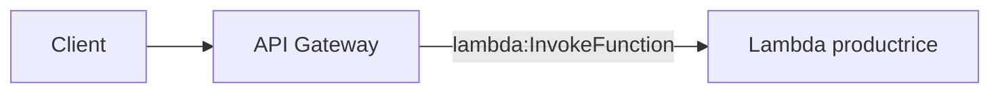

---

## Équivalent AWS CLI - optionnel

Créer une HTTP API rapidement :

```bash
aws apigatewayv2 create-api \
  --name api-tp1-flux-epsi \
  --protocol-type HTTP \
  --target arn:aws:lambda:eu-west-3:ACCOUNT_ID:function:lambda-tp1-producteur \
  --region eu-west-3
```

> **Note :** l’automatisation CLI complète d’API Gateway implique aussi les permissions d’invocation Lambda. Elle sera approfondie dans un TP Infrastructure as Code ou AWS CLI.

---

# 57. Étape 7 - Tester avec Postman

Ouvrez Postman.

Method :

```text
POST
```

URL :

```text
<INVOKE_URL>/inscriptions
```

Header :

```text
Content-Type: application/json
```

Body :

```json
{
  "studentId": "ETU-101",
  "firstName": "Alice",
  "lastName": "Martin",
  "formation": "Formation EPSI",
  "campus": "EPSI",
  "priority": "normal"
}
```

Cliquez :

```text
Send
```

---

# 58. Résultat attendu

Vous devez recevoir :

```text
202 Accepted
```

Body proche de :

```json
{
  "status": "ACCEPTED",
  "messageId": "...",
  "studentId": "ETU-101",
  "notice": "La demande a été placée dans SQS. Le traitement aval n'est pas encore confirmé."
}
```

---

# 59. Test CLI facultatif

```bash
curl -X POST \
  "https://API_ID.execute-api.eu-west-3.amazonaws.com/inscriptions" \
  -H "Content-Type: application/json" \
  -d '{
    "studentId": "ETU-101",
    "firstName": "Alice",
    "lastName": "Martin",
    "formation": "Formation EPSI",
    "campus": "EPSI",
    "priority": "normal"
  }'
```

---

# 60. Étape 8 - Vérifier le backlog SQS

Retournez dans :

```text
SQS
demandes-inscription
Monitoring
```

ou consultez les métriques / compteurs de la queue.

Vous devez observer que des messages sont disponibles.

---

# 61. Envoyer plusieurs messages

Envoyez ensuite :

```json
{
  "studentId": "ETU-102",
  "firstName": "Karim",
  "lastName": "Dupont",
  "formation": "Formation EPSI",
  "campus": "EPSI",
  "priority": "urgent"
}
```

Puis quelques autres étudiants.

Comme aucun consommateur n’existe encore :

**le backlog doit augmenter.**

---

# 62. Le backlog

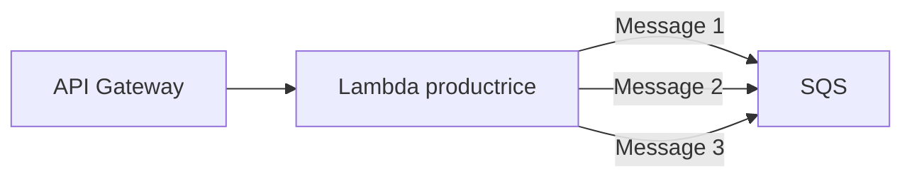

Le **backlog** correspond aux messages :

```text
stockés
mais pas encore traités
```

---

# 63. Question 1

Pourquoi les messages restent-ils dans SQS ?

**Réponse :**

Parce qu’aucun consommateur n’est encore connecté à la queue.

SQS joue donc son rôle de **tampon asynchrone**.

---

# 64. Question 2

La Lambda productrice dépend-elle de la Lambda consommatrice pour retourner `202` ?

**Réponse :**

Non.

La productrice dépend de sa capacité à :

1. valider la demande ;
2. déposer le message dans SQS.

Le consommateur peut fonctionner plus tard.

---

# 65. Étape 9 - Observer CloudWatch Logs du producteur

Dans la fonction :

```text
lambda-tp1-producteur
```

ouvrez :

```text
Monitor
View CloudWatch logs
```

Vous devez retrouver les invocations.

Cherchez notamment :

```text
MESSAGE_PUBLISHED
```

---

# 66. À quoi sert CloudWatch ici ?

**CloudWatch Logs** permet de voir :

- les logs `print()` de la Lambda ;
- les erreurs Python ;
- les erreurs boto3 ;
- les identifiants d’invocation ;
- la durée de la fonction.

---

# 67. Tip debug

Lorsqu’un flux échoue, ne dites pas simplement :

*« AWS ne marche pas ».*

Essayez de déterminer :

```text
API Gateway ?
Lambda ?
IAM ?
SQS ?
```

---

# 68. Chaîne de debug du producteur

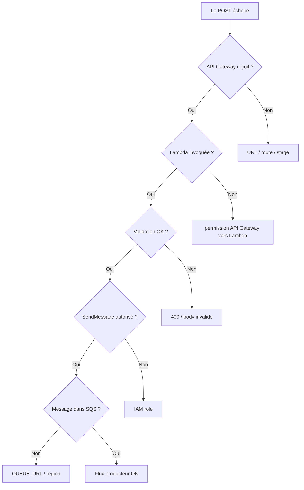

---

# 69. Étape 10 - Créer le rôle IAM du consommateur

La Lambda consommatrice doit :

- écrire dans CloudWatch Logs ;
- recevoir des messages SQS ;
- supprimer les messages après succès ;
- lire les attributs de la queue.

---

# 70. Créer le rôle

Dans :

```text
IAM
Roles
Create role
```

Trusted entity :

```text
AWS service
Lambda
```

Ajoutez :

```text
AWSLambdaBasicExecutionRole
```

Nom :

```text
role-tp1-consommateur
```

---

# 71. Permissions SQS du consommateur

Ajoutez une inline policy ciblée sur la queue.

Exemple :

```json
{
  "Version": "2012-10-17",
  "Statement": [
    {
      "Effect": "Allow",
      "Action": [
        "sqs:ReceiveMessage",
        "sqs:DeleteMessage",
        "sqs:GetQueueAttributes"
      ],
      "Resource": "ARN_DE_LA_QUEUE"
    }
  ]
}
```

---

# 72. Alternative AWS Managed Policy

AWS fournit aussi :

```text
AWSLambdaSQSQueueExecutionRole
```

Cette politique gérée contient les permissions de base nécessaires pour qu’une Lambda lise depuis SQS.

Pour un TP pédagogique orienté **Least Privilege**, la policy ciblée sur une seule queue permet cependant de mieux comprendre le scope.

---

# 73. Cas compte EPSI restreint

Si vous utilisez un rôle précréé par l’école, vérifiez avec l’enseignant qu’il autorise :

```text
sqs:ReceiveMessage
sqs:DeleteMessage
sqs:GetQueueAttributes
logs:CreateLogGroup
logs:CreateLogStream
logs:PutLogEvents
```

---

# 74. Étape 11 - Créer la Lambda consommatrice

Dans :

```text
Lambda
Create function
```

Function name :

```text
lambda-tp1-consommateur
```

Runtime :

```text
Python 3.x
```

Execution role :

```text
role-tp1-consommateur
```

ou le rôle fourni par l’établissement.

Cliquez :

```text
Create function
```

---

# 75. Code de la Lambda consommatrice

Remplacez le code par :

```python
import json


def lambda_handler(event, context):
    records = event.get("Records", [])

    print(
        json.dumps(
            {
                "level": "INFO",
                "message": "BATCH_RECEIVED",
                "recordCount": len(records),
            }
        )
    )

    for record in records:
        message_id = record.get("messageId")
        body = json.loads(record["body"])

        print(
            json.dumps(
                {
                    "level": "INFO",
                    "message": "MESSAGE_CONSUMED",
                    "sqsMessageId": message_id,
                    "eventType": body.get("eventType"),
                    "internalMessageId": body.get("messageId"),
                    "studentId": body.get("data", {}).get("studentId"),
                    "priority": body.get("data", {}).get("priority"),
                    "payload": body,
                },
                ensure_ascii=False,
            )
        )

    return {
        "processed": len(records)
    }
```

Cliquez :

```text
Deploy
```

---

# 76. Que fait ce code ?

La Lambda reçoit un événement contenant :

```text
Records
```

Chaque record représente un message SQS.

Le code :

1. lit chaque record ;
2. parse `record["body"]` ;
3. affiche les informations dans CloudWatch ;
4. termine avec succès.

---

# 77. Exemple simplifié de l’événement SQS reçu

Conceptuellement :

```json
{
  "Records": [
    {
      "messageId": "id-sqs",
      "body": "{\"eventType\":\"StudentRegistrationRequested\",\"data\":{\"studentId\":\"ETU-101\"}}"
    }
  ]
}
```

Le body du message est une **chaîne JSON**.

Nous devons donc exécuter :

```python
json.loads(record["body"])
```

---

# 78. Étape 12 - Connecter SQS à la Lambda

Ouvrez :

```text
lambda-tp1-consommateur
```

Dans le diagramme de la fonction :

```text
Add trigger
```

Choisissez :

```text
SQS
```

---

# 79. Configurer le trigger SQS

Queue :

```text
demandes-inscription
```

Batch size :

```text
1
```

Pour ce TP, choisissez **1** afin de voir clairement un message par invocation.

Laissez :

```text
Enable trigger
```

activé.

Cliquez :

```text
Add
```

---

# 80. Qu’est-ce qu’un Event Source Mapping ?

Pour SQS, Lambda crée un **Event Source Mapping**.

Lambda gère des pollers qui lisent la queue puis invoquent votre fonction lorsqu’un message est disponible.

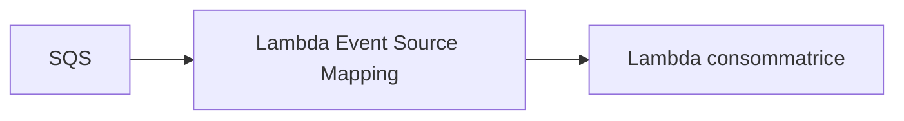

Le code de la Lambda n’effectue donc pas lui-même un appel explicite :

```python
sqs.receive_message(...)
```

dans ce TP.

---

# 81. Pourquoi Batch Size = 1 ?

Par défaut, le batch SQS peut contenir plusieurs messages.

Pour un TP1, `1` rend le comportement plus facile à observer :

```text
1 message
1 invocation visible
```

Dans un système à forte charge, des batchs plus grands peuvent être plus efficaces.

---

# 82. Que se passe-t-il après un succès ?

Quand la Lambda traite correctement le batch, Lambda gère la suppression des messages SQS concernés.

Vous n’avez pas besoin d’appeler manuellement :

```text
DeleteMessage
```

dans votre code.

---

# 83. Que se passe-t-il après un échec ?

Si la fonction échoue pendant le traitement du batch :

le message n’est pas considéré comme correctement traité.

Après le **Visibility Timeout**, il peut redevenir visible et être retraité.

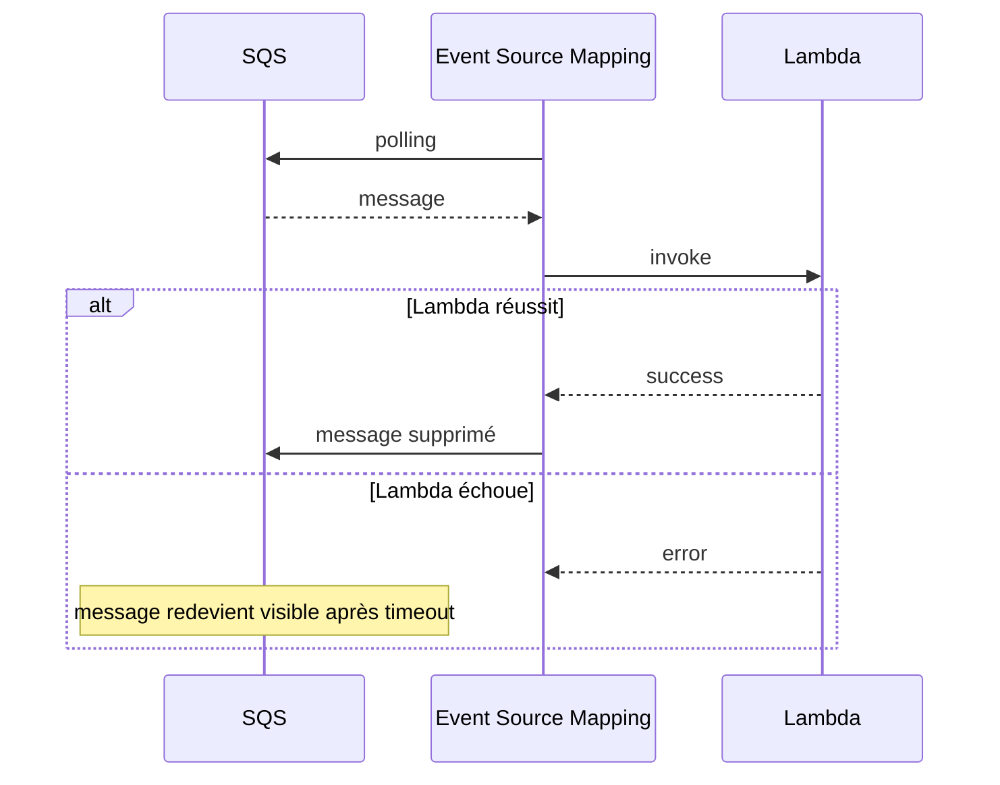

---

# 84. At-least-once delivery

Une SQS Standard Queue utilise un modèle **at-least-once**.

Cela signifie qu’un message peut exceptionnellement être reçu plusieurs fois.

La conséquence importante est :

```text
un consommateur robuste doit être idempotent
```

Nous approfondirons cela dans un TP ultérieur.

---

# 85. Observer le backlog diminuer

Après avoir créé le trigger SQS, les messages déjà présents dans la queue doivent commencer à être traités.

Retournez dans SQS et observez :

```text
Available messages
```

Le nombre doit diminuer.

---

# 86. Observer CloudWatch Logs du consommateur

Ouvrez :

```text
lambda-tp1-consommateur
Monitor
View CloudWatch logs
```

Vous devez trouver :

```text
MESSAGE_CONSUMED
```

avec notamment :

```text
studentId
priority
payload
```

---

# 87. Flux complet

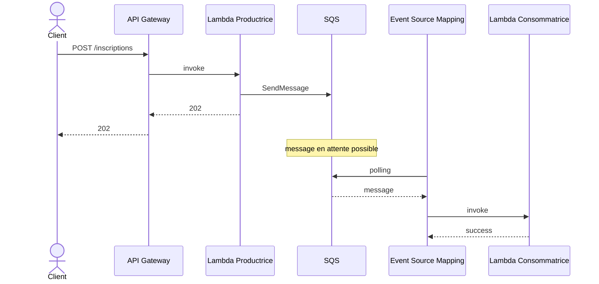

---

# 88. Question 3

Pourquoi utiliser SQS entre les deux Lambda au lieu d’appeler directement la seconde Lambda ?

**Réponse :**

SQS apporte notamment :

- le **découplage temporel** ;
- le **stockage temporaire** ;
- l’absorption d’un backlog ;
- la reprise si le consommateur est momentanément indisponible.

---

# 89. Question 4

Que se passe-t-il si la Lambda consommatrice est désactivée ?

**Réponse :**

Les nouveaux messages peuvent continuer à être envoyés dans SQS.

Ils restent dans la queue tant qu’ils ne sont pas consommés et que leur durée de rétention n’est pas dépassée.

---

# 90. Étape 13 - Désactiver temporairement le trigger du consommateur

Dans :

```text
Lambda
lambda-tp1-consommateur
Configuration
Triggers
```

sélectionnez le trigger SQS.

Désactivez l’**Event Source Mapping**.

*Selon la version de la console, l’action peut être accessible depuis la configuration du trigger ou la page Event source mappings.*

---

# 91. Créer volontairement un backlog

Avec le trigger désactivé :

envoyez cinq nouvelles demandes depuis Postman.

Exemples :

```text
ETU-201
ETU-202
ETU-203
ETU-204
ETU-205
```

Vérifiez que :

```text
Available messages
```

augmente dans SQS.

---

# 92. Réactiver le trigger

Réactivez ensuite l’Event Source Mapping.

Observez :

- la queue ;
- les invocations Lambda ;
- les logs CloudWatch.

Le backlog doit commencer à diminuer.

---

# 93. Diagramme de l’expérience

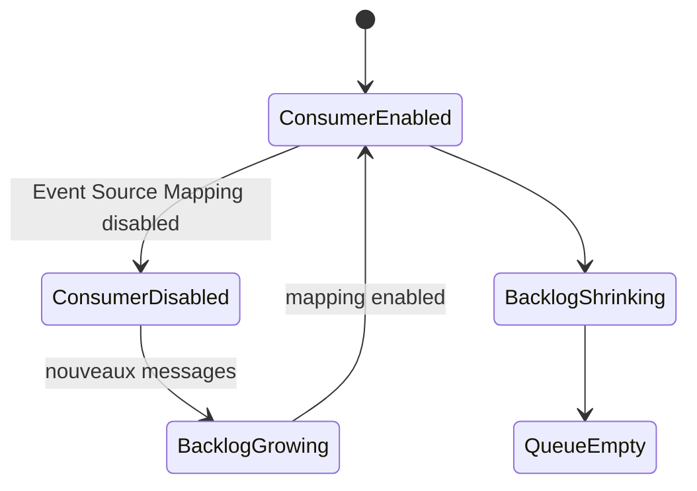

---

# 94. Question 5

Pourquoi le producteur continue-t-il de répondre `202` pendant que le consommateur est désactivé ?

**Réponse :**

Parce que le producteur dépend seulement de :

- sa propre exécution ;
- l’accès à SQS ;
- la capacité de SQS à accepter le message.

Le consommateur est découplé.

---

# 95. Étape 14 - Tester un payload invalide

Dans Postman, envoyez :

```json
{
  "studentId": "ETU-INVALID",
  "firstName": "Test",
  "lastName": "Invalid",
  "formation": "Formation EPSI",
  "priority": "normal"
}
```

Le champ :

```text
campus
```

est absent.

---

# 96. Résultat attendu

La Lambda productrice doit retourner :

```text
400 Bad Request
```

Le body doit indiquer un champ manquant.

Et surtout :

**aucun message ne doit être ajouté dans SQS.**

---

# 97. Pourquoi ce test est important ?

Un bon système doit :

- réussir avec les bonnes données ;
- **refuser proprement les mauvaises données**.

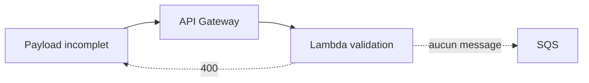

---

# 98. Tester une priorité invalide

Envoyez :

```json
{
  "studentId": "ETU-INVALID-2",
  "firstName": "Test",
  "lastName": "Priority",
  "formation": "Formation EPSI",
  "campus": "EPSI",
  "priority": "super-important"
}
```

Résultat attendu :

```text
400 Bad Request
```

---

# 99. Tester un champ inconnu

Envoyez :

```json
{
  "studentId": "ETU-INVALID-3",
  "firstName": "Test",
  "lastName": "Extra",
  "formation": "Formation EPSI",
  "campus": "EPSI",
  "priority": "normal",
  "champInvente": "abc"
}
```

Résultat attendu :

```text
400 Bad Request
```

---

# 100. Debug - API Gateway retourne 404

Vérifiez :

- l’**Invoke URL** ;
- le path :
  ```text
  /inscriptions
  ```
- la méthode :
  ```text
  POST
  ```
- le stage.

---

# 101. Debug - API Gateway retourne 500

Vérifiez CloudWatch Logs de :

```text
lambda-tp1-producteur
```

Une erreur Python non gérée peut provoquer un échec d’intégration.

---

# 102. Debug - Lambda n’est jamais invoquée

Vérifiez :

```text
API Gateway
Routes
POST /inscriptions
```

Puis :

```text
Integrations
```

La route doit être reliée à :

```text
lambda-tp1-producteur
```

---

# 103. Debug - Producteur retourne 502

La Lambda a probablement été exécutée, mais :

```text
sqs.send_message
```

a échoué.

Vérifiez :

- `QUEUE_URL` ;
- la région ;
- l’IAM role ;
- `sqs:SendMessage` ;
- l’existence de la queue.

---

# 104. Debug - AccessDenied sur SendMessage

Chaîne de vérification :

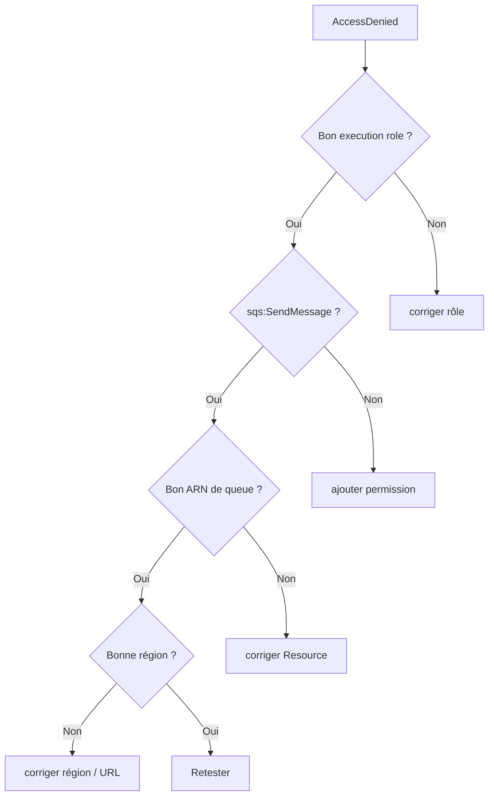

---

# 105. Debug - Consumer sans invocation

Vérifiez :

1. la queue contient-elle un message ?
2. l’Event Source Mapping est-il **Enabled** ?
3. la Lambda a-t-elle les permissions SQS ?
4. la région est-elle la même ?
5. le trigger référence-t-il la bonne queue ?

---

# 106. Debug - Event Source Mapping ne peut pas être créé

AWS vérifie certaines conditions lors de la création.

Vérifiez notamment :

- les permissions du rôle consommateur ;
- la queue ;
- le **Visibility Timeout** ;
- le timeout de la Lambda.

AWS exige que le timeout de la fonction Lambda soit inférieur ou égal au visibility timeout de la queue pour l’intégration SQS.

---

# 107. Vérifier le timeout Lambda

Dans :

```text
Lambda
lambda-tp1-consommateur
Configuration
General configuration
```

Pour ce TP, gardez un timeout simple, par exemple :

```text
3 seconds
```

ou :

```text
5 seconds
```

Avec un SQS Visibility Timeout de :

```text
30 seconds
```

vous restez dans une configuration cohérente.

---

# 108. Debug - Un message est traité deux fois

Avec une **Standard Queue**, c’est possible dans le modèle *at-least-once*.

Ne considérez pas automatiquement cela comme un bug SQS.

Dans un prochain TP, nous ajouterons :

- **idempotence** ;
- table de messages déjà traités ;
- clés métier ;
- déduplication ;
- DLQ.

---

# 109. Standard Queue et FIFO Queue

| Caractéristique | Standard | FIFO |
|---|---|---|
| Débit | très élevé | différent / contraint par le modèle FIFO |
| Ordre | best effort | ordre FIFO |
| Livraison | at-least-once | déduplication / ordering avancés |
| Utilisée dans ce TP | **Oui** | Non |

Le TP1 utilise **Standard** pour introduire le messaging simple.

---

# 110. IAM - Producteur et consommateur

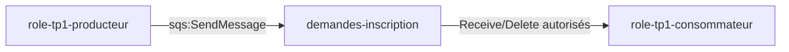

Le producteur n’a pas besoin :

```text
sqs:ReceiveMessage
```

Le consommateur n’a pas besoin :

```text
sqs:SendMessage
```

dans ce TP.

---

# 111. Question 6

Pourquoi créer deux rôles IAM différents ?

**Réponse :**

Parce que les deux fonctions ont des responsabilités différentes.

Cela permet :

- le **Least Privilege** ;
- une meilleure lisibilité ;
- un audit plus clair ;
- une réduction de la surface d’autorisation.

---

# 112. Question 7

Pourquoi `202 Accepted` est-il adapté ?

**Réponse :**

Parce que la demande a été :

```text
acceptée
et
stockée dans SQS
```

mais le traitement asynchrone de la Lambda consommatrice peut être différé.

---

# 113. Question 8

Pourquoi ne pas retourner `202` avant `SendMessage` ?

**Réponse :**

Parce qu’un `202` ne doit pas annoncer l’acceptation si le système n’a pas encore confirmé que le message a pu être placé dans la queue.

Dans ce TP :

```text
SendMessage réussi
puis
202
```

---

# 114. Question 9

Quel service conserve temporairement la demande ?

**Réponse :**

**Amazon SQS**.

La Lambda productrice ne conserve pas elle-même durablement la file des demandes.

---

# 115. Question 10

Quelle différence entre SQS et CloudWatch Logs ?

**Réponse :**

**SQS** transporte des messages destinés au traitement.

**CloudWatch Logs** conserve des traces et logs techniques.

Un log ne remplace pas une queue métier.

---

# 116. Plan de contrôle et plan de données

Dans AWS également, il est utile de distinguer :

- la création / configuration des ressources ;
- le trafic métier réellement échangé.

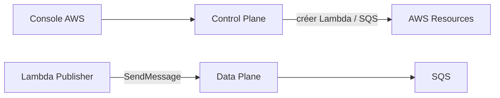

---

# 117. AWS CLI : rôle dans ce TP

AWS CLI n’est pas la méthode principale.

Il sert à montrer qu’une opération graphique peut être :

- vérifiée ;
- automatisée ;
- scriptée.

---

# 118. Tableau Console AWS et CLI

| Console AWS | AWS CLI indicatif |
|---|---|
| Create SQS Queue | `aws sqs create-queue` |
| Get queue attributes | `aws sqs get-queue-attributes` |
| Create Lambda | `aws lambda create-function` |
| Update Lambda code | `aws lambda update-function-code` |
| Create API Gateway HTTP API | `aws apigatewayv2 create-api` |
| List Lambda functions | `aws lambda list-functions` |
| View logs | `aws logs ...` |
| Create event source mapping | `aws lambda create-event-source-mapping` |

---

# 119. Équivalent CLI - créer l’Event Source Mapping

Récupérer l’ARN de la queue :

```bash
QUEUE_ARN=$(aws sqs get-queue-attributes \
  --queue-url "$QUEUE_URL" \
  --attribute-names QueueArn \
  --region eu-west-3 \
  --query Attributes.QueueArn \
  --output text)
```

Créer le mapping :

```bash
aws lambda create-event-source-mapping \
  --function-name lambda-tp1-consommateur \
  --event-source-arn "$QUEUE_ARN" \
  --batch-size 1 \
  --enabled \
  --region eu-west-3
```

---

# 120. Équivalent CLI - observer le backlog

```bash
aws sqs get-queue-attributes \
  --queue-url "$QUEUE_URL" \
  --attribute-names \
    ApproximateNumberOfMessages \
    ApproximateNumberOfMessagesNotVisible \
  --region eu-west-3
```

---

# 121. Équivalent CLI - envoyer un message directement

Cette commande contourne volontairement API Gateway et la Lambda productrice.

Elle peut servir pour isoler SQS pendant un debug.

```bash
aws sqs send-message \
  --queue-url "$QUEUE_URL" \
  --message-body '{"eventType":"DebugMessage","schemaVersion":1}' \
  --region eu-west-3
```

> **Tip debug :** si ce message arrive au consommateur, SQS et le consumer fonctionnent. Le problème se trouve probablement avant la queue.

---

# 122. Équivalent CLI - consulter les fonctions

```bash
aws lambda list-functions \
  --region eu-west-3 \
  --query 'Functions[].{Name:FunctionName,Runtime:Runtime,Role:Role}' \
  --output table
```

---

# 123. Équivalent CLI - consulter les event source mappings

```bash
aws lambda list-event-source-mappings \
  --function-name lambda-tp1-consommateur \
  --region eu-west-3 \
  --output table
```

---

# 124. Pourquoi ne pas tout faire en CLI dès le TP1 ?

Le but initial est de comprendre visuellement :

- SQS ;
- les rôles IAM ;
- les Lambda ;
- API Gateway ;
- l’Event Source Mapping ;
- les logs.

Automatiser immédiatement une architecture que l’on ne comprend pas peut masquer les concepts.

---

# 125. Exercice guidé 1 - Produire 5 messages

Désactivez le trigger SQS du consommateur.

Depuis Postman, envoyez cinq étudiants :

```text
ETU-301
ETU-302
ETU-303
ETU-304
ETU-305
```

Vérifiez :

```text
SQS Available messages
```

Le backlog doit augmenter.

---

# 126. Exercice guidé 2 - Reprise du consommateur

Réactivez le trigger SQS.

Observez :

- la diminution du backlog ;
- les nouvelles invocations Lambda ;
- les logs CloudWatch.

---

# 127. Exercice guidé 3 - Priorité urgente

Envoyez :

```json
{
  "studentId": "ETU-URGENT",
  "firstName": "Sonia",
  "lastName": "Test",
  "formation": "Formation EPSI",
  "campus": "EPSI",
  "priority": "urgent"
}
```

Dans les logs du consommateur, vérifiez :

```text
priority = urgent
```

---

# 128. Exercice guidé 4 - Erreur de permissions

*À réaliser uniquement si votre enseignant l’autorise.*

Retirez temporairement :

```text
sqs:SendMessage
```

du rôle producteur.

Envoyez une demande.

Observez :

- réponse du producteur ;
- logs CloudWatch ;
- absence de nouveau message SQS.

Puis restaurez immédiatement la permission.

---

# 129. Ce que démontre l’exercice IAM

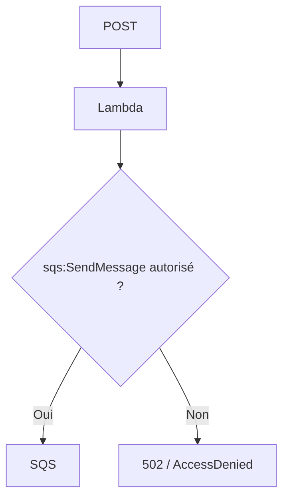

La Lambda existe et s’exécute.

Mais elle ne peut effectuer que les opérations autorisées par son rôle.

---

# 130. Exercice guidé 5 - Validation

Testez successivement :

1. champ manquant ;
2. priorité incorrecte ;
3. champ supplémentaire ;
4. JSON mal formé.

Pour chaque test :

- notez le code HTTP ;
- vérifiez la réponse ;
- vérifiez que SQS ne reçoit pas de nouveau message.

---

# 131. Codes HTTP du TP

| Code | Signification dans ce TP |
|---|---|
| **`202`** | demande valide et message envoyé dans SQS |
| **`400`** | payload invalide |
| **`502`** | la Lambda n’a pas pu confirmer l’envoi au broker |
| **`404`** | route API Gateway incorrecte ou absente |
| **`500`** | erreur non gérée côté backend |

---

# 132. SQS n’utilise pas les mêmes codes visibles au client

Le client HTTP n’appelle pas directement SQS.

Le flux est :

```mermaid
sequenceDiagram
    actor C as Client
    participant A as API Gateway
    participant L as Lambda
    participant Q as SQS

    C->>A: POST
    A->>L: invoke
    L->>Q: SendMessage
    Q-->>L: succès AWS SDK
    L-->>A: 202
    A-->>C: 202
```

Le client voit la réponse de la Lambda via API Gateway, pas la réponse native SQS.

---

# 133. Logs du producteur et du consommateur

Vous avez maintenant deux groupes de logs CloudWatch correspondant aux Lambda.

Conceptuellement :

```text
/aws/lambda/lambda-tp1-producteur
/aws/lambda/lambda-tp1-consommateur
```

---

# 134. Tip CloudWatch

Utilisez les logs pour répondre à des questions précises.

Exemple :

```text
La Lambda a-t-elle été invoquée ?
Le JSON a-t-il été validé ?
SendMessage a-t-il échoué ?
Quel studentId a été traité ?
```

Évitez de lire des centaines de lignes sans hypothèse.

---

# 135. Debug méthodique

```mermaid
flowchart TD
    START["Ça ne marche pas"]
    HTTP{"Postman atteint API Gateway ?"}
    L1{"Publisher invoqué ?"}
    S{"Message dans SQS ?"}
    M{"Mapping enabled ?"}
    L2{"Consumer invoqué ?"}
    OK["Flux OK"]

    START --> HTTP
    HTTP -->|"Non"| D1["URL / route"]
    HTTP -->|"Oui"| L1
    L1 -->|"Non"| D2["integration / permission"]
    L1 -->|"Oui"| S
    S -->|"Non"| D3["validation / IAM / QUEUE_URL"]
    S -->|"Oui"| M
    M -->|"Non"| D4["activer mapping"]
    M -->|"Oui"| L2
    L2 -->|"Non"| D5["consumer IAM / timeout / région"]
    L2 -->|"Oui"| OK
```

---

# 136. Tip : isoler les composants

Pour debugger :

1. testez directement la Lambda productrice ;
2. testez SQS avec `aws sqs send-message` si nécessaire ;
3. observez le consumer séparément ;
4. ajoutez API Gateway une fois la productrice validée.

C’est une méthode générale d’intégration SI :

**tester chaque maillon avant de tester toute la chaîne.**

---

# 137. Limite du TP1

Le consommateur ne fait ici qu’écrire dans CloudWatch Logs.

Dans un vrai SI, il pourrait :

- appeler un ERP ;
- appeler un CRM ;
- écrire dans une base ;
- envoyer une notification ;
- déclencher un autre workflow.

---

# 138. Ce qui manque encore pour un système robuste

Nous n’avons pas encore mis en place :

- **Dead-Letter Queue** ;
- retry métier avancé ;
- idempotence du consommateur ;
- FIFO ;
- observabilité avancée ;
- correlation ID complet ;
- alarmes CloudWatch ;
- tracing ;
- concurrence maîtrisée.

Ces éléments seront ajoutés progressivement.

---

# 139. Aperçu de la suite - DLQ

```mermaid
flowchart LR
    Q["SQS principale"]
    L["Lambda"]
    ERR{"échecs répétés ?"}
    DLQ["Dead-Letter Queue"]

    Q --> L
    L --> ERR
    ERR -->|"Oui"| DLQ
```

---

# 140. Aperçu de la suite - idempotence

Avec *at-least-once*, un même message peut être reçu plusieurs fois.

Le consommateur avancé devra pouvoir faire :

```text
eventId déjà traité ?
```

Si oui :

```text
ne pas refaire l’effet métier
```

---

# 141. Aperçu de la suite - concurrence

SQS et Lambda peuvent traiter plusieurs messages en parallèle.

Dans un futur TP, vous étudierez :

- concurrence Lambda ;
- accès concurrent à une ressource ;
- verrouillage ;
- idempotence ;
- race conditions.

---

# 142. Nettoyage - important pour les comptes étudiants

À la fin du TP, supprimez les ressources si l’enseignant l’autorise.

Ressources à supprimer :

- **API Gateway HTTP API** ;
- **Lambda productrice** ;
- **Lambda consommatrice** ;
- **SQS queue** ;
- rôles IAM créés spécifiquement pour le TP ;
- politiques IAM inline associées si nécessaire.

---

# 143. Ordre de nettoyage conseillé

Pour éviter de laisser des ressources :

1. supprimer l’Event Source Mapping ;
2. supprimer l’API Gateway ;
3. supprimer les deux Lambda ;
4. supprimer la queue SQS ;
5. supprimer les rôles IAM du TP si vous les avez créés.

---

# 144. Nettoyage - API Gateway

Dans :

```text
API Gateway
APIs
api-tp1-flux-epsi
```

choisissez :

```text
Delete
```

Confirmez.

---

# 145. Nettoyage - Lambda

Supprimez :

```text
lambda-tp1-producteur
lambda-tp1-consommateur
```

---

# 146. Nettoyage - SQS

Supprimez :

```text
demandes-inscription
```

Attention :

**la suppression détruit les messages restants.**

---

# 147. Nettoyage - IAM

Si vous avez créé :

```text
role-tp1-producteur
role-tp1-consommateur
```

supprimez-les après les Lambda.

Si le rôle est fourni par l’école :

**ne le supprimez jamais.**

---

## Équivalent AWS CLI - optionnel

Supprimer l’API :

```bash
aws apigatewayv2 delete-api \
  --api-id API_ID \
  --region eu-west-3
```

Supprimer une Lambda :

```bash
aws lambda delete-function \
  --function-name lambda-tp1-producteur \
  --region eu-west-3
```

Supprimer la queue :

```bash
aws sqs delete-queue \
  --queue-url "$QUEUE_URL" \
  --region eu-west-3
```

---

# 148. Tips de fin de TP

Avant de quitter la séance, retenez ces réflexes :

1. **Toujours identifier le producteur, le canal d’échange et le consommateur.**
2. **Toujours valider les données à l’entrée.**
3. **Toujours distinguer code et permissions IAM.**
4. **Toujours vérifier l’état du broker, pas seulement la réponse HTTP.**
5. **Toujours utiliser des rôles à privilèges minimaux.**
6. **Toujours penser aux redélivrances avec une queue Standard.**
7. **Toujours nettoyer les ressources cloud de TP.**

> **Tip soutenance :** si on vous demande pourquoi SQS est utile, ne répondez pas seulement *« pour envoyer des messages »*. Expliquez le **découplage temporel**, le **stockage temporaire**, le **backlog** et la **résilience**.

---

# 149. Checklist finale

Vous devez être capables de cocher :

- [ ] J’ai choisi une seule région AWS.
- [ ] J’ai créé une **SQS Standard Queue**.
- [ ] Je sais expliquer *at-least-once*.
- [ ] J’ai créé un rôle IAM producteur ou utilisé celui fourni.
- [ ] Le producteur possède `sqs:SendMessage`.
- [ ] J’ai créé la Lambda productrice.
- [ ] J’ai configuré `QUEUE_URL`.
- [ ] J’ai validé le payload en Python.
- [ ] J’ai créé un événement interne.
- [ ] J’ai envoyé le message dans SQS.
- [ ] J’ai renvoyé **`202 Accepted`**.
- [ ] J’ai créé une **HTTP API** API Gateway.
- [ ] J’ai créé `POST /inscriptions`.
- [ ] J’ai testé avec Postman.
- [ ] J’ai observé le backlog SQS.
- [ ] J’ai créé un rôle IAM consommateur ou utilisé celui fourni.
- [ ] Le consommateur peut recevoir et supprimer les messages.
- [ ] J’ai créé la Lambda consommatrice.
- [ ] J’ai créé un **Event Source Mapping SQS**.
- [ ] J’ai réglé le batch à `1`.
- [ ] J’ai observé les logs CloudWatch.
- [ ] J’ai désactivé puis réactivé le mapping.
- [ ] J’ai observé le backlog augmenter puis diminuer.
- [ ] J’ai testé un JSON invalide.
- [ ] Je sais expliquer le rôle d’API Gateway.
- [ ] Je sais expliquer le rôle de SQS.
- [ ] Je sais expliquer le rôle de chaque Lambda.
- [ ] Je sais expliquer les IAM execution roles.
- [ ] J’ai nettoyé les ressources à la fin.

---

# 150. Résumé final

```mermaid
flowchart LR
    POST["POST étudiant"]
    API["API Gateway"]
    PUB["Lambda Productrice"]
    Q["SQS"]
    ESM["Event Source Mapping"]
    CON["Lambda Consommatrice"]
    LOG["CloudWatch"]

    POST --> API
    API --> PUB
    PUB --> Q
    PUB -.->|"202"| API
    Q --> ESM --> CON
    PUB --> LOG
    CON --> LOG
```

Le point essentiel est :

> **Amazon SQS permet à deux composants du SI d’échanger sans être obligés d’être disponibles et rapides au même moment.**

La **Lambda productrice** :

- reçoit les données via API Gateway ;
- valide ;
- transforme ;
- publie.

**Amazon SQS** :

- stocke temporairement ;
- découple ;
- absorbe le backlog.

La **Lambda consommatrice** :

- est déclenchée par un Event Source Mapping ;
- reçoit les messages ;
- effectue le traitement.

**IAM** :

- définit les permissions accordées aux fonctions.

**CloudWatch** :

- permet d’observer les logs et les erreurs techniques.

---

# 151. Références AWS

Documentation utile :

- API Gateway HTTP APIs :  
  `https://docs.aws.amazon.com/apigateway/latest/developerguide/http-api.html`

- Créer une HTTP API :  
  `https://docs.aws.amazon.com/apigateway/latest/developerguide/http-api-develop.html`

- API Gateway et Lambda :  
  `https://docs.aws.amazon.com/lambda/latest/dg/services-apigateway.html`

- AWS Lambda execution roles :  
  `https://docs.aws.amazon.com/lambda/latest/dg/lambda-intro-execution-role.html`

- Lambda avec Amazon SQS :  
  `https://docs.aws.amazon.com/lambda/latest/dg/with-sqs.html`

- Configuration SQS Event Source Mapping :  
  `https://docs.aws.amazon.com/lambda/latest/dg/services-sqs-configure.html`

- SQS Standard et at-least-once :  
  `https://docs.aws.amazon.com/AWSSimpleQueueService/latest/SQSDeveloperGuide/standard-queues-at-least-once-delivery.html`

- Tarification SQS :  
  `https://aws.amazon.com/sqs/pricing/`

- Tarification Lambda :  
  `https://aws.amazon.com/lambda/pricing/`

- Tarification API Gateway :  
  `https://aws.amazon.com/api-gateway/pricing/`

- AWS Free Tier :  
  `https://aws.amazon.com/free/`
