# TP 2 - Routage et transformation de flux avec AWS Lambda, Amazon SQS et API Gateway - EPSI

**Niveau :** *intermédiaire*  

**Durée indicative :** *3 h à 4 h*  

**Mode principal :** **Console AWS**  

**Mode secondaire :** *AWS CLI, uniquement en option et à titre de comparaison* 

**Architecture :** **Amazon API Gateway HTTP API**, **AWS Lambda**, **Amazon SQS Standard**, **AWS IAM** et **Amazon CloudWatch**  

**Public visé :** *étudiants EPSI disposant d’un compte AWS personnel, d’un compte AWS Free Tier ou d’un environnement AWS fourni par l’établissement.*

---

# 1. Objectifs du TP

À la fin de ce TP, vous devez être capables de :

- créer plusieurs **Amazon SQS Standard queues** ;
- créer une **Lambda routeur** ;
- recevoir un payload JSON avec **API Gateway HTTP API** ;
- distinguer **validation technique** et **validation fonctionnelle** ;
- normaliser des valeurs en Python ;
- utiliser `strip()` et `lower()` ;
- créer un **événement interne** ;
- ajouter un **messageId** ;
- ajouter un **correlationId** ;
- router vers plusieurs queues ;
- créer une queue de **rejet fonctionnel** ;
- retourner des codes **`202`**, **`400`** et **`422`** ;
- créer deux **Lambda consommatrices** ;
- créer deux **Event Source Mappings SQS** ;
- observer plusieurs backlogs ;
- comprendre la livraison **at-least-once** de SQS Standard ;
- diagnostiquer une erreur IAM ;
- diagnostiquer une erreur de routage ;
- observer les logs dans **CloudWatch Logs** ;
- utiliser **AWS CLI** uniquement comme *équivalent optionnel*.

---

# 2. Position du TP2 dans la progression

Le TP1 AWS a montré :

```text
API Gateway
Lambda productrice
SQS
Lambda consommatrice
```

Le TP2 ajoute :

```text
Validation plus riche
Normalisation
Transformation
Routage
Plusieurs queues
Plusieurs consommateurs
Rejet fonctionnel
Observabilité du routage
```

---

# 3. Contexte métier

EPSI souhaite centraliser les demandes de maintenance de ses locaux et équipements.

Un portail interne permet de déclarer un incident.

Exemples :

- panne réseau dans une salle ;
- vidéoprojecteur indisponible ;
- problème électrique ;
- problème d’accès à une salle ;
- équipement défectueux.

Tous les incidents ne doivent pas suivre le même traitement.

Nous allons distinguer :

```text
urgent
standard
rejeté
```

---

# 4. Exemple de demande

```json
{
  "ticketId": "INC-001",
  "campus": "EPSI",
  "building": "Batiment A",
  "room": "A204",
  "category": "network",
  "priority": "URGENT",
  "description": "Plus de reseau dans la salle.",
  "reportedBy": {
    "email": "etudiant@example.com",
    "role": "student"
  }
}
```

---

# 5. Problème à résoudre

Le portail peut envoyer :

```text
URGENT
urgent
 Urgent
NORMAL
normal
Standard
```

Le SI interne ne doit pas dépendre de la manière dont le client écrit ces valeurs.

Nous allons donc :

1. **valider** le JSON ;
2. **normaliser** certaines valeurs ;
3. **construire** un événement interne ;
4. **router** l’événement ;
5. **publier** dans la bonne queue ;
6. **traiter** urgent et standard avec deux consumers différents.

---

# 6. Architecture générale

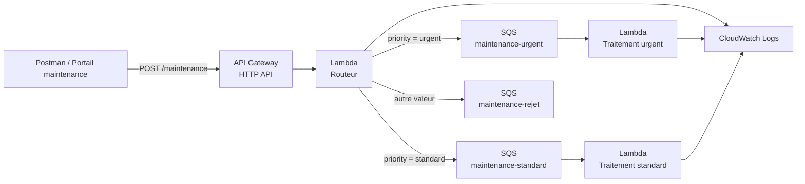

> **À retenir :** la **Lambda routeur** ne résout pas l’incident. Elle décide **où** envoyer l’événement.

> **Tip EPSI :** dans une architecture d’intégration, séparez toujours **réception**, **validation**, **transformation**, **routage** et **traitement métier**.

---

# 7. Pipeline logique du TP

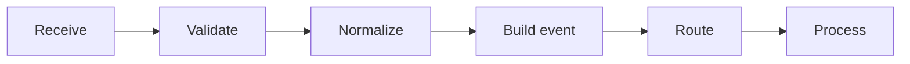

Le TP2 ne consiste donc plus seulement à :

```text
recevoir puis envoyer
```

Il faut maintenant :

```text
comprendre
transformer
classer
router
```

---

# 8. Correspondance avec le TP2 Azure

| Concept pédagogique | Azure | AWS |
|---|---|---|
| Endpoint HTTP | Logic Apps Request Trigger | API Gateway HTTP API |
| Routeur | Logic App + Switch | Lambda routeur |
| Normalisation | `trim()` / `toLower()` | `strip()` / `lower()` |
| Queue urgent | Service Bus Queue | SQS Standard Queue |
| Queue standard | Service Bus Queue | SQS Standard Queue |
| Queue rejet | Service Bus Queue | SQS Standard Queue |
| Consommateur | Logic App | Lambda |
| Déclenchement queue | Service Bus trigger | Event Source Mapping |
| Permissions | Managed Identity + RBAC | IAM Execution Role |
| Logs | Run History | CloudWatch Logs |

> **Important :** il s’agit d’une correspondance **architecturale et pédagogique**, pas d’une équivalence complète entre les services Azure et AWS.

---

# 9. Pourquoi transformer avant de router ?

Supposons que le portail envoie :

```text
URGENT
Urgent
 urgent
 UrGeNt
```

Sans normalisation, votre logique peut considérer ces valeurs comme différentes.

Nous voulons obtenir :

```text
urgent
```

dans tous les cas.

---

# 10. Validation technique et validation fonctionnelle

Le TP distingue deux types d’erreurs.

## Validation technique

Le JSON respecte-t-il le contrat ?

Exemple invalide :

```json
{
  "ticketId": "INC-002",
  "priority": "urgent"
}
```

Il manque :

- `campus` ;
- `building` ;
- `room` ;
- `category` ;
- `description` ;
- `reportedBy`.

Résultat attendu :

```text
400 Bad Request
```

---

# 11. Validation fonctionnelle

Exemple :

```json
{
  "ticketId": "INC-003",
  "campus": "EPSI",
  "building": "Batiment B",
  "room": "B102",
  "category": "network",
  "priority": "low",
  "description": "Signal faible.",
  "reportedBy": {
    "email": "test@example.com",
    "role": "student"
  }
}
```

Le JSON est techniquement correct.

Mais :

```text
low
```

n’est pas supporté par la règle métier du TP.

Le message sera conservé dans :

```text
maintenance-rejet
```

et le client recevra :

```text
422 Unprocessable Entity
```

---

# 12. Diagramme des deux validations

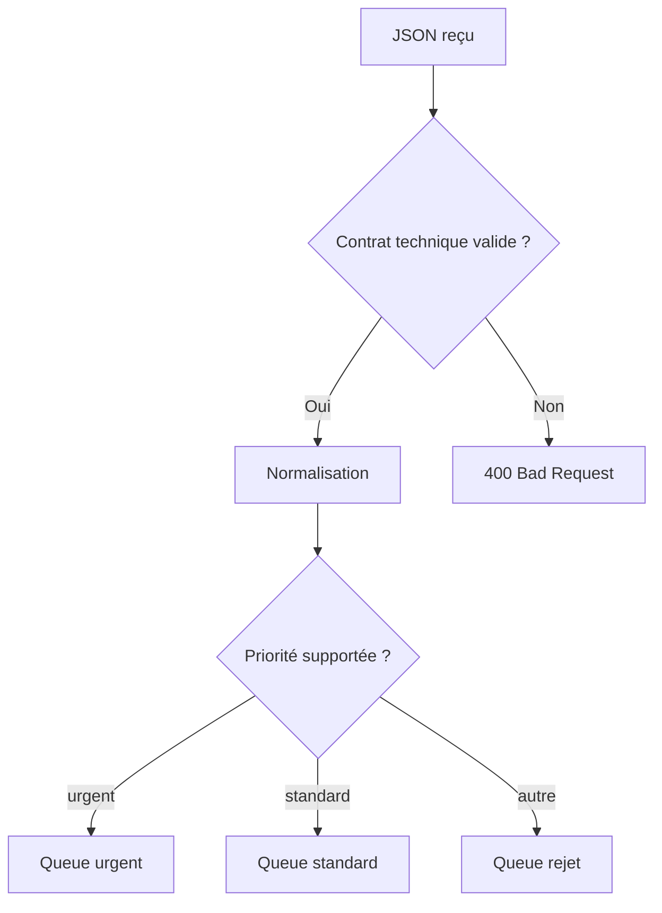

---

# 13. Comptes AWS étudiants et comptes EPSI

Vous pouvez utiliser :

- un **compte AWS personnel** ;
- le **AWS Free Tier** ;
- un environnement fourni par EPSI ;
- un compte de laboratoire avec un rôle IAM déjà fourni.

---

# 14. AWS Free Tier actuel

AWS propose actuellement aux nouveaux clients :

- **100 USD de crédits** à la création du compte ;
- la possibilité de gagner jusqu’à **100 USD supplémentaires** ;
- un **Free Plan** pouvant durer jusqu’à six mois pour les comptes éligibles.

*Les offres peuvent évoluer : vérifiez toujours les conditions affichées dans votre compte.*

---

# 15. Services utilisés et coût

Le TP utilise :

- **AWS Lambda** ;
- **Amazon SQS** ;
- **Amazon API Gateway HTTP API** ;
- **CloudWatch Logs**.

Pour un TP avec quelques dizaines de messages et d’invocations, la consommation reste très faible.

Amazon SQS propose actuellement **1 million de requêtes gratuites par mois**.

AWS Lambda propose actuellement notamment :

- **1 million de requêtes gratuites par mois** ;
- **400 000 GB-secondes** de calcul dans le Free Tier.

> **Tip coût :** ne lancez pas des centaines de tests inutiles. Le but est de comprendre le routage, pas de générer de la charge.

---

# 16. Comptes école avec IAM restreint

Certains environnements pédagogiques bloquent :

- la création de rôles IAM ;
- la création de policies ;
- certaines permissions administratives.

Si vous voyez :

```text
AccessDenied
```

pendant une étape IAM :

**ne contournez pas la restriction.**

Utilisez le rôle fourni par l’enseignant.

Exemples fréquents :

```text
LabRole
StudentRole
LambdaExecutionRole
```

---

# 17. Région AWS

Choisissez une région unique.

Exemple :

```text
Europe (Paris)
eu-west-3
```

ou celle imposée par le laboratoire.

Toutes les ressources du TP doivent rester dans la même région.

> **Erreur fréquente :** créer une queue dans `eu-west-3` et une Lambda dans une autre région.

---

# 18. Ressources du TP

Nous allons créer :

```text
SQS queues
maintenance-urgent
maintenance-standard
maintenance-rejet

Lambda routeur
lambda-tp2-routeur

Lambda consommateurs
lambda-tp2-urgent
lambda-tp2-standard

HTTP API
api-tp2-routage-epsi

Route HTTP
POST /maintenance
```

Rôles IAM proposés :

```text
role-tp2-routeur
role-tp2-urgent
role-tp2-standard
```

---

# 19. Étape 1 - Créer la queue urgent

## Méthode principale - Console AWS

Dans la console, recherchez :

```text
SQS
```

Ouvrez **Simple Queue Service**.

Cliquez sur :

```text
Create queue
```

Type :

```text
Standard
```

Nom :

```text
maintenance-urgent
```

---

# 20. Paramètres urgent

Pour ce TP, conservez une configuration simple.

Visibility timeout :

```text
30 seconds
```

Message retention :

```text
valeur par défaut
```

Ne configurez pas encore :

- DLQ ;
- chiffrement KMS personnalisé ;
- FIFO.

Cliquez sur **Create queue**.

---

# 21. Étape 2 - Créer la queue standard

Créez une deuxième **Standard Queue** :

```text
maintenance-standard
```

Utilisez les mêmes paramètres simples.

---

# 22. Étape 3 - Créer la queue de rejet

Créez :

```text
maintenance-rejet
```

Type :

```text
Standard
```

---

# 23. Pourquoi trois queues ?

Nous voulons trois flux indépendants.

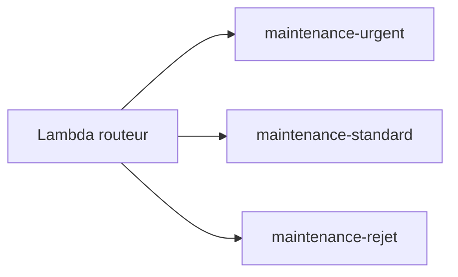

Cela permet d’avoir :

- des consommateurs différents ;
- des backlogs différents ;
- des priorités opérationnelles différentes ;
- des permissions différentes ;
- des métriques séparées.

---

# 24. Queue de rejet et DLQ : différence

`maintenance-rejet` est une **queue métier**.

Le routeur y place volontairement les messages techniquement valides mais non supportés par la règle métier.

Une **Dead-Letter Queue** sert plutôt aux messages qu’un consumer n’arrive pas à traiter correctement après plusieurs tentatives.

> **À retenir :** **rejet fonctionnel** et **échec technique répété** sont deux concepts différents.

---

# 25. Vérifier les trois queues

Dans SQS, vous devez voir :

```text
maintenance-urgent
maintenance-standard
maintenance-rejet
```

Au départ :

```text
Available messages = 0
```

pour chaque queue.

---

## Équivalent AWS CLI - optionnel

```bash
aws sqs create-queue \
  --queue-name maintenance-urgent \
  --region eu-west-3

aws sqs create-queue \
  --queue-name maintenance-standard \
  --region eu-west-3

aws sqs create-queue \
  --queue-name maintenance-rejet \
  --region eu-west-3
```

Lister les queues :

```bash
aws sqs list-queues \
  --queue-name-prefix maintenance- \
  --region eu-west-3
```

---

# 26. Étape 4 - Récupérer les URLs des queues

Ouvrez chaque queue.

Repérez :

- **Queue URL** ;
- **ARN**.

Nous allons utiliser les URLs dans les variables d’environnement de la Lambda routeur.

Exemple :

```text
URGENT_QUEUE_URL
STANDARD_QUEUE_URL
REJECT_QUEUE_URL
```

---

# 27. Pourquoi utiliser les URLs SQS ?

Avec boto3 :

```python
sqs.send_message(
    QueueUrl=...
)
```

attend l’URL de la queue.

Nous évitons de mettre ces URLs directement dans le code.

---

# 28. Étape 5 - Créer le rôle IAM du routeur

La Lambda routeur doit pouvoir :

- écrire dans CloudWatch Logs ;
- envoyer dans les trois queues.

Dans **IAM**, ouvrez :

```text
Roles
```

Cliquez sur :

```text
Create role
```

Trusted entity :

```text
AWS service
```

Use case :

```text
Lambda
```

---

# 29. Ajouter les logs

Ajoutez la managed policy :

```text
AWSLambdaBasicExecutionRole
```

Nom du rôle :

```text
role-tp2-routeur
```

Créez le rôle.

---

# 30. Ajouter les permissions SQS du routeur

Ajoutez une **inline policy**.

Principe :

```json
{
  "Version": "2012-10-17",
  "Statement": [
    {
      "Effect": "Allow",
      "Action": "sqs:SendMessage",
      "Resource": [
        "ARN_URGENT",
        "ARN_STANDARD",
        "ARN_REJET"
      ]
    }
  ]
}
```

---

# 31. Pourquoi trois ARN ?

Le routeur doit pouvoir publier dans :

- urgent ;
- standard ;
- rejet.

Il n’a pas besoin d’envoyer dans toutes les queues du compte AWS.

Nous appliquons donc le **Least Privilege**.

---

# 32. Ce qu’il ne faut pas faire

Évitez si possible :

```json
{
  "Action": "sqs:*",
  "Resource": "*"
}
```

Ce serait beaucoup trop permissif pour le besoin du TP.

---

# 33. Compte EPSI avec rôle fourni

Si vous ne pouvez pas créer de rôle IAM :

utilisez le rôle fourni par l’enseignant.

Il doit permettre au minimum :

```text
logs:CreateLogGroup
logs:CreateLogStream
logs:PutLogEvents
sqs:SendMessage
```

sur les queues concernées.

---

# 34. Étape 6 - Créer la Lambda routeur

Dans :

```text
Lambda
```

cliquez sur :

```text
Create function
```

Choisissez :

```text
Author from scratch
```

---

# 35. Paramètres du routeur

Function name :

```text
lambda-tp2-routeur
```

Runtime :

```text
Python 3.x
```

Execution role :

```text
role-tp2-routeur
```

ou le rôle EPSI fourni.

Cliquez sur **Create function**.

---

# 36. Étape 7 - Ajouter les variables d’environnement

Dans :

```text
Configuration
Environment variables
```

ajoutez :

```text
URGENT_QUEUE_URL
STANDARD_QUEUE_URL
REJECT_QUEUE_URL
```

Utilisez les URLs des trois queues.

---

# 37. Pourquoi ces variables ?

Le code doit connaître les destinations sans coder les URLs en dur.

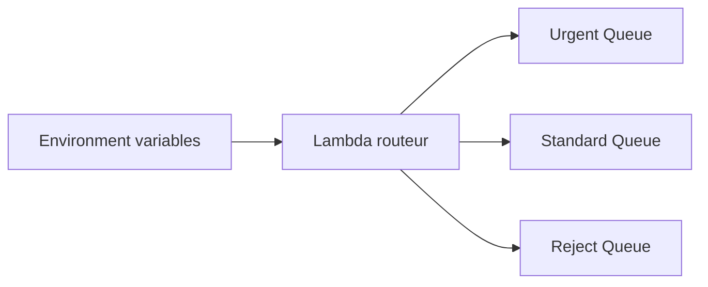

---

# 38. Étape 8 - Écrire le code du routeur

Dans l’onglet **Code**, remplacez le code par :

```python
import json
import os
import uuid
from datetime import datetime, timezone

import boto3
from botocore.exceptions import ClientError


sqs = boto3.client("sqs")

URGENT_QUEUE_URL = os.environ["URGENT_QUEUE_URL"]
STANDARD_QUEUE_URL = os.environ["STANDARD_QUEUE_URL"]
REJECT_QUEUE_URL = os.environ["REJECT_QUEUE_URL"]

REQUIRED_FIELDS = {
    "ticketId",
    "campus",
    "building",
    "room",
    "category",
    "priority",
    "description",
    "reportedBy",
}

REPORTED_BY_REQUIRED_FIELDS = {
    "email",
    "role",
}

SUPPORTED_PRIORITIES = {
    "urgent": "maintenance-urgent",
    "standard": "maintenance-standard",
}


def http_response(status_code, payload):
    return {
        "statusCode": status_code,
        "headers": {
            "content-type": "application/json"
        },
        "body": json.dumps(
            payload,
            ensure_ascii=False,
        ),
    }


def normalize_text(value):
    if not isinstance(value, str):
        return value

    return value.strip().lower()


def validate_request(body):
    if not isinstance(body, dict):
        return [
            "BODY_MUST_BE_AN_OBJECT"
        ]

    errors = []

    missing = sorted(
        field
        for field in REQUIRED_FIELDS
        if field not in body
        or body[field] is None
        or body[field] == ""
    )

    if missing:
        errors.append(
            {
                "error": "MISSING_REQUIRED_FIELDS",
                "fields": missing,
            }
        )

    unknown = sorted(
        set(body.keys()) - REQUIRED_FIELDS
    )

    if unknown:
        errors.append(
            {
                "error": "UNKNOWN_FIELDS",
                "fields": unknown,
            }
        )

    reported_by = body.get("reportedBy")

    if reported_by is not None:
        if not isinstance(reported_by, dict):
            errors.append(
                {
                    "error": "REPORTED_BY_MUST_BE_AN_OBJECT"
                }
            )
        else:
            nested_missing = sorted(
                field
                for field in REPORTED_BY_REQUIRED_FIELDS
                if not reported_by.get(field)
            )

            if nested_missing:
                errors.append(
                    {
                        "error": "MISSING_REPORTED_BY_FIELDS",
                        "fields": nested_missing,
                    }
                )

            nested_unknown = sorted(
                set(reported_by.keys())
                - REPORTED_BY_REQUIRED_FIELDS
            )

            if nested_unknown:
                errors.append(
                    {
                        "error": "UNKNOWN_REPORTED_BY_FIELDS",
                        "fields": nested_unknown,
                    }
                )

    return errors


def send_event(queue_url, internal_event, route_name):
    response = sqs.send_message(
        QueueUrl=queue_url,
        MessageBody=json.dumps(
            internal_event,
            ensure_ascii=False,
        ),
        MessageAttributes={
            "eventType": {
                "DataType": "String",
                "StringValue": internal_event["eventType"],
            },
            "priority": {
                "DataType": "String",
                "StringValue": internal_event["data"]["priority"],
            },
            "correlationId": {
                "DataType": "String",
                "StringValue": internal_event["correlationId"],
            },
            "route": {
                "DataType": "String",
                "StringValue": route_name,
            },
        },
    )

    return response["MessageId"]


def lambda_handler(event, context):
    try:
        raw_body = event.get("body") or "{}"
        body = json.loads(raw_body)
    except json.JSONDecodeError:
        return http_response(
            400,
            {
                "status": "INVALID_REQUEST",
                "errors": [
                    {
                        "error": "INVALID_JSON"
                    }
                ],
            },
        )

    validation_errors = validate_request(body)

    if validation_errors:
        return http_response(
            400,
            {
                "status": "INVALID_REQUEST",
                "errors": validation_errors,
            },
        )

    normalized_priority = normalize_text(
        body["priority"]
    )

    normalized_category = normalize_text(
        body["category"]
    )

    internal_message_id = str(
        uuid.uuid4()
    )

    correlation_id = (
        event.get("headers", {}).get(
            "x-correlation-id"
        )
        or event.get("headers", {}).get(
            "X-Correlation-ID"
        )
        or str(uuid.uuid4())
    )

    internal_event = {
        "eventType": "MaintenanceIncidentReceived",
        "schemaVersion": 1,
        "messageId": internal_message_id,
        "correlationId": correlation_id,
        "receivedAt": datetime.now(
            timezone.utc
        ).isoformat(),
        "source": "epsi-maintenance-portal",
        "data": {
            "ticketId": body["ticketId"],
            "campus": body["campus"].strip(),
            "building": body["building"].strip(),
            "room": body["room"].strip(),
            "category": normalized_category,
            "priority": normalized_priority,
            "description": body[
                "description"
            ].strip(),
            "reportedBy": body["reportedBy"],
        },
    }

    if normalized_priority == "urgent":
        target_queue_url = URGENT_QUEUE_URL
        target_queue_name = "maintenance-urgent"
        status_code = 202
        response_status = "ROUTED"

    elif normalized_priority == "standard":
        target_queue_url = STANDARD_QUEUE_URL
        target_queue_name = "maintenance-standard"
        status_code = 202
        response_status = "ROUTED"

    else:
        target_queue_url = REJECT_QUEUE_URL
        target_queue_name = "maintenance-rejet"
        status_code = 422
        response_status = "REJECTED"

        internal_event = {
            "eventType": "MaintenanceIncidentRejected",
            "schemaVersion": 1,
            "messageId": internal_message_id,
            "correlationId": correlation_id,
            "receivedAt": internal_event[
                "receivedAt"
            ],
            "source": "epsi-maintenance-portal",
            "reason": "UNSUPPORTED_PRIORITY",
            "receivedPriority": normalized_priority,
            "originalEvent": internal_event,
        }

    try:
        sqs_message_id = send_event(
            target_queue_url,
            internal_event,
            target_queue_name,
        )

    except ClientError as exc:
        print(
            json.dumps(
                {
                    "level": "ERROR",
                    "message": "SQS_SEND_FAILED",
                    "correlationId": correlation_id,
                    "targetQueue": target_queue_name,
                    "error": str(exc),
                }
            )
        )

        return http_response(
            502,
            {
                "status": "BROKER_ERROR",
                "correlationId": correlation_id,
            },
        )

    print(
        json.dumps(
            {
                "level": "INFO",
                "message": "MESSAGE_ROUTED",
                "correlationId": correlation_id,
                "internalMessageId": internal_message_id,
                "sqsMessageId": sqs_message_id,
                "targetQueue": target_queue_name,
                "normalizedPriority": normalized_priority,
                "normalizedCategory": normalized_category,
            },
            ensure_ascii=False,
        )
    )

    response_payload = {
        "status": response_status,
        "queue": target_queue_name,
        "messageId": internal_message_id,
        "correlationId": correlation_id,
        "ticketId": body["ticketId"],
    }

    if status_code == 422:
        response_payload[
            "reason"
        ] = "UNSUPPORTED_PRIORITY"

    return http_response(
        status_code,
        response_payload,
    )
```

Cliquez ensuite sur :

```text
Deploy
```

---

# 39. Lecture du code - validation JSON

Le code commence par :

```python
json.loads(raw_body)
```

Si le body n’est pas du JSON valide :

```text
400
```

---

# 40. Lecture du code - validate_request()

La fonction :

```python
validate_request(body)
```

vérifie :

- champs obligatoires ;
- champs inconnus ;
- objet `reportedBy` ;
- champs obligatoires de `reportedBy` ;
- champs inconnus dans `reportedBy`.

---

# 41. Pourquoi vérifier les champs inconnus ?

Supposons :

```json
{
  "ticketId": "INC-01",
  "priorite": "urgent"
}
```

au lieu de :

```json
{
  "priority": "urgent"
}
```

Un système permissif pourrait ignorer l’erreur.

Nous préférons :

```text
400 Bad Request
```

afin de rendre le contrat explicite.

---

# 42. Lecture du code - normalisation

```python
def normalize_text(value):
    if not isinstance(value, str):
        return value

    return value.strip().lower()
```

---

# 43. strip()

```python
value.strip()
```

supprime les espaces au début et à la fin.

Exemple :

```text
" urgent "
```

devient :

```text
"urgent"
```

---

# 44. lower()

```python
value.lower()
```

met la chaîne en minuscules.

Exemple :

```text
"URGENT"
```

devient :

```text
"urgent"
```

---

# 45. Normalisation complète

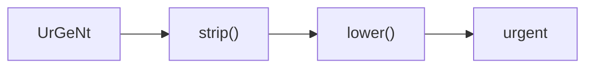

---

# 46. Lecture du code - messageId

Nous générons :

```python
internal_message_id = str(
    uuid.uuid4()
)
```

Ce **messageId interne** permet de tracer l’événement.

Il est différent du :

```text
SQS MessageId
```

créé par AWS lors de `SendMessage`.

---

# 47. Deux identifiants possibles

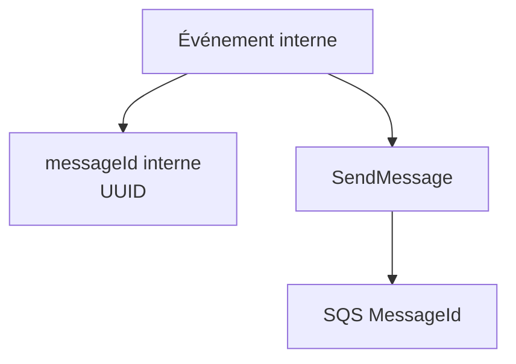

Les deux peuvent être utiles pour le debug.

---

# 48. Lecture du code - correlationId

Le routeur cherche d’abord le header :

```text
X-Correlation-ID
```

Si le client ne le fournit pas :

```python
str(uuid.uuid4())
```

est utilisé.

---

# 49. Pourquoi un correlationId ?

Un SI peut comporter :

```text
API Gateway
Lambda Router
SQS
Lambda Consumer
API métier
Base de données
```

Le **correlationId** permet de relier les traces de la même demande.

---

# 50. Diagramme de corrélation

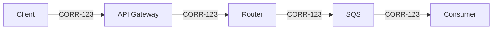

---

# 51. Lecture du code - événement interne

Pour une priorité connue, l’événement contient :

```json
{
  "eventType": "MaintenanceIncidentReceived",
  "schemaVersion": 1,
  "messageId": "...",
  "correlationId": "...",
  "receivedAt": "...",
  "source": "epsi-maintenance-portal",
  "data": {
    "ticketId": "...",
    "category": "network",
    "priority": "urgent"
  }
}
```

---

# 52. Pourquoi un événement interne ?

Le payload HTTP est un **contrat externe**.

L’événement SQS est un **contrat interne**.

Cette séparation permet de :

- normaliser ;
- enrichir ;
- versionner ;
- tracer ;
- faire évoluer les composants.

---

# 53. Routage urgent

```python
if normalized_priority == "urgent":
```

Destination :

```text
maintenance-urgent
```

Réponse :

```text
202
```

---

# 54. Routage standard

```python
elif normalized_priority == "standard":
```

Destination :

```text
maintenance-standard
```

Réponse :

```text
202
```

---

# 55. Routage rejet

Toutes les autres valeurs passent dans :

```python
else:
```

Destination :

```text
maintenance-rejet
```

Réponse :

```text
422
```

---

# 56. Événement de rejet

Le message de rejet contient :

```text
reason
receivedPriority
originalEvent
```

Cela facilite l’analyse.

---

# 57. Pourquoi publier le rejet au lieu de le perdre ?

Si le système reçoit :

```text
priority = critical
```

nous voulons pouvoir retrouver :

- le ticket ;
- la priorité reçue ;
- le contexte ;
- la raison du rejet.

Une donnée rejetée ne doit pas disparaître silencieusement.

---

# 58. Diagramme du routeur

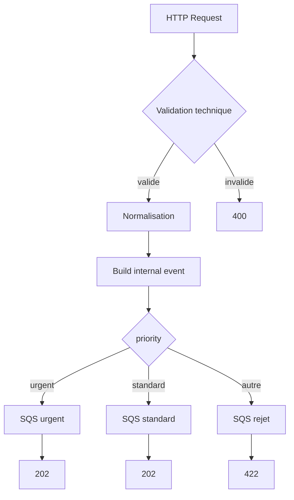

---

# 59. Étape 9 - Tester directement la Lambda routeur

Avant API Gateway, testons la Lambda seule.

Créez un événement de test.

Nom :

```text
test-urgent
```

---

# 60. Événement Lambda test urgent

```json
{
  "headers": {
    "x-correlation-id": "CORR-TP2-001"
  },
  "body": "{\"ticketId\":\"INC-101\",\"campus\":\"EPSI\",\"building\":\"Batiment A\",\"room\":\"A204\",\"category\":\"NETWORK\",\"priority\":\" UrGeNt \",\"description\":\"Plus de reseau.\",\"reportedBy\":{\"email\":\"etudiant@example.com\",\"role\":\"student\"}}"
}
```

---

# 61. Résultat attendu urgent

Vous devez obtenir :

```text
statusCode = 202
```

et :

```text
queue = maintenance-urgent
```

---

# 62. Vérifier la queue urgent

Dans SQS :

```text
maintenance-urgent
```

le compteur de messages disponibles doit augmenter.

---

# 63. Test direct standard

Créez un second événement :

```json
{
  "headers": {},
  "body": "{\"ticketId\":\"INC-102\",\"campus\":\"EPSI\",\"building\":\"Batiment B\",\"room\":\"B101\",\"category\":\"PROJECTOR\",\"priority\":\"STANDARD\",\"description\":\"Videoprojecteur indisponible.\",\"reportedBy\":{\"email\":\"enseignant@example.com\",\"role\":\"teacher\"}}"
}
```

Résultat :

```text
202
maintenance-standard
```

---

# 64. Test direct rejet

```json
{
  "headers": {},
  "body": "{\"ticketId\":\"INC-103\",\"campus\":\"EPSI\",\"building\":\"Batiment C\",\"room\":\"C010\",\"category\":\"FURNITURE\",\"priority\":\"LOW\",\"description\":\"Chaise endommagee.\",\"reportedBy\":{\"email\":\"test@example.com\",\"role\":\"student\"}}"
}
```

Résultat :

```text
422
maintenance-rejet
```

---

# 65. Test direct invalide

```json
{
  "headers": {},
  "body": "{\"ticketId\":\"INC-104\",\"priority\":\"urgent\"}"
}
```

Résultat :

```text
400
```

Aucune queue ne doit recevoir de message.

---

# 66. Étape 10 - Créer API Gateway HTTP API

Dans la console, recherchez :

```text
API Gateway
```

Cliquez sur :

```text
Create API
```

Dans :

```text
HTTP API
```

cliquez sur :

```text
Build
```

---

# 67. Pourquoi HTTP API ?

Pour ce TP, nous avons besoin d’un endpoint simple :

```text
POST /maintenance
```

vers une Lambda.

**HTTP API** fournit les fonctionnalités nécessaires avec un modèle plus simple qu’une REST API complète.

---

# 68. Ajouter l’intégration

Integration :

```text
Lambda
```

Choisissez :

```text
lambda-tp2-routeur
```

Nom de l’API :

```text
api-tp2-routage-epsi
```

---

# 69. Créer la route

Route :

```text
POST /maintenance
```

Destination :

```text
lambda-tp2-routeur
```

---

# 70. Stage

Utilisez :

```text
$default
```

avec :

```text
Auto-deploy
```

si la console le propose.

---

# 71. Créer l’API

Validez.

Récupérez l’**Invoke URL**.

Endpoint complet :

```text
<INVOKE_URL>/maintenance
```

---

# 72. Permission API Gateway vers Lambda

La console configure généralement la permission permettant à API Gateway d’invoquer la Lambda.

Conceptuellement :

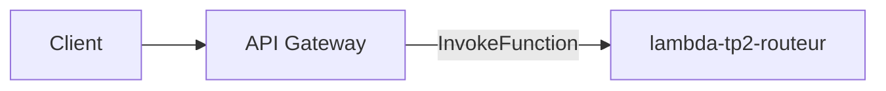

---

## Équivalent AWS CLI - optionnel

Création rapide d’une HTTP API :

```bash
aws apigatewayv2 create-api \
  --name api-tp2-routage-epsi \
  --protocol-type HTTP \
  --target arn:aws:lambda:eu-west-3:ACCOUNT_ID:function:lambda-tp2-routeur \
  --region eu-west-3
```

---

# 73. Étape 11 - Test urgent avec Postman

Method :

```text
POST
```

URL :

```text
<INVOKE_URL>/maintenance
```

Header :

```text
Content-Type: application/json
```

Ajoutez aussi :

```text
X-Correlation-ID: CORR-POSTMAN-001
```

Body :

```json
{
  "ticketId": "INC-201",
  "campus": "EPSI",
  "building": "Batiment A",
  "room": "A204",
  "category": "NETWORK",
  "priority": " UrGeNt ",
  "description": "Plus de reseau.",
  "reportedBy": {
    "email": "etudiant@example.com",
    "role": "student"
  }
}
```

---

# 74. Résultat urgent attendu

```text
202 Accepted
```

Body proche de :

```json
{
  "status": "ROUTED",
  "queue": "maintenance-urgent",
  "messageId": "...",
  "correlationId": "CORR-POSTMAN-001",
  "ticketId": "INC-201"
}
```

---

# 75. Vérifier la normalisation

Dans CloudWatch Logs du routeur, retrouvez :

```text
normalizedPriority
normalizedCategory
```

Attendu :

```text
urgent
network
```

---

# 76. Étape 12 - Test standard

Body :

```json
{
  "ticketId": "INC-202",
  "campus": "EPSI",
  "building": "Batiment B",
  "room": "B101",
  "category": "PROJECTOR",
  "priority": "STANDARD",
  "description": "Videoprojecteur indisponible.",
  "reportedBy": {
    "email": "enseignant@example.com",
    "role": "teacher"
  }
}
```

Attendu :

```text
202
maintenance-standard
```

---

# 77. Étape 13 - Test rejet fonctionnel

Body :

```json
{
  "ticketId": "INC-203",
  "campus": "EPSI",
  "building": "Batiment C",
  "room": "C010",
  "category": "FURNITURE",
  "priority": "LOW",
  "description": "Chaise endommagee.",
  "reportedBy": {
    "email": "test@example.com",
    "role": "student"
  }
}
```

Attendu :

```text
422
maintenance-rejet
```

---

# 78. Étape 14 - Test techniquement invalide

```json
{
  "ticketId": "INC-204",
  "priority": "urgent"
}
```

Attendu :

```text
400 Bad Request
```

Et :

```text
aucune queue ne doit recevoir
```

---

# 79. Matrice de routage

| Valeur reçue | Valeur normalisée | Destination | Code |
|---|---|---|---:|
| `URGENT` | `urgent` | `maintenance-urgent` | `202` |
| ` UrGeNt ` | `urgent` | `maintenance-urgent` | `202` |
| `STANDARD` | `standard` | `maintenance-standard` | `202` |
| ` Standard ` | `standard` | `maintenance-standard` | `202` |
| `LOW` | `low` | `maintenance-rejet` | `422` |
| payload incomplet | non calculée | aucune queue | `400` |

---

# 80. Trois résultats métier

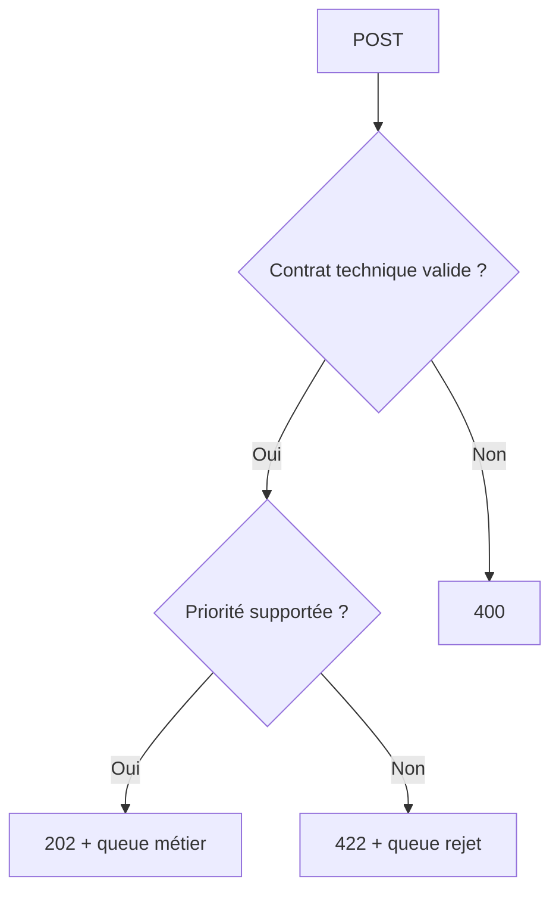

---

# 81. Pourquoi 422 ?

Le payload :

- est du JSON valide ;
- contient tous les champs ;
- possède la bonne structure ;

mais :

```text
priority = low
```

n’est pas pris en charge par le SI.

**`422 Unprocessable Entity`** est donc utilisé pédagogiquement pour distinguer ce cas d’un contrat invalide.

---

# 82. Étape 15 - Observer CloudWatch Logs du routeur

Ouvrez :

```text
Lambda
lambda-tp2-routeur
Monitor
View CloudWatch logs
```

Cherchez :

```text
MESSAGE_ROUTED
```

---

# 83. Informations importantes dans les logs

Le routeur logue notamment :

```text
correlationId
internalMessageId
sqsMessageId
targetQueue
normalizedPriority
normalizedCategory
```

---

# 84. Pourquoi ces logs sont utiles ?

Ils permettent de répondre à :

```text
Quel ticket a été routé ?
Vers quelle queue ?
Avec quelle valeur normalisée ?
Quel correlationId ?
Quel messageId ?
```

---

# 85. Tip CloudWatch

Ne lisez pas les logs au hasard.

Commencez avec une question précise.

Exemple :

```text
Pourquoi INC-203 est allé dans rejet ?
```

Puis cherchez son :

```text
correlationId
ticketId
normalizedPriority
```

---

# 86. Étape 16 - Créer le rôle IAM urgent

Créez un rôle Lambda :

```text
role-tp2-urgent
```

Trusted entity :

```text
Lambda
```

Ajoutez :

```text
AWSLambdaBasicExecutionRole
```

---

# 87. Permissions SQS du consumer urgent

Le consumer doit pouvoir lire la queue urgent.

Policy ciblée :

```json
{
  "Version": "2012-10-17",
  "Statement": [
    {
      "Effect": "Allow",
      "Action": [
        "sqs:ReceiveMessage",
        "sqs:DeleteMessage",
        "sqs:GetQueueAttributes"
      ],
      "Resource": "ARN_MAINTENANCE_URGENT"
    }
  ]
}
```

---

# 88. Étape 17 - Créer lambda-tp2-urgent

Créez une Lambda :

```text
lambda-tp2-urgent
```

Runtime :

```text
Python 3.x
```

Execution role :

```text
role-tp2-urgent
```

---

# 89. Code du consumer urgent

```python
import json


def lambda_handler(event, context):
    records = event.get("Records", [])

    for record in records:
        body = json.loads(
            record["body"]
        )

        print(
            json.dumps(
                {
                    "level": "INFO",
                    "worker": "urgent",
                    "status": "PRISE_EN_CHARGE_PRIORITAIRE",
                    "sqsMessageId": record.get(
                        "messageId"
                    ),
                    "internalMessageId": body.get(
                        "messageId"
                    ),
                    "correlationId": body.get(
                        "correlationId"
                    ),
                    "ticketId": body.get(
                        "data",
                        {},
                    ).get(
                        "ticketId"
                    ),
                    "priority": body.get(
                        "data",
                        {},
                    ).get(
                        "priority"
                    ),
                    "payload": body,
                },
                ensure_ascii=False,
            )
        )

    return {
        "processed": len(records)
    }
```

Cliquez sur **Deploy**.

---

# 90. Étape 18 - Ajouter le trigger SQS urgent

Dans :

```text
lambda-tp2-urgent
```

cliquez sur :

```text
Add trigger
```

Choisissez :

```text
SQS
```

Queue :

```text
maintenance-urgent
```

Batch size :

```text
1
```

Enable trigger :

```text
Yes
```

---

# 91. Pourquoi Batch Size = 1 ?

Pour le TP, cela rend l’observation plus simple.

```text
1 message
1 invocation visible
```

Le batch par défaut pour SQS est généralement plus grand.

---

# 92. Visibility Timeout et timeout Lambda

AWS recommande de configurer un visibility timeout SQS suffisamment supérieur au timeout de la Lambda.

Pour une intégration SQS/Lambda, AWS recommande généralement un visibility timeout d’au moins **six fois le timeout de la fonction**, afin de laisser du temps aux retries et throttles.

Dans le TP :

```text
Lambda timeout = 3 à 5 secondes
SQS visibility timeout = 30 secondes
```

est cohérent.

---

# 93. Étape 19 - Créer le rôle standard

Créez :

```text
role-tp2-standard
```

Ajoutez :

```text
AWSLambdaBasicExecutionRole
```

et une policy ciblée sur :

```text
maintenance-standard
```

avec :

```text
sqs:ReceiveMessage
sqs:DeleteMessage
sqs:GetQueueAttributes
```

---

# 94. Étape 20 - Créer lambda-tp2-standard

Nom :

```text
lambda-tp2-standard
```

Runtime :

```text
Python 3.x
```

Role :

```text
role-tp2-standard
```

---

# 95. Code du consumer standard

```python
import json


def lambda_handler(event, context):
    records = event.get("Records", [])

    for record in records:
        body = json.loads(
            record["body"]
        )

        print(
            json.dumps(
                {
                    "level": "INFO",
                    "worker": "standard",
                    "status": "PRISE_EN_CHARGE_STANDARD",
                    "sqsMessageId": record.get(
                        "messageId"
                    ),
                    "internalMessageId": body.get(
                        "messageId"
                    ),
                    "correlationId": body.get(
                        "correlationId"
                    ),
                    "ticketId": body.get(
                        "data",
                        {},
                    ).get(
                        "ticketId"
                    ),
                    "priority": body.get(
                        "data",
                        {},
                    ).get(
                        "priority"
                    ),
                    "payload": body,
                },
                ensure_ascii=False,
            )
        )

    return {
        "processed": len(records)
    }
```

Déployez.

---

# 96. Ajouter le trigger standard

Ajoutez un trigger SQS.

Queue :

```text
maintenance-standard
```

Batch size :

```text
1
```

Enable :

```text
Yes
```

---

# 97. Architecture finale

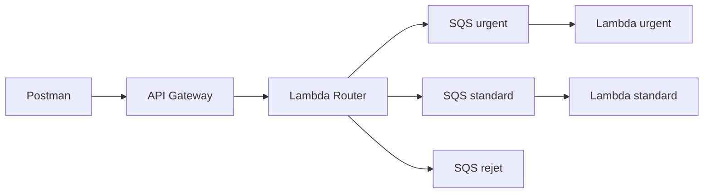

---

# 98. Pourquoi pas de consumer rejet ?

Dans ce TP, nous voulons conserver les rejets pour les observer.

La queue :

```text
maintenance-rejet
```

n’a donc pas de Lambda consommatrice.

---

# 99. Ce que pourrait faire un consumer rejet dans un vrai SI

Il pourrait :

- créer une alerte ;
- notifier une équipe ;
- écrire dans une base d’audit ;
- enrichir le message ;
- demander une correction ;
- déclencher un workflow humain.

---

# 100. Étape 21 - Créer un backlog différencié

Désactivez les deux **Event Source Mappings** :

```text
maintenance-urgent vers lambda-tp2-urgent
maintenance-standard vers lambda-tp2-standard
```

---

# 101. Comment désactiver le mapping ?

Dans la Lambda :

```text
Configuration
Triggers
```

ouvrez le trigger SQS.

Désactivez le mapping.

*Selon la version de la console, l’option peut être accessible depuis la page Event source mappings.*

---

# 102. Envoyer plusieurs incidents

Envoyez :

```text
3 urgents
2 standards
1 priorité low
```

---

# 103. Résultat attendu

Vous devez observer approximativement :

```text
maintenance-urgent
3 messages

maintenance-standard
2 messages

maintenance-rejet
1 message
```

---

# 104. Diagramme des backlogs

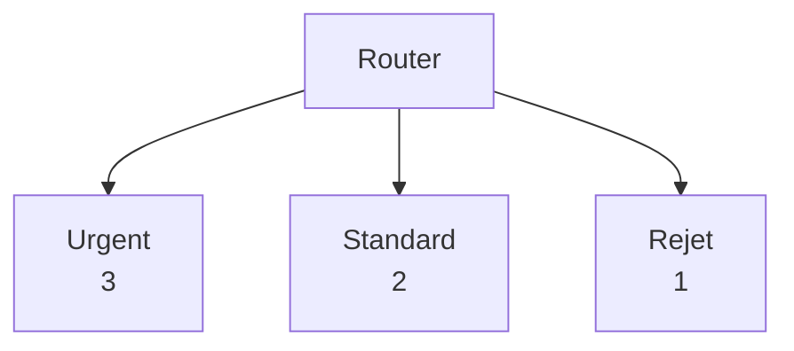

---

# 105. Question 1

Pourquoi plusieurs queues plutôt qu’une seule ?

**Réponse :**

Parce que chaque flux peut avoir :

- un traitement différent ;
- une priorité différente ;
- une scalabilité différente ;
- des permissions différentes ;
- un backlog indépendant.

---

# 106. Question 2

Pourquoi normaliser avant le `if` ?

**Réponse :**

Pour rendre le routage indépendant :

- de la casse ;
- des espaces inutiles ;
- de certaines variations de saisie.

---

# 107. Question 3

Pourquoi conserver les rejets ?

**Réponse :**

Pour ne pas perdre silencieusement une donnée que le SI ne sait pas traiter.

La queue permet :

- l’audit ;
- le debug ;
- l’analyse ;
- une correction ultérieure.

---

# 108. Question 4

Quelle différence entre `400` et `422` ?

**Réponse :**

**`400`** :

le contrat technique est invalide.

**`422`** :

le contrat technique est valide, mais la valeur métier n’est pas supportée.

---

# 109. Question 5

Quelle différence entre queue rejet et DLQ ?

**Réponse :**

La **queue rejet** reçoit volontairement une donnée non supportée par la règle métier.

Une **DLQ** reçoit généralement un message qu’un consumer n’arrive plus à traiter normalement après plusieurs réceptions.

---

# 110. Étape 22 - Réactiver seulement urgent

Réactivez l’Event Source Mapping :

```text
maintenance-urgent
```

Laissez le mapping standard désactivé.

---

# 111. Résultat attendu

Vous devez observer :

```text
urgent diminue
standard reste en attente
rejet reste en attente
```

---

# 112. Panne partielle simulée

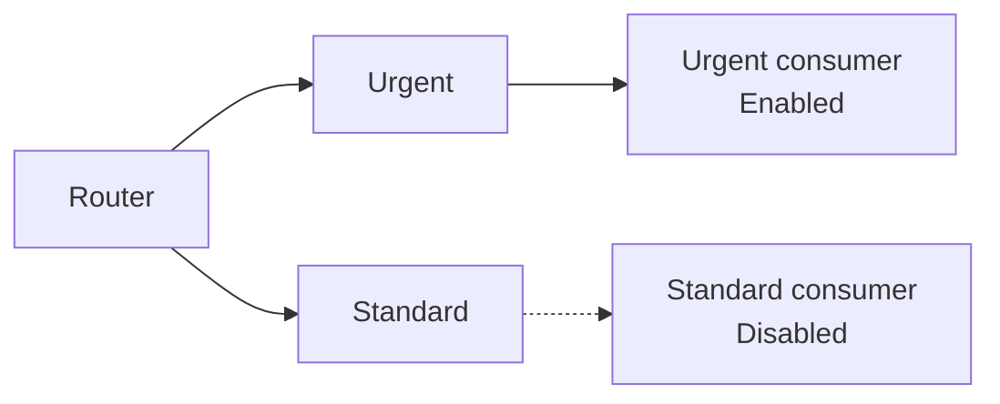

---

# 113. Ce que démontre l’expérience

Une architecture découplée peut continuer **partiellement**.

Le flux urgent peut fonctionner même si le traitement standard est arrêté.

---

# 114. Question 6

Le routeur doit-il savoir si `lambda-tp2-standard` est désactivée ?

**Réponse :**

Non.

Le routeur doit pouvoir envoyer dans SQS indépendamment de l’état immédiat du consumer.

C’est le **découplage temporel**.

---

# 115. Réactiver standard

Réactivez ensuite :

```text
maintenance-standard
```

Le backlog doit diminuer.

---

# 116. At-least-once avec SQS Standard

Une **Standard Queue** utilise une livraison *at-least-once*.

Cela signifie qu’un même message peut exceptionnellement être livré plusieurs fois.

---

# 117. Pourquoi est-ce important maintenant ?

Imaginez que le consumer urgent fasse :

```text
créer un ticket
envoyer un SMS
déclencher une intervention
```

Si le même message est retraité :

```text
double effet métier
```

peut devenir problématique.

---

# 118. Conséquence

Un consumer robuste doit être **idempotent**.

Nous approfondirons cela dans un TP suivant.

---

# 119. SQS Standard et ordre

Une Standard Queue fournit un ordre en *best effort*.

Ne concevez donc pas le consumer en supposant que :

```text
INC-001
sera toujours traité avant
INC-002
```

si l’ordre strict est critique.

---

# 120. Standard et FIFO

| Propriété | Standard | FIFO |
|---|---|---|
| Livraison | at-least-once | mécanismes FIFO avancés |
| Ordre | best effort | ordre FIFO |
| Débit | très élevé | modèle différent |
| TP2 | **Oui** | Non |

---

# 121. Pourquoi ne pas utiliser FIFO ici ?

Parce que l’objectif du TP est :

- transformation ;
- routage ;
- plusieurs queues ;
- consumers distincts.

FIFO ajouterait :

- `MessageGroupId` ;
- déduplication FIFO ;
- contraintes supplémentaires.

Ces notions seront étudiées plus tard.

---

# 122. Debug - message urgent va dans rejet

Vérifiez dans CloudWatch :

```text
normalizedPriority
```

Attendu :

```text
urgent
```

---

# 123. Debug - normalizedPriority incorrect

Vérifiez :

```python
body["priority"]
```

puis :

```python
normalize_text(...)
```

Le code doit utiliser :

```python
strip().lower()
```

---

# 124. Debug - SQS_SEND_FAILED

Dans les logs routeur, cherchez :

```text
SQS_SEND_FAILED
```

Vérifiez :

- rôle IAM ;
- `sqs:SendMessage` ;
- ARN autorisés ;
- URL de queue ;
- région.

---

# 125. Debug - une queue fonctionne mais pas une autre

Vérifiez la policy du rôle routeur.

La liste `Resource` doit contenir les trois ARN.

---

# 126. Exemple d’erreur IAM typique

Si vous avez oublié l’ARN rejet :

```text
urgent fonctionne
standard fonctionne
rejet renvoie 502
```

Le code est peut-être correct.

La permission IAM est incomplète.

---

# 127. Debug - API retourne 500

Ouvrez les logs :

```text
lambda-tp2-routeur
```

Une exception non gérée peut provoquer une erreur backend.

---

# 128. Debug - 404

Vérifiez :

```text
POST
/maintenance
Invoke URL
```

---

# 129. Debug - 400 au lieu de 422

Le payload ne passe probablement pas la validation technique.

Vérifiez :

- tous les champs obligatoires ;
- `reportedBy.email` ;
- `reportedBy.role` ;
- les champs inconnus.

---

# 130. Debug - 422 attendu mais 202 reçu

Vérifiez :

```python
SUPPORTED_PRIORITIES
```

et :

```python
normalized_priority
```

---

# 131. Debug - consumer urgent ne s’exécute pas

Vérifiez :

1. message présent dans la queue ;
2. Event Source Mapping **Enabled** ;
3. queue et Lambda dans la même région ;
4. rôle consumer ;
5. visibility timeout ;
6. timeout Lambda.

---

# 132. Même région obligatoire

Pour une intégration SQS comme source d’événement Lambda :

```text
queue
et
fonction Lambda
```

doivent être dans la même région AWS.

---

# 133. Debug - timeout mapping

AWS vérifie que :

```text
Lambda timeout
```

n’est pas supérieur au :

```text
SQS visibility timeout
```

Pour le TP :

```text
Lambda = 3 ou 5 secondes
SQS = 30 secondes
```

reste simple.

---

# 134. Debug - le message revient dans la queue

Si la Lambda consumer échoue :

le message peut redevenir visible après le visibility timeout.

Cela est normal.

---

# 135. Pourquoi ne pas supprimer manuellement le message ?

Avec l’intégration SQS/Lambda, Lambda gère le polling et la suppression des messages lorsque le batch est traité avec succès.

Le code du consumer n’appelle pas directement :

```text
DeleteMessage
```

---

# 136. Batch Size = 1

Nous avons volontairement choisi :

```text
1
```

pour faciliter l’apprentissage.

Par défaut, le batch SQS d’un Event Source Mapping peut contenir plusieurs messages.

---

# 137. Que se passe-t-il avec Batch Size = 10 ?

Une invocation Lambda peut recevoir plusieurs `Records`.

Le code doit donc toujours être capable de parcourir :

```python
for record in event["Records"]:
```

Même dans ce TP, nous avons gardé cette boucle.

---

# 138. Pourquoi garder la boucle ?

Parce qu’elle montre la structure correcte d’un consumer SQS.

Changer plus tard le batch size ne nécessitera pas de réécrire entièrement le code.

---

# 139. Event Source Mapping

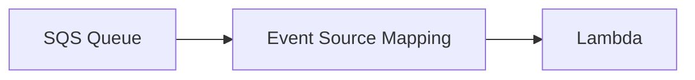

Le mapping est la couche gérée par Lambda qui effectue le polling.

---

# 140. AWS recommande un visibility timeout plus grand

AWS recommande, pour SQS avec Lambda, un visibility timeout d’au moins **six fois** le timeout de la fonction, avec adaptation supplémentaire lorsqu’une batching window est configurée.

L’objectif est de laisser du temps pour :

- le traitement ;
- les retries ;
- les throttles.

---

# 141. Exercice guidé 1 - variantes urgent

Testez :

```text
URGENT
Urgent
 urgent
 UrGeNt
```

Résultat :

```text
maintenance-urgent
```

---

# 142. Exercice guidé 2 - variantes standard

Testez :

```text
STANDARD
Standard
 standard
```

Résultat :

```text
maintenance-standard
```

---

# 143. Exercice guidé 3 - rejet

Testez :

```text
critical
```

Résultat :

```text
422
maintenance-rejet
```

---

# 144. Exercice guidé 4 - champ absent

Supprimez :

```text
description
```

Résultat :

```text
400
aucune queue
```

---

# 145. Exercice guidé 5 - champ inconnu

Ajoutez :

```json
"unknownField": "test"
```

Résultat :

```text
400
```

---

# 146. Exercice guidé 6 - reportedBy invalide

Envoyez :

```json
"reportedBy": {
  "email": "test@example.com"
}
```

Il manque :

```text
role
```

Résultat :

```text
400
```

---

# 147. Exercice guidé 7 - consumer urgent indisponible

Désactivez le mapping urgent.

Laissez standard actif.

Envoyez :

```text
2 urgent
2 standard
```

---

# 148. Résultat attendu

Urgent :

```text
backlog augmente
```

Standard :

```text
messages consommés
```

---

# 149. Exercice guidé 8 - correlationId

Envoyez un header :

```text
X-Correlation-ID: EPSI-TP2-TEST-001
```

Puis cherchez dans les logs :

```text
EPSI-TP2-TEST-001
```

du routeur puis du consumer.

---

# 150. Ce que démontre correlationId

Vous pouvez relier :

```text
requête cliente
message SQS
consumer
logs
```

sans dépendre uniquement d’un timestamp.

---

# 151. Exercice guidé 9 - retirer une permission

*Uniquement si l’enseignant l’autorise.*

Retirez temporairement l’ARN de :

```text
maintenance-rejet
```

de la policy routeur.

Envoyez :

```text
priority = low
```

Attendu :

```text
502
```

Puis restaurez immédiatement la policy.

---

# 152. Ce que démontre l’exercice IAM

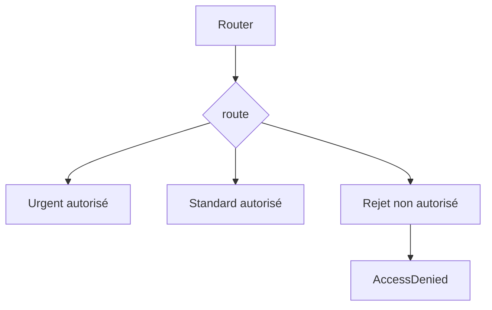

Le code peut être correct mais l’autorisation insuffisante.

---

# 153. Codes HTTP du TP2

| Code | Signification |
|---|---|
| **`202`** | incident valide et routé vers urgent ou standard |
| **`400`** | contrat technique invalide |
| **`422`** | contrat valide mais priorité non supportée |
| **`502`** | publication SQS non confirmée |
| **`404`** | route API Gateway incorrecte |
| **`500`** | erreur backend non gérée |

---

# 154. Différence entre 400 et 422

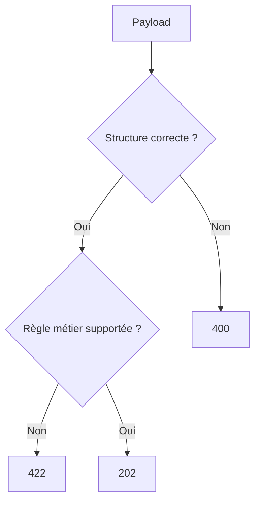

---

# 155. Différence entre 422 et 502

**`422`** :

le SI comprend la demande mais ne supporte pas sa priorité.

**`502`** :

le routeur n’a pas réussi à publier correctement dans SQS.

---

# 156. À retenir sur le routeur

Un routeur doit être :

- déterministe ;
- simple à tester ;
- observable ;
- explicite.

Une règle de routage trop complexe peut devenir difficile à maintenir.

---

# 157. À retenir sur la normalisation

Ne comparez pas directement des données externes sans réfléchir à leur forme.

Exemples :

```text
URGENT
urgent
 Urgent
```

peuvent représenter la même valeur métier.

---

# 158. À retenir sur le rejet

Un rejet doit idéalement contenir :

- le motif ;
- la donnée reçue ;
- un identifiant de corrélation ;
- le message original ou un extrait suffisant.

---

# 159. À retenir sur SQS Standard

Ne supposez pas :

```text
exactly once
```

avec une Standard Queue.

Concevez progressivement vos consumers pour tolérer :

```text
redelivery
```

---

# 160. Aperçu du TP suivant

Une progression possible consiste à ajouter :

- **DLQ** ;
- retry maîtrisé ;
- idempotence consumer ;
- limites de concurrence ;
- alarmes CloudWatch ;
- FIFO ;
- Step Functions ;
- EventBridge.

---

# 161. Pourquoi EventBridge pourrait devenir intéressant ?

Dans le TP2, le routeur décide explicitement :

```text
quelle queue reçoit le message
```

Avec **EventBridge**, des règles peuvent router des événements vers différentes cibles selon leur contenu.

C’est un autre modèle de routage événementiel.

---

# 162. Pourquoi ne pas utiliser EventBridge dans ce TP2 ?

Nous voulons d’abord maîtriser :

- le routage explicite ;
- le code de transformation ;
- SQS ;
- plusieurs backlogs ;
- les permissions IAM.

EventBridge pourra être introduit ensuite sans masquer ces notions fondamentales.

---

# 163. AWS CLI - rôle dans le TP2

AWS CLI reste **optionnel**.

Il sert principalement à :

- vérifier ;
- automatiser ;
- diagnostiquer ;
- comparer avec la console.

---

# 164. Tableau Console AWS et CLI

| Console AWS | CLI indicatif |
|---|---|
| Create SQS queue | `aws sqs create-queue` |
| Get queue attributes | `aws sqs get-queue-attributes` |
| Create Lambda | `aws lambda create-function` |
| List Lambda | `aws lambda list-functions` |
| Create HTTP API | `aws apigatewayv2 create-api` |
| Create mapping | `aws lambda create-event-source-mapping` |
| Disable mapping | `aws lambda update-event-source-mapping` |
| List mapping | `aws lambda list-event-source-mappings` |
| View logs | `aws logs ...` |

---

# 165. CLI - récupérer les trois URLs

```bash
URGENT_QUEUE_URL=$(aws sqs get-queue-url \
  --queue-name maintenance-urgent \
  --region eu-west-3 \
  --query QueueUrl \
  --output text)

STANDARD_QUEUE_URL=$(aws sqs get-queue-url \
  --queue-name maintenance-standard \
  --region eu-west-3 \
  --query QueueUrl \
  --output text)

REJECT_QUEUE_URL=$(aws sqs get-queue-url \
  --queue-name maintenance-rejet \
  --region eu-west-3 \
  --query QueueUrl \
  --output text)
```

---

# 166. CLI - afficher les backlogs

```bash
for URL in \
  "$URGENT_QUEUE_URL" \
  "$STANDARD_QUEUE_URL" \
  "$REJECT_QUEUE_URL"
do
  aws sqs get-queue-attributes \
    --queue-url "$URL" \
    --attribute-names \
      ApproximateNumberOfMessages \
      ApproximateNumberOfMessagesNotVisible \
    --region eu-west-3
done
```

---

# 167. CLI - créer le mapping urgent

Récupérez l’ARN :

```bash
URGENT_ARN=$(aws sqs get-queue-attributes \
  --queue-url "$URGENT_QUEUE_URL" \
  --attribute-names QueueArn \
  --region eu-west-3 \
  --query Attributes.QueueArn \
  --output text)
```

Puis :

```bash
aws lambda create-event-source-mapping \
  --function-name lambda-tp2-urgent \
  --event-source-arn "$URGENT_ARN" \
  --batch-size 1 \
  --enabled \
  --region eu-west-3
```

---

# 168. CLI - lister les mappings

```bash
aws lambda list-event-source-mappings \
  --region eu-west-3 \
  --query 'EventSourceMappings[].{UUID:UUID,State:State,Function:FunctionArn,Source:EventSourceArn}' \
  --output table
```

---

# 169. CLI - désactiver un mapping

Récupérez son UUID puis :

```bash
aws lambda update-event-source-mapping \
  --uuid UUID_DU_MAPPING \
  --no-enabled \
  --region eu-west-3
```

---

# 170. CLI - réactiver

```bash
aws lambda update-event-source-mapping \
  --uuid UUID_DU_MAPPING \
  --enabled \
  --region eu-west-3
```

---

# 171. CLI - envoyer directement un message dans urgent

Pour isoler le consumer :

```bash
aws sqs send-message \
  --queue-url "$URGENT_QUEUE_URL" \
  --message-body '{
    "eventType":"DebugIncident",
    "schemaVersion":1,
    "messageId":"DEBUG-001",
    "correlationId":"CORR-DEBUG",
    "data":{
      "ticketId":"INC-DEBUG",
      "priority":"urgent"
    }
  }' \
  --region eu-west-3
```

---

# 172. Pourquoi ce test CLI est utile ?

Il contourne :

```text
API Gateway
Lambda routeur
```

Si le message direct est consommé correctement :

```text
SQS + consumer urgent
```

fonctionnent.

Le problème se situe donc probablement avant la queue.

---

# 173. Debug méthodique

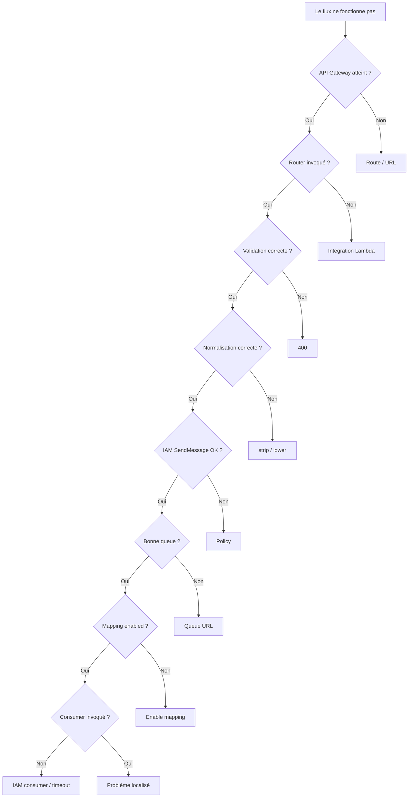

---

# 174. Tip debug

Ne modifiez pas :

```text
code
policy IAM
route API
queue
mapping
```

en même temps.

Corrigez une seule couche puis retestez.

---

# 175. Tip IAM

Un `AccessDenied` est une information utile.

Regardez :

```text
quelle action
quelle ressource
quel rôle
```

sont mentionnés dans l’erreur.

---

# 176. Tip SQS

Un compteur SQS est souvent **approximatif**.

Les attributs :

```text
ApproximateNumberOfMessages
```

sont justement nommés *Approximate*.

Ne vous attendez pas toujours à une synchronisation visuelle instantanée.

---

# 177. Tip CloudWatch

Ajoutez toujours des logs structurés.

Mieux :

```json
{
  "level": "INFO",
  "message": "MESSAGE_ROUTED",
  "correlationId": "CORR-123",
  "targetQueue": "maintenance-urgent"
}
```

que :

```text
ca marche
```

---

# 178. Tip soutenance

Si on vous demande :

*« Pourquoi créer un routeur ? »*

ne répondez pas seulement :

*« pour choisir une queue ».*

Expliquez :

- **validation** ;
- **normalisation** ;
- **transformation** ;
- **enrichissement** ;
- **routage** ;
- **traçabilité**.

---

# 179. Nettoyage - important pour les comptes étudiants

À la fin du TP, supprimez les ressources si l’enseignant l’autorise.

Ressources :

- API Gateway ;
- trois Lambda ;
- trois Event Source Mappings ;
- trois queues SQS ;
- rôles IAM créés spécifiquement pour le TP.

---

# 180. Ordre de nettoyage conseillé

1. désactiver ou supprimer les mappings ;
2. supprimer API Gateway ;
3. supprimer les trois Lambda ;
4. supprimer les trois queues ;
5. supprimer les rôles du TP si vous les avez créés.

---

# 181. Ne jamais supprimer un rôle EPSI fourni

Si vous avez utilisé :

```text
LabRole
StudentRole
```

ou un autre rôle partagé :

**ne le supprimez pas.**

---

# 182. CLI - supprimer une queue

```bash
aws sqs delete-queue \
  --queue-url "$URGENT_QUEUE_URL" \
  --region eu-west-3
```

Même principe pour les autres queues.

---

# 183. CLI - supprimer une Lambda

```bash
aws lambda delete-function \
  --function-name lambda-tp2-routeur \
  --region eu-west-3
```

---

# 184. CLI - supprimer l’API

```bash
aws apigatewayv2 delete-api \
  --api-id API_ID \
  --region eu-west-3
```

---

# 185. Tips de fin de TP

Retenez :

1. **Valider avant de transformer.**
2. **Normaliser avant de comparer.**
3. **Séparer rejet technique et rejet fonctionnel.**
4. **Conserver les rejets.**
5. **Utiliser un Correlation Id.**
6. **Appliquer Least Privilege.**
7. **Observer chaque backlog indépendamment.**
8. **Penser at-least-once avec SQS Standard.**
9. **Diagnostiquer couche par couche.**
10. **Nettoyer les ressources cloud.**

---

# 186. Checklist finale

- [ ] J’ai choisi une seule région AWS.
- [ ] J’ai créé `maintenance-urgent`.
- [ ] J’ai créé `maintenance-standard`.
- [ ] J’ai créé `maintenance-rejet`.
- [ ] J’ai récupéré les URLs et ARN.
- [ ] J’ai créé ou utilisé un IAM role routeur.
- [ ] Le routeur peut faire `sqs:SendMessage` sur les trois queues.
- [ ] J’ai créé `lambda-tp2-routeur`.
- [ ] J’ai configuré les trois variables d’environnement.
- [ ] J’ai validé le JSON.
- [ ] J’ai normalisé `priority`.
- [ ] J’ai normalisé `category`.
- [ ] J’ai créé un événement interne.
- [ ] J’ai généré un `messageId`.
- [ ] J’ai généré ou propagé un `correlationId`.
- [ ] J’ai routé urgent.
- [ ] J’ai routé standard.
- [ ] J’ai créé un rejet fonctionnel.
- [ ] J’ai renvoyé `202`.
- [ ] J’ai renvoyé `400`.
- [ ] J’ai renvoyé `422`.
- [ ] J’ai créé API Gateway HTTP API.
- [ ] J’ai créé `POST /maintenance`.
- [ ] J’ai testé avec Postman.
- [ ] J’ai observé CloudWatch Logs.
- [ ] J’ai créé `lambda-tp2-urgent`.
- [ ] J’ai créé `lambda-tp2-standard`.
- [ ] J’ai créé le mapping urgent.
- [ ] J’ai créé le mapping standard.
- [ ] J’ai utilisé Batch Size `1`.
- [ ] J’ai observé des backlogs séparés.
- [ ] J’ai simulé une panne partielle.
- [ ] Je sais expliquer *at-least-once*.
- [ ] Je sais expliquer la différence entre queue rejet et DLQ.
- [ ] J’ai nettoyé les ressources à la fin.

---

# 187. Résumé final

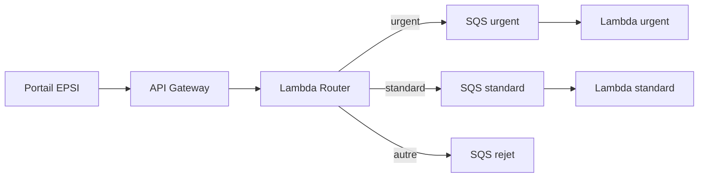

Le point essentiel du TP2 est :

> **Une couche d’intégration ne sert pas uniquement à transporter des données. Elle peut aussi valider, normaliser, enrichir et router les messages avant leur traitement.**

---

# 188. Références AWS

Documentation utile :

- **API Gateway HTTP APIs** :  
  `https://docs.aws.amazon.com/apigateway/latest/developerguide/http-api.html`

- **HTTP API avec intégration Lambda** :  
  `https://docs.aws.amazon.com/apigateway/latest/developerguide/http-api-develop-integrations-lambda.html`

- **Lambda execution roles** :  
  `https://docs.aws.amazon.com/lambda/latest/dg/lambda-intro-execution-role.html`

- **Lambda avec SQS** :  
  `https://docs.aws.amazon.com/lambda/latest/dg/with-sqs.html`

- **Configurer un Event Source Mapping SQS** :  
  `https://docs.aws.amazon.com/lambda/latest/dg/services-sqs-configure.html`

- **Paramètres des Event Source Mappings** :  
  `https://docs.aws.amazon.com/lambda/latest/dg/services-sqs-parameters.html`

- **SQS Standard et at-least-once** :  
  `https://docs.aws.amazon.com/AWSSimpleQueueService/latest/SQSDeveloperGuide/standard-queues-at-least-once-delivery.html`

- **AWS Free Tier** :  
  `https://aws.amazon.com/free/`

- **Tarification SQS** :  
  `https://aws.amazon.com/sqs/pricing/`

- **Tarification Lambda** :  
  `https://aws.amazon.com/lambda/pricing/`

- **Tarification API Gateway** :  
  `https://aws.amazon.com/api-gateway/pricing/`
