# TP 3 - Publish/Subscribe avec Amazon SNS, Amazon SQS et AWS Lambda - EPSI

**Niveau :** *intermédiaire à avancé*  
**Durée indicative :** *3 h à 4 h*  
**Mode principal :** **Console AWS**  
**Mode secondaire :** *AWS CLI, uniquement en option et à titre de comparaison*  
**Architecture :** **Amazon API Gateway HTTP API**, **AWS Lambda**, **Amazon SNS Standard Topic**, **Amazon SQS Standard Queues**, **Subscription Filter Policies**, **AWS IAM** et **Amazon CloudWatch**  
**Public visé :** *étudiants EPSI disposant d’un compte AWS personnel, d’un compte AWS Free Tier ou d’un environnement AWS fourni par l’établissement.*

---

# 1. Objectifs du TP

À la fin de ce TP, vous devez être capables de :

- comprendre le modèle **publish/subscribe** ;
- distinguer une **SQS queue** d’un **SNS topic** ;
- créer un **Amazon SNS Standard Topic** ;
- créer plusieurs **SQS Standard Queues** ;
- connecter plusieurs queues à un même topic SNS ;
- comprendre qu’un même message peut être distribué à plusieurs abonnés ;
- créer des **SNS Subscription Filter Policies** ;
- filtrer sur les **Message Attributes** ;
- comprendre le comportement d’une subscription **sans filter policy** ;
- activer la **Raw Message Delivery** ;
- configurer les **SQS Queue Policies** nécessaires à SNS ;
- créer une Lambda productrice ;
- publier un seul message sur SNS ;
- utiliser un **messageId** interne ;
- utiliser un **correlationId** ;
- utiliser des **Message Attributes** ;
- créer deux Lambda consommatrices ;
- utiliser des **Event Source Mappings SQS** ;
- observer plusieurs backlogs indépendants ;
- simuler une panne partielle ;
- comprendre le **fan-out** ;
- comprendre la livraison **at-least-once** de SQS Standard ;
- comprendre la différence entre :
  - **point-to-point** ;
  - **publish/subscribe** ;
  - **routage dans le producteur** ;
  - **routage dans le broker** ;
- diagnostiquer une erreur IAM ;
- diagnostiquer une erreur de Filter Policy ;
- diagnostiquer une erreur de Queue Policy ;
- utiliser AWS CLI uniquement comme *équivalent optionnel*.

---

# 2. Position du TP3 dans la progression

Le TP1 AWS a introduit :

```text
API Gateway
Lambda productrice
SQS
Lambda consommatrice
```

Le TP2 AWS a ajouté :

```text
plusieurs queues
normalisation
transformation
routage dans la Lambda
plusieurs consommateurs
```

Le TP3 déplace maintenant une partie du routage dans :

```text
Amazon SNS
```

avec :

```text
Topic
Subscriptions
Filter Policies
```

---

# 3. Idée principale du TP3

Dans le TP2 :

```text
la Lambda routeur choisissait explicitement une queue
```

Dans le TP3 :

```text
la Lambda productrice publie une seule fois sur un SNS Topic
```

Puis :

```text
SNS décide quels abonnements reçoivent le message
```

---

# 4. Architecture générale

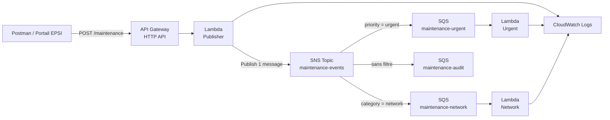

> **À retenir :** la Lambda productrice publie **une seule fois**. Amazon SNS distribue ensuite le message vers les abonnements correspondant aux **Filter Policies**.

> **Tip EPSI :** dans une architecture publish/subscribe, distinguez toujours **le publisher**, **le topic**, **les subscriptions**, **les endpoints abonnés** et **les consommateurs finaux**.

---

# 5. Scénario métier

EPSI continue d’utiliser son portail de maintenance.

Un incident peut intéresser plusieurs équipes en même temps.

Exemple :

```json
{
  "ticketId": "INC-301",
  "campus": "EPSI",
  "building": "Batiment A",
  "room": "A204",
  "category": "network",
  "priority": "urgent",
  "description": "Plus de reseau.",
  "reportedBy": {
    "email": "etudiant@example.com",
    "role": "student"
  }
}
```

Cet incident intéresse :

- le traitement **urgent** ;
- le traitement **network** ;
- le flux **audit**.

---

# 6. Résultat attendu pour INC-301

La Lambda productrice publie :

```text
1 message
```

dans :

```text
SNS maintenance-events
```

SNS distribue ensuite une copie à :

```text
maintenance-urgent
maintenance-network
maintenance-audit
```

---

# 7. Pourquoi utiliser SNS puis SQS ?

Nous pourrions connecter SNS directement à plusieurs Lambda.

Mais ce TP utilise :

```text
SNS
puis
SQS
puis
Lambda
```

pour conserver un **backlog durable et observable** pour chaque abonné.

---

# 8. Architecture SNS + SQS

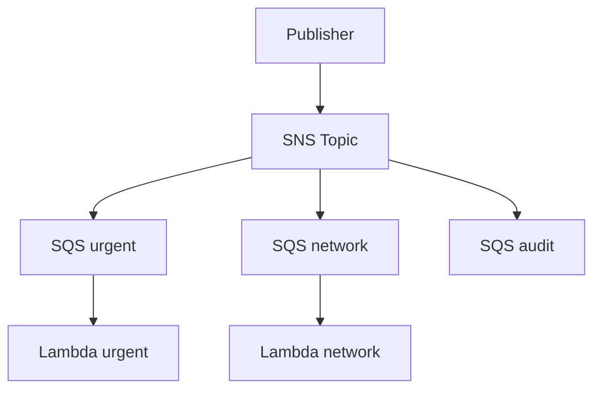

---

# 9. Pourquoi SQS après SNS ?

SQS apporte notamment :

- une file persistante ;
- un backlog indépendant ;
- le découplage du consumer ;
- un Visibility Timeout ;
- la possibilité de connecter Lambda via un Event Source Mapping ;
- une base pour les futurs TP sur DLQ et retries.

---

# 10. Queue et Topic : différence

## SQS Queue

Modèle principal :

```text
Producer
Queue
Consumer
```

La queue représente un flux de travail à consommer.

## SNS Topic

Modèle :

```text
Publisher
Topic
plusieurs Subscriptions
plusieurs Endpoints
```

SNS est adapté au **fan-out**.

---

# 11. Comparaison visuelle

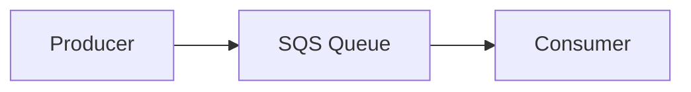

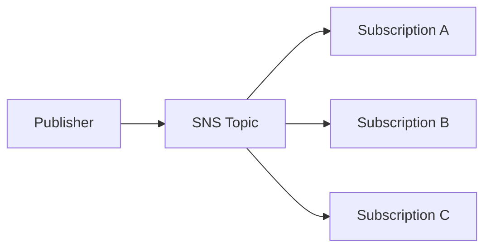

---

# 12. Qu’est-ce qu’une SNS Subscription ?

Une **SNS Subscription** relie :

```text
un SNS Topic
```

à :

```text
un endpoint
```

L’endpoint peut notamment être :

- Amazon SQS ;
- AWS Lambda ;
- HTTP/S ;
- email ;
- d’autres types supportés.

Dans ce TP, les endpoints sont des **SQS queues**.

---

# 13. Fan-out

Un message publié une seule fois peut être distribué à plusieurs endpoints.

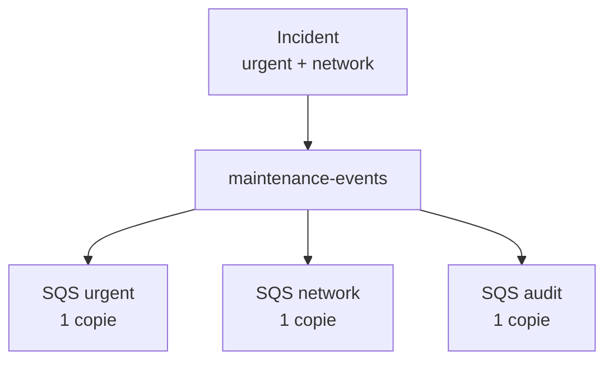

---

# 14. Découplage supplémentaire

Dans le TP2, le routeur connaissait :

```text
maintenance-urgent
maintenance-standard
maintenance-rejet
```

Dans le TP3, le publisher connaît seulement :

```text
maintenance-events
```

---

# 15. Le broker participe au routage

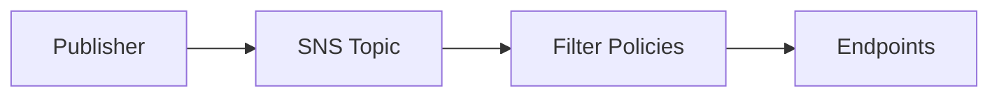

---

# 16. Filter Policy SNS

Une **Filter Policy** est un objet JSON.

Exemple :

```json
{
  "priority": [
    "urgent"
  ]
}
```

Cette policy accepte les messages dont l’attribut :

```text
priority
```

correspond à :

```text
urgent
```

---

# 17. Filter Policy network

```json
{
  "category": [
    "network"
  ]
}
```

---

# 18. Audit sans Filter Policy

Pour le flux audit :

```text
aucune Filter Policy
```

Une subscription SNS sans Filter Policy reçoit par défaut tous les messages publiés sur le topic.

---

# 19. Différence importante avec Azure TP3

Dans Azure Service Bus :

```text
$Default TrueFilter
```

peut être présent.

Dans SNS :

```text
l’absence de Filter Policy
```

signifie simplement :

```text
recevoir tous les messages
```

---

# 20. Filter Policy Scope

SNS peut filtrer sur :

```text
MessageAttributes
```

ou :

```text
MessageBody
```

Dans ce TP, nous choisissons :

```text
MessageAttributes
```

qui est aussi le scope par défaut.

---

# 21. Pourquoi MessageAttributes ?

Nous voulons publier des métadonnées dédiées au routage :

```text
priority
category
eventType
campus
```

Le body JSON conserve le contenu métier complet.

---

# 22. Body et Message Attributes

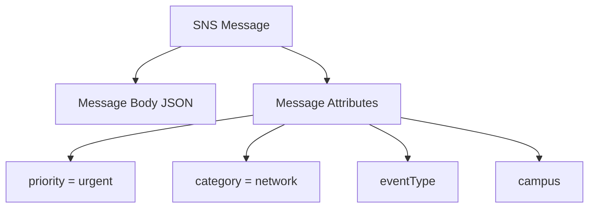

---

# 23. Pourquoi séparer body et attributs ?

Le **body** transporte l’événement complet.

Les **Message Attributes** facilitent :

- le routage ;
- le filtrage ;
- la métadonnée ;
- l’observabilité.

---

# 24. Cohérence éventuelle des filtres

Une modification d’une **SNS Filter Policy** peut demander jusqu’à :

```text
15 minutes
```

pour être pleinement effective.

> **Tip debug important :** après avoir créé ou modifié un filtre SNS, ne modifiez pas immédiatement votre code si le premier test semble incohérent. Vérifiez la policy et laissez le temps à la propagation.

---

# 25. Ressources du TP

Nous allons créer :

```text
SNS Topic
maintenance-events

SQS queues
maintenance-urgent
maintenance-network
maintenance-audit

SNS subscriptions
urgent vers maintenance-urgent
network vers maintenance-network
audit vers maintenance-audit

Lambda
lambda-tp3-publisher
lambda-tp3-urgent
lambda-tp3-network

API Gateway
api-tp3-pubsub-epsi

Route
POST /maintenance
```

---

# 26. IAM Roles proposés

```text
role-tp3-publisher
role-tp3-urgent
role-tp3-network
```

*Si votre environnement EPSI fournit un rôle de laboratoire, utilisez celui indiqué par l’enseignant.*

---

# 27. Comptes AWS étudiants et comptes EPSI

Vous pouvez utiliser :

- un compte AWS personnel ;
- un compte AWS Free Tier ;
- un environnement de laboratoire EPSI ;
- un compte géré par l’établissement.

---

# 28. AWS Free Tier actuel

AWS propose actuellement aux nouveaux clients un système de crédits et un Free Plan pour les comptes éligibles.

*Les conditions évoluent : vérifiez toujours les informations visibles dans votre compte.*

---

# 29. Coûts du TP

Nous utilisons :

- SNS ;
- SQS ;
- Lambda ;
- API Gateway ;
- CloudWatch Logs.

Pour quelques dizaines de messages, l’utilisation reste très faible.

Amazon SQS propose actuellement :

```text
1 million de requêtes gratuites par mois
```

dans son niveau gratuit applicable.

SNS est facturé principalement selon les requêtes et livraisons, avec des règles spécifiques selon le type d’endpoint et le volume.

---

# 30. Filtrage SNS et coût

Le filtrage basé sur les **Message Attributes** n’ajoute actuellement pas de coût de filtrage spécifique SNS.

Le filtrage sur **MessageBody** suit une tarification différente basée sur les données analysées.

Pour ce TP, nous choisissons donc aussi **MessageAttributes** pour garder le modèle simple.

---

# 31. Comptes école avec IAM restreint

Certains comptes EPSI peuvent interdire :

- création de rôles IAM ;
- modification de policies ;
- certaines permissions administratives.

Si une action IAM retourne :

```text
AccessDenied
```

utilisez le rôle fourni par l’enseignant.

---

# 32. Région AWS

Choisissez une seule région.

Exemple :

```text
Europe (Paris)
eu-west-3
```

ou la région imposée par votre laboratoire.

Toutes les ressources doivent rester dans la même région.

---

# 33. Étape 1 - Créer le SNS Topic

## Méthode principale - Console AWS

Dans la console, recherchez :

```text
SNS
```

Ouvrez :

```text
Simple Notification Service
```

Dans :

```text
Topics
```

cliquez sur :

```text
Create topic
```

---

# 34. Type du topic

Choisissez :

```text
Standard
```

Nom :

```text
maintenance-events
```

Créez le topic.

---

# 35. Pourquoi Standard Topic ?

Le TP porte sur :

- fan-out ;
- Filter Policies ;
- plusieurs abonnés.

Nous n’avons pas besoin de FIFO dans ce TP.

---

# 36. Récupérer le Topic ARN

Ouvrez :

```text
maintenance-events
```

Copiez :

```text
ARN
```

Exemple :

```text
arn:aws:sns:eu-west-3:123456789012:maintenance-events
```

Nous en aurons besoin pour :

- IAM ;
- SQS Queue Policies ;
- CLI.

---

## Équivalent AWS CLI - optionnel

```bash
TOPIC_ARN=$(aws sns create-topic \
  --name maintenance-events \
  --region eu-west-3 \
  --query TopicArn \
  --output text)
```

Afficher :

```bash
echo "$TOPIC_ARN"
```

---

# 37. Étape 2 - Créer maintenance-urgent

Dans SQS :

```text
Create queue
```

Type :

```text
Standard
```

Nom :

```text
maintenance-urgent
```

Visibility timeout :

```text
30 seconds
```

Créez la queue.

---

# 38. Étape 3 - Créer maintenance-network

Créez :

```text
maintenance-network
```

Type :

```text
Standard
```

---

# 39. Étape 4 - Créer maintenance-audit

Créez :

```text
maintenance-audit
```

Type :

```text
Standard
```

---

# 40. Vérifier les queues

Vous devez voir :

```text
maintenance-urgent
maintenance-network
maintenance-audit
```

---

## Équivalent AWS CLI - optionnel

```bash
aws sqs create-queue \
  --queue-name maintenance-urgent \
  --region eu-west-3

aws sqs create-queue \
  --queue-name maintenance-network \
  --region eu-west-3

aws sqs create-queue \
  --queue-name maintenance-audit \
  --region eu-west-3
```

---

# 41. Étape 5 - Récupérer les ARN des queues

Ouvrez chaque queue et copiez :

```text
Queue ARN
```

Nous utiliserons :

```text
URGENT_QUEUE_ARN
NETWORK_QUEUE_ARN
AUDIT_QUEUE_ARN
```

---

# 42. Pourquoi SNS a besoin d’une Queue Policy ?

Créer une subscription SNS vers SQS ne suffit pas toujours à autoriser effectivement l’envoi.

La **SQS queue** doit autoriser le service :

```text
sns.amazonaws.com
```

à exécuter :

```text
sqs:SendMessage
```

depuis notre topic.

---

# 43. IAM Identity Policy et SQS Resource Policy

Le publisher possède une **IAM identity policy**.

La queue possède une **resource policy**.

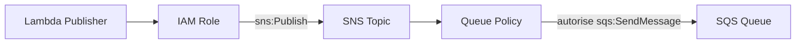

---

# 44. Étape 6 - Configurer la Queue Policy urgent

Ouvrez :

```text
SQS
maintenance-urgent
```

Puis :

```text
Access policy
```

ou l’éditeur de policy de la queue.

---

# 45. Policy urgent

Utilisez une policy basée sur ce modèle :

```json
{
  "Version": "2012-10-17",
  "Statement": [
    {
      "Sid": "AllowSnsTopicToSend",
      "Effect": "Allow",
      "Principal": {
        "Service": "sns.amazonaws.com"
      },
      "Action": "sqs:SendMessage",
      "Resource": "URGENT_QUEUE_ARN",
      "Condition": {
        "ArnEquals": {
          "aws:SourceArn": "TOPIC_ARN"
        }
      }
    }
  ]
}
```

Remplacez :

```text
URGENT_QUEUE_ARN
TOPIC_ARN
```

par les vraies valeurs.

---

# 46. Pourquoi la Condition SourceArn ?

Sans condition :

```text
n’importe quel topic SNS autorisé par la policy pourrait potentiellement envoyer
```

Avec :

```text
aws:SourceArn
```

nous limitons l’autorisation à :

```text
maintenance-events
```

---

# 47. Étape 7 - Policy network

Appliquez la même logique sur :

```text
maintenance-network
```

avec son propre ARN.

---

# 48. Étape 8 - Policy audit

Appliquez la même logique sur :

```text
maintenance-audit
```

---

# 49. Vérification rapide Queue Policies

Chaque queue doit autoriser :

```text
Principal
sns.amazonaws.com

Action
sqs:SendMessage

Condition SourceArn
maintenance-events
```

---

# 50. Debug - subscription créée mais aucune livraison

Une cause fréquente est :

```text
Queue Policy absente ou incorrecte
```

Vérifiez toujours ce point avant de modifier le code publisher.

---

# 51. Étape 9 - Créer la subscription urgent

Dans SNS :

```text
Subscriptions
```

cliquez :

```text
Create subscription
```

Topic ARN :

```text
maintenance-events
```

Protocol :

```text
Amazon SQS
```

Endpoint :

```text
ARN de maintenance-urgent
```

---

# 52. Raw Message Delivery

Activez :

```text
Enable raw message delivery
```

pour cette subscription.

---

# 53. Pourquoi Raw Message Delivery ?

Sans Raw Message Delivery, SQS reçoit une enveloppe JSON SNS contenant notamment :

```text
Type
MessageId
TopicArn
Message
Timestamp
MessageAttributes
```

Avec **Raw Message Delivery** :

```text
le body publié par notre Lambda arrive directement comme body SQS
```

Cela simplifie le consumer.

---

# 54. Raw Delivery et Filter Policy

**Raw Message Delivery** n’est pas obligatoire pour que les Filter Policies fonctionnent.

Les deux mécanismes ont des rôles différents :

- Filter Policy : *dois-je livrer le message ?*
- Raw Delivery : *sous quelle forme le message est-il livré ?*

---

# 55. Filter Policy urgent

Dans :

```text
Subscription filter policy
```

choisissez :

```text
Message attributes
```

Policy :

```json
{
  "priority": [
    "urgent"
  ]
}
```

Créez la subscription.

---

# 56. Étape 10 - Créer la subscription network

Topic :

```text
maintenance-events
```

Protocol :

```text
Amazon SQS
```

Endpoint :

```text
maintenance-network ARN
```

Activez :

```text
Raw Message Delivery
```

Filter Policy :

```json
{
  "category": [
    "network"
  ]
}
```

Scope :

```text
MessageAttributes
```

---

# 57. Étape 11 - Créer la subscription audit

Topic :

```text
maintenance-events
```

Protocol :

```text
Amazon SQS
```

Endpoint :

```text
maintenance-audit ARN
```

Activez :

```text
Raw Message Delivery
```

---

# 58. Aucun filtre pour audit

Ne configurez aucune :

```text
Filter Policy
```

pour audit.

Cette subscription doit recevoir :

```text
tous les messages
```

---

# 59. Résultat des subscriptions

| Endpoint SQS | Filter Policy |
|---|---|
| `maintenance-urgent` | `{"priority":["urgent"]}` |
| `maintenance-network` | `{"category":["network"]}` |
| `maintenance-audit` | aucune |

---

# 60. Diagramme de filtrage

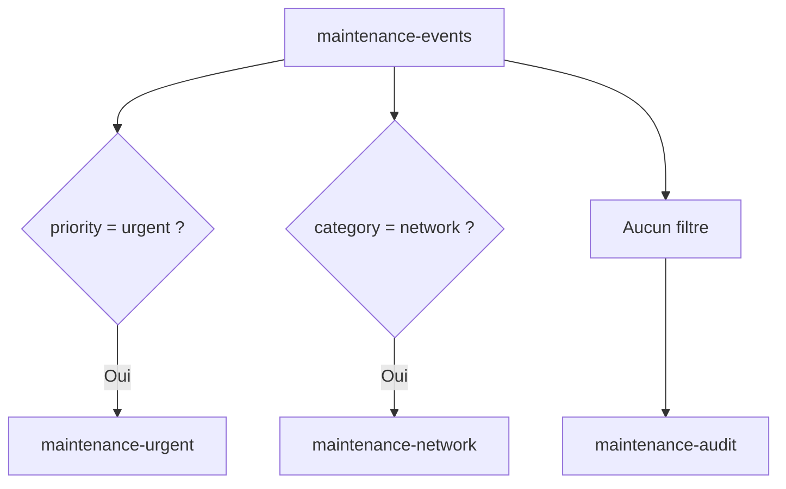

---

# 61. Propagation des Filter Policies

Après création ou modification d’une Filter Policy, AWS indique que la propagation peut prendre :

```text
jusqu’à 15 minutes
```

> **Tip :** si vous venez de modifier un filtre, attendez avant de conclure que votre logique de publication est mauvaise.

---

# 62. Équivalent CLI - créer une subscription urgent

Récupérez l’ARN de la queue puis :

```bash
URGENT_SUB_ARN=$(aws sns subscribe \
  --topic-arn "$TOPIC_ARN" \
  --protocol sqs \
  --notification-endpoint "$URGENT_QUEUE_ARN" \
  --attributes '{
    "RawMessageDelivery":"true",
    "FilterPolicy":"{\"priority\":[\"urgent\"]}",
    "FilterPolicyScope":"MessageAttributes"
  }' \
  --region eu-west-3 \
  --query SubscriptionArn \
  --output text)
```

---

# 63. CLI - network

```bash
NETWORK_SUB_ARN=$(aws sns subscribe \
  --topic-arn "$TOPIC_ARN" \
  --protocol sqs \
  --notification-endpoint "$NETWORK_QUEUE_ARN" \
  --attributes '{
    "RawMessageDelivery":"true",
    "FilterPolicy":"{\"category\":[\"network\"]}",
    "FilterPolicyScope":"MessageAttributes"
  }' \
  --region eu-west-3 \
  --query SubscriptionArn \
  --output text)
```

---

# 64. CLI - audit

```bash
AUDIT_SUB_ARN=$(aws sns subscribe \
  --topic-arn "$TOPIC_ARN" \
  --protocol sqs \
  --notification-endpoint "$AUDIT_QUEUE_ARN" \
  --attributes '{
    "RawMessageDelivery":"true"
  }' \
  --region eu-west-3 \
  --query SubscriptionArn \
  --output text)
```

---

# 65. CLI - vérifier un abonnement

```bash
aws sns get-subscription-attributes \
  --subscription-arn "$URGENT_SUB_ARN" \
  --region eu-west-3
```

Vérifiez :

```text
FilterPolicy
FilterPolicyScope
RawMessageDelivery
```

---

# 66. Étape 12 - Créer le rôle IAM du Publisher

La Lambda productrice doit :

- écrire dans CloudWatch Logs ;
- publier dans le topic SNS.

Dans IAM :

```text
Create role
```

Trusted entity :

```text
AWS service
Lambda
```

---

# 67. Permissions logs

Ajoutez :

```text
AWSLambdaBasicExecutionRole
```

Nom :

```text
role-tp3-publisher
```

---

# 68. Ajouter sns:Publish

Ajoutez une inline policy :

```json
{
  "Version": "2012-10-17",
  "Statement": [
    {
      "Effect": "Allow",
      "Action": "sns:Publish",
      "Resource": "TOPIC_ARN"
    }
  ]
}
```

---

# 69. Pourquoi ne pas donner sqs:SendMessage au Publisher ?

La Lambda productrice n’envoie pas directement vers SQS.

Elle fait seulement :

```text
sns:Publish
```

C’est SNS qui distribue ensuite vers les queues.

---

# 70. Least Privilege Publisher

La Lambda n’a pas besoin :

- `sqs:*` ;
- `sns:*` ;
- accès à tous les topics.

Elle a seulement besoin de :

```text
sns:Publish
```

sur :

```text
maintenance-events
```

---

# 71. Étape 13 - Créer lambda-tp3-publisher

Dans Lambda :

```text
Create function
```

Function name :

```text
lambda-tp3-publisher
```

Runtime :

```text
Python 3.x
```

Execution role :

```text
role-tp3-publisher
```

---

# 72. Variable d’environnement TOPIC_ARN

Dans :

```text
Configuration
Environment variables
```

ajoutez :

```text
TOPIC_ARN
```

avec l’ARN de :

```text
maintenance-events
```

---

# 73. Pourquoi une variable d’environnement ?

Nous séparons :

- le code ;
- la configuration AWS.

Le code ne contient pas l’ARN en dur.

---

# 74. Étape 14 - Code du Publisher

Utilisez :

```python
import json
import os
import uuid
from datetime import datetime, timezone

import boto3
from botocore.exceptions import ClientError


sns = boto3.client("sns")
TOPIC_ARN = os.environ["TOPIC_ARN"]

REQUIRED_FIELDS = {
    "ticketId",
    "campus",
    "building",
    "room",
    "category",
    "priority",
    "description",
    "reportedBy",
}

REPORTED_BY_REQUIRED_FIELDS = {
    "email",
    "role",
}


def http_response(status_code, payload):
    return {
        "statusCode": status_code,
        "headers": {
            "content-type": "application/json"
        },
        "body": json.dumps(
            payload,
            ensure_ascii=False,
        ),
    }


def normalize_text(value):
    if not isinstance(value, str):
        return value

    return value.strip().lower()


def validate_request(body):
    errors = []

    if not isinstance(body, dict):
        return [
            {
                "error": "BODY_MUST_BE_AN_OBJECT"
            }
        ]

    missing = sorted(
        field
        for field in REQUIRED_FIELDS
        if field not in body
        or body[field] is None
        or body[field] == ""
    )

    if missing:
        errors.append(
            {
                "error": "MISSING_REQUIRED_FIELDS",
                "fields": missing,
            }
        )

    unknown = sorted(
        set(body.keys()) - REQUIRED_FIELDS
    )

    if unknown:
        errors.append(
            {
                "error": "UNKNOWN_FIELDS",
                "fields": unknown,
            }
        )

    reported_by = body.get("reportedBy")

    if reported_by is not None:
        if not isinstance(reported_by, dict):
            errors.append(
                {
                    "error": "REPORTED_BY_MUST_BE_AN_OBJECT"
                }
            )
        else:
            nested_missing = sorted(
                field
                for field in REPORTED_BY_REQUIRED_FIELDS
                if not reported_by.get(field)
            )

            if nested_missing:
                errors.append(
                    {
                        "error": "MISSING_REPORTED_BY_FIELDS",
                        "fields": nested_missing,
                    }
                )

            nested_unknown = sorted(
                set(reported_by.keys())
                - REPORTED_BY_REQUIRED_FIELDS
            )

            if nested_unknown:
                errors.append(
                    {
                        "error": "UNKNOWN_REPORTED_BY_FIELDS",
                        "fields": nested_unknown,
                    }
                )

    return errors


def lambda_handler(event, context):
    try:
        raw_body = event.get("body") or "{}"
        body = json.loads(raw_body)
    except json.JSONDecodeError:
        return http_response(
            400,
            {
                "status": "INVALID_REQUEST",
                "errors": [
                    {
                        "error": "INVALID_JSON"
                    }
                ],
            },
        )

    validation_errors = validate_request(
        body
    )

    if validation_errors:
        return http_response(
            400,
            {
                "status": "INVALID_REQUEST",
                "errors": validation_errors,
            },
        )

    normalized_priority = normalize_text(
        body["priority"]
    )

    normalized_category = normalize_text(
        body["category"]
    )

    headers = event.get("headers") or {}

    normalized_headers = {
        str(key).lower(): value
        for key, value in headers.items()
    }

    correlation_id = (
        normalized_headers.get(
            "x-correlation-id"
        )
        or str(uuid.uuid4())
    )

    internal_message_id = str(
        uuid.uuid4()
    )

    internal_event = {
        "eventType": "MaintenanceIncidentReceived",
        "schemaVersion": 1,
        "messageId": internal_message_id,
        "correlationId": correlation_id,
        "receivedAt": datetime.now(
            timezone.utc
        ).isoformat(),
        "source": "epsi-maintenance-portal",
        "data": {
            "ticketId": body["ticketId"],
            "campus": body["campus"].strip(),
            "building": body["building"].strip(),
            "room": body["room"].strip(),
            "category": normalized_category,
            "priority": normalized_priority,
            "description": body[
                "description"
            ].strip(),
            "reportedBy": body["reportedBy"],
        },
    }

    try:
        publish_response = sns.publish(
            TopicArn=TOPIC_ARN,
            Message=json.dumps(
                internal_event,
                ensure_ascii=False,
            ),
            MessageAttributes={
                "priority": {
                    "DataType": "String",
                    "StringValue": normalized_priority,
                },
                "category": {
                    "DataType": "String",
                    "StringValue": normalized_category,
                },
                "eventType": {
                    "DataType": "String",
                    "StringValue": internal_event[
                        "eventType"
                    ],
                },
                "campus": {
                    "DataType": "String",
                    "StringValue": body[
                        "campus"
                    ].strip(),
                },
                "correlationId": {
                    "DataType": "String",
                    "StringValue": correlation_id,
                },
            },
        )

    except ClientError as exc:
        print(
            json.dumps(
                {
                    "level": "ERROR",
                    "message": "SNS_PUBLISH_FAILED",
                    "correlationId": correlation_id,
                    "error": str(exc),
                }
            )
        )

        return http_response(
            502,
            {
                "status": "BROKER_ERROR",
                "correlationId": correlation_id,
            },
        )

    sns_message_id = publish_response[
        "MessageId"
    ]

    print(
        json.dumps(
            {
                "level": "INFO",
                "message": "EVENT_PUBLISHED",
                "snsMessageId": sns_message_id,
                "internalMessageId": internal_message_id,
                "correlationId": correlation_id,
                "ticketId": body["ticketId"],
                "priority": normalized_priority,
                "category": normalized_category,
            },
            ensure_ascii=False,
        )
    )

    return http_response(
        202,
        {
            "status": "PUBLISHED",
            "topic": "maintenance-events",
            "messageId": internal_message_id,
            "snsMessageId": sns_message_id,
            "correlationId": correlation_id,
            "ticketId": body["ticketId"],
        },
    )
```

Cliquez sur :

```text
Deploy
```

---

# 75. Lecture du code - pas de routage if/elif

Contrairement au TP2, le publisher ne contient pas :

```python
if priority == ...
```

pour sélectionner une queue.

Il publie toujours vers :

```text
TOPIC_ARN
```

---

# 76. C’est le changement architectural majeur

TP2 :

```text
Lambda décide destination
```

TP3 :

```text
SNS Filter Policies décident distribution
```

---

# 77. Lecture du code - normalisation

Nous utilisons :

```python
strip().lower()
```

pour normaliser :

```text
priority
category
```

---

# 78. Pourquoi normaliser avant SNS ?

Notre Filter Policy attend :

```json
{
  "priority": [
    "urgent"
  ]
}
```

Donc :

```text
URGENT
 UrGeNt
urgent
```

doivent tous devenir :

```text
urgent
```

---

# 79. Lecture du code - Message Attributes

Le publisher ajoute :

```python
MessageAttributes={
    "priority": ...,
    "category": ...,
    "eventType": ...,
    "campus": ...,
    "correlationId": ...
}
```

---

# 80. Pourquoi les attributes sont essentiels ?

Les Filter Policies du TP utilisent :

```text
MessageAttributes
```

Si `priority` n’est pas publié comme Message Attribute :

```text
la subscription urgent ne peut pas matcher ce critère
```

---

# 81. Message body

Le body reste :

```json
{
  "eventType": "...",
  "schemaVersion": 1,
  "messageId": "...",
  "correlationId": "...",
  "data": {
    "ticketId": "...",
    "priority": "...",
    "category": "..."
  }
}
```

---

# 82. Deux couches de données

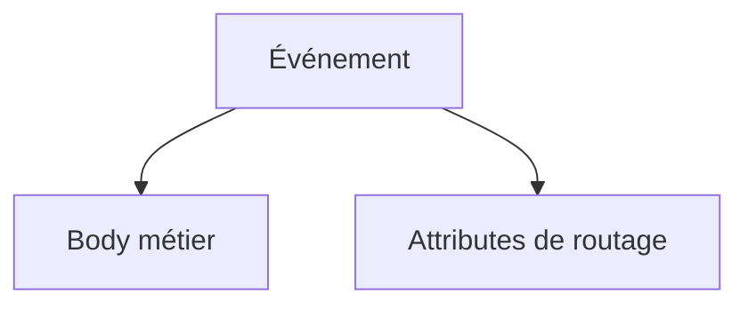

---

# 83. MessageId SNS et messageId interne

SNS retourne son propre :

```text
MessageId
```

Notre événement contient également :

```text
messageId
```

interne.

---

# 84. Pourquoi garder les deux ?

Le MessageId SNS est utile pour la trace technique AWS.

Le messageId interne est utile pour le contrat événementiel.

---

# 85. CorrelationId

Le publisher réutilise :

```text
X-Correlation-ID
```

s’il est fourni.

Sinon il génère un UUID.

---

# 86. Étape 15 - Tester directement la Lambda Publisher

Créez un événement Lambda.

Nom :

```text
test-urgent-network
```

---

# 87. Événement de test

```json
{
  "headers": {
    "x-correlation-id": "CORR-TP3-001"
  },
  "body": "{\"ticketId\":\"INC-301\",\"campus\":\"EPSI\",\"building\":\"Batiment A\",\"room\":\"A204\",\"category\":\" NETWORK \",\"priority\":\" UrGeNt \",\"description\":\"Plus de reseau.\",\"reportedBy\":{\"email\":\"etudiant@example.com\",\"role\":\"student\"}}"
}
```

---

# 88. Résultat Publisher

Attendu :

```text
statusCode = 202
```

---

# 89. Vérifier les trois queues

Après propagation des filtres :

```text
maintenance-urgent
1 message

maintenance-network
1 message

maintenance-audit
1 message
```

environ.

---

# 90. Si le résultat ne correspond pas immédiatement

Vérifiez :

- Filter Policies ;
- Queue Policies ;
- Message Attributes ;
- Raw Message Delivery ;
- délai de propagation des filtres.

---

# 91. Étape 16 - Créer API Gateway

Dans :

```text
API Gateway
```

créez une :

```text
HTTP API
```

Integration :

```text
lambda-tp3-publisher
```

Nom :

```text
api-tp3-pubsub-epsi
```

---

# 92. Route

Créez :

```text
POST /maintenance
```

---

# 93. Stage

Utilisez :

```text
$default
```

avec :

```text
Auto-deploy
```

si proposé.

---

# 94. Récupérer l’Invoke URL

Endpoint final :

```text
<INVOKE_URL>/maintenance
```

---

## Équivalent AWS CLI - optionnel

```bash
aws apigatewayv2 create-api \
  --name api-tp3-pubsub-epsi \
  --protocol-type HTTP \
  --target arn:aws:lambda:eu-west-3:ACCOUNT_ID:function:lambda-tp3-publisher \
  --region eu-west-3
```

---

# 95. Étape 17 - Test 1 urgent + network

Dans Postman :

```json
{
  "ticketId": "INC-301",
  "campus": "EPSI",
  "building": "Batiment A",
  "room": "A204",
  "category": " NETWORK ",
  "priority": " UrGeNt ",
  "description": "Plus de reseau.",
  "reportedBy": {
    "email": "etudiant@example.com",
    "role": "student"
  }
}
```

---

# 96. Header de corrélation

Ajoutez :

```text
X-Correlation-ID: CORR-POSTMAN-301
```

---

# 97. Réponse attendue

```text
202 Accepted
```

Body proche de :

```json
{
  "status": "PUBLISHED",
  "topic": "maintenance-events",
  "messageId": "...",
  "snsMessageId": "...",
  "correlationId": "CORR-POSTMAN-301",
  "ticketId": "INC-301"
}
```

---

# 98. Backlogs attendus

```text
urgent
+1

network
+1

audit
+1
```

---

# 99. Pourquoi trois copies ?

Après normalisation :

```text
priority = urgent
category = network
```

Le message correspond :

- à la Filter Policy urgent ;
- à la Filter Policy network ;
- à audit qui n’a aucun filtre.

---

# 100. Test 2 - standard + network

```json
{
  "ticketId": "INC-302",
  "campus": "EPSI",
  "building": "Batiment A",
  "room": "A205",
  "category": "network",
  "priority": "standard",
  "description": "Debit faible.",
  "reportedBy": {
    "email": "enseignant@example.com",
    "role": "teacher"
  }
}
```

---

# 101. Résultat attendu test 2

```text
maintenance-network
+1

maintenance-audit
+1

maintenance-urgent
aucune nouvelle copie
```

---

# 102. Test 3 - urgent + projector

```json
{
  "ticketId": "INC-303",
  "campus": "EPSI",
  "building": "Batiment B",
  "room": "B101",
  "category": "projector",
  "priority": "urgent",
  "description": "Videoprojecteur HS.",
  "reportedBy": {
    "email": "enseignant@example.com",
    "role": "teacher"
  }
}
```

---

# 103. Résultat attendu test 3

```text
maintenance-urgent
+1

maintenance-audit
+1

maintenance-network
aucune nouvelle copie
```

---

# 104. Test 4 - standard + projector

```json
{
  "ticketId": "INC-304",
  "campus": "EPSI",
  "building": "Batiment B",
  "room": "B102",
  "category": "projector",
  "priority": "standard",
  "description": "Cable HDMI a remplacer.",
  "reportedBy": {
    "email": "test@example.com",
    "role": "student"
  }
}
```

---

# 105. Résultat attendu test 4

Seulement :

```text
maintenance-audit
```

reçoit une nouvelle copie.

---

# 106. Matrice de filtrage

| Incident | Priority | Category | urgent | network | audit |
|---|---|---|---|---|---|
| INC-301 | urgent | network | Oui | Oui | Oui |
| INC-302 | standard | network | Non | Oui | Oui |
| INC-303 | urgent | projector | Oui | Non | Oui |
| INC-304 | standard | projector | Non | Non | Oui |

---

# 107. Ce que démontre la matrice

Un seul :

```text
sns.publish()
```

peut entraîner :

```text
0
1
2
3
```

livraisons selon les subscriptions.

Dans notre scénario audit reçoit toujours.

---

# 108. Publication unique

Le Publisher exécute :

```python
sns.publish(...)
```

une seule fois par incident.

Il ne fait pas trois `send_message()` SQS.

---

# 109. Étape 18 - Observer CloudWatch Logs Publisher

Dans :

```text
lambda-tp3-publisher
Monitor
View CloudWatch logs
```

cherchez :

```text
EVENT_PUBLISHED
```

---

# 110. Log attendu

Vous devez retrouver :

```text
snsMessageId
internalMessageId
correlationId
ticketId
priority
category
```

---

# 111. Tip observation

Le publisher peut avoir réussi alors qu’une subscription n’a pas encore reçu le message attendu.

Le debug doit donc séparer :

```text
Publish SNS
```

de :

```text
Filtering et delivery
```

---

# 112. Étape 19 - Créer le rôle consumer urgent

Créez :

```text
role-tp3-urgent
```

Trusted entity :

```text
Lambda
```

Ajoutez :

```text
AWSLambdaBasicExecutionRole
```

---

# 113. Permissions SQS urgent

Ajoutez une policy ciblée :

```json
{
  "Version": "2012-10-17",
  "Statement": [
    {
      "Effect": "Allow",
      "Action": [
        "sqs:ReceiveMessage",
        "sqs:DeleteMessage",
        "sqs:GetQueueAttributes"
      ],
      "Resource": "URGENT_QUEUE_ARN"
    }
  ]
}
```

---

# 114. Étape 20 - Créer lambda-tp3-urgent

Nom :

```text
lambda-tp3-urgent
```

Runtime :

```text
Python 3.x
```

Role :

```text
role-tp3-urgent
```

---

# 115. Code consumer urgent

Grâce à **Raw Message Delivery**, le body SQS contient directement notre événement JSON.

```python
import json


def lambda_handler(event, context):
    records = event.get("Records", [])

    for record in records:
        body = json.loads(
            record["body"]
        )

        print(
            json.dumps(
                {
                    "level": "INFO",
                    "worker": "urgent",
                    "status": "PRISE_EN_CHARGE_PRIORITAIRE",
                    "sqsMessageId": record.get(
                        "messageId"
                    ),
                    "internalMessageId": body.get(
                        "messageId"
                    ),
                    "correlationId": body.get(
                        "correlationId"
                    ),
                    "ticketId": body.get(
                        "data",
                        {},
                    ).get(
                        "ticketId"
                    ),
                    "priority": body.get(
                        "data",
                        {},
                    ).get(
                        "priority"
                    ),
                    "category": body.get(
                        "data",
                        {},
                    ).get(
                        "category"
                    ),
                    "payload": body,
                },
                ensure_ascii=False,
            )
        )

    return {
        "processed": len(records)
    }
```

Déployez.

---

# 116. Étape 21 - Ajouter trigger SQS urgent

Ajoutez un trigger :

```text
SQS
```

Queue :

```text
maintenance-urgent
```

Batch size :

```text
1
```

Enable trigger :

```text
Yes
```

---

# 117. Étape 22 - Créer role network

Créez :

```text
role-tp3-network
```

avec :

- AWSLambdaBasicExecutionRole ;
- Receive/Delete/GetQueueAttributes sur `maintenance-network`.

---

# 118. Étape 23 - Créer lambda-tp3-network

Nom :

```text
lambda-tp3-network
```

Runtime :

```text
Python 3.x
```

Role :

```text
role-tp3-network
```

---

# 119. Code consumer network

```python
import json


def lambda_handler(event, context):
    records = event.get("Records", [])

    for record in records:
        body = json.loads(
            record["body"]
        )

        print(
            json.dumps(
                {
                    "level": "INFO",
                    "worker": "network",
                    "status": "PRISE_EN_CHARGE_RESEAU",
                    "sqsMessageId": record.get(
                        "messageId"
                    ),
                    "internalMessageId": body.get(
                        "messageId"
                    ),
                    "correlationId": body.get(
                        "correlationId"
                    ),
                    "ticketId": body.get(
                        "data",
                        {},
                    ).get(
                        "ticketId"
                    ),
                    "priority": body.get(
                        "data",
                        {},
                    ).get(
                        "priority"
                    ),
                    "category": body.get(
                        "data",
                        {},
                    ).get(
                        "category"
                    ),
                    "payload": body,
                },
                ensure_ascii=False,
            )
        )

    return {
        "processed": len(records)
    }
```

---

# 120. Ajouter trigger network

Queue :

```text
maintenance-network
```

Batch size :

```text
1
```

---

# 121. Architecture avec consumers

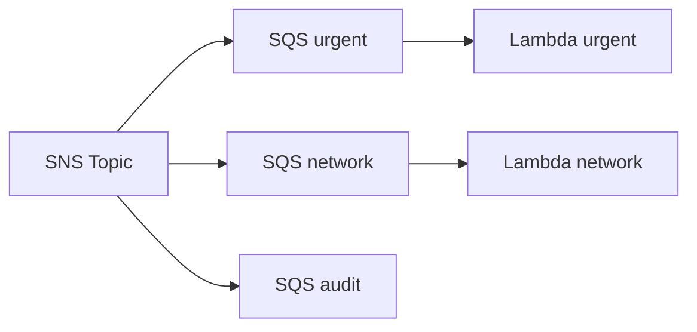

---

# 122. Pourquoi aucun consumer audit obligatoire ?

Nous voulons conserver le backlog :

```text
maintenance-audit
```

pour observer facilement que tous les messages sont reçus.

---

# 123. Bonus audit

Si vous avez le temps :

créez :

```text
lambda-tp3-audit
```

et connectez-la à :

```text
maintenance-audit
```

---

# 124. Étape 24 - Tester avec consumers actifs

Envoyez :

```text
INC-301
urgent + network
```

---

# 125. Résultat attendu

`lambda-tp3-urgent` :

```text
1 invocation
```

`lambda-tp3-network` :

```text
1 invocation
```

`maintenance-audit` :

```text
1 message reste disponible
```

si aucun consumer audit n’est actif.

---

# 126. Un événement, deux traitements

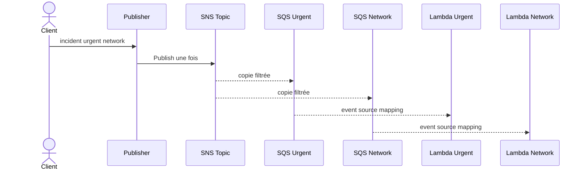

---

# 127. Question 1

La Lambda publisher a-t-elle publié deux messages ?

**Réponse :**

Non.

Elle a effectué un seul appel :

```text
sns:Publish
```

SNS a effectué la distribution.

---

# 128. Question 2

Pourquoi le modèle découple davantage le publisher ?

**Réponse :**

Parce que le publisher ne connaît pas :

- les queues ;
- les consumers ;
- le nombre d’abonnés.

Il connaît seulement :

```text
maintenance-events
```

---

# 129. Question 3

Que se passe-t-il si une nouvelle équipe veut les incidents électriques ?

**Réponse :**

On peut :

1. créer une nouvelle SQS queue ;
2. l’abonner au topic ;
3. ajouter une Filter Policy ;
4. créer son consumer.

Le publisher ne change pas.

---

# 130. C’est l’un des intérêts principaux du Pub/Sub

```text
ajouter un subscriber
```

ne nécessite pas :

```text
modifier le publisher
```

---

# 131. Étape 25 - Simuler une panne du consumer network

Désactivez l’Event Source Mapping de :

```text
lambda-tp3-network
```

Laissez urgent actif.

---

# 132. Envoyer un incident urgent + network

Envoyez un nouveau message :

```text
priority = urgent
category = network
```

---

# 133. Résultat attendu

Queue urgent :

```text
consommée
```

Queue network :

```text
message en attente
```

Queue audit :

```text
message en attente
```

---

# 134. Panne partielle

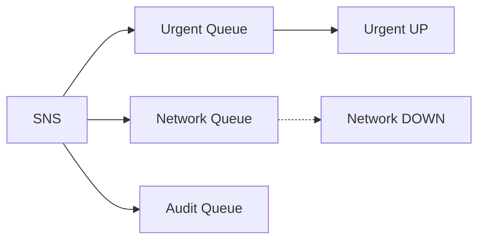

---

# 135. Question 4

La panne network bloque-t-elle urgent ?

**Réponse :**

Non.

Les queues sont indépendantes.

---

# 136. Question 5

La panne network empêche-t-elle audit de recevoir ?

**Réponse :**

Non.

SNS distribue chaque livraison selon chaque subscription indépendamment.

---

# 137. Réactiver network

Réactivez le mapping.

Le backlog network doit diminuer.

---

# 138. SQS Standard et at-least-once

Les trois queues sont des :

```text
SQS Standard Queues
```

Elles suivent un modèle :

```text
at-least-once
```

---

# 139. Conséquence

Un message peut exceptionnellement être livré plusieurs fois à un consumer.

Donc :

```text
un consumer robuste doit être idempotent
```

---

# 140. Pourquoi le TP3 doit déjà le rappeler ?

Avec fan-out, un même événement peut être traité par plusieurs branches.

Si une branche reçoit également un doublon :

```text
il faut éviter un double effet métier
```

---

# 141. Exemple futur

Consumer urgent :

```text
envoie une alerte SMS
```

Si le message est traité deux fois :

```text
deux SMS
```

peuvent partir.

L’idempotence sera étudiée plus tard.

---

# 142. Event Source Mapping SQS

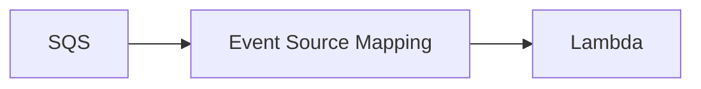

Lambda gère le polling de la queue.

---

# 143. Batch Size = 1

Nous gardons :

```text
Batch Size = 1
```

pour faciliter l’observation.

Le code garde tout de même :

```python
for record in event["Records"]:
```

afin d’être compatible avec des batchs plus grands.

---

# 144. Visibility Timeout

Pour le TP :

```text
SQS Visibility Timeout = 30 s
Lambda timeout = 3 à 5 s
```

est une configuration simple.

---

# 145. Raw Message Delivery et consumer

Grâce au mode Raw :

```python
json.loads(record["body"])
```

suffit.

---

# 146. Que se passerait-il sans Raw Message Delivery ?

Le body SQS contiendrait une enveloppe SNS.

Le consumer devrait d’abord faire :

```python
sns_envelope = json.loads(
    record["body"]
)
```

puis :

```python
event = json.loads(
    sns_envelope["Message"]
)
```

---

# 147. Pourquoi avoir choisi Raw ?

Pour que le TP se concentre sur :

- Pub/Sub ;
- filtrage ;
- fan-out ;
- backlogs.

Pas sur le décodage de l’enveloppe SNS.

---

# 148. Debug - urgent reçoit tout

Vérifiez la subscription urgent.

Si elle ne possède pas de Filter Policy :

```text
elle reçoit tous les messages
```

---

# 149. Debug - audit ne reçoit pas tout

Vérifiez qu’une Filter Policy n’a pas été ajoutée par erreur.

Pour audit :

```text
Filter Policy absente
```

---

# 150. Debug - filter correct mais résultat ancien

Rappelez-vous :

```text
propagation jusqu’à 15 minutes
```

après modification d’une Filter Policy.

---

# 151. Debug - network ne reçoit rien

Vérifiez :

1. `category` Message Attribute existe ;
2. sa valeur est `network` ;
3. la Filter Policy est `{"category":["network"]}` ;
4. la Queue Policy autorise le topic ;
5. l’endpoint de subscription est la bonne queue.

---

# 152. Debug - audit ne reçoit rien non plus

Si aucune queue ne reçoit :

vérifiez d’abord :

```text
sns.publish
```

et :

```text
Queue Policies
```

---

# 153. Debug - publisher 202 mais rien dans SQS

Le `202` indique que `sns.publish()` a réussi côté publisher.

Mais il faut encore diagnostiquer :

- subscriptions ;
- Queue Policies ;
- filtres ;
- endpoints ;
- propagation.

---

# 154. Debug - AccessDenied sns:Publish

Vérifiez :

```text
role-tp3-publisher
```

et :

```text
sns:Publish
```

sur :

```text
TOPIC_ARN
```

---

# 155. Debug - SNS ne peut pas envoyer vers SQS

Cause typique :

```text
SQS Queue Policy
```

incorrecte.

---

# 156. Queue Policy à vérifier

Elle doit contenir :

```text
Principal = sns.amazonaws.com
Action = sqs:SendMessage
Resource = ARN de la queue
Condition SourceArn = ARN du topic
```

---

# 157. Debug - mauvais endpoint

Dans la subscription SNS, vérifiez :

```text
Endpoint
```

Il doit être l’ARN de la bonne SQS queue.

---

# 158. Debug - mauvais scope de filtre

Vérifiez :

```text
FilterPolicyScope = MessageAttributes
```

---

# 159. Debug - body a urgent mais filtre ne matche pas

Le filtre du TP ne lit pas le body.

Il lit :

```text
MessageAttributes.priority
```

Vérifiez l’attribut publié.

---

# 160. Debug - faute de casse

Si la Filter Policy attend :

```text
urgent
```

mais que le Message Attribute contient :

```text
URGENT
```

le filtre ne correspond pas comme vous l’attendez.

Notre normalisation évite ce problème.

---

# 161. Debug - Lambda consumer ne démarre pas

Vérifiez :

- queue contient un message ;
- mapping **Enabled** ;
- rôle consumer ;
- même région ;
- Lambda timeout ;
- visibility timeout.

---

# 162. Debug - message revient dans la queue

Si le consumer échoue :

le message peut redevenir visible.

C’est le fonctionnement normal SQS.

---

# 163. Debug méthodique

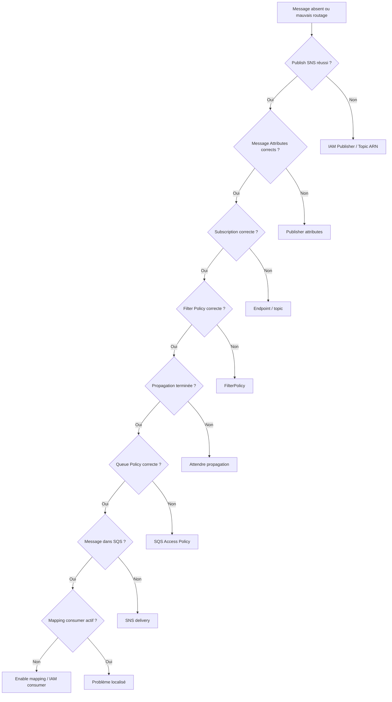

---

# 164. Tip debug

Testez d’abord le système **sans consumers**.

Les messages restent alors dans les queues et les Filter Policies sont plus faciles à vérifier.

---

# 165. Tip SNS

Ne commencez pas par une Filter Policy complexe.

Testez d’abord :

```json
{
  "priority": [
    "urgent"
  ]
}
```

---

# 166. Tip Queue Policy

Un abonnement SNS/SQS comporte deux aspects :

```text
subscription
```

et :

```text
permission de livraison
```

Ne confondez pas les deux.

---

# 167. Tip IAM

Le rôle Lambda Publisher et la Queue Policy SQS répondent à deux questions différentes.

Publisher IAM :

```text
la Lambda peut-elle publier sur SNS ?
```

Queue Policy :

```text
SNS peut-il livrer dans cette queue ?
```

---

# 168. Tip CloudWatch

Loguez des informations structurées.

Exemple :

```json
{
  "message": "EVENT_PUBLISHED",
  "correlationId": "CORR-123",
  "priority": "urgent",
  "category": "network"
}
```

---

# 169. Exercice guidé 1 - vérifier la matrice

Envoyez :

```text
INC-301
INC-302
INC-303
INC-304
```

Comparez les trois backlogs.

---

# 170. Exercice guidé 2 - nouvelle queue electrical

Créez :

```text
maintenance-electrical
```

Ajoutez sa Queue Policy.

Abonnez-la au topic.

---

# 171. Filter Policy electrical

```json
{
  "category": [
    "electricity"
  ]
}
```

---

# 172. Ce que démontre cet exercice

Vous ajoutez un nouveau subscriber sans modifier :

```text
lambda-tp3-publisher
```

---

# 173. Exercice guidé 3 - filter avec plusieurs valeurs

Créez une queue :

```text
maintenance-infrastructure
```

Filter Policy :

```json
{
  "category": [
    "network",
    "electricity"
  ]
}
```

---

# 174. OR dans une même clé

Pour une même propriété :

```json
{
  "category": [
    "network",
    "electricity"
  ]
}
```

signifie :

```text
network OU electricity
```

---

# 175. Exercice guidé 4 - AND entre plusieurs clés

Créez :

```text
maintenance-network-urgent
```

Filter Policy :

```json
{
  "priority": [
    "urgent"
  ],
  "category": [
    "network"
  ]
}
```

---

# 176. AND entre propriétés

Avec plusieurs clés, le message doit satisfaire les conditions de chaque clé.

Donc :

```text
priority urgent
ET
category network
```

---

# 177. Tester network-urgent

INC-301 :

```text
urgent + network
```

doit être livré.

INC-302 :

```text
standard + network
```

ne doit pas être livré.

---

# 178. Exercice guidé 5 - anything-but

SNS Filter Policies permettent aussi des opérateurs plus avancés.

Exemple conceptuel :

```json
{
  "category": [
    {
      "anything-but": "projector"
    }
  ]
}
```

Cette policy accepte les catégories différentes de `projector`.

---

# 179. Exercice guidé 6 - prefix

Exemple :

```json
{
  "campus": [
    {
      "prefix": "EPSI"
    }
  ]
}
```

*Exercice facultatif.*

---

# 180. Exercice guidé 7 - numeric

Ajoutez un attribut :

```text
severity
```

de type Number.

Une Filter Policy peut utiliser des comparaisons numériques.

---

# 181. Pourquoi ces filtres sont puissants ?

Ils permettent au broker de décider :

```text
qui reçoit quoi
```

sans réécrire le publisher.

---

# 182. Mais attention à la complexité

Des dizaines de subscriptions avec des policies très complexes peuvent devenir difficiles à :

- comprendre ;
- tester ;
- auditer ;
- maintenir.

---

# 183. Contrat événementiel

Les Message Attributes utilisés par les Filter Policies deviennent une partie importante du contrat.

Exemples :

```text
priority
category
eventType
campus
```

---

# 184. Changer un nom peut casser le routage

Si le publisher remplace :

```text
priority
```

par :

```text
incidentPriority
```

sans mettre à jour les Filter Policies :

```text
les subscriptions peuvent ne plus recevoir
```

---

# 185. Versionner

Le body contient :

```text
schemaVersion = 1
```

Vous pouvez également publier :

```text
schemaVersion
```

comme Message Attribute si vous voulez filtrer dessus.

---

# 186. Bonus - filter schemaVersion

Message Attribute :

```text
schemaVersion = 1
```

Filter Policy :

```json
{
  "schemaVersion": [
    "1"
  ]
}
```

---

# 187. MessageBody filtering

SNS peut également filtrer directement sur le body JSON.

Pour cela :

```text
FilterPolicyScope = MessageBody
```

---

# 188. Pourquoi ne pas l’utiliser dans le TP principal ?

Nous voulons apprendre explicitement :

```text
Message Attributes
```

et séparer :

```text
contenu métier
métadonnées de routage
```

---

# 189. MessageBody filter : bonus

Créez une subscription bonus.

Scope :

```text
MessageBody
```

Filter Policy conceptuelle :

```json
{
  "data": {
    "priority": [
      "urgent"
    ]
  }
}
```

*Vérifiez la structure réellement attendue par SNS pour votre payload.*

---

# 190. Coût du payload-based filtering

Le filtrage basé sur le body est facturé selon le volume de données analysées pour les subscriptions concernées.

Le filtrage basé sur les Message Attributes est actuellement gratuit en tant que fonctionnalité de filtrage.

---

# 191. Exercice guidé 8 - désactiver urgent consumer

Désactivez le mapping :

```text
maintenance-urgent vers lambda-tp3-urgent
```

Laissez network actif.

---

# 192. Envoyer 3 incidents urgent + network

Attendu :

```text
urgent backlog augmente
network consommé
audit backlog augmente
```

---

# 193. Indépendance des branches

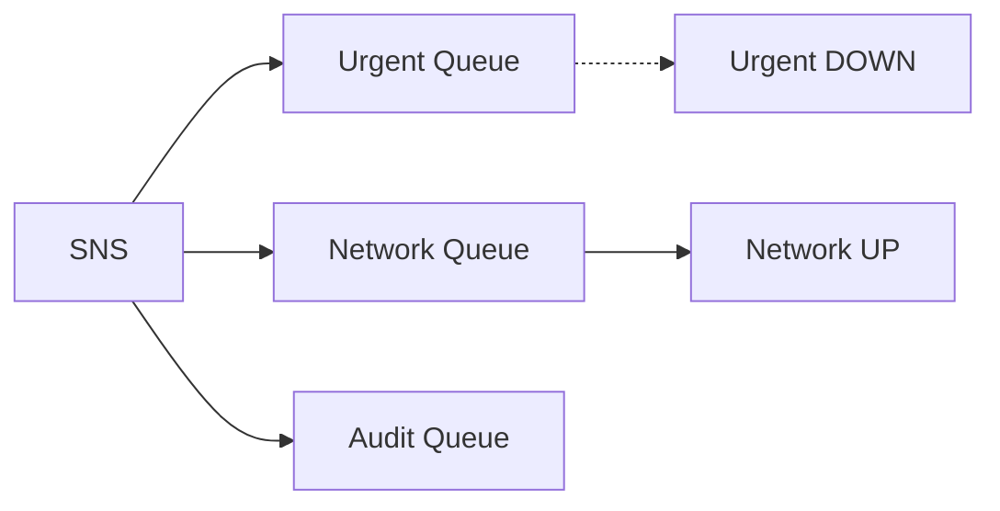

---

# 194. Question 6

La panne urgent bloque-t-elle network ?

**Réponse :**

Non.

Les queues et consumers sont indépendants.

---

# 195. Question 7

Pourquoi garder une queue entre SNS et Lambda ?

**Réponse :**

Elle apporte :

- buffering ;
- backlog ;
- reprise ;
- visibilité ;
- contrôle indépendant de consommation.

---

# 196. Question 8

Pourquoi ne pas souscrire Lambda directement à SNS ?

**Réponse :**

Ce serait possible dans d’autres architectures.

Mais nous perdrions dans ce TP le backlog SQS indépendant qui nous permet d’étudier :

- indisponibilité ;
- reprise ;
- Event Source Mapping ;
- redélivrance.

---

# 197. Question 9

Une subscription SNS stocke-t-elle elle-même un backlog SQS ?

**Réponse :**

Dans notre architecture, le backlog visible est stocké par l’endpoint :

```text
SQS queue
```

SNS réalise la distribution vers cette queue.

---

# 198. Question 10

Pourquoi audit n’a-t-il pas de filter policy ?

**Réponse :**

Parce que nous voulons qu’il reçoive tous les messages.

---

# 199. AWS CLI - rôle dans le TP3

AWS CLI reste optionnel.

Il devient utile pour :

- inspecter les subscriptions ;
- appliquer les Filter Policies ;
- vérifier Raw Message Delivery ;
- lister les queues ;
- inspecter les mappings.

---

# 200. CLI - lister les subscriptions

```bash
aws sns list-subscriptions-by-topic \
  --topic-arn "$TOPIC_ARN" \
  --region eu-west-3 \
  --output table
```

---

# 201. CLI - appliquer un filtre urgent

```bash
aws sns set-subscription-attributes \
  --subscription-arn "$URGENT_SUB_ARN" \
  --attribute-name FilterPolicy \
  --attribute-value '{"priority":["urgent"]}' \
  --region eu-west-3
```

---

# 202. CLI - choisir le scope MessageAttributes

```bash
aws sns set-subscription-attributes \
  --subscription-arn "$URGENT_SUB_ARN" \
  --attribute-name FilterPolicyScope \
  --attribute-value MessageAttributes \
  --region eu-west-3
```

---

# 203. CLI - activer Raw Message Delivery

```bash
aws sns set-subscription-attributes \
  --subscription-arn "$URGENT_SUB_ARN" \
  --attribute-name RawMessageDelivery \
  --attribute-value true \
  --region eu-west-3
```

---

# 204. CLI - supprimer une Filter Policy

Une policy vide :

```bash
aws sns set-subscription-attributes \
  --subscription-arn "$AUDIT_SUB_ARN" \
  --attribute-name FilterPolicy \
  --attribute-value '{}' \
  --region eu-west-3
```

permet de ne plus limiter les messages avec cette policy.

---

# 205. CLI - inspecter les attributs

```bash
aws sns get-subscription-attributes \
  --subscription-arn "$URGENT_SUB_ARN" \
  --region eu-west-3
```

---

# 206. CLI - publier directement sur SNS

Pour isoler SNS et les subscriptions :

```bash
aws sns publish \
  --topic-arn "$TOPIC_ARN" \
  --message '{
    "eventType":"DebugIncident",
    "schemaVersion":1,
    "messageId":"DEBUG-001",
    "correlationId":"CORR-DEBUG",
    "data":{
      "ticketId":"INC-DEBUG",
      "priority":"urgent",
      "category":"network"
    }
  }' \
  --message-attributes '{
    "priority":{
      "DataType":"String",
      "StringValue":"urgent"
    },
    "category":{
      "DataType":"String",
      "StringValue":"network"
    }
  }' \
  --region eu-west-3
```

---

# 207. Pourquoi ce test CLI est utile ?

Il contourne :

```text
API Gateway
Lambda Publisher
```

Si les trois queues reçoivent comme prévu :

```text
SNS + subscriptions + queue policies
```

fonctionnent.

---

# 208. CLI - observer backlog urgent

```bash
URGENT_QUEUE_URL=$(aws sqs get-queue-url \
  --queue-name maintenance-urgent \
  --region eu-west-3 \
  --query QueueUrl \
  --output text)

aws sqs get-queue-attributes \
  --queue-url "$URGENT_QUEUE_URL" \
  --attribute-names \
    ApproximateNumberOfMessages \
    ApproximateNumberOfMessagesNotVisible \
  --region eu-west-3
```

---

# 209. CLI - lister mappings Lambda

```bash
aws lambda list-event-source-mappings \
  --region eu-west-3 \
  --output table
```

---

# 210. Debug méthodique

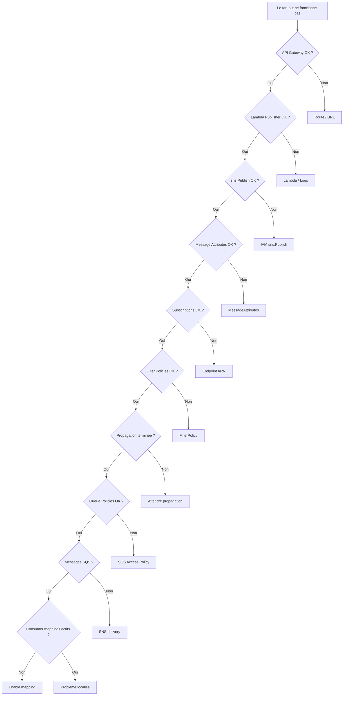

---

# 211. Tip debug

Le TP3 contient plusieurs couches de permissions :

```text
Lambda Publisher IAM
SNS Subscription
SQS Queue Policy
Lambda Consumer IAM
```

Diagnostiquez-les séparément.

---

# 212. Tip Filter Policy

Une Filter Policy qui ne correspond pas :

```text
ne produit pas forcément une erreur
```

Le message est simplement :

```text
non livré à cet abonnement
```

---

# 213. Tip propagation

Un filtre SNS modifié peut ne pas être immédiatement appliqué partout.

Gardez en tête :

```text
jusqu’à 15 minutes
```

---

# 214. Tip Queue Policy

Si aucune queue ne reçoit alors que `sns.publish()` réussit :

vérifiez rapidement :

```text
Queue Policy
```

---

# 215. Tip Raw Delivery

Si le consumer échoue sur :

```python
json.loads(record["body"])
```

vérifiez si :

```text
RawMessageDelivery = true
```

---

# 216. Tip soutenance

Si on vous demande :

*« Quelle est la différence fondamentale entre le TP2 et le TP3 AWS ? »*

répondez :

> Dans le TP2, la **Lambda routeur choisissait explicitement la SQS queue cible**. Dans le TP3, le publisher publie une seule fois sur un **SNS Topic** et **SNS distribue le message aux abonnements selon leurs Filter Policies**.

---

# 217. À retenir sur Publish/Subscribe

Le publisher ne doit pas connaître :

- le nombre de consumers ;
- leurs queues ;
- leurs traitements ;
- leur disponibilité.

---

# 218. Ajouter un subscriber

On peut ajouter :

```text
maintenance-security
maintenance-reporting
maintenance-notifications
```

sans modifier le publisher.

---

# 219. Mais attention au fan-out

100 messages publiés.

10 subscriptions sans filtre.

Potentiellement :

```text
1000 livraisons vers les endpoints
```

---

# 220. Flexibilité et coût

Le fan-out apporte de la souplesse.

Mais plus de subscriptions signifie potentiellement :

- plus de livraisons ;
- plus de messages SQS ;
- plus d’invocations Lambda ;
- plus de logs.

---

# 221. Observabilité

Avec plusieurs branches, **correlationId** devient encore plus important.

Il permet de chercher le même événement dans :

- Publisher logs ;
- Urgent consumer logs ;
- Network consumer logs ;
- autres branches futures.

---

# 222. Contrat des Message Attributes

Les noms suivants deviennent une partie du contrat :

```text
priority
category
eventType
campus
correlationId
```

---

# 223. Attention aux changements

Si vous renommez :

```text
priority
```

en :

```text
incidentPriority
```

sans modifier les Filter Policies :

```text
le routage urgent casse
```

---

# 224. Filter Policy avec plusieurs valeurs

```json
{
  "category": [
    "network",
    "electricity"
  ]
}
```

signifie un OR sur les valeurs.

---

# 225. Filter Policy avec plusieurs clés

```json
{
  "priority": [
    "urgent"
  ],
  "category": [
    "network"
  ]
}
```

applique une logique AND entre les propriétés.

---

# 226. Contraintes de Filter Policy

SNS impose des limites sur les Filter Policies.

Par exemple, une policy ne peut actuellement contenir qu’un nombre limité de clés.

Pour ce TP, nos filtres restent très petits.

---

# 227. Ne transformez pas SNS en moteur métier

Évitez de placer toutes vos règles métier dans les Filter Policies.

SNS doit principalement réaliser :

```text
distribution événementielle
```

---

# 228. Bonne répartition des responsabilités

**Lambda Publisher** :

- valide ;
- normalise ;
- construit l’événement ;
- publie.

**SNS** :

- filtre ;
- distribue.

**SQS** :

- bufferise ;
- conserve le backlog.

**Lambda Consumer** :

- traite.

---

# 229. Diagramme des responsabilités

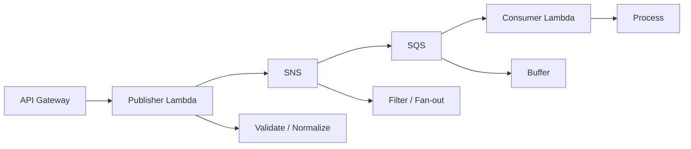

---

# 230. Cleanup - important

À la fin du TP, supprimez les ressources si l’enseignant l’autorise.

---

# 231. Ressources à supprimer

- API Gateway HTTP API ;
- Lambda Publisher ;
- Lambda urgent ;
- Lambda network ;
- Event Source Mappings ;
- SNS subscriptions ;
- SNS topic ;
- trois SQS queues ;
- rôles IAM créés pour le TP.

---

# 232. Ordre conseillé

1. désactiver / supprimer les Event Source Mappings ;
2. supprimer API Gateway ;
3. supprimer les Lambda ;
4. supprimer les SNS subscriptions ;
5. supprimer les SQS queues ;
6. supprimer le SNS topic ;
7. supprimer les rôles IAM du TP.

---

# 233. Ne supprimez pas un rôle EPSI partagé

Si vous utilisez :

```text
LabRole
StudentRole
```

ou un rôle fourni par l’établissement :

**ne le supprimez jamais.**

---

# 234. CLI - supprimer une subscription

```bash
aws sns unsubscribe \
  --subscription-arn "$URGENT_SUB_ARN" \
  --region eu-west-3
```

---

# 235. CLI - supprimer le topic

```bash
aws sns delete-topic \
  --topic-arn "$TOPIC_ARN" \
  --region eu-west-3
```

---

# 236. CLI - supprimer une queue

```bash
aws sqs delete-queue \
  --queue-url "$URGENT_QUEUE_URL" \
  --region eu-west-3
```

---

# 237. CLI - supprimer une Lambda

```bash
aws lambda delete-function \
  --function-name lambda-tp3-publisher \
  --region eu-west-3
```

---

# 238. Tips de fin de TP

Retenez :

1. **SQS correspond au point-to-point.**
2. **SNS correspond au publish/subscribe.**
3. **Un Publish SNS peut alimenter plusieurs endpoints.**
4. **Les Filter Policies contrôlent la distribution.**
5. **Sans Filter Policy, une subscription reçoit tous les messages.**
6. **MessageAttributes est le scope de filtrage choisi dans ce TP.**
7. **Le body métier et les attributes de routage ont des rôles différents.**
8. **Raw Message Delivery simplifie le consumer SQS.**
9. **Une SQS Queue Policy doit autoriser SNS à envoyer.**
10. **Chaque queue possède son propre backlog.**
11. **Une panne d’un consumer ne bloque pas les autres.**
12. **Le publisher ne doit pas connaître tous les subscribers.**
13. **Les Filter Policies peuvent demander un délai de propagation.**
14. **SQS Standard implique at-least-once.**
15. **Nettoyez les ressources cloud à la fin.**

---

# 239. Checklist finale

- [ ] J’ai choisi une seule région AWS.
- [ ] J’ai créé le topic `maintenance-events`.
- [ ] J’ai créé `maintenance-urgent`.
- [ ] J’ai créé `maintenance-network`.
- [ ] J’ai créé `maintenance-audit`.
- [ ] J’ai récupéré les ARN des queues.
- [ ] J’ai configuré les trois Queue Policies.
- [ ] Les Queue Policies autorisent uniquement le topic attendu.
- [ ] J’ai créé la subscription urgent.
- [ ] J’ai activé Raw Message Delivery urgent.
- [ ] J’ai ajouté la Filter Policy urgent.
- [ ] J’ai créé la subscription network.
- [ ] J’ai activé Raw Message Delivery network.
- [ ] J’ai ajouté la Filter Policy network.
- [ ] J’ai créé la subscription audit.
- [ ] J’ai activé Raw Message Delivery audit.
- [ ] Audit n’a pas de Filter Policy.
- [ ] Je sais expliquer MessageAttributes.
- [ ] Je sais expliquer MessageBody filtering.
- [ ] Je sais expliquer la propagation des Filter Policies.
- [ ] J’ai créé le rôle publisher.
- [ ] Le publisher possède uniquement `sns:Publish` sur le topic.
- [ ] J’ai créé `lambda-tp3-publisher`.
- [ ] J’ai configuré `TOPIC_ARN`.
- [ ] J’ai validé le JSON.
- [ ] J’ai normalisé priority.
- [ ] J’ai normalisé category.
- [ ] J’ai créé un événement interne.
- [ ] J’ai ajouté un messageId interne.
- [ ] J’ai propagé un correlationId.
- [ ] J’ai publié des Message Attributes.
- [ ] J’ai créé API Gateway HTTP API.
- [ ] J’ai créé `POST /maintenance`.
- [ ] J’ai testé INC-301.
- [ ] J’ai observé les trois copies.
- [ ] J’ai testé INC-302.
- [ ] J’ai testé INC-303.
- [ ] J’ai testé INC-304.
- [ ] J’ai créé `lambda-tp3-urgent`.
- [ ] J’ai créé `lambda-tp3-network`.
- [ ] J’ai créé les Event Source Mappings.
- [ ] J’ai simulé une panne partielle.
- [ ] Je sais expliquer SNS vs SQS.
- [ ] Je sais expliquer Queue Policy vs IAM Role.
- [ ] Je sais expliquer Raw Message Delivery.
- [ ] Je sais expliquer at-least-once.
- [ ] Je sais expliquer le fan-out.
- [ ] J’ai nettoyé les ressources à la fin.

---

# 240. Résumé final

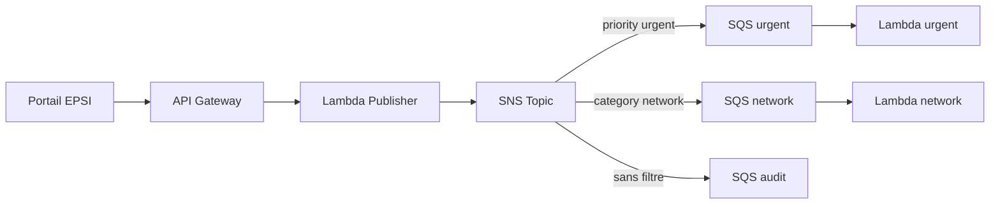

Le point essentiel du TP3 est :

> **Le Publish/Subscribe permet à un publisher de publier un événement une seule fois, puis à Amazon SNS de distribuer ce message vers plusieurs abonnés indépendants selon leurs Filter Policies. SQS ajoute ensuite un backlog durable devant chaque consumer.**

---

# 241. Références AWS

Documentation utile :

- **Amazon SNS message filtering** :  
  `https://docs.aws.amazon.com/sns/latest/dg/sns-message-filtering.html`

- **SNS subscription filter policies** :  
  `https://docs.aws.amazon.com/sns/latest/dg/sns-subscription-filter-policies.html`

- **Filter Policy Scope** :  
  `https://docs.aws.amazon.com/sns/latest/dg/sns-message-filtering-scope.html`

- **Appliquer une Filter Policy** :  
  `https://docs.aws.amazon.com/sns/latest/dg/message-filtering-apply.html`

- **SNS Message Attributes** :  
  `https://docs.aws.amazon.com/sns/latest/dg/sns-message-attributes.html`

- **Souscrire une SQS Queue à un SNS Topic** :  
  `https://docs.aws.amazon.com/sns/latest/dg/subscribe-sqs-queue-to-sns-topic.html`

- **Créer une SNS Subscription** :  
  `https://docs.aws.amazon.com/sns/latest/dg/sns-create-subscribe-endpoint-to-topic.html`

- **Lambda avec SQS** :  
  `https://docs.aws.amazon.com/lambda/latest/dg/with-sqs.html`

- **Configuration SQS Event Source Mapping** :  
  `https://docs.aws.amazon.com/lambda/latest/dg/services-sqs-configure.html`

- **SQS Standard at-least-once** :  
  `https://docs.aws.amazon.com/AWSSimpleQueueService/latest/SQSDeveloperGuide/standard-queues-at-least-once-delivery.html`

- **Tarification SNS** :  
  `https://aws.amazon.com/sns/pricing/`

- **Tarification SQS** :  
  `https://aws.amazon.com/sqs/pricing/`

- **AWS Free Tier** :  
  `https://aws.amazon.com/free/`
