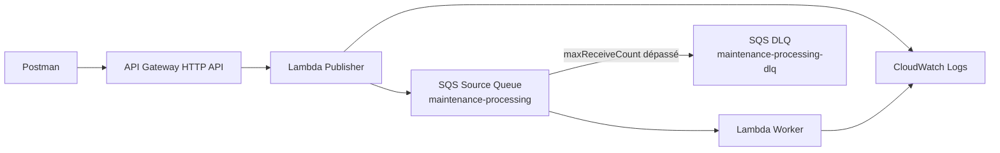
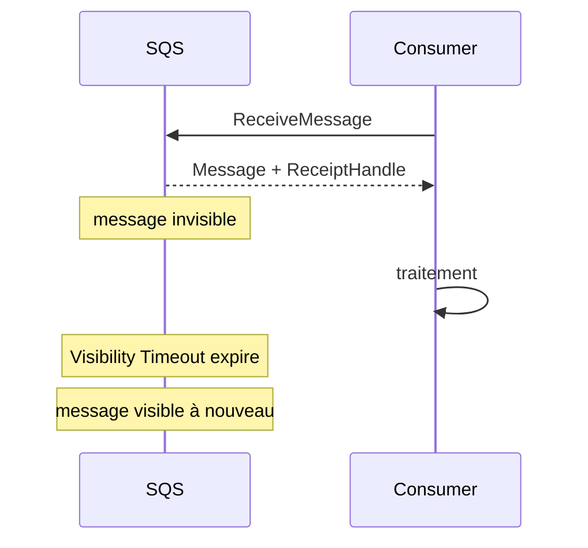
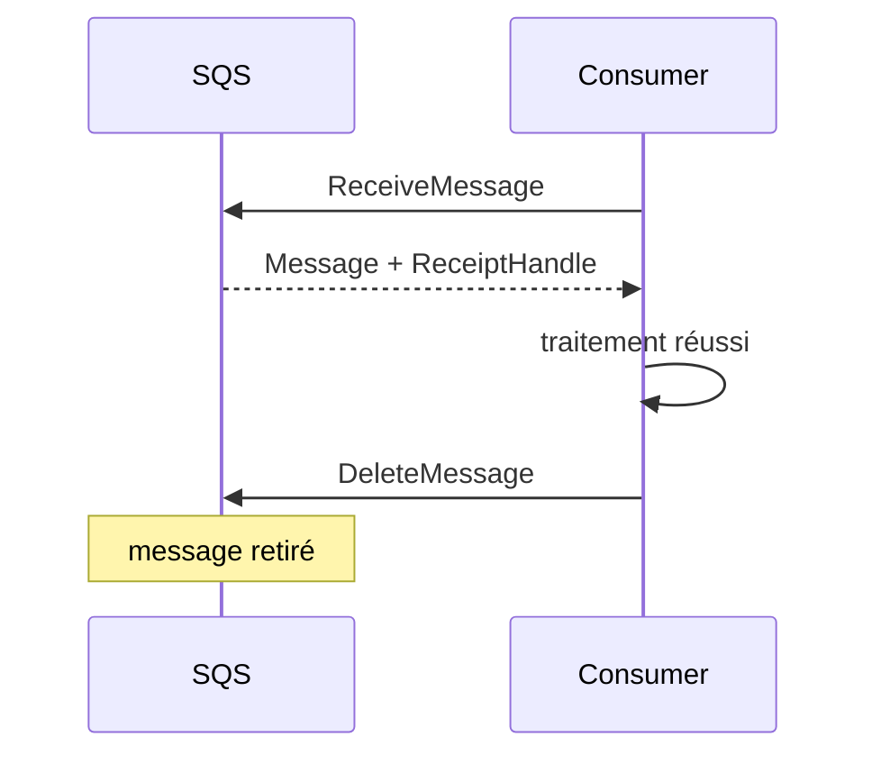
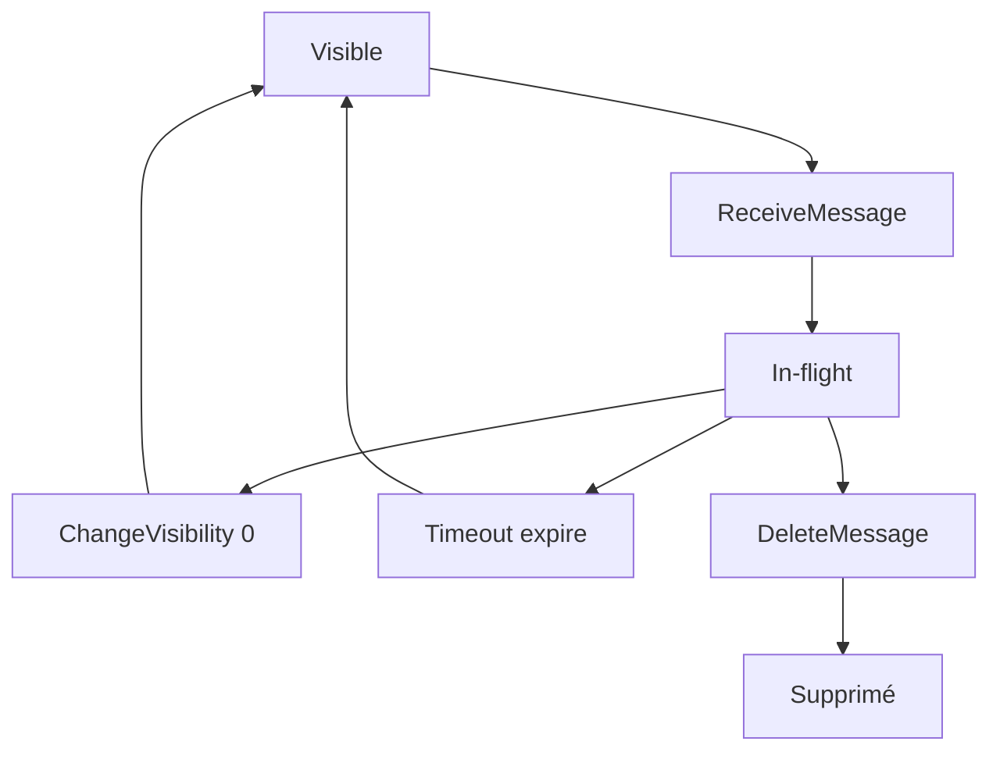
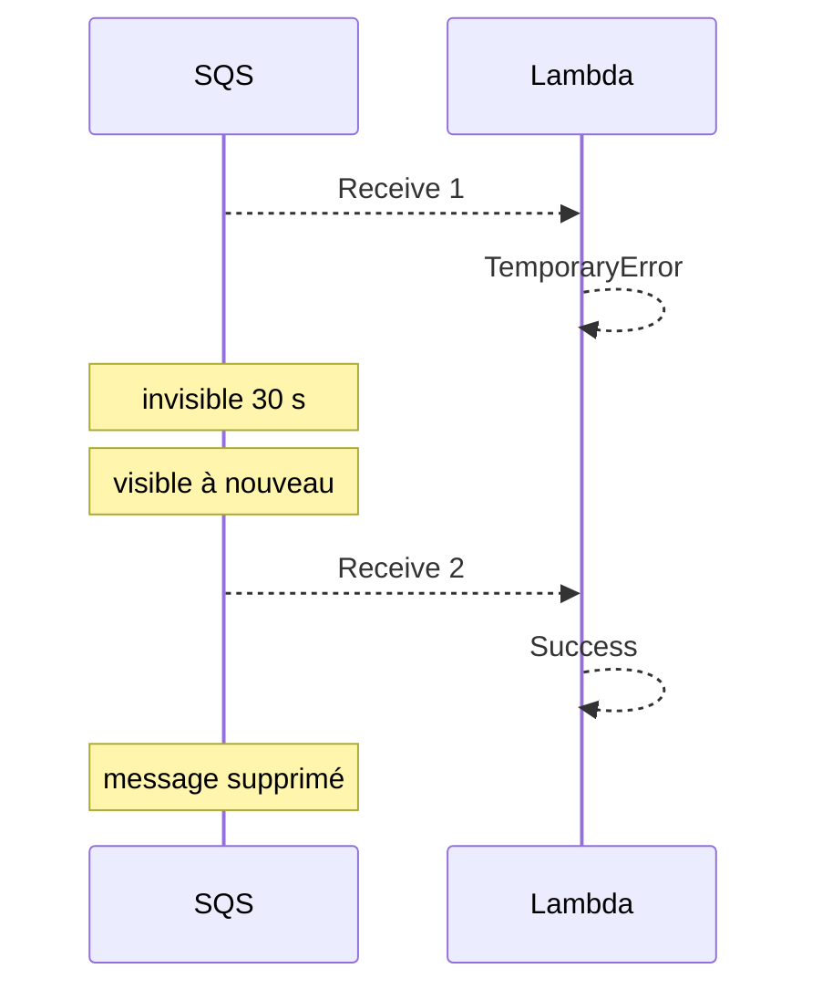
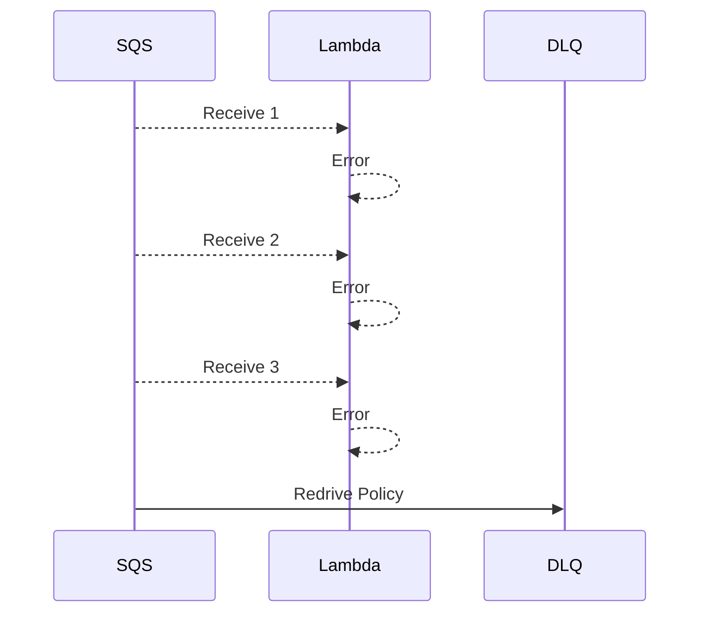
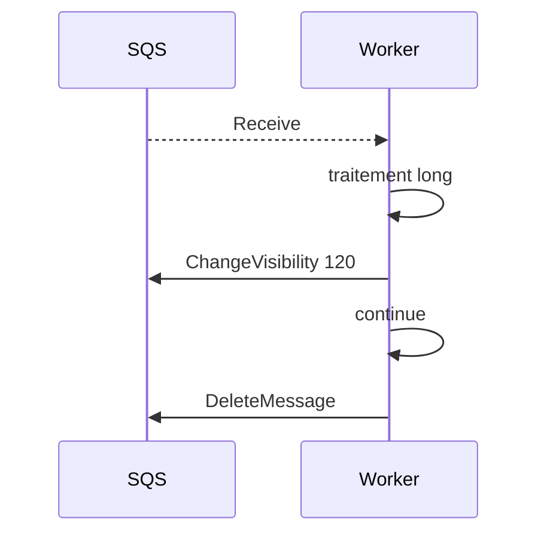
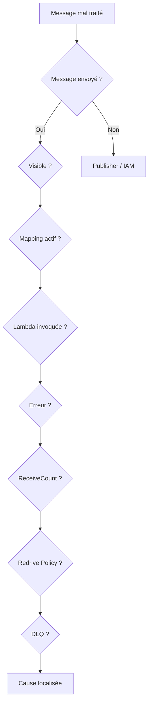
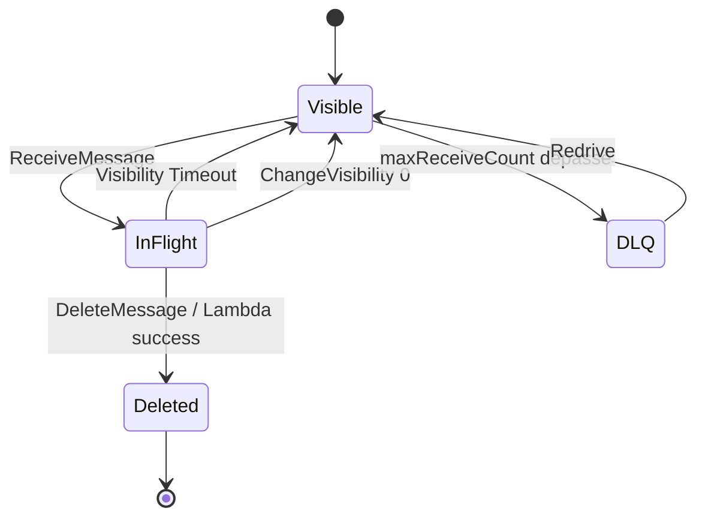
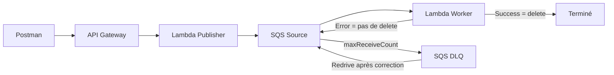

# TP 4 - Fiabilité des traitements avec Amazon SQS : Visibility Timeout, DeleteMessage, retries et Dead-Letter Queue - EPSI

**Niveau :** *intermédiaire à avancé*  
**Durée indicative :** *3 h à 4 h*  
**Mode principal :** **Console AWS**  
**Mode secondaire :** *AWS CLI, uniquement en option et à titre de comparaison*  
**Architecture :** **Amazon API Gateway HTTP API**, **AWS Lambda**, **Amazon SQS Standard**, **Visibility Timeout**, **ReceiptHandle**, **ChangeMessageVisibility**, **Dead-Letter Queue**, **Redrive Policy**, **CloudWatch Logs** et **IAM**  
**Public visé :** *étudiants EPSI disposant d’un compte AWS personnel, d’un compte AWS Free Tier ou d’un environnement AWS fourni par l’établissement.*

---

# 1. Objectifs du TP

À la fin de ce TP, vous devez être capables de :

- comprendre pourquoi **recevoir un message** ne signifie pas qu’il est traité ;
- comprendre les trois états principaux d’un message SQS :
  - envoyé ;
  - reçu ;
  - supprimé ;
- comprendre le **Visibility Timeout** ;
- comprendre la différence entre :
  - message visible ;
  - message *in-flight* ;
- comprendre le rôle du **ReceiptHandle** ;
- utiliser **ReceiveMessage** ;
- utiliser **DeleteMessage** ;
- utiliser **ChangeMessageVisibility** ;
- rendre un message immédiatement visible avec :
  - `VisibilityTimeout = 0` ;
- comprendre l’équivalent conceptuel AWS de :
  - `Complete` ;
  - `Abandon` ;
- comprendre qu’Amazon SQS ne possède pas une opération native :
  - `DeadLetter(message)` ;
- créer une **Dead-Letter Queue** ;
- associer une DLQ avec une **Redrive Policy** ;
- configurer `maxReceiveCount` ;
- comprendre `ApproximateReceiveCount` ;
- provoquer une redélivrance ;
- provoquer le passage d’un **poison message** vers la DLQ ;
- utiliser **Start DLQ redrive** ;
- corriger un problème avant de redriver ;
- comprendre les limites d’un redrive automatique ;
- créer une Lambda productrice ;
- créer une Lambda consommatrice ;
- connecter SQS à Lambda avec un **Event Source Mapping** ;
- configurer :
  - `Batch Size = 1` ;
- comprendre pourquoi le TP4 n’utilise pas encore :
  - Partial Batch Response ;
- comprendre le comportement Lambda sur succès ;
- comprendre le comportement Lambda sur erreur ;
- comprendre pourquoi un message peut être reçu plusieurs fois ;
- comprendre la sémantique **at-least-once** ;
- comprendre le risque de **double effet métier** ;
- comprendre pourquoi l’**idempotence** sera nécessaire dans le TP5 ;
- comprendre la relation entre :
  - Lambda timeout ;
  - SQS Visibility Timeout ;
- utiliser la recommandation :
  - Visibility Timeout au moins égal à six fois le timeout Lambda ;
- simuler :
  - succès ;
  - erreur temporaire ;
  - erreur permanente ;
- utiliser **CloudWatch Logs** pour observer :
  - MessageId ;
  - ApproximateReceiveCount ;
  - Lambda RequestId ;
- diagnostiquer :
  - AccessDenied ;
  - messages non consommés ;
  - messages redélivrés ;
  - Visibility Timeout trop court ;
  - DLQ vide ;
- utiliser AWS CLI uniquement comme *équivalent optionnel*.

---

# 2. Position du TP4 dans la progression

Le TP1 AWS a introduit :

```text
API Gateway
Lambda
SQS
Producteur
Consommateur
```

Le TP2 AWS a ajouté :

```text
Transformation
Normalisation
Routage
Plusieurs queues
```

Le TP3 AWS a ajouté :

```text
SNS
Publish/Subscribe
Filter Policies
Fan-out
```

Le TP4 s’intéresse maintenant à une question différente :

```text
Que se passe-t-il quand le traitement d'un message échoue ?
```

---

# 3. Idée principale

Dans les TP précédents, nous avons surtout vérifié :

```text
le message arrive
```

Dans ce TP, nous allons vérifier :

```text
le message a-t-il réellement été traité ?
```

---

# 4. Scénario métier

EPSI dispose d’un flux de maintenance.

Une demande est envoyée dans :

```text
maintenance-processing
```

La Lambda consommatrice doit simuler trois situations :

```text
success
temporary_error
permanent_error
```

---

# 5. Signification des scénarios

## success

Le traitement métier réussit.

Avec une intégration :

```text
SQS -> Lambda
```

si la Lambda termine avec succès, Lambda supprime le message de SQS.

---

## temporary_error

Le problème est supposé temporaire.

Exemples :

- API momentanément indisponible ;
- timeout ;
- panne réseau ;
- service occupé.

La Lambda échoue.

Le message reste *in-flight* jusqu’à expiration du Visibility Timeout, puis il redevient visible.

---

## permanent_error

Le message ne peut pas être traité correctement.

La Lambda échoue à chaque tentative.

Après plusieurs réceptions :

```text
maxReceiveCount
```

SQS déplace le message vers la :

```text
Dead-Letter Queue
```

---

# 6. Architecture générale



---

# 7. Différence importante avec Azure Service Bus

Dans le TP4 Azure, nous avions :

```text
Complete
Abandon
Dead-letter
```

Avec Amazon SQS, la mécanique est différente.

---

# 8. Equivalences conceptuelles

| Azure Service Bus | Amazon SQS |
|---|---|
| Peek-Lock | Receive + Visibility Timeout |
| Complete | DeleteMessage |
| Abandon | ChangeMessageVisibility à 0 ou attendre l’expiration |
| Dead-letter explicite | pas d’équivalent natif direct |
| Delivery Count | ApproximateReceiveCount |
| Max Delivery Count | maxReceiveCount |
| DLQ système | vraie queue SQS séparée |

---

# 9. Point essentiel

Amazon SQS n’a pas une opération :

```text
DeadLetterThisMessage
```

La DLQ est alimentée automatiquement lorsque la **Redrive Policy** considère que le message a été reçu trop de fois sans traitement réussi.

---

# 10. Les trois états fondamentaux d’un message SQS

Un message passe conceptuellement par :

```text
Sent
Received
Deleted
```

---

# 11. Sent

Le message existe dans la queue et est visible.

Un consumer peut le recevoir.

---

# 12. Received

Quand un consumer reçoit le message :

```text
le message n'est pas supprimé
```

Il devient temporairement :

```text
invisible
```

---

# 13. In-flight

Pendant le Visibility Timeout :

```text
le message est in-flight
```

Il existe toujours dans SQS, mais n’est normalement pas livré à un autre consumer.

---

# 14. Deleted

Le consumer confirme le succès en supprimant le message.

Manuellement :

```text
DeleteMessage
```

Avec Lambda :

```text
suppression automatique après succès de l'invocation
```

---

# 15. Visibility Timeout

Le **Visibility Timeout** correspond à la durée pendant laquelle un message reçu reste invisible aux autres consumers.

---

# 16. Valeur par défaut

Pour une queue SQS standard :

```text
30 secondes
```

est la valeur par défaut.

---

# 17. Valeur maximale

Le Visibility Timeout peut aller jusqu’à :

```text
12 heures
```

---

# 18. Que se passe-t-il si le consumer ne supprime pas le message ?

Après expiration :

```text
le message redevient visible
```

et peut être reçu à nouveau.

---

# 19. Diagramme



---

# 20. Succès



---

# 21. ReceiptHandle

Lors de la réception, SQS retourne un :

```text
ReceiptHandle
```

---

# 22. A quoi sert le ReceiptHandle ?

Il identifie :

```text
cette réception du message
```

Il est utilisé notamment pour :

- supprimer le message ;
- modifier sa visibilité.

---

# 23. Ne pas confondre

```text
MessageId
```

identifie le message.

```text
ReceiptHandle
```

identifie une réception particulière du message.

---

# 24. MessageId et ReceiptHandle

Un message redélivré peut garder le même :

```text
MessageId
```

mais obtenir un nouveau :

```text
ReceiptHandle
```

---

# 25. DeleteMessage

Pour confirmer manuellement un succès :

```text
DeleteMessage
```

avec :

```text
QueueUrl
ReceiptHandle
```

---

# 26. Equivalent conceptuel de Complete

Dans ce TP :

```text
DeleteMessage
```

joue conceptuellement le rôle de :

```text
Complete
```

---

# 27. ChangeMessageVisibility

SQS permet de modifier le Visibility Timeout d’un message déjà reçu.

---

# 28. Retry immédiat

Avec :

```text
VisibilityTimeout = 0
```

le message redevient immédiatement visible.

---

# 29. Equivalent conceptuel de Abandon

Dans le TP manuel :

```text
ChangeMessageVisibility = 0
```

joue le rôle pédagogique de :

```text
Abandon
```

---

# 30. Mais avec Lambda ?

Quand Lambda échoue :

```text
le message n'est pas supprimé
```

Il redevient visible après le Visibility Timeout.

---

# 31. Pourquoi ne pas mettre toujours VisibilityTimeout = 0 ?

Parce que vous pourriez créer :

```text
une boucle de retry très agressive
```

et surcharger le système en panne.

---

# 32. ApproximateReceiveCount

SQS peut indiquer :

```text
ApproximateReceiveCount
```

---

# 33. Signification

Ce compteur représente approximativement :

```text
le nombre de réceptions du message
```

---

# 34. Avec Lambda

Dans l’événement reçu par Lambda :

```python
record["attributes"]["ApproximateReceiveCount"]
```

permet de récupérer ce compteur.

---

# 35. Dead-Letter Queue

Une DLQ SQS est :

```text
une vraie queue séparée
```

---

# 36. Contrairement à Azure

Azure Service Bus utilise une sous-file système.

SQS utilise :

```text
une queue créée explicitement
```

---

# 37. Redrive Policy

La queue source possède une :

```text
Redrive Policy
```

qui contient notamment :

```text
deadLetterTargetArn
maxReceiveCount
```

---

# 38. maxReceiveCount

Ce paramètre indique combien de réceptions sont autorisées avant déplacement vers la DLQ.

---

# 39. Valeur pédagogique du TP

Nous utiliserons :

```text
maxReceiveCount = 3
```

---

# 40. Pourquoi 3 ?

Pour rendre le passage en DLQ visible pendant une séance.

---

# 41. Recommandation AWS et valeur du TP

AWS recommande souvent une valeur d’au moins :

```text
5
```

pour un Event Source Mapping Lambda/SQS afin de laisser plusieurs chances au traitement.

Dans ce TP, nous utilisons volontairement :

```text
3
```

pour accélérer l’observation.

---

# 42. Poison Message

Un message qui échoue systématiquement est souvent appelé :

```text
poison message
```

---

# 43. Pourquoi une DLQ ?

Pour éviter qu’un poison message :

- soit retenté indéfiniment ;
- pollue les logs ;
- consomme des invocations ;
- masque d’autres problèmes.

---

# 44. DLQ n’est pas une poubelle

Une équipe doit :

- surveiller la DLQ ;
- analyser les messages ;
- corriger les causes ;
- décider si un redrive est pertinent.

---

# 45. Redrive

Après correction :

```text
Start DLQ redrive
```

permet de remettre les messages dans la queue source ou vers une destination compatible.

---

# 46. Attention

Ne faites pas un redrive si la cause n’est pas corrigée.

Sinon :

```text
le message échouera encore
```

---

# 47. Relation Lambda timeout / Visibility Timeout

AWS recommande avec une source SQS :

```text
Visibility Timeout >= 6 x Lambda timeout
```

---

# 48. Valeurs du TP

Lambda worker :

```text
Timeout = 5 secondes
```

SQS :

```text
Visibility Timeout = 30 secondes
```

---

# 49. Calcul

```text
6 x 5 = 30
```

---

# 50. Pourquoi ?

Pour laisser de la marge au système lorsque Lambda doit retenter ou subit du throttling.

---

# 51. Batch Size

Dans ce TP :

```text
Batch Size = 1
```

---

# 52. Pourquoi ?

Nous voulons étudier :

```text
la vie d'un seul message
```

sans introduire encore la complexité des batchs.

---

# 53. Partial Batch Response

Elle sera étudiée dans :

```text
TP5 AWS
```

---

# 54. Ressources du TP

```text
SQS
maintenance-processing
maintenance-processing-dlq

Lambda
lambda-tp4-publisher
lambda-tp4-worker

API Gateway
api-tp4-resilience-epsi

Route
POST /maintenance-events
```

---

# 55. Région

Exemple :

```text
Europe (Paris)
eu-west-3
```

Utilisez la même région pour toutes les ressources.

---

# 56. Etape 1 - Créer la DLQ

Console AWS :

```text
SQS
Create queue
```

Type :

```text
Standard
```

Nom :

```text
maintenance-processing-dlq
```

---

# 57. Pourquoi créer la DLQ en premier ?

Parce que la queue source doit référencer son ARN dans sa Redrive Policy.

---

# 58. Créer

Cliquez :

```text
Create queue
```

---

# 59. Récupérer l’ARN

Ouvrez :

```text
maintenance-processing-dlq
```

Copiez :

```text
ARN
```

---

## AWS CLI - optionnel

### Linux / macOS

```bash
DLQ_URL=$(aws sqs create-queue \
  --queue-name maintenance-processing-dlq \
  --region eu-west-3 \
  --query QueueUrl \
  --output text)
```

```bash
DLQ_ARN=$(aws sqs get-queue-attributes \
  --queue-url "$DLQ_URL" \
  --attribute-names QueueArn \
  --region eu-west-3 \
  --query Attributes.QueueArn \
  --output text)
```

---

### Windows PowerShell

```powershell
$DLQ_URL = aws sqs create-queue `
  --queue-name maintenance-processing-dlq `
  --region eu-west-3 `
  --query QueueUrl `
  --output text
```

```powershell
$DLQ_ARN = aws sqs get-queue-attributes `
  --queue-url $DLQ_URL `
  --attribute-names QueueArn `
  --region eu-west-3 `
  --query Attributes.QueueArn `
  --output text
```

---

# 60. Etape 2 - Créer la source queue

Dans SQS :

```text
Create queue
```

Type :

```text
Standard
```

Nom :

```text
maintenance-processing
```

---

# 61. Visibility Timeout

Configurez :

```text
30 seconds
```

---

# 62. Dead-letter queue

Activez :

```text
Dead-letter queue
```

Sélectionnez :

```text
maintenance-processing-dlq
```

---

# 63. Maximum receives

Configurez :

```text
3
```

---

# 64. Créer

Cliquez :

```text
Create queue
```

---

# 65. Vérifier

Dans les détails :

```text
Visibility timeout = 30
Dead-letter queue = maintenance-processing-dlq
Maximum receives = 3
```

---

# 66. CLI source queue - Linux / macOS

```bash
SOURCE_URL=$(aws sqs create-queue \
  --queue-name maintenance-processing \
  --attributes VisibilityTimeout=30 \
  --region eu-west-3 \
  --query QueueUrl \
  --output text)
```

Appliquer la Redrive Policy :

```bash
aws sqs set-queue-attributes \
  --queue-url "$SOURCE_URL" \
  --attributes "RedrivePolicy={\"deadLetterTargetArn\":\"$DLQ_ARN\",\"maxReceiveCount\":\"3\"}" \
  --region eu-west-3
```

---

# 67. CLI source queue - PowerShell

```powershell
$SOURCE_URL = aws sqs create-queue `
  --queue-name maintenance-processing `
  --attributes VisibilityTimeout=30 `
  --region eu-west-3 `
  --query QueueUrl `
  --output text
```

---

# 68. Etape 3 - Expérience manuelle avant Lambda

Avant d’automatiser, nous allons comprendre SQS sans Lambda.

---

# 69. Envoyer un message manuellement

Ouvrez :

```text
maintenance-processing
Send and receive messages
```

Dans **Message body** :

```json
{
  "eventId": "EVT-MANUAL-1",
  "simulateResult": "success"
}
```

Cliquez :

```text
Send message
```

---

# 70. Observer Available messages

La queue doit contenir environ :

```text
1 message available
```

---

# 71. Poll for messages

Cliquez :

```text
Poll for messages
```

---

# 72. Que se passe-t-il ?

Le message est reçu.

Il n’est pas encore supprimé.

Il devient :

```text
in-flight
```

---

# 73. Attendre 30 secondes

Ne supprimez pas le message.

Après expiration du Visibility Timeout :

```text
il redevient visible
```

---

# 74. Poll une deuxième fois

Le même message peut être reçu à nouveau.

---

# 75. Que devons-nous observer ?

```text
ApproximateReceiveCount
```

doit augmenter.

---

# 76. Attention console

Les compteurs SQS sont :

```text
approximatifs
```

et l’interface peut avoir un léger délai d’actualisation.

---

# 77. Expérience CLI plus précise

Envoyez :

```bash
aws sqs send-message \
  --queue-url "$SOURCE_URL" \
  --message-body '{"eventId":"EVT-CLI-MANUAL","simulateResult":"success"}' \
  --region eu-west-3
```

---

# 78. ReceiveMessage CLI

```bash
aws sqs receive-message \
  --queue-url "$SOURCE_URL" \
  --attribute-names All \
  --message-attribute-names All \
  --max-number-of-messages 1 \
  --region eu-west-3
```

---

# 79. Résultat

Repérez :

```text
MessageId
ReceiptHandle
Attributes.ApproximateReceiveCount
Body
```

---

# 80. ReceiptHandle

Copiez le `ReceiptHandle`.

Il sera utilisé pour :

```text
DeleteMessage
```

ou :

```text
ChangeMessageVisibility
```

---

# 81. Expérience Abandon conceptuel

Recevez un message.

Puis :

```bash
aws sqs change-message-visibility \
  --queue-url "$SOURCE_URL" \
  --receipt-handle "RECEIPT_HANDLE" \
  --visibility-timeout 0 \
  --region eu-west-3
```

---

# 82. Résultat

Le message redevient visible immédiatement.

---

# 83. Pourquoi ?

Nous avons changé sa visibilité à :

```text
0 seconde
```

---

# 84. Expérience Complete conceptuel

Recevez le message à nouveau.

Copiez son **nouveau ReceiptHandle**.

Puis :

```bash
aws sqs delete-message \
  --queue-url "$SOURCE_URL" \
  --receipt-handle "NOUVEAU_RECEIPT_HANDLE" \
  --region eu-west-3
```

---

# 85. Résultat

Le message est supprimé.

---

# 86. Pourquoi utiliser le nouveau ReceiptHandle ?

Une nouvelle réception fournit un nouveau ReceiptHandle.

Travaillez toujours avec celui de la réception courante.

---

# 87. Résumé manuel



---

# 88. Etape 4 - Créer le rôle Publisher

IAM :

```text
Create role
```

Trusted entity :

```text
Lambda
```

Nom :

```text
role-tp4-publisher
```

---

# 89. Logs Publisher

Ajoutez :

```text
AWSLambdaBasicExecutionRole
```

---

# 90. Permission SQS

Ajoutez une inline policy :

```json
{
  "Version": "2012-10-17",
  "Statement": [
    {
      "Effect": "Allow",
      "Action": [
        "sqs:SendMessage"
      ],
      "Resource": "SOURCE_QUEUE_ARN"
    }
  ]
}
```

---

# 91. Etape 5 - lambda-tp4-publisher

Runtime :

```text
Python 3.x
```

Role :

```text
role-tp4-publisher
```

---

# 92. Variable d’environnement

```text
QUEUE_URL
```

Valeur :

```text
URL de maintenance-processing
```

---

# 93. Code Publisher

```python
import json
import os
import uuid
from datetime import datetime, timezone

import boto3
from botocore.exceptions import ClientError


sqs = boto3.client("sqs")
QUEUE_URL = os.environ["QUEUE_URL"]


ALLOWED_RESULTS = {
    "success",
    "temporary_error",
    "permanent_error",
}


def response(status_code, payload):
    # Construit une réponse HTTP API Gateway.
    return {
        "statusCode": status_code,
        "headers": {
            "content-type": "application/json"
        },
        "body": json.dumps(
            payload,
            ensure_ascii=False,
        ),
    }


def lambda_handler(event, context):
    # API Gateway place le body HTTP dans event["body"].
    try:
        body = json.loads(
            event.get("body") or "{}"
        )
    except json.JSONDecodeError:
        return response(
            400,
            {
                "error": "INVALID_JSON"
            },
        )

    required = {
        "incidentId",
        "campus",
        "category",
        "description",
        "simulateResult",
    }

    missing = sorted(
        key
        for key in required
        if not body.get(key)
    )

    if missing:
        return response(
            400,
            {
                "error": "MISSING_FIELDS",
                "fields": missing,
            },
        )

    if (
        body["simulateResult"]
        not in ALLOWED_RESULTS
    ):
        return response(
            400,
            {
                "error": "INVALID_SIMULATION",
                "allowed": sorted(
                    ALLOWED_RESULTS
                ),
            },
        )

    # eventId est généré une seule fois par publication.
    event_id = str(uuid.uuid4())

    message = {
        "eventType": "MaintenanceProcessingRequested",
        "schemaVersion": 1,
        "eventId": event_id,
        "createdAt": datetime.now(
            timezone.utc
        ).isoformat(),
        "data": {
            "incidentId": body[
                "incidentId"
            ],
            "campus": body[
                "campus"
            ].strip(),
            "category": body[
                "category"
            ].strip().lower(),
            "description": body[
                "description"
            ].strip(),
            "simulateResult": body[
                "simulateResult"
            ],
        },
    }

    try:
        result = sqs.send_message(
            QueueUrl=QUEUE_URL,
            MessageBody=json.dumps(
                message,
                ensure_ascii=False,
            ),
            MessageAttributes={
                "eventId": {
                    "DataType": "String",
                    "StringValue": event_id,
                },
                "simulateResult": {
                    "DataType": "String",
                    "StringValue": body[
                        "simulateResult"
                    ],
                },
            },
        )

    except ClientError as exc:
        print(
            json.dumps(
                {
                    "level": "ERROR",
                    "message": "SQS_SEND_FAILED",
                    "error": str(exc),
                }
            )
        )

        return response(
            502,
            {
                "status": "BROKER_ERROR"
            },
        )

    print(
        json.dumps(
            {
                "level": "INFO",
                "message": "EVENT_QUEUED",
                "eventId": event_id,
                "sqsMessageId": result[
                    "MessageId"
                ],
            }
        )
    )

    return response(
        202,
        {
            "status": "QUEUED",
            "eventId": event_id,
            "sqsMessageId": result[
                "MessageId"
            ],
        },
    )
```

---

# 94. Déployer

Cliquez :

```text
Deploy
```

---

# 95. Etape 6 - API Gateway

Créez :

```text
HTTP API
```

Nom :

```text
api-tp4-resilience-epsi
```

Integration :

```text
lambda-tp4-publisher
```

---

# 96. Route

```text
POST /maintenance-events
```

---

# 97. Stage

Utilisez :

```text
$default
```

---

# 98. Tester le publisher sans worker

Envoyez :

```json
{
  "incidentId": "INC-401",
  "campus": "EPSI",
  "category": "NETWORK",
  "description": "Point d'acces indisponible.",
  "simulateResult": "success"
}
```

---

# 99. Attendu

```text
202 Accepted
```

---

# 100. Queue

Le message doit être visible dans :

```text
maintenance-processing
```

---

# 101. Etape 7 - Créer le rôle Worker

IAM :

```text
Create role
```

Trusted entity :

```text
Lambda
```

Nom :

```text
role-tp4-worker
```

---

# 102. Logs Worker

Ajoutez :

```text
AWSLambdaBasicExecutionRole
```

---

# 103. Permission SQS Worker

Le plus simple pour un TP est d’ajouter :

```text
AWSLambdaSQSQueueExecutionRole
```

---

# 104. Least Privilege

Dans une architecture stricte, vous pouvez créer une inline policy ciblée.

Lambda a notamment besoin de :

```text
sqs:ReceiveMessage
sqs:DeleteMessage
sqs:GetQueueAttributes
```

---

# 105. Etape 8 - lambda-tp4-worker

Runtime :

```text
Python 3.x
```

Role :

```text
role-tp4-worker
```

---

# 106. Timeout

Dans :

```text
Configuration
General configuration
```

mettez :

```text
5 seconds
```

---

# 107. Code Worker

```python
import json
from datetime import datetime, timezone


def lambda_handler(event, context):
    # TP4 utilise Batch Size = 1.
    # La boucle reste néanmoins générique.
    for record in event.get(
        "Records",
        [],
    ):
        body = json.loads(
            record["body"]
        )

        event_id = body[
            "eventId"
        ]

        simulation = body[
            "data"
        ]["simulateResult"]

        receive_count = int(
            record.get(
                "attributes",
                {},
            ).get(
                "ApproximateReceiveCount",
                "1",
            )
        )

        print(
            json.dumps(
                {
                    "level": "INFO",
                    "message": "MESSAGE_RECEIVED",
                    "eventId": event_id,
                    "sqsMessageId": record[
                        "messageId"
                    ],
                    "receiveCount": receive_count,
                    "simulation": simulation,
                    "lambdaRequestId": (
                        context.aws_request_id
                    ),
                    "receivedAt": datetime.now(
                        timezone.utc
                    ).isoformat(),
                }
            )
        )

        # Cas 1 : succès.
        if simulation == "success":
            print(
                json.dumps(
                    {
                        "level": "INFO",
                        "message": "PROCESSED",
                        "eventId": event_id,
                    }
                )
            )

            # Aucune suppression explicite ici.
            # Si la Lambda termine avec succès,
            # l'intégration Lambda/SQS supprime
            # automatiquement le message.
            continue

        # Cas 2 : erreur temporaire.
        if simulation == "temporary_error":
            # Nous simulons un échec uniquement
            # lors de la première réception.
            if receive_count == 1:
                raise RuntimeError(
                    "SIMULATED_TEMPORARY_ERROR"
                )

            print(
                json.dumps(
                    {
                        "level": "INFO",
                        "message": (
                            "TEMPORARY_ERROR_RECOVERED"
                        ),
                        "eventId": event_id,
                        "receiveCount": receive_count,
                    }
                )
            )

            continue

        # Cas 3 : erreur permanente.
        if simulation == "permanent_error":
            # L'erreur est volontairement répétée.
            # Le message finira en DLQ après
            # dépassement de maxReceiveCount.
            raise RuntimeError(
                "SIMULATED_PERMANENT_ERROR"
            )

        raise RuntimeError(
            "UNKNOWN_SIMULATION"
        )

    return {
        "status": "OK"
    }
```

---

# 108. Déployer

Cliquez :

```text
Deploy
```

---

# 109. Etape 9 - Ajouter le trigger SQS

Dans la Lambda :

```text
Add trigger
```

Choisissez :

```text
SQS
```

Queue :

```text
maintenance-processing
```

---

# 110. Batch Size

Configurez :

```text
1
```

---

# 111. Maximum batching window

Gardez :

```text
0
```

ou la valeur par défaut.

---

# 112. Activer le trigger

Vérifiez :

```text
Enabled
```

---

# 113. Validation Lambda

Lambda vérifie notamment que :

```text
Lambda timeout <= Visibility Timeout
```

---

# 114. Notre configuration

```text
Lambda timeout = 5 s
Visibility timeout = 30 s
```

---

# 115. Etape 10 - Observer le message existant

Le message `INC-401` envoyé précédemment était :

```text
success
```

---

# 116. Attendu

Le worker est invoqué.

La fonction termine avec succès.

Lambda supprime le message.

---

# 117. Queue

Après traitement :

```text
ApproximateNumberOfMessages = 0 environ
```

---

# 118. CloudWatch

Ouvrez :

```text
Lambda
lambda-tp4-worker
Monitor
View CloudWatch logs
```

---

# 119. Logs attendus

```text
MESSAGE_RECEIVED
PROCESSED
```

---

# 120. Question 1

Pourquoi le code Worker n’appelle-t-il pas `DeleteMessage` ?

**Réponse :**

Parce que l’intégration Lambda/SQS gère automatiquement la suppression des messages lorsque l’invocation réussit.

---

# 121. Test 1 - Success

Envoyez :

```json
{
  "incidentId": "INC-SUCCESS",
  "campus": "EPSI",
  "category": "network",
  "description": "Test success.",
  "simulateResult": "success"
}
```

---

# 122. Attendu

```text
202
1 invocation worker
PROCESSED
message supprimé
DLQ inchangée
```

---

# 123. Test 2 - Temporary Error

Envoyez :

```json
{
  "incidentId": "INC-TEMP",
  "campus": "EPSI",
  "category": "network",
  "description": "Simulation panne temporaire.",
  "simulateResult": "temporary_error"
}
```

---

# 124. Première réception

Logs :

```text
receiveCount = 1
SIMULATED_TEMPORARY_ERROR
```

---

# 125. Comportement

La Lambda échoue.

Le message n’est pas supprimé.

---

# 126. Pendant le Visibility Timeout

Le message est :

```text
in-flight
```

---

# 127. Après environ 30 secondes

Il redevient visible.

Lambda le reçoit à nouveau.

---

# 128. Deuxième réception

```text
receiveCount >= 2
```

La simulation considère que la panne temporaire a disparu.

---

# 129. Attendu final

Logs :

```text
TEMPORARY_ERROR_RECOVERED
```

Puis :

```text
message supprimé
```

---

# 130. Question 2

Pourquoi le message n’est-il pas supprimé après la première invocation ?

**Réponse :**

Parce que la fonction a levé une exception. Lambda ne confirme donc pas le traitement réussi.

---

# 131. Question 3

Pourquoi n’avons-nous pas appelé ChangeMessageVisibility dans la Lambda ?

**Réponse :**

Parce que le comportement naturel de l’Event Source Mapping suffit : après un échec, le message redevient disponible après le Visibility Timeout.

---

# 132. Test 3 - Permanent Error

Envoyez :

```json
{
  "incidentId": "INC-PERM",
  "campus": "EPSI",
  "category": "unknown",
  "description": "Simulation erreur permanente.",
  "simulateResult": "permanent_error"
}
```

---

# 133. Première réception

```text
ApproximateReceiveCount = 1
```

Erreur :

```text
SIMULATED_PERMANENT_ERROR
```

---

# 134. Réceptions suivantes

Le message revient plusieurs fois.

Le compteur augmente.

---

# 135. maxReceiveCount

Notre Redrive Policy utilise :

```text
3
```

---

# 136. Résultat final

Le message doit finir dans :

```text
maintenance-processing-dlq
```

---

# 137. Remarque temporelle

Le passage en DLQ ne se fait pas instantanément.

Il dépend :

- du Visibility Timeout ;
- des nouvelles réceptions ;
- du traitement Lambda.

---

# 138. Vérifier DLQ

Ouvrez :

```text
maintenance-processing-dlq
```

---

# 139. Send and receive messages

Cliquez :

```text
Poll for messages
```

---

# 140. Inspecter

Vous devez retrouver :

```text
eventId
incidentId
simulateResult = permanent_error
```

---

# 141. Question 4

Pourquoi SQS n’a-t-il pas déplacé le message en DLQ dès la première erreur ?

**Réponse :**

Parce que la Redrive Policy autorise plusieurs réceptions avant de considérer le message comme poison message.

---

# 142. Question 5

Quelle est la différence entre permanent_error et temporary_error ?

**Réponse :**

`temporary_error` réussit lors d’une tentative suivante.

`permanent_error` échoue sur toutes les tentatives et finit en DLQ.

---

# 143. Diagramme temporary_error



---

# 144. Diagramme permanent_error



---

# 145. Etape 11 - Comprendre ApproximateReceiveCount

Dans CloudWatch Logs, comparez les lignes :

```text
receiveCount
```

pour :

```text
INC-TEMP
INC-PERM
```

---

# 146. Tableau d’observation

| Message | Tentative | ApproximateReceiveCount | Résultat |
|---|---:|---:|---|
| temporary | 1 | ... | erreur |
| temporary | 2 | ... | succès |
| permanent | 1 | ... | erreur |
| permanent | 2 | ... | erreur |
| permanent | 3 | ... | erreur / DLQ |

---

# 147. Pourquoi Approximate ?

Les compteurs SQS sont conçus pour un système distribué et certains attributs sont exposés comme valeurs approximatives.

---

# 148. Etape 12 - Désactiver le worker

Dans le trigger SQS du worker :

```text
Disable
```

---

# 149. Envoyer trois succès

Envoyez trois messages :

```text
success
```

---

# 150. Résultat

La queue accumule les messages.

---

# 151. Réactiver le trigger

Les messages sont consommés.

---

# 152. Ce que démontre l’expérience

Le producteur et le consumer sont :

```text
temporellement découplés
```

---

# 153. Etape 13 - Visibility Timeout trop court

Le timeout du worker vaut :

```text
5 secondes
```

---

# 154. Configuration correcte

Visibility Timeout :

```text
30 secondes
```

---

# 155. Expérience bonus

Créez temporairement une autre queue avec un Visibility Timeout très court, par exemple :

```text
5 secondes
```

et un traitement artificiellement plus long.

---

# 156. Code de simulation

Dans une Lambda de test :

```python
import time

time.sleep(8)
```

---

# 157. Risque

Le message peut redevenir visible avant la fin du traitement.

---

# 158. Conséquence

Un second worker peut commencer à traiter le même message.

---

# 159. Double effet métier

Imaginez que la Lambda fasse :

```text
créer un ticket
```

avant la fin.

Deux invocations peuvent alors créer :

```text
2 tickets
```

---

# 160. Pourquoi le TP5 existe ?

Le TP5 introduira :

```text
idempotence
DynamoDB
conditional write
```

pour empêcher ces doubles effets.

---

# 161. SQS Standard est at-least-once

Une Standard Queue peut livrer un message plus d’une fois.

Votre consumer doit donc être conçu pour tolérer les doublons.

---

# 162. Ne cherchez pas exactement-once métier uniquement avec SQS Standard

Le broker ne peut pas garantir à lui seul que votre opération métier externe n’aura lieu qu’une fois.

---

# 163. Etape 14 - Inspecter les métriques SQS

Dans :

```text
SQS
maintenance-processing
Monitoring
```

observez notamment :

```text
ApproximateNumberOfMessagesVisible
ApproximateNumberOfMessagesNotVisible
ApproximateAgeOfOldestMessage
NumberOfMessagesReceived
NumberOfMessagesDeleted
```

---

# 164. Visible

```text
ApproximateNumberOfMessagesVisible
```

correspond approximativement aux messages disponibles.

---

# 165. Not Visible

```text
ApproximateNumberOfMessagesNotVisible
```

correspond approximativement aux messages in-flight.

---

# 166. Deleted

```text
NumberOfMessagesDeleted
```

aide à observer le débit de suppression.

---

# 167. Age

```text
ApproximateAgeOfOldestMessage
```

est très utile pour détecter un backlog qui vieillit.

---

# 168. Lambda metrics

Dans :

```text
Lambda
Monitor
Metrics
```

observez :

```text
Invocations
Errors
Duration
ConcurrentExecutions
```

---

# 169. Erreurs permanentes

Avec un poison message :

```text
Errors
```

augmente.

---

# 170. Etape 15 - DLQ Redrive

Avant de redriver :

```text
corrigez la cause
```

---

# 171. Notre permanent_error

Le body contient :

```text
simulateResult = permanent_error
```

Un redrive sans correction le ferait échouer à nouveau.

---

# 172. Stratégie pédagogique A

Modifiez temporairement le worker afin de considérer :

```text
permanent_error
```

comme succès.

---

# 173. Stratégie pédagogique B

Utilisez la DLQ pour diagnostiquer l’ancien message et republiez manuellement une version corrigée.

---

# 174. Pour démontrer Start DLQ redrive

Choisissez la stratégie A.

Corrigez le worker.

Déployez.

---

# 175. Ouvrir la DLQ

Dans :

```text
maintenance-processing-dlq
```

cliquez :

```text
Start DLQ redrive
```

---

# 176. Destination

Choisissez :

```text
Redrive to source queue(s)
```

---

# 177. Velocity

Pour le TP :

```text
System optimized
```

convient.

---

# 178. Lancer

Cliquez :

```text
Redrive messages
```

---

# 179. Résultat

Le message retourne vers :

```text
maintenance-processing
```

---

# 180. Le worker corrigé

Il traite le message.

Il est ensuite supprimé.

---

# 181. Important sur Redrive

Les messages redriven sont réintroduits côté destination comme de nouveaux messages, avec de nouvelles métadonnées d’enqueue.

---

# 182. CLI Redrive

Récupérez l’ARN de la DLQ.

Puis :

```bash
aws sqs start-message-move-task \
  --source-arn "$DLQ_ARN" \
  --region eu-west-3
```

---

# 183. Lister les tâches

```bash
aws sqs list-message-move-tasks \
  --source-arn "$DLQ_ARN" \
  --region eu-west-3
```

---

# 184. Pourquoi ne pas redriver automatiquement en boucle ?

Parce qu’un poison message non corrigé peut :

- revenir ;
- échouer ;
- retourner en DLQ ;
- consommer des ressources sans progrès.

---

# 185. Etape 16 - ChangeMessageVisibility avancé

`ChangeMessageVisibility` peut aussi :

```text
augmenter temporairement la durée d'invisibilité
```

---

# 186. Exemple

Un consumer pense avoir besoin de plus de temps.

Il peut appeler :

```text
VisibilityTimeout = 120
```

---

# 187. Attention

La valeur modifiée s’applique à :

```text
la réception actuelle
```

Elle ne change pas la configuration permanente de la queue.

---

# 188. Nouvelle réception

Si le message redevient visible puis est reçu de nouveau, la configuration standard de la queue s’applique à nouveau.

---

# 189. Change visibility CLI

```bash
aws sqs change-message-visibility \
  --queue-url "$SOURCE_URL" \
  --receipt-handle "RECEIPT_HANDLE" \
  --visibility-timeout 120 \
  --region eu-west-3
```

---

# 190. Maximum

La valeur maximale est :

```text
43200 secondes
12 heures
```

---

# 191. Pourquoi ne pas choisir 12 heures systématiquement ?

Un Visibility Timeout excessif ralentit la reprise en cas de crash du consumer.

---

# 192. Compromis

Visibility Timeout doit être :

```text
assez long pour traiter
mais
pas inutilement long
```

---

# 193. Renouvellement dynamique

Pour un traitement dont la durée est imprévisible :

```text
ChangeMessageVisibility
```

peut prolonger l’invisibilité au fur et à mesure.

---

# 194. Exemple conceptuel



---

# 195. Lambda et visibilité

Dans ce TP, nous n’implémentons pas manuellement ce renouvellement dans Lambda.

Nous dimensionnons correctement la queue.

---

# 196. Debug - aucun message consommé

Vérifiez :

1. trigger Enabled ;
2. même région ;
3. rôle Lambda ;
4. queue correcte ;
5. Event Source Mapping actif.

---

# 197. Debug - AccessDenied

Vérifiez les permissions :

```text
sqs:ReceiveMessage
sqs:DeleteMessage
sqs:GetQueueAttributes
```

---

# 198. Debug - Lambda timeout > visibility

Lambda peut refuser la configuration de l’Event Source Mapping.

Réduisez le timeout Lambda ou augmentez le Visibility Timeout SQS.

---

# 199. Debug - message apparaît plusieurs fois

Ce comportement peut être normal avec SQS Standard et avec un traitement ayant échoué.

Vérifiez :

```text
ApproximateReceiveCount
```

---

# 200. Debug - temporary_error part en DLQ

Causes possibles :

- logique de récupération incorrecte ;
- Max Receive Count trop faible ;
- worker continue d’échouer ;
- Visibility Timeout / throttling.

---

# 201. Debug - permanent_error ne va pas en DLQ

Vérifiez :

- DLQ attachée ;
- Redrive Policy ;
- maxReceiveCount ;
- le message est réellement reçu plusieurs fois.

---

# 202. Debug - DLQ toujours vide

Regardez la queue source.

Le message peut être :

```text
in-flight
```

ou ne pas avoir encore dépassé `maxReceiveCount`.

---

# 203. Debug - Poll Console modifie vos tests

Attention :

```text
Poll for messages
```

est une réception.

Cela peut augmenter le Receive Count.

---

# 204. Recommandation

Pendant les tests Lambda :

```text
évitez de poller manuellement la source queue
```

si vous voulez des compteurs propres.

---

# 205. Debug - ancien ReceiptHandle

Si vous recevez le message plusieurs fois :

```text
utilisez le ReceiptHandle de la réception courante
```

---

# 206. Debug - ChangeVisibility ne semble pas persister

C’est normal.

Une modification sur un message reçu ne remplace pas la configuration par défaut de la queue pour ses futures réceptions.

---

# 207. Debug - redrive échoue

Vérifiez :

- DLQ réellement configurée comme DLQ SQS ;
- permissions ;
- destination compatible ;
- aucune autre tâche de move active.

---

# 208. Debug méthodique



---

# 209. Tip debug

Dans ce TP, observez toujours ensemble :

```text
MessageId
ApproximateReceiveCount
Lambda RequestId
```

---

# 210. Tip sécurité

Publisher :

```text
sqs:SendMessage
```

Worker :

```text
Receive
Delete
GetQueueAttributes
```

Évitez :

```text
sqs:*
```

si ce n’est pas nécessaire.

---

# 211. Tip coûts

Un poison message génère plusieurs invocations.

Ne créez pas :

```text
1000 permanent_error
```

pendant une séance.

---

# 212. Tip observabilité

Une DLQ non vide est :

```text
un signal d'exploitation
```

pas seulement un détail technique.

---

# 213. Tip soutenance

Si on vous demande :

*« Quel est l’équivalent de Peek-Lock sur SQS ? »*

répondez :

> **SQS ne supprime pas un message lorsqu’il est reçu. Il le rend invisible pendant le Visibility Timeout. Si le consumer réussit, il supprime le message. S’il ne le supprime pas, le message peut redevenir visible et être redélivré.**

---

# 214. Tip soutenance

Si on vous demande :

*« Quel est l’équivalent de Complete ? »*

répondez :

> **Manuellement, c’est DeleteMessage avec le ReceiptHandle. Avec une intégration Lambda/SQS, Lambda supprime automatiquement le message après une invocation réussie.**

---

# 215. Tip soutenance

Si on vous demande :

*« Quel est l’équivalent de Abandon ? »*

répondez :

> **On peut laisser expirer le Visibility Timeout ou utiliser ChangeMessageVisibility avec une valeur de 0 pour rendre le message immédiatement visible.**

---

# 216. Tip soutenance

Si on vous demande :

*« Existe-t-il Dead-letter(message) dans SQS ? »*

répondez :

> **Non. Une DLQ SQS est une queue séparée et le déplacement est piloté par la Redrive Policy lorsque maxReceiveCount est dépassé.**

---

# 217. Question 6

Pourquoi un message SQS n’est-il pas supprimé à la réception ?

**Réponse :**

Pour permettre une nouvelle tentative si le consumer plante avant de terminer le traitement.

---

# 218. Question 7

Pourquoi le Visibility Timeout est-il important ?

**Réponse :**

Il protège temporairement le message contre une réception concurrente tout en permettant sa reprise si le consumer échoue.

---

# 219. Question 8

Pourquoi le ReceiptHandle est-il différent du MessageId ?

**Réponse :**

Le MessageId identifie le message, alors que le ReceiptHandle identifie une réception particulière utilisée pour agir sur ce message reçu.

---

# 220. Question 9

Pourquoi maxReceiveCount doit-il être borné ?

**Réponse :**

Pour empêcher un poison message d’être retenté indéfiniment.

---

# 221. Question 10

Pourquoi SQS Standard exige-t-il quand même un consumer idempotent ?

**Réponse :**

Parce qu’une livraison peut se produire plusieurs fois et qu’un effet métier peut avoir réussi avant une redélivrance.

---

# 222. Exercice guidé 1 - Receive sans Delete

Envoyez un message.

Recevez-le.

Ne le supprimez pas.

Attendez l’expiration du Visibility Timeout.

Vérifiez qu’il réapparaît.

---

# 223. Exercice guidé 2 - ChangeVisibility 0

Recevez un message.

Utilisez :

```text
ChangeMessageVisibility = 0
```

Vérifiez sa réapparition immédiate.

---

# 224. Exercice guidé 3 - DeleteMessage

Recevez un message.

Utilisez le ReceiptHandle courant.

Supprimez-le.

Vérifiez qu’il ne revient pas.

---

# 225. Exercice guidé 4 - Lambda success

Envoyez :

```text
success
```

Vérifiez :

```text
1 traitement
0 DLQ
```

---

# 226. Exercice guidé 5 - Temporary error

Envoyez :

```text
temporary_error
```

Vérifiez :

```text
première invocation en erreur
redélivrance
deuxième invocation en succès
```

---

# 227. Exercice guidé 6 - Permanent error

Envoyez :

```text
permanent_error
```

Vérifiez :

```text
plusieurs erreurs
DLQ
```

---

# 228. Exercice guidé 7 - Désactiver worker

Désactivez le mapping.

Envoyez cinq messages.

Réactivez.

Observez la consommation.

---

# 229. Exercice guidé 8 - Redrive

Corrigez le worker.

Redrivez un poison message.

Vérifiez le succès.

---

# 230. Exercice guidé 9 - comparer les métriques

Comparez :

```text
Visible
NotVisible
Received
Deleted
AgeOfOldestMessage
```

---

# 231. Exercice guidé 10 - Visibility trop court

Sur une queue de test seulement :

- utilisez un traitement long ;
- utilisez un Visibility Timeout trop court ;
- observez le risque de redélivrance.

---

# 232. Ce que démontre le TP4

```text
une queue fiable
n'est pas seulement
un endroit où stocker des messages
```

Il faut gérer :

```text
réception
invisibilité
succès
suppression
retry
poison messages
DLQ
reprise
```

---

# 233. Machine à états conceptuelle



---

# 234. Prochaine étape logique

Le TP5 introduit :

```text
idempotence
DynamoDB
conditional write
partial batch response
concurrence
```

---

# 235. Pourquoi ?

Parce que le TP4 montre qu’un message peut être redélivré.

Le TP5 montre comment éviter :

```text
un double effet métier
```

---

# 236. CLI - vérifier les attributs de la queue

```bash
aws sqs get-queue-attributes \
  --queue-url "$SOURCE_URL" \
  --attribute-names All \
  --region eu-west-3
```

---

# 237. CLI - recevoir avec tous les attributs

```bash
aws sqs receive-message \
  --queue-url "$SOURCE_URL" \
  --attribute-names All \
  --message-attribute-names All \
  --max-number-of-messages 1 \
  --wait-time-seconds 5 \
  --region eu-west-3
```

---

# 238. Long Polling

`wait-time-seconds` permet d’attendre quelques secondes qu’un message soit disponible.

Cela évite certains polls vides immédiats.

---

# 239. CLI - delete

```bash
aws sqs delete-message \
  --queue-url "$SOURCE_URL" \
  --receipt-handle "RECEIPT_HANDLE" \
  --region eu-west-3
```

---

# 240. CLI - visibility 0

```bash
aws sqs change-message-visibility \
  --queue-url "$SOURCE_URL" \
  --receipt-handle "RECEIPT_HANDLE" \
  --visibility-timeout 0 \
  --region eu-west-3
```

---

# 241. CLI - visibility 120

```bash
aws sqs change-message-visibility \
  --queue-url "$SOURCE_URL" \
  --receipt-handle "RECEIPT_HANDLE" \
  --visibility-timeout 120 \
  --region eu-west-3
```

---

# 242. CLI - vérifier DLQ

```bash
aws sqs get-queue-attributes \
  --queue-url "$DLQ_URL" \
  --attribute-names \
    ApproximateNumberOfMessages \
    QueueArn \
  --region eu-west-3
```

---

# 243. Windows PowerShell - principe

Les commandes AWS CLI sont les mêmes.

La différence principale concerne :

- continuation de ligne ;
- variables.

---

# 244. Bash

```bash
SOURCE_URL="https://sqs..."
```

---

# 245. PowerShell

```powershell
$SOURCE_URL = "https://sqs..."
```

---

# 246. Continuité Bash

```bash
aws sqs get-queue-attributes \
  --queue-url "$SOURCE_URL" \
  --attribute-names All
```

---

# 247. Continuité PowerShell

```powershell
aws sqs get-queue-attributes `
  --queue-url $SOURCE_URL `
  --attribute-names All
```

---

# 248. Nettoyage

À la fin du TP :

1. désactivez l’Event Source Mapping ;
2. inspectez la DLQ ;
3. supprimez API Gateway ;
4. supprimez les Lambda ;
5. supprimez les queues ;
6. supprimez les rôles créés uniquement pour le TP.

---

# 249. Ne supprimez pas les rôles EPSI partagés

Exemples :

```text
LabRole
StudentRole
```

---

# 250. Supprimer les Lambda CLI - optionnel

```bash
aws lambda delete-function \
  --function-name lambda-tp4-publisher \
  --region eu-west-3
```

```bash
aws lambda delete-function \
  --function-name lambda-tp4-worker \
  --region eu-west-3
```

---

# 251. Supprimer les queues CLI - optionnel

```bash
aws sqs delete-queue \
  --queue-url "$SOURCE_URL" \
  --region eu-west-3
```

```bash
aws sqs delete-queue \
  --queue-url "$DLQ_URL" \
  --region eu-west-3
```

---

# 252. Tips de fin de TP

Retenez :

1. **ReceiveMessage ne supprime pas un message.**
2. **Un message reçu devient invisible pendant le Visibility Timeout.**
3. **DeleteMessage confirme le traitement manuel.**
4. **Lambda supprime automatiquement un message SQS après succès.**
5. **Une erreur Lambda laisse le message revenir après le Visibility Timeout.**
6. **ChangeMessageVisibility à 0 rend un message immédiatement visible.**
7. **ReceiptHandle correspond à une réception.**
8. **MessageId et ReceiptHandle ne sont pas la même chose.**
9. **ApproximateReceiveCount permet d’observer les redélivrances.**
10. **Une SQS DLQ est une queue séparée.**
11. **La Redrive Policy associe source et DLQ.**
12. **maxReceiveCount limite les tentatives avant DLQ.**
13. **SQS n’a pas de DeadLetter(message) natif.**
14. **Un poison message doit être analysé avant redrive.**
15. **Visibility Timeout doit être cohérent avec la durée du worker.**
16. **Avec Lambda, AWS recommande au moins six fois le timeout fonction.**
17. **SQS Standard est at-least-once.**
18. **Un double traitement métier reste possible.**
19. **L’idempotence sera indispensable au TP5.**
20. **Nettoyez les ressources du TP.**

---

# 253. Checklist finale

- [ ] J’ai créé `maintenance-processing-dlq`.
- [ ] J’ai créé `maintenance-processing`.
- [ ] J’ai configuré Visibility Timeout à 30 secondes.
- [ ] J’ai associé la DLQ.
- [ ] J’ai configuré maxReceiveCount à 3.
- [ ] J’ai envoyé un message manuellement.
- [ ] J’ai reçu un message sans le supprimer.
- [ ] J’ai observé le message in-flight.
- [ ] J’ai attendu sa réapparition.
- [ ] J’ai identifié le ReceiptHandle.
- [ ] J’ai utilisé ChangeMessageVisibility à 0.
- [ ] J’ai utilisé DeleteMessage.
- [ ] Je sais distinguer MessageId et ReceiptHandle.
- [ ] J’ai créé `lambda-tp4-publisher`.
- [ ] J’ai donné `sqs:SendMessage` au publisher.
- [ ] J’ai créé API Gateway.
- [ ] J’ai créé `POST /maintenance-events`.
- [ ] J’ai créé `lambda-tp4-worker`.
- [ ] J’ai configuré son timeout à 5 secondes.
- [ ] J’ai créé l’Event Source Mapping SQS.
- [ ] J’ai utilisé Batch Size = 1.
- [ ] J’ai testé `success`.
- [ ] J’ai testé `temporary_error`.
- [ ] J’ai observé ApproximateReceiveCount.
- [ ] J’ai testé `permanent_error`.
- [ ] Le poison message a atteint la DLQ.
- [ ] J’ai observé les métriques SQS.
- [ ] J’ai observé les métriques Lambda.
- [ ] J’ai corrigé une cause avant Redrive.
- [ ] J’ai utilisé Start DLQ redrive.
- [ ] Je sais expliquer Visibility Timeout.
- [ ] Je sais expliquer DeleteMessage.
- [ ] Je sais expliquer ChangeMessageVisibility.
- [ ] Je sais expliquer maxReceiveCount.
- [ ] Je sais expliquer la Redrive Policy.
- [ ] Je sais expliquer pourquoi SQS Standard peut redélivrer.
- [ ] Je sais expliquer pourquoi l’idempotence sera nécessaire.
- [ ] J’ai nettoyé les ressources.

---

# 254. Résumé final



Le point essentiel du TP4 est :

> **Amazon SQS ne supprime pas un message lorsqu’il est reçu. Il le masque pendant le Visibility Timeout. Un traitement réussi conduit à sa suppression, tandis qu’un échec permet sa redélivrance. Après plusieurs réceptions infructueuses, la Redrive Policy peut déplacer le poison message vers une Dead-Letter Queue afin de l’isoler et de permettre son diagnostic.**

---

# 255. Références AWS

Documentation utile :

- **Visibility Timeout** :  
  `https://docs.aws.amazon.com/AWSSimpleQueueService/latest/SQSDeveloperGuide/sqs-visibility-timeout.html`

- **ChangeMessageVisibility API** :  
  `https://docs.aws.amazon.com/AWSSimpleQueueService/latest/APIReference/API_ChangeMessageVisibility.html`

- **DeleteMessage API** :  
  `https://docs.aws.amazon.com/AWSSimpleQueueService/latest/APIReference/API_DeleteMessage.html`

- **ReceiveMessage API** :  
  `https://docs.aws.amazon.com/AWSSimpleQueueService/latest/APIReference/API_ReceiveMessage.html`

- **SQS avec Lambda** :  
  `https://docs.aws.amazon.com/lambda/latest/dg/with-sqs.html`

- **Configurer un Event Source Mapping SQS** :  
  `https://docs.aws.amazon.com/lambda/latest/dg/services-sqs-configure.html`

- **Gestion des erreurs Lambda/SQS** :  
  `https://docs.aws.amazon.com/lambda/latest/dg/services-sqs-errorhandling.html`

- **Dead-Letter Queues SQS** :  
  `https://docs.aws.amazon.com/AWSSimpleQueueService/latest/SQSDeveloperGuide/sqs-dead-letter-queues.html`

- **Configurer une DLQ** :  
  `https://docs.aws.amazon.com/AWSSimpleQueueService/latest/SQSDeveloperGuide/sqs-configure-dead-letter-queue.html`

- **DLQ Redrive** :  
  `https://docs.aws.amazon.com/AWSSimpleQueueService/latest/SQSDeveloperGuide/sqs-configure-dead-letter-queue-redrive.html`

- **AWS CLI SQS** :  
  `https://docs.aws.amazon.com/cli/latest/reference/sqs/`

- **AWS Free Tier** :  
  `https://aws.amazon.com/free/`

- **SQS Pricing** :  
  `https://aws.amazon.com/sqs/pricing/`

- **Lambda Pricing** :  
  `https://aws.amazon.com/lambda/pricing/`
