# TP 5 - Idempotence, traitement par batch, retries, DLQ et concurrence avec AWS Lambda, SQS et DynamoDB - EPSI

**Niveau :** *avancé*  
**Durée indicative :** *3 h 30 à 4 h 30*  
**Mode principal :** **Console AWS**  
**Mode secondaire :** *AWS CLI, uniquement en option et à titre de comparaison*  
**Architecture :** **Amazon API Gateway HTTP API**, **AWS Lambda**, **Amazon SQS Standard**, **Dead-Letter Queue**, **Partial Batch Response**, **Amazon DynamoDB**, **Conditional Write**, **Maximum Concurrency**, **AWS IAM** et **CloudWatch Logs**  
**Public visé :** *étudiants EPSI disposant d’un compte AWS personnel, d’un compte AWS Free Tier ou d’un environnement AWS fourni par l’établissement.*

---

# 1. Objectifs du TP

À la fin de ce TP, vous devez être capables de :

- comprendre pourquoi une **SQS Standard Queue** implique une logique de traitement **at-least-once** ;
- expliquer pourquoi un message peut être reçu plusieurs fois ;
- comprendre le traitement SQS par **batch** ;
- comprendre ce qui se passe lorsqu’un seul message échoue dans un batch ;
- créer une **Dead-Letter Queue** SQS ;
- configurer une **Redrive Policy** ;
- configurer `maxReceiveCount` ;
- comprendre `ApproximateReceiveCount` ;
- activer **Partial Batch Response** ;
- utiliser `ReportBatchItemFailures` ;
- retourner `batchItemFailures` depuis une Lambda ;
- empêcher le retraitement inutile des messages déjà réussis ;
- créer une table **DynamoDB** ;
- implémenter une écriture conditionnelle avec :
  - `attribute_not_exists()` ;
- implémenter un traitement **idempotent** ;
- empêcher deux invocations concurrentes de créer deux effets métier identiques ;
- distinguer :
  - **SQS MessageId** ;
  - **eventId métier** ;
- comprendre pourquoi le SQS MessageId ne suffit pas toujours comme clé d’idempotence métier ;
- configurer une **Maximum Concurrency** sur un Event Source Mapping ;
- comprendre la différence entre :
  - **Maximum Concurrency** ;
  - **Reserved Concurrency** ;
- observer plusieurs invocations Lambda en parallèle ;
- comprendre le rôle du **Visibility Timeout** ;
- comprendre la recommandation de dimensionnement du Visibility Timeout ;
- observer un **poison message** ;
- laisser un poison message atteindre la DLQ ;
- utiliser **Start DLQ redrive** ;
- réinjecter un message corrigé vers la queue source ;
- utiliser **CloudWatch Logs** pour relier :
  - eventId ;
  - SQS MessageId ;
  - receive count ;
  - batch ;
- diagnostiquer une erreur IAM ;
- diagnostiquer un problème de batch ;
- diagnostiquer une duplication ;
- utiliser AWS CLI uniquement comme *équivalent optionnel*.

---

# 2. Position du TP5 dans la progression

Le TP1 AWS a introduit :

```text
API Gateway
Lambda
SQS
Consumer
```

Le TP2 AWS a ajouté :

```text
Transformation
Normalisation
Plusieurs queues
Routage
```

Le TP3 AWS a ajouté :

```text
SNS
Publish/Subscribe
Filter Policies
Fan-out
```

Le TP5 va maintenant traiter un problème central des architectures asynchrones :

```text
un message peut être livré plusieurs fois
et
un batch peut contenir plusieurs succès et plusieurs échecs
```

---

# 3. Problématique centrale

Supposons qu’une Lambda reçoive un batch de cinq messages :

```text
Message A
Message B
Message C
Message D
Message E
```

Les messages :

```text
A
B
D
E
```

sont traités correctement.

Mais :

```text
C
```

échoue.

Question :

```text
faut-il rejouer les cinq messages ?
```

---

# 4. Comportement sans Partial Batch Response

Par défaut, lorsqu’une invocation Lambda échoue pendant le traitement d’un batch SQS :

```text
le batch peut être considéré en échec
```

Les messages déjà correctement traités peuvent donc être à nouveau visibles et retraités.

---

# 5. Risque

Si A a déjà produit un effet métier :

```text
création d'une intervention
```

et que le batch est rejoué :

```text
A peut être traité une deuxième fois
```

---

# 6. Deux protections complémentaires

Nous allons utiliser :

1. **Partial Batch Response** ;
2. **Idempotence DynamoDB**.

---

# 7. Rôle de Partial Batch Response

Partial Batch Response permet de dire à Lambda :

```text
A réussi
B réussi
C échoué
D réussi
E réussi
```

et donc :

```text
ne retenter que C
```

---

# 8. Rôle de l’idempotence

Même avec Partial Batch Response, un système robuste doit accepter qu’un message puisse être redélivré.

Nous allons donc protéger l’effet métier avec :

```text
DynamoDB
ConditionExpression
attribute_not_exists(eventId)
```

---

# 9. Architecture générale

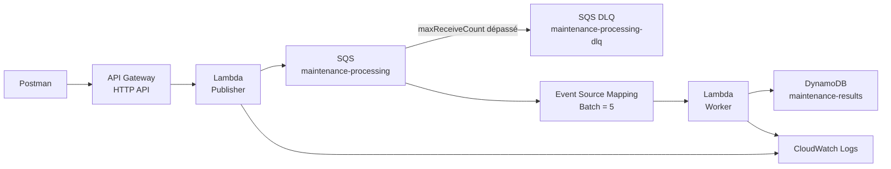

---

# 10. Scénario métier

EPSI traite des événements de maintenance.

Chaque événement possède un identifiant métier :

```text
eventId
```

Exemple :

```json
{
  "eventId": "EVT-5001",
  "incidentId": "INC-5001",
  "campus": "EPSI",
  "category": "network",
  "simulateResult": "success"
}
```

---

# 11. Pourquoi eventId est-il fourni ?

Dans ce TP, `eventId` représente la clé d’idempotence métier.

Si le même événement est envoyé deux fois :

```text
eventId identique
```

le consumer ne doit créer qu’un seul résultat métier.

---

# 12. Différence avec SQS MessageId

SQS génère également son propre :

```text
MessageId
```

Mais deux messages différents envoyés à SQS peuvent avoir :

```text
deux SQS MessageId différents
```

tout en représentant :

```text
le même événement métier
```

---

# 13. Exemple

Premier envoi :

```text
eventId = EVT-5001
SQS MessageId = AAA
```

Deuxième envoi :

```text
eventId = EVT-5001
SQS MessageId = BBB
```

Pour le métier :

```text
c'est le même événement
```

---

# 14. Clé d’idempotence du TP

Nous utiliserons :

```text
eventId
```

comme clé de partition DynamoDB.

---

# 15. Résultat attendu en cas de doublon

Premier traitement :

```text
DynamoDB PutItem réussit
```

Second traitement avec le même `eventId` :

```text
ConditionalCheckFailedException
```

Le worker considère alors :

```text
déjà traité
```

et n’applique pas l’effet une seconde fois.

---

# 16. Idempotence et concurrence

Imaginez deux invocations Lambda qui traitent le même `eventId` presque au même moment.

Sans protection :

```text
les deux peuvent croire que l'événement est nouveau
```

Avec une **écriture conditionnelle atomique** :

```text
une seule écriture gagne
```

---

# 17. Diagramme concurrence

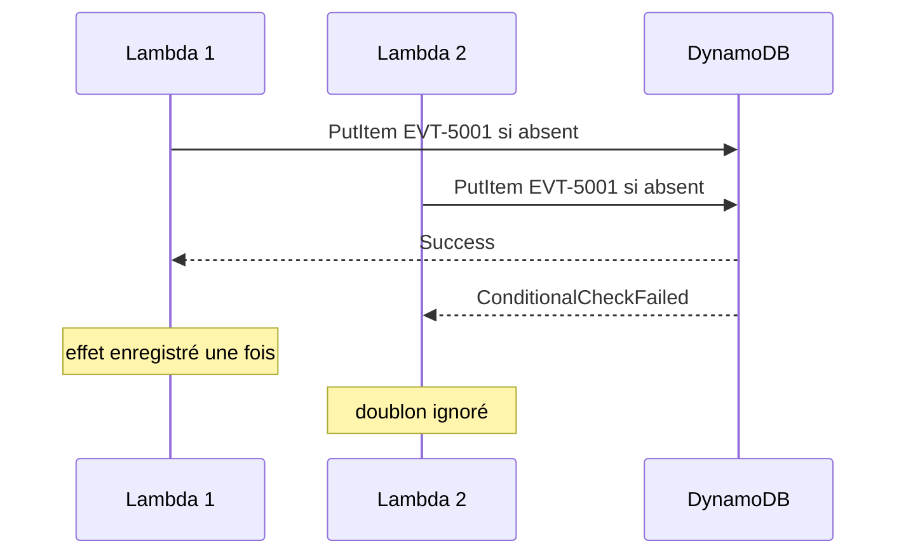

---

# 18. Services utilisés

Nous allons utiliser :

- **Amazon API Gateway HTTP API** ;
- **AWS Lambda Publisher** ;
- **Amazon SQS Standard Queue** ;
- **Amazon SQS DLQ** ;
- **AWS Lambda Worker** ;
- **Amazon DynamoDB** ;
- **CloudWatch Logs**.

---

# 19. Ressources du TP

```text
SQS source queue
maintenance-processing

SQS DLQ
maintenance-processing-dlq

DynamoDB table
maintenance-results

Lambda
lambda-tp5-publisher
lambda-tp5-worker

API Gateway
api-tp5-resilience-epsi

Route
POST /maintenance-events
```

---

# 20. IAM Roles

```text
role-tp5-publisher
role-tp5-worker
```

---

# 21. Paramètres pédagogiques

Nous utiliserons :

```text
SQS Visibility Timeout = 30 secondes
DLQ maxReceiveCount = 3
Lambda worker timeout = 5 secondes
Batch Size = 5
Maximum Concurrency = 2
```

---

# 22. Pourquoi ces valeurs ?

Elles permettent d’observer facilement :

- batch ;
- retries ;
- DLQ ;
- concurrence ;

sans créer une charge importante.

---

# 23. Visibility Timeout

Lorsqu’un message SQS est reçu :

```text
il devient temporairement invisible
```

Si le traitement échoue et qu’il n’est pas supprimé :

```text
il peut redevenir visible après le Visibility Timeout
```

---

# 24. Valeur du TP

```text
30 secondes
```

---

# 25. Timeout Lambda

Le worker utilisera :

```text
5 secondes
```

---

# 26. Rapport entre les deux

AWS recommande généralement, pour une intégration Lambda/SQS, un Visibility Timeout d’au moins :

```text
6 fois le timeout de la Lambda
```

pour laisser de la marge aux retries et throttles.

Dans notre cas :

```text
6 x 5 secondes = 30 secondes
```

---

# 27. Dead-Letter Queue AWS

Contrairement à Azure Service Bus, Amazon SQS ne crée pas automatiquement la DLQ.

Vous devez créer :

```text
maintenance-processing-dlq
```

comme une vraie queue SQS.

---

# 28. Type de DLQ

La queue source est :

```text
Standard
```

La DLQ doit donc également être :

```text
Standard
```

---

# 29. Redrive Policy

La queue source possède une :

```text
Redrive Policy
```

qui définit :

- la DLQ cible ;
- `maxReceiveCount`.

---

# 30. Valeur du TP

```text
maxReceiveCount = 3
```

---

# 31. Meaning de maxReceiveCount

Après plusieurs réceptions infructueuses, SQS déplace le message vers :

```text
maintenance-processing-dlq
```

---

# 32. Poison Message

Un message qui échoue systématiquement est souvent appelé :

```text
poison message
```

La DLQ l’isole du flux principal.

---

# 33. Comptes AWS étudiants

Le TP reste volontairement léger :

- deux Lambda ;
- deux SQS queues ;
- une petite table DynamoDB ;
- quelques dizaines de messages ;
- une HTTP API.

---

# 34. DynamoDB et coût

Pour le TP, vous pouvez choisir :

```text
Provisioned capacity
1 RCU
1 WCU
```

si votre environnement l’autorise.

Cela reste très inférieur au niveau gratuit DynamoDB provisionné actuellement disponible.

---

# 35. Alternative On-Demand

Si votre laboratoire impose ou préfère :

```text
On-demand
```

vous pouvez l’utiliser.

Le volume de ce TP est très faible.

---

# 36. Comptes EPSI avec restrictions IAM

Si vous ne pouvez pas créer :

- rôles IAM ;
- policies ;

utilisez les rôles fournis par l’enseignant.

**Ne contournez pas les restrictions du laboratoire.**

---

# 37. Région

Choisissez une seule région.

Exemple :

```text
Europe (Paris)
eu-west-3
```

Toutes les ressources doivent être créées dans cette région.

---

# 38. Étape 1 - Créer la DLQ

## Méthode principale - Console AWS

Ouvrez :

```text
SQS
```

Cliquez :

```text
Create queue
```

Type :

```text
Standard
```

Nom :

```text
maintenance-processing-dlq
```

---

# 39. Paramètres DLQ

Conservez des valeurs simples.

Ne configurez pas encore cette queue comme source d’un consumer.

Créez-la.

---

# 40. Récupérer l’ARN DLQ

Ouvrez la queue.

Copiez :

```text
ARN
```

Nous en aurons besoin pour la Redrive Policy.

---

## Équivalent AWS CLI - optionnel

```bash
DLQ_URL=$(aws sqs create-queue \
  --queue-name maintenance-processing-dlq \
  --region eu-west-3 \
  --query QueueUrl \
  --output text)
```

Récupérer l’ARN :

```bash
DLQ_ARN=$(aws sqs get-queue-attributes \
  --queue-url "$DLQ_URL" \
  --attribute-names QueueArn \
  --region eu-west-3 \
  --query Attributes.QueueArn \
  --output text)
```

---

# 41. Étape 2 - Créer la queue source

Créez :

```text
maintenance-processing
```

Type :

```text
Standard
```

---

# 42. Configurer Visibility Timeout

Valeur :

```text
30 seconds
```

---

# 43. Configurer la DLQ

Dans la section :

```text
Dead-letter queue
```

activez la fonctionnalité.

Sélectionnez :

```text
maintenance-processing-dlq
```

---

# 44. Maximum receives

Configurez :

```text
3
```

---

# 45. Créer la queue

Enregistrez.

---

# 46. Vérifier la Redrive Policy

Dans les détails de :

```text
maintenance-processing
```

vérifiez :

```text
Dead-letter queue
maintenance-processing-dlq

Maximum receives
3
```

---

## Équivalent AWS CLI - optionnel

Créer la source :

```bash
SOURCE_URL=$(aws sqs create-queue \
  --queue-name maintenance-processing \
  --attributes VisibilityTimeout=30 \
  --region eu-west-3 \
  --query QueueUrl \
  --output text)
```

Puis appliquer la Redrive Policy :

```bash
aws sqs set-queue-attributes \
  --queue-url "$SOURCE_URL" \
  --attributes "RedrivePolicy={\"deadLetterTargetArn\":\"$DLQ_ARN\",\"maxReceiveCount\":\"3\"}" \
  --region eu-west-3
```

---

# 47. Vérifier la queue en CLI - optionnel

```bash
aws sqs get-queue-attributes \
  --queue-url "$SOURCE_URL" \
  --attribute-names \
    VisibilityTimeout \
    RedrivePolicy \
    QueueArn \
  --region eu-west-3
```

---

# 48. Étape 3 - Créer la table DynamoDB

Ouvrez :

```text
DynamoDB
```

Cliquez :

```text
Create table
```

---

# 49. Paramètres table

Table name :

```text
maintenance-results
```

Partition key :

```text
eventId
```

Type :

```text
String
```

---

# 50. Capacity mode

Choisissez selon votre environnement :

```text
Provisioned
```

avec :

```text
Read capacity units = 1
Write capacity units = 1
```

ou :

```text
On-demand
```

si votre laboratoire le demande.

---

# 51. Pourquoi pas de sort key ?

Pour ce TP :

```text
1 eventId = 1 effet métier
```

Une simple partition key suffit.

---

# 52. Item stocké

Un item ressemblera à :

```json
{
  "eventId": "EVT-5001",
  "incidentId": "INC-5001",
  "status": "PROCESSED",
  "processedAt": "2026-10-05T10:00:00+00:00",
  "sqsMessageId": "..."
}
```

---

# 53. Pourquoi cette table représente l’effet métier ?

Dans ce TP, l’effet métier simulé est :

```text
enregistrer qu'un événement de maintenance a été traité
```

DynamoDB joue donc à la fois :

- le rôle de résultat métier simple ;
- la protection d’idempotence.

---

# 54. Limite pédagogique

Dans un système réel, l’effet pourrait être :

- appel ERP ;
- création d’un ticket ;
- paiement ;
- email ;
- workflow humain.

L’idempotence de ces effets peut demander des stratégies supplémentaires.

---

## Équivalent AWS CLI - optionnel

```bash
aws dynamodb create-table \
  --table-name maintenance-results \
  --attribute-definitions \
    AttributeName=eventId,AttributeType=S \
  --key-schema \
    AttributeName=eventId,KeyType=HASH \
  --provisioned-throughput \
    ReadCapacityUnits=1,WriteCapacityUnits=1 \
  --region eu-west-3
```

---

# 55. Étape 4 - Créer le rôle Publisher

Dans IAM :

```text
Create role
```

Trusted entity :

```text
Lambda
```

Ajoutez :

```text
AWSLambdaBasicExecutionRole
```

Nom :

```text
role-tp5-publisher
```

---

# 56. Permission SQS Publisher

Ajoutez une inline policy ciblée sur :

```text
maintenance-processing
```

Exemple :

```json
{
  "Version": "2012-10-17",
  "Statement": [
    {
      "Effect": "Allow",
      "Action": "sqs:SendMessage",
      "Resource": "SOURCE_QUEUE_ARN"
    }
  ]
}
```

---

# 57. Étape 5 - Créer lambda-tp5-publisher

Runtime :

```text
Python 3.x
```

Execution role :

```text
role-tp5-publisher
```

---

# 58. Variable QUEUE_URL

Ajoutez :

```text
QUEUE_URL
```

avec l’URL de :

```text
maintenance-processing
```

---

# 59. Code Publisher

```python
import json
import os
from datetime import datetime, timezone

import boto3
from botocore.exceptions import ClientError


sqs = boto3.client("sqs")
QUEUE_URL = os.environ["QUEUE_URL"]

REQUIRED_FIELDS = {
    "eventId",
    "incidentId",
    "campus",
    "category",
    "simulateResult",
}

ALLOWED_RESULTS = {
    "success",
    "retry_once",
    "permanent_error",
}


def response(status_code, payload):
    return {
        "statusCode": status_code,
        "headers": {
            "content-type": "application/json"
        },
        "body": json.dumps(
            payload,
            ensure_ascii=False,
        ),
    }


def lambda_handler(event, context):
    try:
        body = json.loads(
            event.get("body") or "{}"
        )
    except json.JSONDecodeError:
        return response(
            400,
            {
                "error": "INVALID_JSON"
            },
        )

    missing = sorted(
        field
        for field in REQUIRED_FIELDS
        if not body.get(field)
    )

    if missing:
        return response(
            400,
            {
                "error": "MISSING_REQUIRED_FIELDS",
                "fields": missing,
            },
        )

    unknown = sorted(
        set(body.keys()) - REQUIRED_FIELDS
    )

    if unknown:
        return response(
            400,
            {
                "error": "UNKNOWN_FIELDS",
                "fields": unknown,
            },
        )

    if body["simulateResult"] not in ALLOWED_RESULTS:
        return response(
            400,
            {
                "error": "INVALID_SIMULATION",
                "allowed": sorted(
                    ALLOWED_RESULTS
                ),
            },
        )

    message = {
        "eventType": "MaintenanceProcessingRequested",
        "schemaVersion": 1,
        "eventId": body["eventId"],
        "createdAt": datetime.now(
            timezone.utc
        ).isoformat(),
        "data": {
            "incidentId": body[
                "incidentId"
            ],
            "campus": body[
                "campus"
            ].strip(),
            "category": body[
                "category"
            ].strip().lower(),
            "simulateResult": body[
                "simulateResult"
            ],
        },
    }

    try:
        sqs_response = sqs.send_message(
            QueueUrl=QUEUE_URL,
            MessageBody=json.dumps(
                message,
                ensure_ascii=False,
            ),
            MessageAttributes={
                "eventId": {
                    "DataType": "String",
                    "StringValue": body[
                        "eventId"
                    ],
                },
                "simulateResult": {
                    "DataType": "String",
                    "StringValue": body[
                        "simulateResult"
                    ],
                },
            },
        )
    except ClientError as exc:
        print(
            json.dumps(
                {
                    "level": "ERROR",
                    "message": "SQS_SEND_FAILED",
                    "error": str(exc),
                }
            )
        )

        return response(
            502,
            {
                "status": "BROKER_ERROR"
            },
        )

    print(
        json.dumps(
            {
                "level": "INFO",
                "message": "EVENT_QUEUED",
                "eventId": body[
                    "eventId"
                ],
                "sqsMessageId": sqs_response[
                    "MessageId"
                ],
            }
        )
    )

    return response(
        202,
        {
            "status": "QUEUED",
            "eventId": body["eventId"],
            "sqsMessageId": sqs_response[
                "MessageId"
            ],
        },
    )
```

Cliquez :

```text
Deploy
```

---

# 60. Étape 6 - Créer API Gateway

Créez une :

```text
HTTP API
```

Nom :

```text
api-tp5-resilience-epsi
```

Integration :

```text
lambda-tp5-publisher
```

---

# 61. Route

```text
POST /maintenance-events
```

---

# 62. Stage

Utilisez :

```text
$default
```

avec Auto-deploy si disponible.

---

# 63. Étape 7 - Tester Publisher

Dans Postman :

```json
{
  "eventId": "EVT-5001",
  "incidentId": "INC-5001",
  "campus": "EPSI",
  "category": "NETWORK",
  "simulateResult": "success"
}
```

---

# 64. Résultat attendu

```text
202 Accepted
```

La queue source doit contenir un message.

---

# 65. Ne créez pas encore le worker

Nous voulons d’abord préparer :

- IAM ;
- batch ;
- DLQ ;
- idempotence.

---

# 66. Étape 8 - Créer le rôle Worker

Dans IAM :

```text
Create role
```

Trusted entity :

```text
Lambda
```

Nom :

```text
role-tp5-worker
```

---

# 67. Logs Worker

Ajoutez :

```text
AWSLambdaBasicExecutionRole
```

---

# 68. Permissions SQS Worker

Ajoutez une policy ciblée sur la queue source :

```json
{
  "Version": "2012-10-17",
  "Statement": [
    {
      "Effect": "Allow",
      "Action": [
        "sqs:ReceiveMessage",
        "sqs:DeleteMessage",
        "sqs:GetQueueAttributes"
      ],
      "Resource": "SOURCE_QUEUE_ARN"
    }
  ]
}
```

---

# 69. Permissions DynamoDB Worker

Ajoutez :

```json
{
  "Version": "2012-10-17",
  "Statement": [
    {
      "Effect": "Allow",
      "Action": [
        "dynamodb:PutItem"
      ],
      "Resource": "DYNAMODB_TABLE_ARN"
    }
  ]
}
```

---

# 70. Pourquoi uniquement PutItem ?

Le scénario principal utilise une écriture conditionnelle.

Nous n’avons pas besoin de faire un `Scan` ou un `Query` depuis la Lambda.

---

# 71. Least Privilege

Le worker ne doit pas recevoir :

```text
dynamodb:*
```

ou :

```text
sqs:*
```

si ce n’est pas nécessaire.

---

# 72. Étape 9 - Créer lambda-tp5-worker

Runtime :

```text
Python 3.x
```

Execution role :

```text
role-tp5-worker
```

---

# 73. Timeout Worker

Dans :

```text
Configuration
General configuration
```

configurez :

```text
Timeout = 5 seconds
```

---

# 74. Variable TABLE_NAME

Ajoutez :

```text
TABLE_NAME
```

Valeur :

```text
maintenance-results
```

---

# 75. Version 1 du Worker - comportement batch classique

Nous allons d’abord volontairement utiliser une version qui :

```text
échoue complètement si un record échoue
```

Code :

```python
import json
import os
from datetime import datetime, timezone

import boto3
from botocore.exceptions import ClientError


dynamodb = boto3.resource("dynamodb")
table = dynamodb.Table(
    os.environ["TABLE_NAME"]
)


def process_business_effect(
    body,
    sqs_message_id,
):
    event_id = body["eventId"]

    table.put_item(
        Item={
            "eventId": event_id,
            "incidentId": body[
                "data"
            ]["incidentId"],
            "status": "PROCESSED",
            "processedAt": datetime.now(
                timezone.utc
            ).isoformat(),
            "sqsMessageId": sqs_message_id,
        },
        ConditionExpression=(
            "attribute_not_exists(eventId)"
        ),
    )


def lambda_handler(event, context):
    for record in event.get(
        "Records",
        [],
    ):
        body = json.loads(
            record["body"]
        )

        event_id = body["eventId"]
        simulation = body[
            "data"
        ]["simulateResult"]

        receive_count = int(
            record.get(
                "attributes",
                {},
            ).get(
                "ApproximateReceiveCount",
                "1",
            )
        )

        print(
            json.dumps(
                {
                    "level": "INFO",
                    "message": "RECORD_RECEIVED",
                    "eventId": event_id,
                    "sqsMessageId": record[
                        "messageId"
                    ],
                    "receiveCount": receive_count,
                    "simulation": simulation,
                }
            )
        )

        if (
            simulation == "retry_once"
            and receive_count == 1
        ):
            raise RuntimeError(
                "SIMULATED_TEMPORARY_ERROR"
            )

        if simulation == "permanent_error":
            raise RuntimeError(
                "SIMULATED_PERMANENT_ERROR"
            )

        try:
            process_business_effect(
                body,
                record["messageId"],
            )

        except dynamodb.meta.client.exceptions.ConditionalCheckFailedException:
            print(
                json.dumps(
                    {
                        "level": "INFO",
                        "message": "DUPLICATE_SKIPPED",
                        "eventId": event_id,
                    }
                )
            )

    return {
        "status": "BATCH_OK"
    }
```

Déployez.

---

# 76. Ce que fait Version 1

Si tous les messages réussissent :

```text
batch réussi
```

Si un seul lève :

```python
RuntimeError(...)
```

l’invocation complète échoue.

---

# 77. Idempotence déjà présente

Même dans Version 1 :

```python
ConditionExpression="attribute_not_exists(eventId)"
```

empêche un deuxième effet DynamoDB pour le même `eventId`.

---

# 78. Pourquoi mettre l’idempotence avant l’expérience batch ?

Parce que nous allons volontairement provoquer le retraitement de messages déjà réussis.

Cela permettra d’observer :

```text
DUPLICATE_SKIPPED
```

---

# 79. Conditional Put

Sans condition :

```python
put_item(...)
```

pourrait remplacer un item existant.

Avec :

```python
attribute_not_exists(eventId)
```

DynamoDB accepte l’écriture seulement si la clé n’existe pas.

---

# 80. Caractère atomique

La condition est évaluée côté DynamoDB.

Deux Lambdas concurrentes ne peuvent pas toutes les deux réussir le même `PutItem` conditionnel sur la même clé.

---

# 81. Étape 10 - Ajouter le trigger SQS

Dans :

```text
lambda-tp5-worker
```

cliquez :

```text
Add trigger
```

Choisissez :

```text
SQS
```

Queue :

```text
maintenance-processing
```

---

# 82. Batch Size

Configurez :

```text
Batch size = 5
```

---

# 83. Pourquoi Batch Size = 5 ?

Nous voulons voir :

```text
plusieurs records
dans
une invocation Lambda
```

---

# 84. Maximum batching window

Pour garder le TP simple :

```text
0 seconde
```

ou laissez la valeur par défaut.

---

# 85. Partial Batch Response pour l’instant

**Ne l’activez pas encore.**

Nous voulons observer le problème du batch complet.

---

# 86. Maximum Concurrency pour l’instant

Laissez vide pendant la première expérience.

Nous la configurerons plus tard.

---

# 87. Étape 11 - Préparer un batch de test

Pour que les messages s’accumulent avant traitement :

désactivez temporairement le trigger SQS du worker.

---

# 88. Envoyer cinq événements

Envoyez rapidement :

```text
EVT-BATCH-1 success
EVT-BATCH-2 success
EVT-BATCH-3 permanent_error
EVT-BATCH-4 success
EVT-BATCH-5 success
```

---

# 89. Exemple BATCH-1

```json
{
  "eventId": "EVT-BATCH-1",
  "incidentId": "INC-BATCH-1",
  "campus": "EPSI",
  "category": "network",
  "simulateResult": "success"
}
```

---

# 90. Exemple BATCH-3

```json
{
  "eventId": "EVT-BATCH-3",
  "incidentId": "INC-BATCH-3",
  "campus": "EPSI",
  "category": "network",
  "simulateResult": "permanent_error"
}
```

---

# 91. Réactiver le trigger

Le worker doit recevoir des messages par batch.

---

# 92. Résultat sans Partial Batch

Lorsqu’il rencontre :

```text
EVT-BATCH-3
```

l’invocation échoue.

Selon l’ordre des records, certains événements précédents du batch ont peut-être déjà été enregistrés dans DynamoDB.

---

# 93. Après Visibility Timeout

Le batch peut être retraité.

Les événements déjà écrits dans DynamoDB vont alors tenter un nouveau `PutItem`.

---

# 94. Résultat attendu DynamoDB

Pour les succès déjà traités :

```text
ConditionalCheckFailedException
```

est interceptée.

Logs :

```text
DUPLICATE_SKIPPED
```

---

# 95. Pourquoi c’est important ?

Nous venons de démontrer :

```text
un message peut revenir
même si son effet métier avait déjà réussi
```

---

# 96. Problème restant

L’idempotence protège les effets.

Mais nous gaspillons encore :

- invocations ;
- logs ;
- temps ;
- capacité ;

en rejouant des messages déjà réussis.

---

# 97. Solution suivante

Activer :

```text
Partial Batch Response
```

---

# 98. Étape 12 - Arrêter l’expérience Version 1

Attendez que le batch de test soit stabilisé.

`EVT-BATCH-3` peut finir en DLQ après :

```text
maxReceiveCount = 3
```

---

# 99. Vérifier DLQ

Dans :

```text
maintenance-processing-dlq
```

le compteur doit augmenter.

---

# 100. Étape 13 - Activer Partial Batch Response

Dans la configuration du trigger SQS de :

```text
lambda-tp5-worker
```

ouvrez **Edit**.

Cherchez l’option liée à :

```text
Report batch item failures
```

ou :

```text
Function response types
```

Activez :

```text
ReportBatchItemFailures
```

---

# 101. Principe

La Lambda doit maintenant retourner :

```json
{
  "batchItemFailures": [
    {
      "itemIdentifier": "SQS_MESSAGE_ID_EN_ECHEC"
    }
  ]
}
```

---

# 102. Important

`itemIdentifier` doit utiliser :

```text
record["messageId"]
```

du message SQS.

Pas :

```text
eventId
```

---

# 103. Pourquoi SQS MessageId ici ?

Parce que Partial Batch Response doit indiquer à Lambda/SQS :

```text
quel record du batch technique a échoué
```

---

# 104. Différence de responsabilités

**eventId** :

idempotence métier.

**SQS messageId** :

identification du record SQS pour le batch.

---

# 105. Version 2 Worker - Partial Batch Response

Remplacez le code par :

```python
import json
import os
from datetime import datetime, timezone

import boto3


dynamodb = boto3.resource("dynamodb")
table = dynamodb.Table(
    os.environ["TABLE_NAME"]
)


def store_once(
    body,
    sqs_message_id,
):
    event_id = body["eventId"]

    try:
        table.put_item(
            Item={
                "eventId": event_id,
                "incidentId": body[
                    "data"
                ]["incidentId"],
                "status": "PROCESSED",
                "processedAt": datetime.now(
                    timezone.utc
                ).isoformat(),
                "sqsMessageId": sqs_message_id,
            },
            ConditionExpression=(
                "attribute_not_exists(eventId)"
            ),
        )

        print(
            json.dumps(
                {
                    "level": "INFO",
                    "message": "BUSINESS_EFFECT_CREATED",
                    "eventId": event_id,
                }
            )
        )

    except dynamodb.meta.client.exceptions.ConditionalCheckFailedException:
        print(
            json.dumps(
                {
                    "level": "INFO",
                    "message": "DUPLICATE_SKIPPED",
                    "eventId": event_id,
                }
            )
        )


def process_record(record):
    body = json.loads(
        record["body"]
    )

    event_id = body["eventId"]

    receive_count = int(
        record.get(
            "attributes",
            {},
        ).get(
            "ApproximateReceiveCount",
            "1",
        )
    )

    simulation = body[
        "data"
    ]["simulateResult"]

    print(
        json.dumps(
            {
                "level": "INFO",
                "message": "RECORD_RECEIVED",
                "eventId": event_id,
                "sqsMessageId": record[
                    "messageId"
                ],
                "receiveCount": receive_count,
                "simulation": simulation,
            }
        )
    )

    if (
        simulation == "retry_once"
        and receive_count == 1
    ):
        raise RuntimeError(
            "SIMULATED_TEMPORARY_ERROR"
        )

    if simulation == "permanent_error":
        raise RuntimeError(
            "SIMULATED_PERMANENT_ERROR"
        )

    store_once(
        body,
        record["messageId"],
    )


def lambda_handler(event, context):
    failures = []

    for record in event.get(
        "Records",
        [],
    ):
        try:
            process_record(
                record
            )

        except Exception as exc:
            print(
                json.dumps(
                    {
                        "level": "ERROR",
                        "message": "RECORD_FAILED",
                        "sqsMessageId": record.get(
                            "messageId"
                        ),
                        "error": str(exc),
                    }
                )
            )

            failures.append(
                {
                    "itemIdentifier": record[
                        "messageId"
                    ]
                }
            )

    return {
        "batchItemFailures": failures
    }
```

Déployez.

---

# 106. Très important - ne pas lever l’exception hors de la boucle

Si la fonction laisse une exception remonter jusqu’au handler :

```text
tout le batch peut être considéré en échec
```

Même avec ReportBatchItemFailures.

---

# 107. Le handler doit capturer les erreurs record par record

Puis retourner :

```text
uniquement les messageId en échec
```

---

# 108. Diagramme Partial Batch

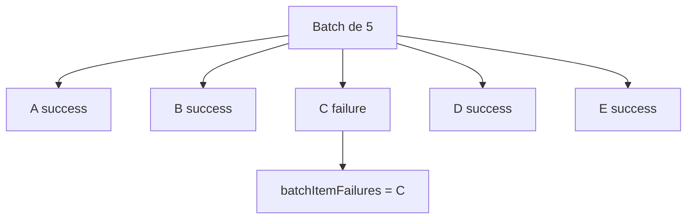

---

# 109. Résultat attendu

Lambda peut supprimer les records réussis.

Seul le record retourné dans :

```text
batchItemFailures
```

doit redevenir disponible.

---

# 110. Étape 14 - Nouveau test batch

Désactivez le mapping.

Envoyez :

```text
EVT-PARTIAL-1 success
EVT-PARTIAL-2 success
EVT-PARTIAL-3 retry_once
EVT-PARTIAL-4 success
EVT-PARTIAL-5 success
```

---

# 111. Réactiver le mapping

Premier passage :

```text
1, 2, 4, 5 réussissent
3 échoue
```

---

# 112. Deuxième passage

`EVT-PARTIAL-3` revient avec :

```text
ApproximateReceiveCount >= 2
```

Le scénario `retry_once` ne lève plus d’erreur.

---

# 113. Résultat final

Les cinq événements doivent finir :

```text
PROCESSED
```

dans DynamoDB.

---

# 114. Aucun replay inutile des succès

Vous devez voir beaucoup moins de :

```text
DUPLICATE_SKIPPED
```

pour ce batch qu’avec Version 1.

---

# 115. Question 1

Que résout Partial Batch Response ?

**Réponse :**

Elle évite de rendre tout le batch à nouveau visible lorsqu’une partie seulement a échoué.

---

# 116. Question 2

Est-ce que Partial Batch Response rend l’idempotence inutile ?

**Réponse :**

Non.

SQS Standard reste un système *at-least-once*.

Des redélivrances restent possibles.

---

# 117. Pourquoi les deux mécanismes sont nécessaires ?

Partial Batch Response :

```text
réduit les retries inutiles
```

Idempotence :

```text
protège les effets métier contre les doublons
```

---

# 118. Étape 15 - Tester un permanent_error avec Version 2

Envoyez :

```json
{
  "eventId": "EVT-POISON-1",
  "incidentId": "INC-POISON-1",
  "campus": "EPSI",
  "category": "network",
  "simulateResult": "permanent_error"
}
```

---

# 119. Résultat attendu

Le record revient plusieurs fois.

Il est retourné dans :

```text
batchItemFailures
```

à chaque tentative.

---

# 120. Après maxReceiveCount

Il est déplacé vers :

```text
maintenance-processing-dlq
```

---

# 121. Vérifier DynamoDB

Aucun item :

```text
EVT-POISON-1
```

ne doit exister.

---

# 122. Pourquoi ?

Parce que l’erreur est levée :

```text
avant l'effet métier
```

---

# 123. ApproximateReceiveCount

Dans le record SQS :

```python
record["attributes"]["ApproximateReceiveCount"]
```

indique combien de fois le message a été reçu.

---

# 124. Utilisation pédagogique

Le scénario :

```text
retry_once
```

échoue seulement lorsque :

```text
ApproximateReceiveCount == 1
```

---

# 125. Ce n’est pas une stratégie de production complète

Nous l’utilisons uniquement pour :

```text
simuler une erreur temporaire déterministe
```

---

# 126. Étape 16 - Tester l’idempotence explicite

Envoyez deux fois exactement :

```json
{
  "eventId": "EVT-DUP-1",
  "incidentId": "INC-DUP-1",
  "campus": "EPSI",
  "category": "network",
  "simulateResult": "success"
}
```

---

# 127. Important

Les deux publications SQS auront normalement :

```text
deux SQS MessageId différents
```

---

# 128. Mais le même eventId

```text
EVT-DUP-1
```

---

# 129. Résultat attendu DynamoDB

Un seul item :

```text
EVT-DUP-1
```

---

# 130. Résultat attendu logs

Une invocation :

```text
BUSINESS_EFFECT_CREATED
```

Une autre :

```text
DUPLICATE_SKIPPED
```

---

# 131. C’est l’idempotence métier

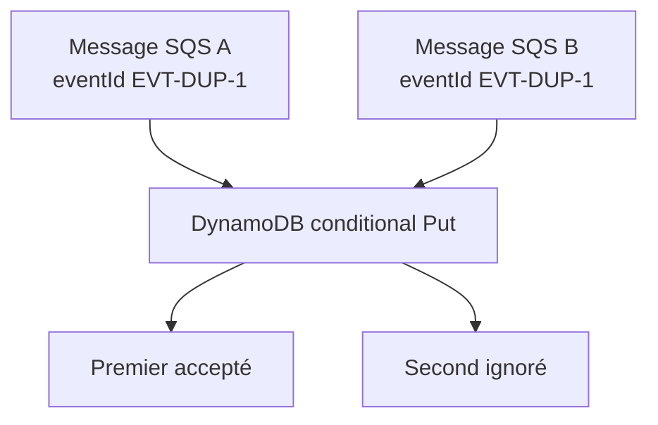

---

# 132. Étape 17 - Tester la concurrence

Nous allons maintenant limiter explicitement la concurrence du mapping.

Dans :

```text
Lambda
lambda-tp5-worker
SQS trigger
Edit
```

cherchez :

```text
Maximum concurrency
```

---

# 133. Valeur

Configurez :

```text
2
```

---

# 134. Pourquoi 2 ?

Nous voulons permettre plusieurs invocations simultanées tout en gardant l’observation facile.

---

# 135. Maximum Concurrency

Cette option limite :

```text
le nombre d'instances Lambda simultanées
```

que ce **mapping SQS** peut invoquer.

---

# 136. Ce n’est pas Reserved Concurrency

**Maximum Concurrency** :

limite ce mapping.

**Reserved Concurrency** :

limite ou réserve la concurrence au niveau de la fonction Lambda.

---

# 137. Relation importante

Ne configurez pas une Maximum Concurrency supérieure à une Reserved Concurrency plus faible.

Cela provoquerait des throttles inutiles.

---

# 138. Dans le TP

Laissez :

```text
Reserved Concurrency non configurée
```

et utilisez seulement :

```text
Maximum Concurrency = 2
```

---

# 139. Diagramme concurrence

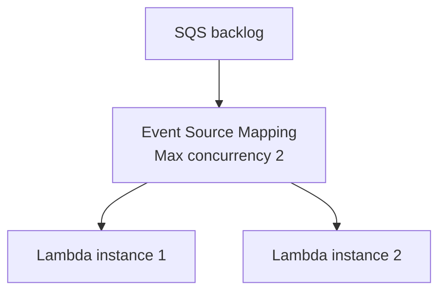

---

# 140. Étape 18 - Créer un backlog de 20 messages

Désactivez le mapping.

Envoyez environ :

```text
20 événements success
```

avec des `eventId` différents.

---

# 141. Exemple de série

```text
EVT-CONC-01
EVT-CONC-02
EVT-CONC-03
...
EVT-CONC-20
```

---

# 142. Réactiver le mapping

Observez :

- CloudWatch Logs ;
- Concurrent executions ;
- diminution du backlog ;
- DynamoDB.

---

# 143. Batch Size et concurrence ensemble

Avec :

```text
Batch Size = 5
Maximum Concurrency = 2
```

deux invocations peuvent chacune recevoir jusqu’à :

```text
5 records
```

en parallèle.

---

# 144. Capacité conceptuelle

À un instant donné :

```text
jusqu'à environ 10 records
```

peuvent être contenus dans deux batches en traitement.

*Le comportement réel dépend du polling et de la disponibilité des messages.*

---

# 145. Pourquoi limiter la concurrence ?

Pour protéger une dépendance aval.

Exemple :

```text
DynamoDB
API ERP
base SQL
service externe
```

---

# 146. Sans limite maîtrisée

Un gros backlog peut entraîner :

```text
une forte augmentation des invocations Lambda
```

---

# 147. Maximum Concurrency est gratuite à configurer

La configuration elle-même n’ajoute pas de frais spécifiques.

Les invocations et services utilisés restent naturellement facturés selon leur tarification.

---

# 148. Étape 19 - Observer la concurrence CloudWatch

Dans la Lambda :

```text
Monitor
Metrics
```

observez notamment :

```text
Concurrent executions
Invocations
Errors
Duration
```

---

# 149. Logs

Ajoutez mentalement la question :

```text
combien de requestId Lambda différents travaillent en même temps ?
```

---

# 150. AWS Lambda RequestId

Chaque invocation Lambda possède son propre identifiant d’invocation.

Vous pouvez l’ajouter aux logs :

```python
context.aws_request_id
```

---

# 151. Bonus - ajouter requestId

Dans les logs record :

```python
"lambdaRequestId": context.aws_request_id
```

Cela aide à voir quels records appartiennent au même batch.

---

# 152. Batch et RequestId

```text
même RequestId Lambda
```

signifie :

```text
même invocation
```

et donc souvent :

```text
même batch reçu
```

---

# 153. Étape 20 - Inspecter DynamoDB

Ouvrez :

```text
DynamoDB
Tables
maintenance-results
Explore table items
```

---

# 154. Vérifier les clés

Chaque `eventId` doit apparaître :

```text
au maximum une fois
```

---

# 155. Question 3

Pourquoi ne pas faire simplement :

```text
GetItem
puis
PutItem
```

pour vérifier un doublon ?

---

# 156. Réponse

Parce qu’entre :

```text
GetItem
```

et :

```text
PutItem
```

une autre invocation pourrait insérer le même eventId.

C’est une **race condition**.

---

# 157. Race condition naïve

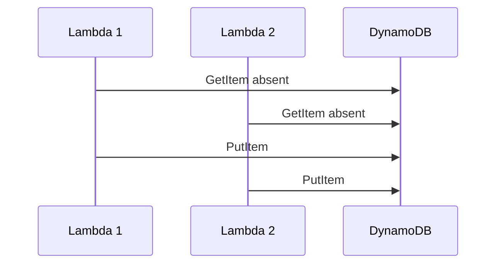

Sans condition atomique :

```text
les deux croient avoir gagné
```

---

# 158. Conditional Write

Avec :

```text
attribute_not_exists(eventId)
```

la décision est prise atomiquement par DynamoDB.

---

# 159. C’est la partie concurrence du TP

L’idempotence ne consiste pas seulement à :

```text
mémoriser les IDs
```

Il faut aussi éviter une fenêtre de course.

---

# 160. Étape 21 - Ouvrir la DLQ

Dans SQS :

```text
maintenance-processing-dlq
```

ouvrez :

```text
Send and receive messages
```

---

# 161. Attention en consultant les messages

La réception de messages via la console peut compter comme une réception.

Dans certains scénarios, manipulez les messages de démonstration avec précaution.

---

# 162. Inspecter EVT-POISON-1

Vérifiez le body.

Vous devez retrouver :

```text
eventId
incidentId
simulateResult = permanent_error
```

---

# 163. Pourquoi ce message est en DLQ ?

Parce qu’il a dépassé :

```text
maxReceiveCount = 3
```

sans être traité avec succès.

---

# 164. DLQ et correction

Une DLQ doit permettre :

```text
diagnostic
correction
redrive
```

---

# 165. Étape 22 - Corriger la cause

Notre poison message contient :

```text
simulateResult = permanent_error
```

Le redrive direct ne permet pas de modifier le message.

---

# 166. Important

Amazon SQS DLQ Redrive ne permet pas de filtrer ni de modifier le message pendant le déplacement.

---

# 167. Deux stratégies pédagogiques

## Stratégie A

Corriger le code worker pour accepter le message.

## Stratégie B

Créer un nouvel événement corrigé avec :

```text
simulateResult = success
```

puis supprimer ou archiver l’ancien.

---

# 168. Pour démontrer le Redrive

Modifiez temporairement le worker afin que :

```text
EVT-POISON-1
```

ne soit plus considéré comme permanent_error.

Ou utilisez un nouveau poison message dont vous corrigez la règle de traitement côté code.

---

# 169. Étape 23 - Start DLQ redrive

Dans :

```text
maintenance-processing-dlq
```

cliquez :

```text
Start DLQ redrive
```

---

# 170. Destination

Choisissez :

```text
Redrive to source queue(s)
```

---

# 171. Velocity

Pour un TP :

```text
System optimized
```

convient.

Avec beaucoup de messages en production, on pourrait utiliser une vitesse personnalisée.

---

# 172. Lancer le Redrive

Cliquez :

```text
Redrive messages
```

---

# 173. Résultat attendu

Les messages retournent vers :

```text
maintenance-processing
```

---

# 174. Si la cause est corrigée

Ils sont traités normalement.

---

# 175. Si la cause n’est pas corrigée

Ils peuvent :

```text
échouer à nouveau
puis revenir en DLQ
```

---

# 176. Cycle DLQ

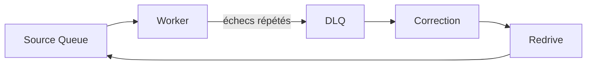

---

# 177. Question 4

Pourquoi ne pas automatiser un redrive infini ?

**Réponse :**

Parce qu’un poison message peut tourner éternellement et consommer :

- requêtes ;
- invocations ;
- logs ;
- capacité.

---

# 178. DLQ Redrive et permissions

Dans un compte EPSI restreint, votre utilisateur peut ne pas avoir le droit de lancer :

```text
StartMessageMoveTask
```

Dans ce cas :

```text
demandez à l'enseignant
```

---

# 179. Étape 24 - CLI Redrive optionnel

Récupérez l’ARN de la DLQ.

Puis :

```bash
aws sqs start-message-move-task \
  --source-arn "$DLQ_ARN" \
  --region eu-west-3
```

Sans destination explicite, le redrive peut utiliser la source associée selon le contexte de la DLQ.

---

# 180. Vérifier les tâches de redrive

```bash
aws sqs list-message-move-tasks \
  --source-arn "$DLQ_ARN" \
  --region eu-west-3
```

---

# 181. Étape 25 - CLI Partial Batch Response

Récupérez l’UUID du mapping :

```bash
aws lambda list-event-source-mappings \
  --function-name lambda-tp5-worker \
  --region eu-west-3 \
  --output table
```

---

# 182. Activer ReportBatchItemFailures

```bash
aws lambda update-event-source-mapping \
  --uuid UUID_DU_MAPPING \
  --function-response-types ReportBatchItemFailures \
  --region eu-west-3
```

---

# 183. CLI - Maximum Concurrency

```bash
aws lambda update-event-source-mapping \
  --uuid UUID_DU_MAPPING \
  --scaling-config '{"MaximumConcurrency":2}' \
  --region eu-west-3
```

---

# 184. Désactiver Maximum Concurrency

```bash
aws lambda update-event-source-mapping \
  --uuid UUID_DU_MAPPING \
  --scaling-config '{}' \
  --region eu-west-3
```

---

# 185. CLI - inspecter mapping

```bash
aws lambda get-event-source-mapping \
  --uuid UUID_DU_MAPPING \
  --region eu-west-3
```

Vérifiez :

```text
BatchSize
FunctionResponseTypes
ScalingConfig
State
```

---

# 186. CLI - vérifier Redrive Policy

```bash
aws sqs get-queue-attributes \
  --queue-url "$SOURCE_URL" \
  --attribute-names \
    RedrivePolicy \
    VisibilityTimeout \
    ApproximateNumberOfMessages \
    ApproximateNumberOfMessagesNotVisible \
  --region eu-west-3
```

---

# 187. CLI - inspecter DynamoDB

```bash
aws dynamodb scan \
  --table-name maintenance-results \
  --region eu-west-3
```

> **Note :** `Scan` est acceptable ici pour un petit TP. Dans une vraie application, évitez d’utiliser systématiquement `Scan` comme stratégie d’accès métier.

---

# 188. Expérience avancée - doublons concurrents

Désactivez le mapping.

Envoyez rapidement dix fois le même :

```text
eventId = EVT-RACE-1
```

---

# 189. Réactiver avec Maximum Concurrency = 2

Plusieurs copies peuvent être traitées dans des invocations différentes.

---

# 190. Résultat attendu

Dans DynamoDB :

```text
1 seul item EVT-RACE-1
```

---

# 191. Logs

Vous devez observer :

```text
1 BUSINESS_EFFECT_CREATED
plusieurs DUPLICATE_SKIPPED
```

---

# 192. Ce test est plus fort qu’un simple doublon séquentiel

Il teste :

```text
l'idempotence sous concurrence
```

---

# 193. Limite du pattern actuel

Notre écriture DynamoDB **est elle-même l’effet métier**.

Cela rend le pattern simple et sûr.

---

# 194. Si l’effet métier est externe

Exemple :

```text
appel API ERP
```

Le pattern devient plus complexe.

---

# 195. Pourquoi ?

Si vous marquez l’événement comme traité :

```text
avant l'appel ERP
```

puis que l’appel ERP échoue :

```text
le retry pourrait être ignoré à tort
```

---

# 196. Inversement

Si vous appelez l’ERP :

```text
avant d'écrire l'idempotency record
```

et que la Lambda plante ensuite :

```text
le retry pourrait rappeler l'ERP
```

---

# 197. C’est un problème transactionnel distribué

Les solutions possibles incluent :

- API aval elle-même idempotente ;
- idempotency key propagée ;
- état `IN_PROGRESS` / `COMPLETE` ;
- Powertools Idempotency ;
- Outbox ;
- Saga ;
- transactions lorsqu’elles sont possibles.

---

# 198. Bonus - AWS Lambda Powertools Idempotency

AWS Lambda Powertools pour Python fournit un utilitaire :

```text
Idempotency
```

---

# 199. Ce que Powertools peut gérer

Il peut notamment aider à :

- créer une clé d’idempotence ;
- gérer des états de traitement ;
- persister dans DynamoDB ;
- protéger contre certains appels concurrents ;
- retourner un résultat précédent.

---

# 200. Pourquoi ne pas l’utiliser dans le cœur du TP ?

Nous voulons d’abord comprendre manuellement :

```text
conditional write
race condition
idempotency key
```

avant d’utiliser une abstraction.

---

# 201. Exemple conceptuel Powertools

```python
from aws_lambda_powertools.utilities.idempotency import (
    DynamoDBPersistenceLayer,
    idempotent,
)

persistence = DynamoDBPersistenceLayer(
    table_name="IdempotencyTable"
)

@idempotent(
    persistence_store=persistence
)
def lambda_handler(event, context):
    ...
```

*Ce code nécessite de déployer le package AWS Lambda Powertools dans votre fonction.*

---

# 202. Bonus - Batch Processor Powertools

Powertools propose aussi un utilitaire **Batch Processor** pour simplifier :

```text
Partial Batch Response
```

---

# 203. Pourquoi cela peut être intéressant ?

Notre code manuel doit :

- capturer les erreurs ;
- construire `batchItemFailures` ;
- continuer les autres records.

Une bibliothèque peut réduire ce code.

---

# 204. Mais le mécanisme reste le même

Sous l’abstraction :

```text
ReportBatchItemFailures
```

reste le concept Lambda/SQS important.

---

# 205. Debug - toute la batch revient encore

Vérifiez :

1. `ReportBatchItemFailures` activé sur le mapping ;
2. la fonction retourne bien `batchItemFailures` ;
3. aucune exception globale ne sort du handler.

---

# 206. Debug - record en erreur disparaît

Si `ReportBatchItemFailures` n’est pas configuré mais que la fonction retourne simplement un dictionnaire de failures sans lever d’erreur :

```text
Lambda peut considérer l'invocation comme réussie
```

Activez donc correctement :

```text
ReportBatchItemFailures
```

---

# 207. Debug - itemIdentifier incorrect

Utilisez :

```python
record["messageId"]
```

pas :

```python
body["eventId"]
```

---

# 208. Debug - duplicate crée quand même deux items

Vérifiez :

```text
Partition key
eventId
```

et :

```python
ConditionExpression="attribute_not_exists(eventId)"
```

---

# 209. Debug - ConditionalCheckFailedException remonte comme erreur

Vous devez la traiter comme :

```text
doublon déjà traité
```

dans le scénario idempotent.

Ne la laissez pas provoquer un retry inutile.

---

# 210. Debug - AccessDenied DynamoDB

Vérifiez :

```text
dynamodb:PutItem
```

sur :

```text
maintenance-results ARN
```

---

# 211. Debug - AccessDenied SQS Worker

Vérifiez :

```text
sqs:ReceiveMessage
sqs:DeleteMessage
sqs:GetQueueAttributes
```

---

# 212. Debug - Worker ne s’exécute pas

Vérifiez :

- mapping **Enabled** ;
- queue correcte ;
- même région ;
- IAM ;
- backlog ;
- Lambda timeout.

---

# 213. Debug - messages vont trop vite en DLQ

Vérifiez :

```text
maxReceiveCount
```

Une valeur trop faible réduit le nombre de retries possibles.

---

# 214. Debug - poison message ne va jamais en DLQ

Vérifiez :

- DLQ réellement associée ;
- Redrive Policy ;
- `maxReceiveCount` ;
- le message échoue réellement.

---

# 215. Debug - Maximum Concurrency impossible

AWS impose actuellement une valeur minimale de :

```text
2
```

pour la Maximum Concurrency SQS.

---

# 216. Debug - throttling après configuration

Vérifiez qu’une éventuelle :

```text
Reserved Concurrency
```

n’est pas plus faible que la somme des Maximum Concurrency des mappings de la fonction.

---

# 217. Debug - visibilité trop courte

Symptômes :

- redélivrances fréquentes ;
- doublons ;
- receive count augmente vite.

Vérifiez :

```text
Visibility Timeout
```

par rapport à la durée réelle du worker.

---

# 218. Debug méthodique

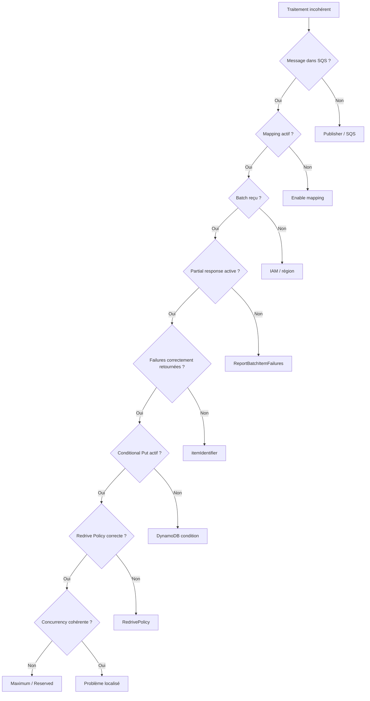

---

# 219. Tip debug

Dans ce TP, quatre identifiants peuvent apparaître :

- **eventId** ;
- **incidentId** ;
- **SQS MessageId** ;
- **Lambda RequestId**.

Ne les confondez pas.

---

# 220. Résumé des identifiants

| Identifiant | Rôle |
|---|---|
| `eventId` | clé d’idempotence métier |
| `incidentId` | identifiant du ticket maintenance |
| SQS `messageId` | identifiant technique du message SQS |
| Lambda `aws_request_id` | identifiant d’une invocation Lambda |

---

# 221. Tip CloudWatch

Ajoutez toujours dans vos logs :

```text
eventId
sqsMessageId
receiveCount
lambdaRequestId
```

si vous devez diagnostiquer des doublons.

---

# 222. Tip idempotence

Ne choisissez pas une clé d’idempotence :

```text
aléatoire à chaque retry
```

Sinon :

```text
le retry paraît toujours nouveau
```

---

# 223. Bonne clé

Une bonne clé représente :

```text
la même opération métier
```

sur toutes les tentatives.

---

# 224. Exemple

```text
eventId généré une fois en amont
puis propagé
```

---

# 225. Tip Partial Batch

Partial Batch Response réduit le retraitement inutile.

Mais il faut :

```text
continuer à traiter les autres records
```

même après une erreur.

---

# 226. Tip exception globale

Si votre handler fait :

```python
raise
```

au premier record échoué :

```text
vous perdez l'intérêt du Partial Batch Response
```

---

# 227. Tip DLQ

Une DLQ ne doit pas rester invisible.

En production :

- métrique ;
- alarme ;
- procédure ;
- ownership.

---

# 228. Tip Redrive

Ne redrivez pas un poison message tant que sa cause n’est pas corrigée.

---

# 229. Tip concurrence

Une grande concurrence n’est pas toujours meilleure.

Elle peut saturer :

- base ;
- ERP ;
- API ;
- quotas.

---

# 230. Tip DynamoDB

Le `Conditional Put` est utile parce que sa décision est atomique.

---

# 231. Tip soutenance

Si on vous demande :

*« Pourquoi utiliser Partial Batch Response si l’idempotence existe déjà ? »*

répondez :

> **L’idempotence protège les effets métier lorsqu’un message est redélivré. Partial Batch Response réduit les redélivrances inutiles des messages déjà réussis lorsqu’un seul élément d’un batch échoue. Les deux mécanismes sont complémentaires.**

---

# 232. Question 5

Que se passe-t-il sans idempotence si un batch complet est rejoué ?

**Réponse :**

Les messages déjà traités peuvent reproduire leurs effets métier.

---

# 233. Question 6

Pourquoi utiliser une écriture conditionnelle au lieu d’un Get puis Put ?

**Réponse :**

Pour éviter une **race condition** entre plusieurs invocations concurrentes.

---

# 234. Question 7

Pourquoi eventId et SQS MessageId sont-ils différents ?

**Réponse :**

Parce que SQS MessageId identifie une publication technique alors que eventId identifie l’opération métier que nous voulons rendre idempotente.

---

# 235. Question 8

Pourquoi une DLQ est-elle utile même avec Partial Batch Response ?

**Réponse :**

Parce qu’un record peut échouer indéfiniment.

Partial Batch Response isole son retry dans le batch, mais la DLQ permet finalement de sortir le poison message du flux normal.

---

# 236. Question 9

Pourquoi limiter la concurrence ?

**Réponse :**

Pour éviter qu’un backlog massif ne surcharge les dépendances aval.

---

# 237. Question 10

Pourquoi redrive ne corrige-t-il pas un message ?

**Réponse :**

Parce que SQS déplace le message ; il ne transforme pas son contenu pendant le redrive.

---

# 238. Exercice guidé 1 - Batch succès

Envoyez cinq messages `success`.

Attendu :

```text
5 items DynamoDB
0 DLQ
```

---

# 239. Exercice guidé 2 - Batch mixte sans Partial Response

Avec Version 1 :

```text
4 success
1 permanent_error
```

Observez les retries et `DUPLICATE_SKIPPED`.

---

# 240. Exercice guidé 3 - Batch mixte avec Partial Response

Avec Version 2 :

```text
4 success
1 retry_once
```

Observez que seul le record temporairement échoué revient.

---

# 241. Exercice guidé 4 - Poison Message

Envoyez :

```text
permanent_error
```

Attendez son passage en DLQ.

---

# 242. Exercice guidé 5 - Double publication

Envoyez deux fois :

```text
eventId = EVT-DUP-2
```

Vérifiez :

```text
1 item DynamoDB
```

---

# 243. Exercice guidé 6 - 10 doublons concurrents

Envoyez dix fois :

```text
eventId = EVT-RACE-2
```

avec Maximum Concurrency `2`.

Attendu :

```text
1 BUSINESS_EFFECT_CREATED
plusieurs DUPLICATE_SKIPPED
```

---

# 244. Exercice guidé 7 - 20 événements uniques

Créez un backlog de 20 événements.

Observez :

- batches ;
- concurrence ;
- durée ;
- diminution du backlog.

---

# 245. Exercice guidé 8 - Redrive

Corrigez la cause d’un poison message.

Utilisez :

```text
Start DLQ redrive
```

---

# 246. Exercice guidé 9 - désactiver Partial Batch

Désactivez temporairement :

```text
ReportBatchItemFailures
```

et comparez le comportement.

---

# 247. Exercice guidé 10 - comparer les coûts logiques

Sans calculer un prix exact, comparez :

```text
nombre d'invocations
nombre de retries
nombre de logs
```

avec et sans Partial Batch Response.

---

# 248. Ce que démontre le TP5

```text
la résilience
n'est pas
simplement activer des retries
```

Il faut aussi :

- isoler les échecs ;
- empêcher les doubles effets ;
- contrôler la concurrence ;
- disposer d’une DLQ ;
- pouvoir redrive ;
- observer les identifiants.

---

# 249. Architecture finale

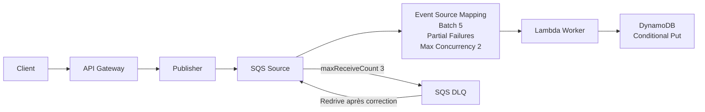

---

# 250. États conceptuels d’un événement

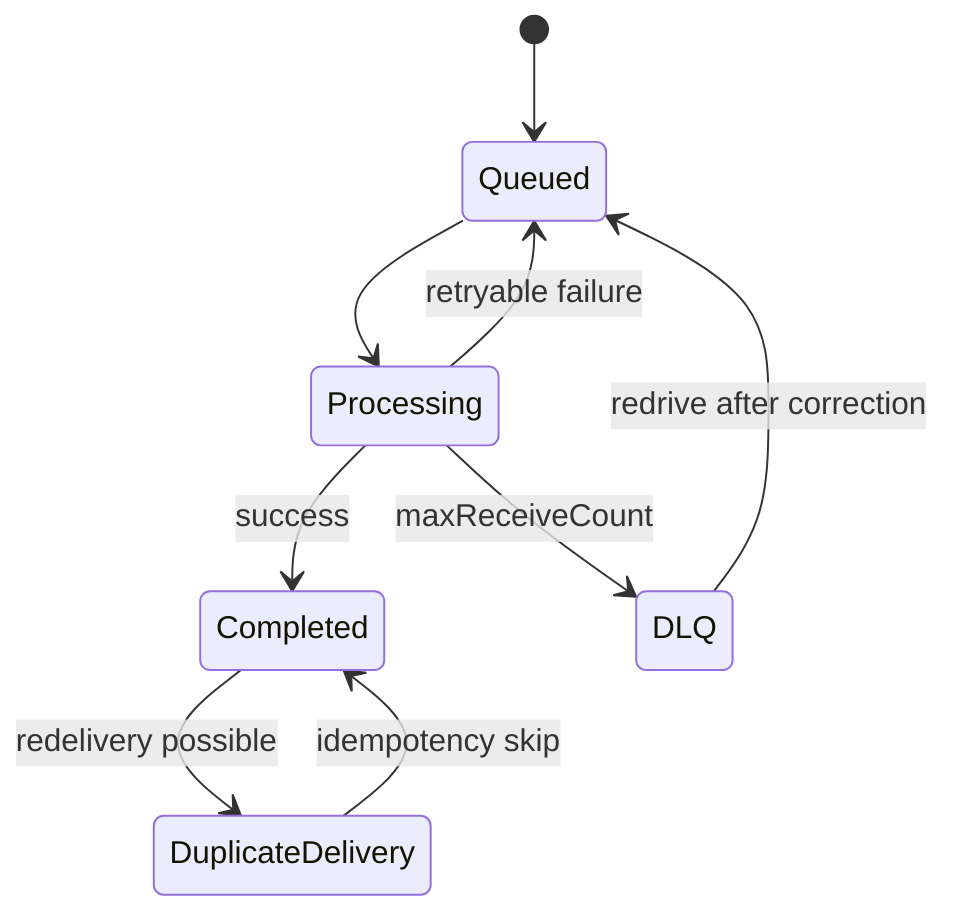

---

# 251. Nettoyage - important

À la fin du TP :

1. désactivez le mapping ;
2. inspectez la DLQ ;
3. supprimez l’API ;
4. supprimez les Lambda ;
5. supprimez les queues ;
6. supprimez la table DynamoDB ;
7. supprimez les rôles du TP si vous les avez créés.

---

# 252. Ne supprimez pas un rôle EPSI partagé

Si vous avez utilisé :

```text
LabRole
StudentRole
```

ou un rôle fourni par l’établissement :

**ne le supprimez pas.**

---

# 253. Supprimer API Gateway

Dans :

```text
API Gateway
APIs
```

supprimez :

```text
api-tp5-resilience-epsi
```

---

# 254. Supprimer Lambda

Supprimez :

```text
lambda-tp5-publisher
lambda-tp5-worker
```

---

# 255. Supprimer SQS

Supprimez :

```text
maintenance-processing
maintenance-processing-dlq
```

---

# 256. Supprimer DynamoDB

Supprimez :

```text
maintenance-results
```

---

# 257. CLI - cleanup optionnel

```bash
aws lambda delete-function \
  --function-name lambda-tp5-publisher \
  --region eu-west-3

aws lambda delete-function \
  --function-name lambda-tp5-worker \
  --region eu-west-3
```

---

# 258. CLI - supprimer table

```bash
aws dynamodb delete-table \
  --table-name maintenance-results \
  --region eu-west-3
```

---

# 259. Tips de fin de TP

Retenez :

1. **SQS Standard est at-least-once.**
2. **Un batch peut contenir succès et échecs.**
3. **Sans Partial Batch Response, des succès peuvent être rejoués.**
4. **ReportBatchItemFailures permet de déclarer les records échoués.**
5. **itemIdentifier utilise le SQS MessageId.**
6. **eventId sert ici de clé d’idempotence métier.**
7. **L’idempotence et Partial Batch Response sont complémentaires.**
8. **Get puis Put peut créer une race condition.**
9. **Conditional Put rend la décision atomique.**
10. **Une DLQ isole les poison messages.**
11. **maxReceiveCount limite les retries.**
12. **Le Redrive ne modifie pas les messages.**
13. **Corrigez la cause avant un Redrive.**
14. **Maximum Concurrency protège les systèmes aval.**
15. **Reserved Concurrency et Maximum Concurrency sont différentes.**
16. **Visibility Timeout doit être cohérent avec le timeout Lambda.**
17. **Les logs doivent contenir les bons identifiants.**
18. **Un SQS MessageId n’est pas forcément une clé métier.**
19. **L’idempotence doit fonctionner sous concurrence.**
20. **Nettoyez les ressources de TP.**

---

# 260. Checklist finale

- [ ] J’ai créé la DLQ `maintenance-processing-dlq`.
- [ ] J’ai créé `maintenance-processing`.
- [ ] J’ai configuré Visibility Timeout à `30 s`.
- [ ] J’ai configuré `maxReceiveCount = 3`.
- [ ] J’ai créé `maintenance-results`.
- [ ] La partition key DynamoDB est `eventId`.
- [ ] J’ai créé `lambda-tp5-publisher`.
- [ ] Le publisher peut faire `sqs:SendMessage`.
- [ ] J’ai créé API Gateway HTTP API.
- [ ] J’ai créé `POST /maintenance-events`.
- [ ] J’ai créé `lambda-tp5-worker`.
- [ ] Le worker peut lire la source SQS.
- [ ] Le worker peut écrire dans DynamoDB.
- [ ] J’ai configuré Lambda timeout à `5 s`.
- [ ] J’ai configuré Batch Size à `5`.
- [ ] J’ai testé Version 1 sans Partial Batch.
- [ ] J’ai observé le retraitement d’un batch.
- [ ] J’ai observé `DUPLICATE_SKIPPED`.
- [ ] J’ai activé `ReportBatchItemFailures`.
- [ ] J’ai déployé Version 2.
- [ ] J’ai retourné `batchItemFailures`.
- [ ] J’ai utilisé le SQS MessageId comme `itemIdentifier`.
- [ ] J’ai testé `retry_once`.
- [ ] Seul le record en échec a été rejoué.
- [ ] J’ai testé `permanent_error`.
- [ ] Le poison message a atteint la DLQ.
- [ ] J’ai testé deux publications avec le même eventId.
- [ ] Un seul item DynamoDB a été créé.
- [ ] J’ai utilisé `attribute_not_exists(eventId)`.
- [ ] Je sais expliquer la race condition Get puis Put.
- [ ] J’ai configuré Maximum Concurrency à `2`.
- [ ] J’ai créé un backlog de plusieurs messages.
- [ ] J’ai observé les invocations concurrentes.
- [ ] Je sais expliquer Maximum Concurrency.
- [ ] Je sais expliquer Reserved Concurrency.
- [ ] Je sais expliquer ApproximateReceiveCount.
- [ ] Je sais expliquer Visibility Timeout.
- [ ] Je sais expliquer Partial Batch Response.
- [ ] Je sais expliquer l’idempotence.
- [ ] Je sais distinguer eventId et SQS MessageId.
- [ ] J’ai utilisé Start DLQ redrive.
- [ ] Je sais pourquoi le message doit être corrigé avant Redrive.
- [ ] J’ai nettoyé les ressources.

---

# 261. Résumé final

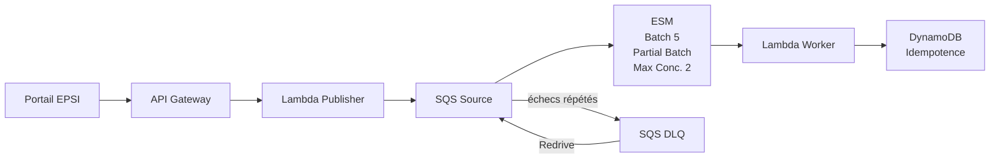

Le point essentiel du TP5 est :

> **Dans une architecture asynchrone, les retries sont normaux. Partial Batch Response réduit les retries inutiles, tandis que l’idempotence protège le métier contre les redélivrances et la concurrence. La DLQ isole les poison messages et le Redrive permet leur reprise après correction.**

---

# 262. Références AWS

Documentation utile :

- **Gestion des erreurs Lambda avec SQS** :  
  `https://docs.aws.amazon.com/lambda/latest/dg/services-sqs-errorhandling.html`

- **Partial Batch Response** :  
  `https://docs.aws.amazon.com/lambda/latest/dg/services-sqs-errorhandling.html#services-sqs-batchfailurereporting`

- **Paramètres Event Source Mapping SQS** :  
  `https://docs.aws.amazon.com/lambda/latest/dg/services-sqs-parameters.html`

- **Configuration SQS Event Source Mapping** :  
  `https://docs.aws.amazon.com/lambda/latest/dg/services-sqs-configure.html`

- **Scaling et Maximum Concurrency SQS/Lambda** :  
  `https://docs.aws.amazon.com/lambda/latest/dg/services-sqs-scaling.html`

- **SQS Dead-Letter Queues** :  
  `https://docs.aws.amazon.com/AWSSimpleQueueService/latest/SQSDeveloperGuide/sqs-dead-letter-queues.html`

- **Configurer une DLQ SQS** :  
  `https://docs.aws.amazon.com/AWSSimpleQueueService/latest/SQSDeveloperGuide/sqs-configure-dead-letter-queue.html`

- **DLQ Redrive** :  
  `https://docs.aws.amazon.com/AWSSimpleQueueService/latest/SQSDeveloperGuide/sqs-configure-dead-letter-queue-redrive.html`

- **DynamoDB Condition Expressions** :  
  `https://docs.aws.amazon.com/amazondynamodb/latest/developerguide/Expressions.ConditionExpressions.html`

- **DynamoDB PutItem** :  
  `https://docs.aws.amazon.com/amazondynamodb/latest/APIReference/API_PutItem.html`

- **AWS Lambda Powertools Idempotency** :  
  `https://docs.aws.amazon.com/powertools/python/latest/utilities/idempotency/`

- **DynamoDB Pricing et Free Tier** :  
  `https://aws.amazon.com/dynamodb/pricing/`

- **AWS Free Tier** :  
  `https://aws.amazon.com/free/`
