# TP 5 - Idempotence, Duplicate Detection, retries, DLQ et concurrence avec Azure Logic Apps, Service Bus et Table Storage - EPSI

**Niveau :** *avancé*  
**Durée indicative :** *3 h 30 à 4 h 30*  
**Mode principal :** **Portail Azure**  
**Mode secondaire :** *Azure CLI, uniquement en option et à titre de comparaison*  
**Architecture :** **Logic Apps Consumption**, **Azure Service Bus Standard**, **Duplicate Detection**, **Peek-Lock**, **Azure Table Storage**, **idempotence**, **Concurrency Control**, **DLQ**, **Managed Identity** et **RBAC**  
**Public visé :** *étudiants EPSI disposant d’un compte Azure personnel, Azure for Students ou d’un abonnement Azure fourni par l’établissement.*

---

# 1. Objectifs du TP

À la fin de ce TP, vous devez être capables de :

- expliquer pourquoi **at-least-once** implique des redélivrances possibles ;
- comprendre la différence entre :
  - doublon à l’**envoi** ;
  - redélivrance au **consumer** ;
- activer **Duplicate Detection** sur Azure Service Bus ;
- comprendre que Duplicate Detection utilise **Message Id** ;
- comprendre la **Duplicate Detection History Window** ;
- distinguer :
  - `eventId` métier ;
  - `Message Id` Service Bus ;
  - `Correlation Id` ;
- créer une queue Service Bus **Standard** ;
- utiliser un **Message Id contrôlé par l’application** ;
- montrer qu’un second envoi avec le même Message Id peut être ignoré par Service Bus ;
- comprendre pourquoi Duplicate Detection **ne remplace pas l’idempotence côté consumer** ;
- créer un compte **Azure Storage** ;
- créer une table **ProcessedEvents** ;
- utiliser **Insert Entity (V2)** ;
- utiliser une combinaison :
  - `PartitionKey` ;
  - `RowKey` ;
  comme clé d’idempotence ;
- exploiter un conflit **409 EntityAlreadyExists** comme détection de doublon métier ;
- utiliser **Managed Identity** avec Azure Table Storage ;
- attribuer **Storage Table Data Contributor** ;
- utiliser **Peek-Lock** ;
- utiliser :
  - **Complete** ;
  - **Abandon** ;
  - **Dead-letter** ;
- comprendre **Delivery Count** ;
- comprendre **Max Delivery Count** ;
- configurer une **DLQ** ;
- provoquer un **retry** ;
- simuler un succès métier suivi d’un problème de settlement ;
- montrer qu’un message redélivré ne recrée pas un effet métier ;
- configurer **Concurrency Control = 2** ;
- comprendre une **race condition** ;
- comprendre pourquoi *Get puis Insert* n’est pas une bonne stratégie d’idempotence ;
- simuler plusieurs messages ayant le même `eventId` mais des Message Id différents ;
- montrer qu’une seule insertion métier est acceptée ;
- comprendre les **Retry Policies** Logic Apps ;
- inspecter les runs concurrents ;
- analyser la DLQ ;
- réinjecter proprement un message après correction ;
- utiliser Azure CLI uniquement comme *équivalent optionnel*.

---

# 2. Position du TP5 dans la progression

Le TP1 a introduit :

```text
Logic App productrice
Service Bus Queue
Logic App consommatrice
```

Le TP2 a ajouté :

```text
Transformation
Normalisation
Routage
Plusieurs queues
```

Le TP3 a ajouté :

```text
Topic
Subscriptions
Filters
Publish/Subscribe
```

Le TP4 a ajouté :

```text
Peek-Lock
Complete
Abandon
Dead-letter
Delivery Count
DLQ
```

Le TP5 traite maintenant le problème suivant :

```text
Comment éviter un double effet métier
quand un message est envoyé ou traité plusieurs fois ?
```

---

# 3. Problème central

Dans une architecture distribuée :

```text
un message peut être envoyé plusieurs fois
```

et :

```text
un message peut être reçu plusieurs fois
```

Ce sont deux problèmes différents.

---

# 4. Doublon côté envoi

Exemple :

```text
le client envoie un message
Service Bus l'accepte
la réponse réseau est perdue
le client ne sait pas si l'envoi a réussi
le client renvoie
```

Résultat potentiel :

```text
2 messages identiques
```

---

# 5. Protection côté envoi

Service Bus propose :

```text
Duplicate Detection
```

Lorsque deux envois utilisent le même :

```text
Message Id
```

dans la fenêtre configurée :

```text
le doublon peut être ignoré
```

---

# 6. Redélivrance côté consumer

Autre scénario :

```text
un seul message existe dans la queue
```

mais :

```text
le consumer le reçoit
fait l'effet métier
puis perd le lock avant Complete
```

Le même message peut être :

```text
redélivré
```

---

# 7. Protection côté consumer

Dans ce cas, Duplicate Detection ne suffit pas.

Il faut :

```text
un traitement idempotent
```

---

# 8. Deux protections complémentaires

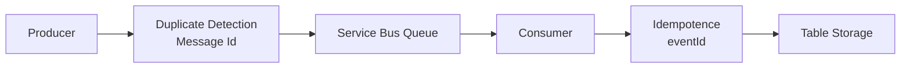

---

# 9. Principe du TP

Nous allons utiliser :

```text
transportMessageId
```

comme :

```text
Message Id Service Bus
```

et :

```text
eventId
```

comme :

```text
clé d'idempotence métier
```

---

# 10. Pourquoi deux identifiants ?

Cela permet de démontrer séparément :

## Test A

Deux messages avec :

```text
même transportMessageId
```

Résultat :

```text
Duplicate Detection bloque le second envoi
```

## Test B

Deux messages avec :

```text
transportMessageId différents
eventId identique
```

Résultat :

```text
les deux passent Service Bus
mais
l'idempotence métier n'accepte qu'un seul effet
```

---

# 11. Architecture générale

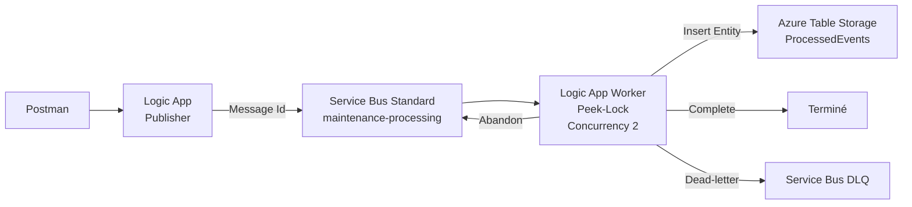

---

# 12. Scénario métier

EPSI traite des demandes de maintenance.

Exemple :

```json
{
  "eventId": "EVT-5001",
  "transportMessageId": "MSG-5001-A",
  "incidentId": "INC-5001",
  "campus": "EPSI",
  "category": "network",
  "simulateResult": "success"
}
```

---

# 13. eventId

`eventId` représente :

```text
l'opération métier unique
```

Il doit rester identique sur les retries ou doubles publications représentant la même opération.

---

# 14. transportMessageId

`transportMessageId` représente :

```text
l'identifiant utilisé dans Message Id Service Bus
```

---

# 15. Correlation Id

Nous utiliserons également :

```text
Correlation Id
```

pour relier :

- producer ;
- queue ;
- worker ;
- logs.

---

# 16. Scénarios de simulation

La propriété :

```text
simulateResult
```

accepte :

```text
success
retry_once
complete_failure_once
permanent_error
```

---

# 17. Signification

## success

Le traitement réussit.

Résultat :

```text
Insert idempotence
Complete
```

## retry_once

Première livraison :

```text
Abandon
```

Livraison suivante :

```text
traitement normal
```

## complete_failure_once

Première livraison :

```text
effet métier enregistré
puis
Abandon volontaire
```

Deuxième livraison :

```text
doublon détecté dans Table Storage
aucun deuxième effet métier
Complete
```

## permanent_error

Résultat :

```text
Dead-letter immédiat
```

---

# 18. Pourquoi complete_failure_once est important ?

C’est le scénario qui montre réellement :

```text
l'effet métier a réussi
mais
le message revient
```

Sans idempotence :

```text
l'effet métier pourrait être produit deux fois
```

---

# 19. Service Bus tier obligatoire

Le TP5 utilise :

```text
Duplicate Detection
```

Cette fonctionnalité nécessite :

```text
Standard
```

ou :

```text
Premium
```

**Basic ne suffit pas.**

---

# 20. Pourquoi revenir à Standard ?

Le TP3 utilisait déjà Standard pour les Topics.

Le TP5 l’utilise pour une autre fonctionnalité :

```text
Duplicate Detection
```

---

# 21. Duplicate Detection doit être activée à la création

Point important :

```text
vous ne pouvez pas activer Duplicate Detection plus tard
si la queue a été créée sans cette option
```

Créez donc correctement la queue dès le départ.

---

# 22. Duplicate Detection History Window

Service Bus conserve une mémoire des Message Id déjà vus pendant une fenêtre.

Valeur par défaut :

```text
10 minutes
```

---

# 23. Plage possible

La fenêtre peut être configurée entre environ :

```text
20 secondes
```

et :

```text
7 jours
```

---

# 24. Valeur du TP

Nous utiliserons :

```text
10 minutes
```

Cela suffit largement pour les expériences.

---

# 25. Attention au débit

Plus la fenêtre est grande :

```text
plus Service Bus doit retenir et comparer de Message Id
```

Cela peut réduire le débit.

---

# 26. Exactement une fois ?

Microsoft décrit Duplicate Detection comme une protection très forte sur les **envois dupliqués dans la fenêtre**.

Mais :

```text
cela ne signifie pas exactly-once métier de bout en bout
```

---

# 27. Pourquoi ?

Parce qu’un consumer peut encore :

- perdre son lock ;
- redémarrer ;
- ne pas confirmer Complete ;
- recevoir le même message à nouveau.

---

# 28. Architecture d’idempotence

Nous utiliserons **Azure Table Storage**.

Table :

```text
ProcessedEvents
```

Chaque effet métier est représenté par une entité.

---

# 29. Clé Table Storage

Nous utiliserons :

```text
PartitionKey = maintenance
RowKey = eventId
```

---

# 30. Unicité

Dans Azure Table Storage :

```text
PartitionKey + RowKey
```

forment la clé primaire unique.

---

# 31. Effet d’un double Insert

Premier Insert :

```text
succès
```

Deuxième Insert avec la même clé :

```text
409 Conflict
EntityAlreadyExists
```

---

# 32. Pourquoi c’est intéressant ?

Nous transformons ce `409` en signal :

```text
cet eventId a déjà produit son effet métier
```

---

# 33. Ce n’est pas une erreur métier

Dans notre workflow idempotent :

```text
409 EntityAlreadyExists
```

sera considéré comme :

```text
DUPLICATE_SKIPPED
```

puis le message sera **Complete**.

---

# 34. Concurrence

Nous configurerons le trigger du worker avec :

```text
Concurrency Control = On
Degree of Parallelism = 2
```

---

# 35. Pourquoi 2 ?

Cela permet de démontrer que :

```text
deux instances peuvent traiter en parallèle
```

et tenter d’insérer le même `eventId`.

---

# 36. Race condition naïve

Une mauvaise approche serait :

```text
Get Entity
si absent
Insert Entity
```

---

# 37. Pourquoi c’est mauvais ?

Deux instances peuvent faire :

```text
Get absent
Get absent
```

puis toutes les deux :

```text
Insert
```

---

# 38. Diagramme de race

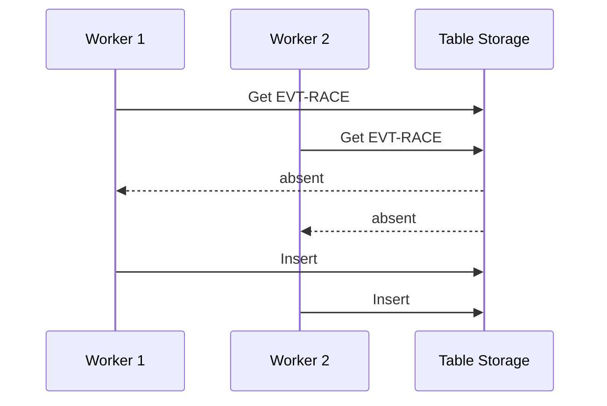

La logique :

```text
Get puis décision
```

n’est pas atomique.

---

# 39. Notre stratégie

Nous faisons directement :

```text
Insert Entity
```

avec une clé unique.

Un seul Insert peut créer la clé.

---

# 40. Résultat sous concurrence

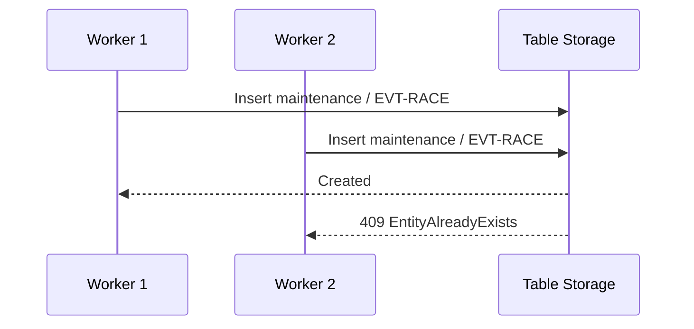

---

# 41. Services du TP

Nous allons utiliser :

- **Azure Logic Apps Consumption** ;
- **Azure Service Bus Standard** ;
- **Azure Storage Account** ;
- **Azure Table Storage** ;
- **Managed Identity** ;
- **Azure RBAC**.

---

# 42. Ressources

```text
Resource Group
rg-tp5-idempotence-si

Service Bus Namespace
sb-tp5-<initiales>-<nombre>

Queue
maintenance-processing

Storage Account
sttp5<initiales><nombre>

Table
ProcessedEvents

Logic Apps
la-tp5-producteur
la-tp5-worker
```

---

# 43. Paramètres Service Bus

```text
SKU = Standard
Duplicate Detection = Enabled
Duplicate Detection Window = 10 minutes
Lock Duration = 1 minute
Max Delivery Count = 3
```

---

# 44. Comptes étudiants

Le TP utilise plus de services que les TP précédents.

Pour limiter les coûts :

- une seule queue ;
- deux Logic Apps ;
- un Storage Account ;
- une seule table ;
- quelques dizaines de messages ;
- suppression du Resource Group à la fin.

---

# 45. Azure for Students

Les étudiants éligibles peuvent utiliser leur crédit **Azure for Students**.

*Les offres peuvent évoluer : vérifiez toujours les conditions de votre abonnement.*

---

# 46. Comptes EPSI restreints

Si le bouton :

```text
Add role assignment
```

est indisponible :

l’enseignant doit effectuer l’attribution RBAC.

---

# 47. Étape 1 - Créer le Resource Group

Dans :

```text
Resource groups
```

cliquez sur :

```text
Create
```

Nom :

```text
rg-tp5-idempotence-si
```

Region :

```text
West Europe
```

ou région autorisée.

---

## Équivalent Azure CLI - optionnel

```bash
az group create \
  --name rg-tp5-idempotence-si \
  --location westeurope
```

---

# 48. Étape 2 - Créer le namespace Service Bus

Dans :

```text
Service Bus
```

cliquez sur :

```text
Create
```

---

# 49. Paramètres namespace

| Paramètre | Valeur |
|---|---|
| Resource Group | `rg-tp5-idempotence-si` |
| Namespace | `sb-tp5-...` |
| Region | même région |
| Pricing tier | **Standard** |

---

# 50. Pourquoi pas Basic ?

Parce que :

```text
Duplicate Detection
```

n’est pas supportée en Basic.

---

## Équivalent Azure CLI - optionnel

```bash
az servicebus namespace create \
  --resource-group rg-tp5-idempotence-si \
  --name sb-tp5-xx-12345 \
  --location westeurope \
  --sku Standard
```

---

# 51. Étape 3 - Créer la queue avec Duplicate Detection

Dans :

```text
Service Bus Namespace
Entities
Queues
```

cliquez sur :

```text
+ Queue
```

Nom :

```text
maintenance-processing
```

---

# 52. Activer Duplicate Detection

Activez :

```text
Enable duplicate detection
```

---

# 53. History Window

Configurez :

```text
10 minutes
```

---

# 54. Lock Duration

Configurez :

```text
1 minute
```

---

# 55. Max Delivery Count

Configurez :

```text
3
```

---

# 56. Créer la queue

Validez.

---

# 57. Vérification importante

Après création, vérifiez :

```text
Duplicate detection
Enabled
```

Si vous avez créé la queue sans l’activer :

```text
recréez la queue
```

car l’activation ne peut pas être ajoutée après coup.

---

## Équivalent Azure CLI - optionnel

```bash
az servicebus queue create \
  --resource-group rg-tp5-idempotence-si \
  --namespace-name sb-tp5-xx-12345 \
  --name maintenance-processing \
  --enable-duplicate-detection true \
  --duplicate-detection-history-time-window PT10M \
  --lock-duration PT1M \
  --max-delivery-count 3
```

---

# 58. Vérifier en CLI - optionnel

```bash
az servicebus queue show \
  --resource-group rg-tp5-idempotence-si \
  --namespace-name sb-tp5-xx-12345 \
  --name maintenance-processing \
  --query '{
    duplicateDetection:requiresDuplicateDetection,
    duplicateWindow:duplicateDetectionHistoryTimeWindow,
    lockDuration:lockDuration,
    maxDeliveryCount:maxDeliveryCount
  }' \
  --output json
```

---

# 59. Étape 4 - Créer le Storage Account

Dans :

```text
Storage accounts
```

cliquez :

```text
Create
```

---

# 60. Paramètres Storage Account

Nom :

```text
sttp5xx12345
```

Le nom doit être :

- en minuscules ;
- unique ;
- sans tiret.

---

# 61. Performance

Choisissez :

```text
Standard
```

Redundancy :

```text
LRS
```

pour le TP.

---

# 62. Pourquoi LRS ?

Le but n’est pas d’étudier la réplication géographique.

**Locally-redundant storage** suffit pour la séance.

---

# 63. Créer le compte

Validez la création.

---

## Équivalent Azure CLI - optionnel

```bash
az storage account create \
  --name sttp5xx12345 \
  --resource-group rg-tp5-idempotence-si \
  --location westeurope \
  --sku Standard_LRS \
  --kind StorageV2
```

---

# 64. Étape 5 - Créer la table

Ouvrez le Storage Account.

Recherchez :

```text
Storage browser
Tables
```

ou :

```text
Table service
```

---

# 65. Créer la table

Nom :

```text
ProcessedEvents
```

---

# 66. Attention au nom

Pour simplifier :

```text
pas de tiret
```

dans le nom de la table.

---

## Équivalent Azure CLI - optionnel

```bash
az storage table create \
  --name ProcessedEvents \
  --account-name sttp5xx12345 \
  --auth-mode login
```

*Selon les droits de votre compte, une attribution RBAC de données peut être nécessaire avant cette commande.*

---

# 67. Étape 6 - Créer la Logic App productrice

Créez :

```text
la-tp5-producteur
```

Plan :

```text
Consumption
```

---

# 68. Activer Managed Identity

**Settings**, puis **Identity**.

Activez :

```text
System assigned
```

---

# 69. Data Sender

Sur la queue :

```text
maintenance-processing
```

attribuez :

```text
Azure Service Bus Data Sender
```

à :

```text
la-tp5-producteur
```

---

# 70. Étape 7 - Trigger HTTP

Dans le Designer :

```text
When a HTTP request is received
```

Method :

```text
POST
```

---

# 71. Payload

Exemple :

```json
{
  "eventId": "EVT-5001",
  "transportMessageId": "MSG-5001-A",
  "incidentId": "INC-5001",
  "campus": "EPSI",
  "category": "network",
  "simulateResult": "success"
}
```

---

# 72. JSON Schema

```json
{
  "type": "object",
  "properties": {
    "eventId": {
      "type": "string",
      "minLength": 1
    },
    "transportMessageId": {
      "type": "string",
      "minLength": 1
    },
    "incidentId": {
      "type": "string",
      "minLength": 1
    },
    "campus": {
      "type": "string",
      "minLength": 1
    },
    "category": {
      "type": "string",
      "minLength": 1
    },
    "simulateResult": {
      "type": "string",
      "enum": [
        "success",
        "retry_once",
        "complete_failure_once",
        "permanent_error"
      ]
    }
  },
  "required": [
    "eventId",
    "transportMessageId",
    "incidentId",
    "campus",
    "category",
    "simulateResult"
  ],
  "additionalProperties": false
}
```

---

# 73. Activer Schema Validation

Dans :

```text
Trigger Settings
Data Handling
Schema Validation
```

choisissez :

```text
On
```

---

# 74. Étape 8 - Build_Event

Ajoutez :

```text
Compose
```

Nom :

```text
Build_Event
```

---

# 75. Body interne

```json
{
  "eventType": "MaintenanceProcessingRequested",
  "schemaVersion": 1,
  "eventId": "@{triggerBody()?['eventId']}",
  "transportMessageId": "@{triggerBody()?['transportMessageId']}",
  "correlationId": "@{guid()}",
  "createdAt": "@{utcNow()}",
  "data": {
    "incidentId": "@{triggerBody()?['incidentId']}",
    "campus": "@{triggerBody()?['campus']}",
    "category": "@{toLower(trim(triggerBody()?['category']))}",
    "simulateResult": "@{triggerBody()?['simulateResult']}"
  }
}
```

---

# 76. Pourquoi eventId n’est pas généré ?

Parce qu’il doit être :

```text
stable
```

sur les doubles publications représentant la même opération.

---

# 77. Pourquoi transportMessageId est fourni par le client de test ?

Pour pouvoir contrôler les expériences de :

```text
Duplicate Detection
```

---

# 78. Étape 9 - Send Message

Ajoutez :

```text
Service Bus
Send message
```

Queue :

```text
maintenance-processing
```

Connexion :

```text
Managed Identity
```

---

# 79. Content

Utilisez :

```text
Outputs de Build_Event
```

---

# 80. Message Id

Dans les paramètres avancés :

```text
Message Id
```

utilisez :

```text
transportMessageId
```

---

# 81. Correlation Id

Utilisez le :

```text
correlationId
```

de `Build_Event`.

---

# 82. Pourquoi ne pas utiliser eventId comme Message Id ?

Nous pourrions le faire en production.

Mais pour le TP, nous voulons démontrer séparément :

- déduplication transport ;
- idempotence métier.

---

# 83. Ajouter Properties

Ajoutez si disponible :

```text
eventId
transportMessageId
simulateResult
```

dans les propriétés du message.

---

# 84. Response

Retournez :

```text
202 Accepted
```

Body :

```json
{
  "status": "QUEUED"
}
```

---

# 85. Étape 10 - Tester Duplicate Detection sans worker

Ne créez pas encore le worker.

Envoyez :

```json
{
  "eventId": "EVT-DD-1",
  "transportMessageId": "MSG-DD-1",
  "incidentId": "INC-DD-1",
  "campus": "EPSI",
  "category": "network",
  "simulateResult": "success"
}
```

---

# 86. Premier résultat

Queue :

```text
Active message count +1
```

---

# 87. Envoyer exactement le même payload une deuxième fois

Le producer peut encore retourner :

```text
202
```

car l’envoi vers Service Bus est accepté.

---

# 88. Résultat attendu queue

Le compteur ne doit pas augmenter comme pour un nouveau Message Id.

Le doublon est reconnu grâce à :

```text
Message Id = MSG-DD-1
```

---

# 89. Point important

Service Bus ne compare pas tout le body.

La Duplicate Detection repose sur :

```text
Message Id
```

---

# 90. Test Message Id différent

Envoyez :

```text
eventId = EVT-DD-1
transportMessageId = MSG-DD-2
```

---

# 91. Résultat

Ce message n’est pas un doublon transport pour Service Bus.

Il est donc accepté comme nouveau message.

---

# 92. C’est volontaire

Nous avons maintenant deux messages différents dans Service Bus qui représentent :

```text
le même eventId métier
```

L’idempotence du consumer devra protéger l’effet.

---

# 93. Étape 11 - Créer la Logic App worker

Créez :

```text
la-tp5-worker
```

Plan :

```text
Consumption
```

---

# 94. Activer Managed Identity

**Settings**, puis **Identity**.

Activez :

```text
System assigned
```

---

# 95. Data Receiver Service Bus

Sur :

```text
maintenance-processing
```

attribuez :

```text
Azure Service Bus Data Receiver
```

à :

```text
la-tp5-worker
```

---

# 96. Accès Table Storage

Sur le Storage Account :

```text
Access control (IAM)
```

attribuez :

```text
Storage Table Data Contributor
```

à :

```text
la-tp5-worker
```

---

# 97. Pourquoi ce rôle ?

Il permet l’accès en lecture / écriture / suppression sur les données Table Storage.

Pour le TP, nous avons principalement besoin de :

```text
Insert Entity
```

---

# 98. Scope manuel

Dans le Portail Azure, utilisez le scope :

```text
Storage Account
```

pour simplifier.

---

# 99. Scope minimal via CLI

Azure RBAC peut être attribué au niveau exact de la table via CLI.

Nous le montrerons en option.

---

# 100. Étape 12 - Trigger Peek-Lock

Dans le Designer :

```text
Service Bus
When a message is received in a queue (peek-lock)
```

Queue :

```text
maintenance-processing
```

---

# 101. Ne pas utiliser Auto-complete

Nous devons décider nous-mêmes :

- Complete ;
- Abandon ;
- Dead-letter.

---

# 102. Étape 13 - Concurrency Control

Ouvrez les **Settings** du trigger.

Activez :

```text
Concurrency Control
```

---

# 103. Degree of Parallelism

Valeur :

```text
2
```

---

# 104. Pourquoi 2 ?

Nous voulons démontrer :

```text
deux runs peuvent travailler en parallèle
```

sur des messages représentant le même `eventId`.

---

# 105. Conséquence

La protection d’idempotence doit fonctionner même si :

```text
deux runs démarrent presque simultanément
```

---

# 106. Étape 14 - Parse JSON

Ajoutez :

```text
Parse JSON
```

Nom :

```text
Parse_Message
```

Utilisez le body / content du trigger Service Bus.

---

# 107. Schéma

Utilisez un exemple comme :

```json
{
  "eventType": "MaintenanceProcessingRequested",
  "schemaVersion": 1,
  "eventId": "EVT-5001",
  "transportMessageId": "MSG-5001-A",
  "correlationId": "CORR-1",
  "createdAt": "2026-10-05T10:00:00Z",
  "data": {
    "incidentId": "INC-5001",
    "campus": "EPSI",
    "category": "network",
    "simulateResult": "success"
  }
}
```

---

# 108. Étape 15 - Créer la connexion Table Storage

Ajoutez une action :

```text
Azure Table Storage
Insert Entity (V2)
```

---

# 109. Authentification

Choisissez :

```text
Managed Identity
```

ou :

```text
Logic Apps Managed Identity
```

selon l’interface.

---

# 110. Storage Account

Sélectionnez :

```text
sttp5...
```

Table :

```text
ProcessedEvents
```

---

# 111. Entité idempotence

L’entité doit contenir conceptuellement :

```json
{
  "PartitionKey": "maintenance",
  "RowKey": "EVT-5001",
  "incidentId": "INC-5001",
  "status": "PROCESSED",
  "processedAt": "date UTC",
  "transportMessageId": "MSG-5001-A"
}
```

---

# 112. Valeurs dynamiques

Utilisez :

```text
PartitionKey
maintenance
```

```text
RowKey
eventId
```

```text
incidentId
Parse_Message.data.incidentId
```

```text
status
PROCESSED
```

```text
processedAt
utcNow()
```

```text
transportMessageId
Parse_Message.transportMessageId
```

---

# 113. UI du connecteur

Selon la version du Designer, les champs de l’entité peuvent apparaître comme :

- objet Entity ;
- propriétés dynamiques ;
- body JSON.

L’objectif reste :

```text
PartitionKey = maintenance
RowKey = eventId
```

---

# 114. Insert Entity et unicité

L’action :

```text
Insert Entity (V2)
```

doit **ajouter** l’entité.

N’utilisez pas :

```text
Insert or Merge
```

ou :

```text
Insert or Replace
```

pour l’idempotence du TP.

---

# 115. Pourquoi pas Upsert ?

Un Upsert :

```text
écraserait ou fusionnerait
```

l’entité déjà existante.

Nous voulons au contraire :

```text
échouer si elle existe déjà
```

---

# 116. Réponse duplicate

Si la même clé existe :

```text
409 Conflict
EntityAlreadyExists
```

---

# 117. Structure globale du worker

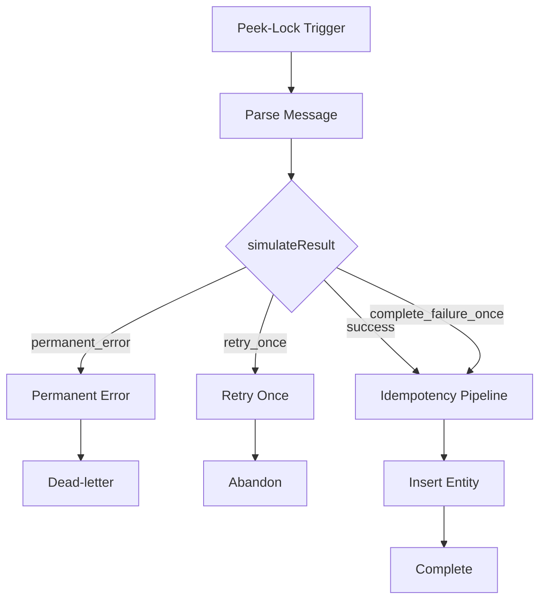

---

# 118. Mais il manque encore le traitement des doublons

Si `Insert Entity` retourne 409 :

```text
le message est déjà traité
```

Il faut donc :

```text
Complete
```

sans recréer l’effet.

---

# 119. Pipeline idempotent complet

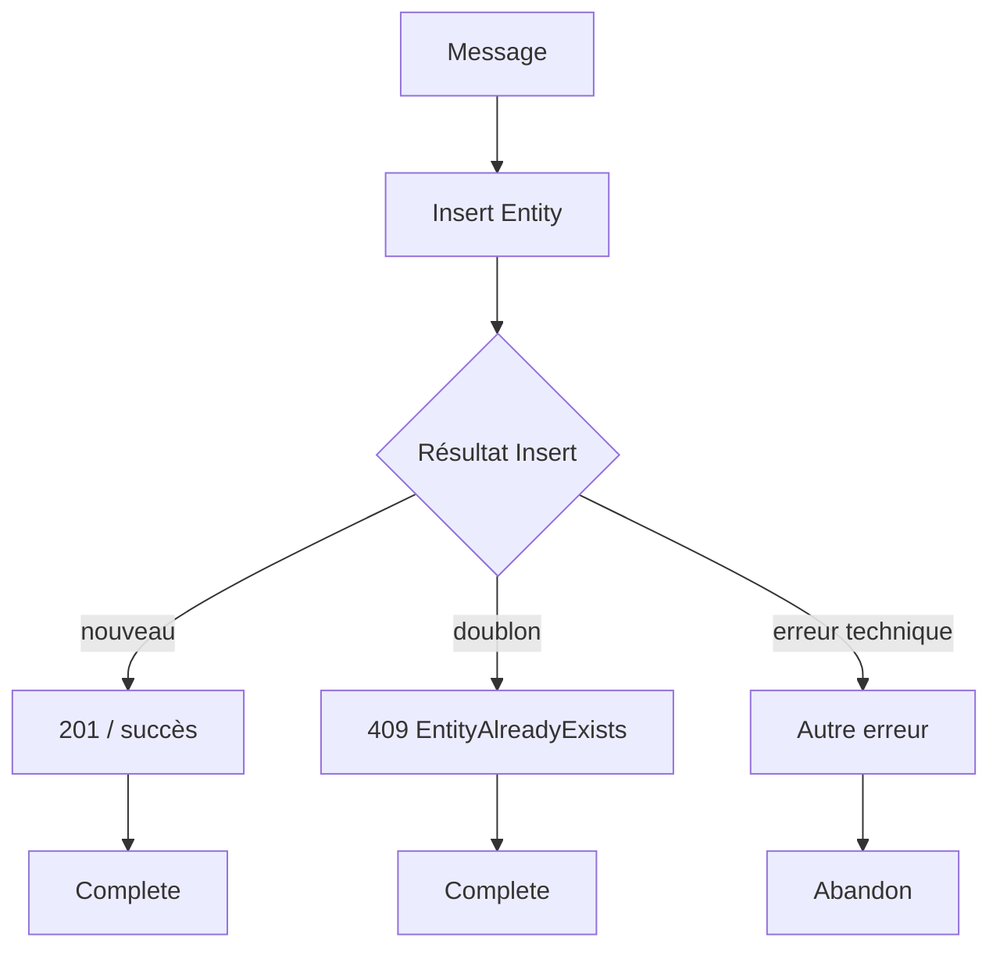

---

# 120. Étape 16 - Organiser les scopes

Créez un **Scope** :

```text
Try_Idempotency
```

À l’intérieur :

```text
Insert Entity (V2)
```

---

# 121. Scope success

Après `Try_Idempotency`, créez :

```text
On_New_Event
```

Configurez **Run after** :

```text
is successful
```

---

# 122. Dans On_New_Event

Ajoutez un **Compose** :

```text
BUSINESS_EFFECT_CREATED
```

Puis :

```text
Complete the message in a queue
```

---

# 123. Lock Token

Utilisez :

```text
Lock Token du trigger
```

---

# 124. Gérer le duplicate

Créez un Scope :

```text
Handle_Insert_Failure
```

Configurez **Run after** :

```text
has failed
```

sur `Try_Idempotency`.

---

# 125. Condition dans Handle_Insert_Failure

Ajoutez une **Condition** pour vérifier si le code retourné correspond à :

```text
409
```

---

# 126. Expression indicative

Selon la structure exacte du connecteur, inspectez le Run History et utilisez une expression proche de :

```text
outputs('Insert_Entity_(V2)')?['statusCode']
```

comparée à :

```text
409
```

> **Tip :** le nom exact de l’action dépend du Designer. Utilisez le contenu dynamique ou l’expression générée par votre workflow.

---

# 127. Branche 409

Si :

```text
409
```

alors :

```text
Compose DUPLICATE_SKIPPED
```

puis :

```text
Complete the message
```

---

# 128. Pourquoi Complete un doublon ?

Parce que l’effet métier existe déjà.

Le message ne doit pas continuer à revenir.

---

# 129. Branche autre erreur

Si l’erreur n’est pas 409 :

```text
Abandon the message
```

---

# 130. Pourquoi Abandon ?

Une erreur technique Storage :

- timeout ;
- service indisponible ;
- 5xx ;

peut être temporaire.

Le message doit pouvoir être retenté.

---

# 131. Retry Policy du connecteur Table

Azure Logic Apps supporte plusieurs stratégies :

- **Default** ;
- **None** ;
- **Fixed Interval** ;
- **Exponential Interval**.

---

# 132. Politique par défaut

Pour de nombreuses actions, la stratégie par défaut effectue jusqu’à :

```text
4 retries
```

avec intervalle exponentiel.

---

# 133. Dans ce TP

Gardez d’abord :

```text
Default
```

sur l’action Table Storage.

---

# 134. Pourquoi 409 n’est pas un retry transient normal ?

Un :

```text
409 EntityAlreadyExists
```

signifie ici :

```text
doublon métier
```

et non :

```text
service temporairement indisponible
```

---

# 135. Étape 17 - Branche permanent_error

Dans le Switch principal :

```text
permanent_error
```

ajoutez :

```text
Dead-letter the message in a queue
```

---

# 136. Reason

```text
PERMANENT_BUSINESS_ERROR
```

---

# 137. Description

```text
Le message est marqué comme erreur permanente dans le TP5.
```

---

# 138. Étape 18 - Branche retry_once

Utilisez :

```text
Delivery Count
```

du trigger.

---

# 139. Condition

Si :

```text
Delivery Count = 1
```

alors :

```text
Abandon
```

Sinon :

```text
continuer vers le pipeline idempotence
```

---

# 140. Pourquoi Delivery Count ?

Il nous permet de simuler :

```text
une erreur temporaire seulement à la première tentative
```

---

# 141. Deuxième livraison

Le message revient avec :

```text
Delivery Count supérieur
```

Le traitement doit alors réussir.

---

# 142. Étape 19 - complete_failure_once

Ce scénario est différent.

Nous voulons :

```text
créer l'effet métier
puis
forcer une redélivrance
```

---

# 143. Première livraison complete_failure_once

Pipeline :

```text
Insert Entity
succès
```

Puis, au lieu de Complete :

```text
Abandon
```

si Delivery Count vaut 1.

---

# 144. Deuxième livraison

Le même message revient.

`Insert Entity` tente à nouveau :

```text
PartitionKey = maintenance
RowKey = même eventId
```

---

# 145. Résultat

Table Storage retourne :

```text
409 EntityAlreadyExists
```

---

# 146. Le workflow doit alors

```text
DUPLICATE_SKIPPED
Complete
```

---

# 147. C’est la démonstration principale de l’idempotence

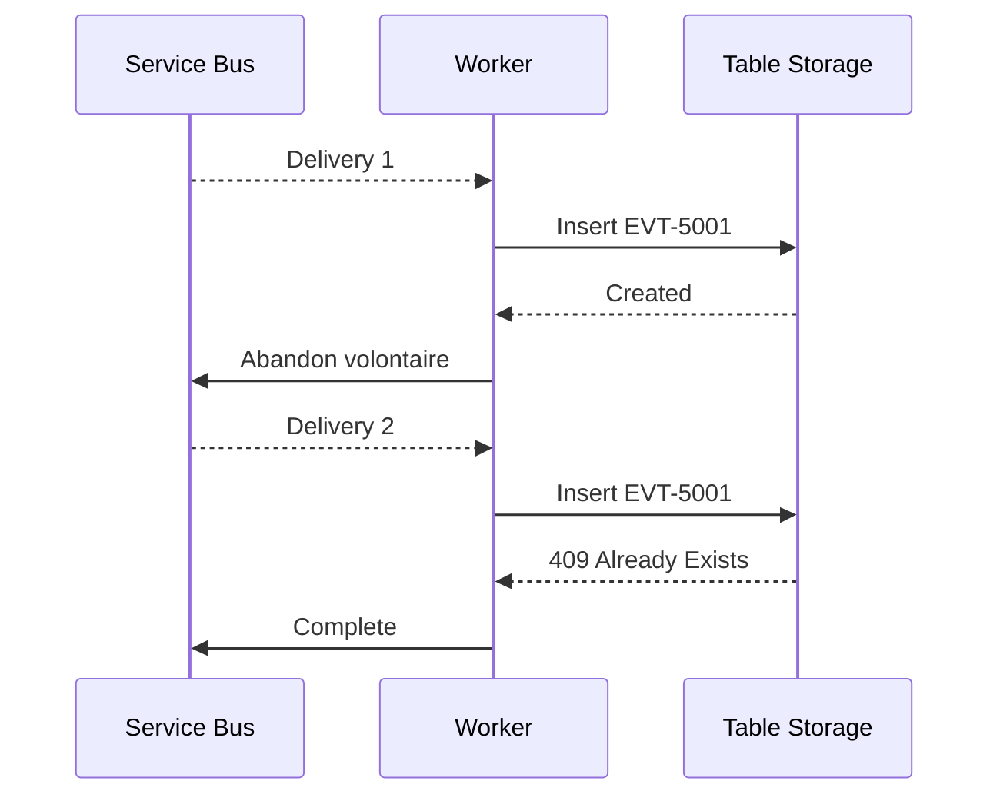

---

# 148. Mise en œuvre dans le workflow

Dans la branche :

```text
complete_failure_once
```

réutilisez le pipeline d’insertion.

Après un **Insert réussi** :

Condition :

```text
Delivery Count = 1 ?
```

---

# 149. Si oui

```text
Abandon
```

---

# 150. Si non

```text
Complete
```

---

# 151. Si Insert retourne 409

```text
Complete
```

directement.

---

# 152. Étape 20 - Sauvegarder le worker

Cliquez :

```text
Save
```

---

# 153. Le worker va consommer les messages de test précédents

Vous avez probablement déjà :

```text
EVT-DD-1
```

dans la queue.

---

# 154. Observer Table Storage

Après traitement :

ouvrez :

```text
Storage browser
Tables
ProcessedEvents
```

---

# 155. Résultat attendu

Une seule entité pour :

```text
RowKey = EVT-DD-1
```

même si deux messages avec des Message Id différents représentent ce même eventId.

---

# 156. Test 1 - success simple

Envoyez :

```json
{
  "eventId": "EVT-SUCCESS-1",
  "transportMessageId": "MSG-SUCCESS-1",
  "incidentId": "INC-SUCCESS-1",
  "campus": "EPSI",
  "category": "network",
  "simulateResult": "success"
}
```

---

# 157. Attendu

```text
Insert Entity
Complete
```

Table :

```text
1 nouvelle entité
```

---

# 158. Test 2 - retry_once

Envoyez :

```json
{
  "eventId": "EVT-RETRY-1",
  "transportMessageId": "MSG-RETRY-1",
  "incidentId": "INC-RETRY-1",
  "campus": "EPSI",
  "category": "network",
  "simulateResult": "retry_once"
}
```

---

# 159. Première tentative

```text
Delivery Count = 1
Abandon
```

---

# 160. Nouvelle tentative

```text
Delivery Count > 1
Insert
Complete
```

---

# 161. Résultat final

Table :

```text
une seule entité EVT-RETRY-1
```

---

# 162. Test 3 - complete_failure_once

Envoyez :

```json
{
  "eventId": "EVT-COMPLETE-FAIL-1",
  "transportMessageId": "MSG-COMPLETE-FAIL-1",
  "incidentId": "INC-COMPLETE-FAIL-1",
  "campus": "EPSI",
  "category": "network",
  "simulateResult": "complete_failure_once"
}
```

---

# 163. Première livraison

```text
Insert Entity = succès
Abandon volontaire
```

---

# 164. Deuxième livraison

```text
Insert Entity = 409
DUPLICATE_SKIPPED
Complete
```

---

# 165. Vérifier la table

Il doit y avoir :

```text
1 seule entité
```

pour cet eventId.

---

# 166. Ce test prouve quoi ?

L’effet métier ne dépend pas de :

```text
nombre de livraisons Service Bus
```

---

# 167. Test 4 - permanent_error

Envoyez :

```json
{
  "eventId": "EVT-PERM-1",
  "transportMessageId": "MSG-PERM-1",
  "incidentId": "INC-PERM-1",
  "campus": "EPSI",
  "category": "network",
  "simulateResult": "permanent_error"
}
```

---

# 168. Attendu

```text
Dead-letter
```

Table :

```text
aucune entité
```

DLQ :

```text
+1
```

---

# 169. Test 5 - Duplicate Detection transport

Désactivez temporairement le worker pour observer le compteur.

---

# 170. Envoyer deux fois

```text
eventId = EVT-TRANSPORT-1
transportMessageId = MSG-TRANSPORT-SAME
```

---

# 171. Attendu

Service Bus ne conserve pas deux messages distincts avec le même Message Id dans la fenêtre.

---

# 172. Réactiver le worker

Le flux reprend.

---

# 173. Test 6 - Idempotence métier avec Message Id différents

Désactivez le worker.

Envoyez :

```text
eventId = EVT-BUSINESS-DUP-1
transportMessageId = MSG-A
```

Puis :

```text
eventId = EVT-BUSINESS-DUP-1
transportMessageId = MSG-B
```

---

# 174. Service Bus

Les deux Message Id sont différents.

La Duplicate Detection ne bloque donc pas le second.

---

# 175. Réactiver le worker

Avec Concurrency Control = 2 :

les deux runs peuvent commencer presque en parallèle.

---

# 176. Résultat Table Storage

Un seul :

```text
RowKey = EVT-BUSINESS-DUP-1
```

doit exister.

---

# 177. Résultat runs

Un run :

```text
BUSINESS_EFFECT_CREATED
```

L’autre :

```text
DUPLICATE_SKIPPED
```

---

# 178. C’est l’idempotence sous concurrence

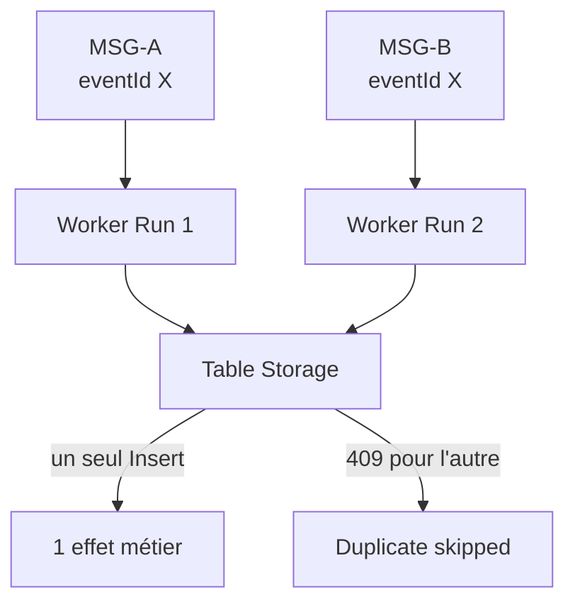

---

# 179. Question 1

Pourquoi Duplicate Detection ne bloque-t-elle pas MSG-A et MSG-B ?

**Réponse :**

Parce que Service Bus compare les :

```text
Message Id
```

et ils sont différents.

---

# 180. Question 2

Pourquoi Table Storage détecte-t-il le doublon ?

**Réponse :**

Parce que les deux messages utilisent le même :

```text
eventId
```

comme :

```text
RowKey
```

dans la même partition.

---

# 181. Question 3

Pourquoi ne pas utiliser uniquement Message Id comme clé métier ?

**Réponse :**

Parce qu’un même événement métier peut parfois être republie avec un nouvel identifiant de transport.

---

# 182. Question 4

Pourquoi ne pas faire Get Entity puis Insert ?

**Réponse :**

Parce que deux runs concurrents peuvent observer l’absence avant l’insertion.

L’Insert basé sur une clé unique laisse le stockage arbitrer atomiquement.

---

# 183. Étape 21 - Observer Run History

Ouvrez :

```text
la-tp5-worker
Runs history
```

---

# 184. Comparer les runs

Pour un même eventId :

recherchez :

- Message Id ;
- Delivery Count ;
- Lock Token ;
- chemin success ;
- chemin duplicate.

---

# 185. Concurrency

Vous pouvez observer deux runs dont les périodes d’exécution se chevauchent.

C’est la preuve que :

```text
Concurrency Control = 2
```

autorise plusieurs instances en parallèle.

---

# 186. Pourquoi contrôler la concurrence ?

Pour éviter de surcharger :

- une base ;
- un ERP ;
- une API ;
- un service tiers.

---

# 187. Concurrency Control n’est pas de l’idempotence

Limiter à :

```text
1
```

réduirait certains risques de concurrence.

Mais cela ne supprime pas :

```text
les redélivrances
```

---

# 188. Mauvaise solution

Dire :

```text
je mets concurrency = 1 donc je n'ai plus besoin d'idempotence
```

est faux.

---

# 189. Pourquoi ?

Le même message peut revenir plus tard, même séquentiellement.

---

# 190. Idempotence reste nécessaire

```text
concurrence 1
ou
concurrence 100
```

un retry doit rester sans danger.

---

# 191. Étape 22 - Inspecter la DLQ

Dans :

```text
Service Bus Explorer
```

sélectionnez :

```text
DeadLetter
```

---

# 192. Peek

Utilisez :

```text
Peek from start
```

---

# 193. Vérifier EVT-PERM-1

Inspectez :

- body ;
- Message Id ;
- Correlation Id ;
- Dead-letter reason ;
- Delivery Count.

---

# 194. Réinjection

Corrigez la cause avant de faire :

```text
Resend
```

---

# 195. Limite

Resend ne doit pas être utilisé comme :

```text
retry infini
```

---

# 196. Étape 23 - Tester Max Delivery Count

Créez un scénario facultatif :

```text
always_retry
```

si vous souhaitez approfondir.

---

# 197. Modification facultative du schema

Ajoutez :

```text
always_retry
```

---

# 198. Worker

Pour `always_retry` :

```text
Abandon à chaque réception
```

---

# 199. Attendu

Après :

```text
Max Delivery Count = 3
```

Service Bus place automatiquement le message en DLQ.

---

# 200. Pourquoi ce scénario est différent de permanent_error ?

`permanent_error` :

```text
DLQ explicite
```

`always_retry` :

```text
DLQ automatique après retries
```

---

# 201. Retry Policy Logic Apps

Les actions Logic Apps peuvent avoir une Retry Policy.

Types :

```text
Default
None
Fixed Interval
Exponential Interval
```

---

# 202. Default

Pour de nombreuses actions, la politique par défaut effectue :

```text
jusqu'à 4 retries
```

avec intervalles exponentiels.

---

# 203. Attention aux couches de retry

Dans notre architecture, il peut y avoir :

```text
retry d'une action
```

et :

```text
redélivrance du message
```

---

# 204. Ce ne sont pas les mêmes choses

Retry action :

```text
même run
même message locké
```

Redelivery Service Bus :

```text
nouveau run
nouvelle livraison
```

---

# 205. Risque de retry multiplication

Si vous combinez :

- nombreux retries action ;
- nombreux Delivery Count ;
- beaucoup de concurrence ;

vous pouvez augmenter fortement :

- coût ;
- latence ;
- charge.

---

# 206. Bon principe

Configurez les retries consciemment.

---

# 207. Exemple

Pour une API externe :

```text
Retry Policy Exponential
```

peut être adaptée.

Pour une erreur métier permanente :

```text
aucun retry
Dead-letter
```

---

# 208. Étape 24 - Tester une Retry Policy

Ajoutez facultativement une action HTTP vers une API de test fournie par l’enseignant.

Dans :

```text
Settings
Retry Policy
```

sélectionnez :

```text
Fixed Interval
```

---

# 209. Exemple

```text
Count = 2
Interval = PT5S
```

---

# 210. Signification

Après l’échec initial :

```text
2 nouvelles tentatives
```

espacées d’environ :

```text
5 secondes
```

---

# 211. Ne pas confondre

```text
Count 2
```

ne signifie pas nécessairement :

```text
2 tentatives totales
```

mais :

```text
2 retries après la tentative initiale
```

---

# 212. Maximum retry count

Logic Apps Consumption permet une configuration de retry plus élevée selon les limites documentées.

Pour un TP :

```text
restez très bas
```

---

# 213. Étape 25 - CLI scope Table Storage précis

Récupérez le principal ID du worker :

```bash
WORKER_ID=$(az resource show \
  --resource-group rg-tp5-idempotence-si \
  --name la-tp5-worker \
  --resource-type Microsoft.Logic/workflows \
  --query identity.principalId \
  --output tsv)
```

---

# 214. Récupérer l’ID Storage Account

```bash
STORAGE_ID=$(az storage account show \
  --resource-group rg-tp5-idempotence-si \
  --name sttp5xx12345 \
  --query id \
  --output tsv)
```

---

# 215. Scope exact table

Construisez :

```bash
TABLE_SCOPE="$STORAGE_ID/tableServices/default/tables/ProcessedEvents"
```

---

# 216. Attribution RBAC

```bash
az role assignment create \
  --assignee-object-id "$WORKER_ID" \
  --assignee-principal-type ServicePrincipal \
  --role "Storage Table Data Contributor" \
  --scope "$TABLE_SCOPE"
```

---

# 217. Pourquoi la CLI est utile ici ?

Le Portail Azure ne permet pas actuellement de choisir directement une table comme scope RBAC.

La CLI permet ce scope plus fin.

---

# 218. CLI - insérer une entité de test

Vous pouvez tester manuellement :

```bash
az storage entity insert \
  --account-name sttp5xx12345 \
  --auth-mode login \
  --table-name ProcessedEvents \
  --entity \
    PartitionKey=maintenance \
    RowKey=EVT-CLI-1 \
    status=PROCESSED \
  --if-exists fail
```

---

# 219. Rejouer la même commande

Résultat attendu :

```text
échec car l'entité existe déjà
```

---

# 220. C’est le même principe que le worker

```text
première création gagnante
les suivantes détectées comme doublons
```

---

# 221. CLI - afficher les entités

```bash
az storage entity query \
  --account-name sttp5xx12345 \
  --auth-mode login \
  --table-name ProcessedEvents \
  --output table
```

---

# 222. CLI - vérifier la queue

```bash
az servicebus queue show \
  --resource-group rg-tp5-idempotence-si \
  --namespace-name sb-tp5-xx-12345 \
  --name maintenance-processing \
  --query '{
    active:countDetails.activeMessageCount,
    deadLetter:countDetails.deadLetterMessageCount,
    duplicateDetection:requiresDuplicateDetection,
    window:duplicateDetectionHistoryTimeWindow
  }' \
  --output table
```

---

# 223. Debug - Duplicate Detection ne fonctionne pas

Vérifiez :

1. SKU Standard ;
2. Duplicate Detection activée à la création ;
3. même **Message Id** ;
4. envoi dans la fenêtre configurée.

---

# 224. Debug - même body mais deux messages stockés

Vérifiez :

```text
Message Id
```

Service Bus ne déduplique pas simplement parce que les bodies sont identiques.

---

# 225. Debug - Message Id vide

Vérifiez l’action :

```text
Send message
Advanced parameters
Message Id
```

---

# 226. Debug - Table Storage Insert remplace l’entité

Vous avez probablement utilisé :

```text
Insert or Replace
```

ou :

```text
Insert or Merge
```

Utilisez :

```text
Insert Entity (V2)
```

---

# 227. Debug - 409 fait échouer tout le workflow

Vérifiez :

```text
Run after
```

du handler duplicate.

Il doit s’exécuter lorsque l’action d’Insert a échoué.

---

# 228. Debug - code 409 non détecté

Ouvrez :

```text
Run History
Insert Entity
Outputs
```

Repérez la structure exacte de :

```text
statusCode
error
```

Adaptez l’expression de la Condition.

---

# 229. Debug - 403 Table Storage

Vérifiez :

```text
Storage Table Data Contributor
```

sur l’identité managée du worker.

---

# 230. Debug - rôle Storage Account Contributor seulement

Ce rôle permet de gérer le compte mais ne donne pas nécessairement accès aux données Table via Microsoft Entra.

Utilisez un rôle de **data access** :

```text
Storage Table Data Contributor
```

---

# 231. Debug - Service Bus 403

Publisher :

```text
Azure Service Bus Data Sender
```

Worker :

```text
Azure Service Bus Data Receiver
```

---

# 232. Debug - duplicate redélivré sans 409

Vérifiez :

```text
PartitionKey
RowKey
```

Les deux tentatives doivent utiliser exactement :

```text
maintenance
même eventId
```

---

# 233. Debug - deux effets métier créés

Vérifiez que l’effet n’est pas produit :

```text
avant
```

l’Insert idempotence.

---

# 234. Ordre correct

```text
acquérir la clé d'idempotence
puis
considérer l'effet comme créé
```

---

# 235. Attention au vrai monde

Dans notre TP :

```text
l'Insert Table représente lui-même l'effet métier
```

Donc la démonstration est atomique et simple.

---

# 236. Si l’effet est une API externe

Exemple :

```text
créer une commande ERP
```

la situation est plus complexe.

---

# 237. Problème

Si vous écrivez la clé avant l’appel ERP :

```text
un échec ERP peut laisser un faux COMPLETED
```

---

# 238. Inversement

Si vous appelez l’ERP avant la clé :

```text
un crash avant l'Insert peut provoquer un deuxième appel ERP
```

---

# 239. Solutions futures

- API aval idempotente ;
- Idempotency-Key ;
- état `IN_PROGRESS` ;
- état `COMPLETED` ;
- Outbox ;
- Saga ;
- transactions ;
- compensation.

---

# 240. Debug - concurrence non visible

Vérifiez :

```text
Concurrency Control = On
Degree of Parallelism = 2
```

et créez plusieurs messages avant de réactiver le worker.

---

# 241. Debug - seulement un run à la fois

Le polling, la disponibilité des messages ou d’autres limites peuvent réduire la concurrence réelle.

Créez un backlog de plusieurs messages.

---

# 242. Debug - trop de runs simultanés

Vérifiez la valeur :

```text
runs
```

du trigger.

---

# 243. Vue Code

La concurrence du trigger correspond à une configuration proche de :

```json
{
  "runtimeConfiguration": {
    "concurrency": {
      "runs": 2
    }
  }
}
```

---

# 244. Ne modifiez pas le JSON si le Designer suffit

Pour ce TP :

```text
utilisez d'abord le Designer
```

La vue Code sert uniquement à comprendre.

---

# 245. Debug méthodique

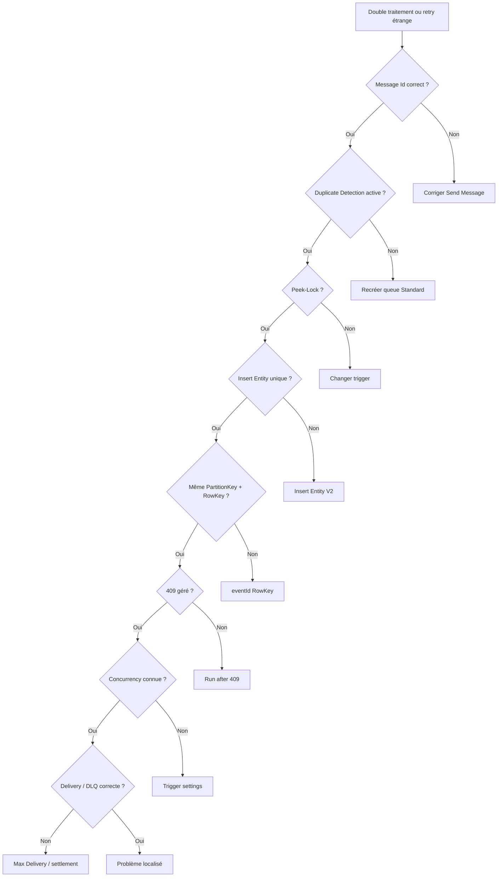

---

# 246. Tip debug

Commencez toujours par répondre à :

```text
est-ce un double envoi
ou
une redélivrance ?
```

---

# 247. Comment le savoir ?

Double envoi :

```text
plusieurs Message Id potentiellement différents
```

Redélivrance :

```text
même message broker
Delivery Count augmente
```

---

# 248. Tip identifiants

Loguez toujours :

- eventId ;
- transportMessageId ;
- Correlation Id ;
- Delivery Count.

---

# 249. Tip Duplicate Detection

Gardez la fenêtre aussi courte que nécessaire.

Une grande fenêtre peut avoir un impact sur le débit.

---

# 250. Tip idempotence

Une bonne clé doit être :

```text
stable pour la même opération
```

---

# 251. Mauvaise clé

```text
guid() généré par le consumer
```

car chaque retry générerait une nouvelle valeur.

---

# 252. Bonne clé

```text
eventId généré une fois en amont
```

et propagé.

---

# 253. Tip 409

Dans ce TP :

```text
409
```

n’est pas forcément une erreur à retenter.

Il signifie :

```text
déjà traité
```

---

# 254. Tip retries

Ne retentez pas aveuglément :

- 400 ;
- 409 métier ;
- validation impossible.

Réservez les retries aux erreurs potentiellement transitoires.

---

# 255. Tip concurrency

La concurrence doit être choisie en fonction du système aval.

Plus n’est pas toujours mieux.

---

# 256. Tip DLQ

Les messages en DLQ doivent avoir :

- un owner ;
- une procédure ;
- une alerte en production.

---

# 257. Tip soutenance

Si on vous demande :

*« Quelle différence entre Duplicate Detection et idempotence ? »*

répondez :

> **Duplicate Detection agit côté Service Bus sur les envois ayant le même Message Id dans une fenêtre donnée. L’idempotence agit côté consumer et garantit qu’une même opération métier ne produit pas plusieurs effets, même si le message est redélivré ou republie avec un autre identifiant de transport.**

---

# 258. Question 5

Pourquoi Service Bus peut-il accepter un doublon transport sans le stocker ?

**Réponse :**

Parce que l’opération d’envoi peut être considérée comme réussie alors que Service Bus reconnaît que le Message Id existe déjà dans la fenêtre et ignore la nouvelle copie.

---

# 259. Question 6

Pourquoi un `eventId` identique avec deux Message Id différents contourne-t-il Duplicate Detection ?

**Réponse :**

Parce que le mécanisme Service Bus compare les Message Id, pas notre clé métier `eventId`.

---

# 260. Question 7

Pourquoi Table Storage convient-il au TP ?

**Réponse :**

Parce que :

```text
PartitionKey + RowKey
```

doivent être uniques et qu’un Insert d’une entité existante renvoie un conflit.

---

# 261. Question 8

Pourquoi ne pas utiliser Insert or Replace ?

**Réponse :**

Parce qu’un upsert masquerait le doublon en remplaçant l’entité existante.

---

# 262. Question 9

Pourquoi une action Table 409 doit-elle finir par Complete ?

**Réponse :**

Parce que le message représente une opération déjà effectuée et ne doit pas être retraité indéfiniment.

---

# 263. Question 10

Pourquoi l’idempotence reste nécessaire même si Concurrency Control = 1 ?

**Réponse :**

Parce qu’une redélivrance peut avoir lieu plus tard, même sans concurrence parallèle.

---

# 264. Exercice guidé 1 - Duplicate Detection

Envoyez deux fois :

```text
même transportMessageId
```

et comparez le compteur de queue.

---

# 265. Exercice guidé 2 - Message Id différent

Gardez :

```text
même eventId
```

mais utilisez deux :

```text
transportMessageId
```

différents.

---

# 266. Résultat

Service Bus accepte les deux.

Table Storage ne crée qu’un effet.

---

# 267. Exercice guidé 3 - retry_once

Observez :

- Delivery Count ;
- Abandon ;
- nouveau run ;
- Insert ;
- Complete.

---

# 268. Exercice guidé 4 - complete_failure_once

Observez :

- Insert réussi ;
- Abandon ;
- redélivrance ;
- 409 ;
- Complete.

---

# 269. Exercice guidé 5 - permanent_error

Vérifiez :

```text
DLQ
```

et l’absence d’entité Table.

---

# 270. Exercice guidé 6 - concurrence

Désactivez le worker.

Envoyez 10 messages avec :

```text
eventId = EVT-RACE-1
```

et :

```text
transportMessageId unique
```

---

# 271. Exemple

```text
MSG-RACE-01
MSG-RACE-02
...
MSG-RACE-10
```

---

# 272. Réactiver le worker

Avec :

```text
Concurrency = 2
```

plusieurs runs peuvent se chevaucher.

---

# 273. Résultat attendu

Table :

```text
1 seule entité EVT-RACE-1
```

Runs :

```text
1 création
plusieurs duplicates
```

---

# 274. Exercice guidé 7 - modifier Concurrency

Passez temporairement de :

```text
2
```

à :

```text
1
```

et comparez le rythme de consommation.

---

# 275. Exercice guidé 8 - Retry Policy

Configurez une action facultative avec :

```text
Fixed Interval
2 retries
PT5S
```

Comparez le Run History.

---

# 276. Exercice guidé 9 - DLQ automatique bonus

Ajoutez :

```text
always_retry
```

et observez :

```text
Max Delivery Count = 3
```

---

# 277. Exercice guidé 10 - Resend DLQ

Corrigez la cause.

Puis utilisez :

```text
Service Bus Explorer
Resend
```

---

# 278. À retenir sur Duplicate Detection

```text
même Message Id
dans la fenêtre
```

permet d’éviter des copies d’envoi.

---

# 279. À retenir sur idempotence

```text
même eventId métier
```

ne doit créer qu’un seul effet.

---

# 280. À retenir sur Table Storage

La clé :

```text
PartitionKey + RowKey
```

est notre arbitre d’unicité.

---

# 281. À retenir sur Concurrency

Deux runs peuvent tenter le même effet en parallèle.

Le stockage doit décider atomiquement.

---

# 282. À retenir sur Peek-Lock

Un message peut revenir tant que son traitement n’est pas correctement settled.

---

# 283. À retenir sur Retry Policy

Un retry d’action et une redélivrance Service Bus sont deux niveaux différents.

---

# 284. À retenir sur DLQ

Un message impossible à traiter doit sortir du flux normal.

---

# 285. Architecture finale

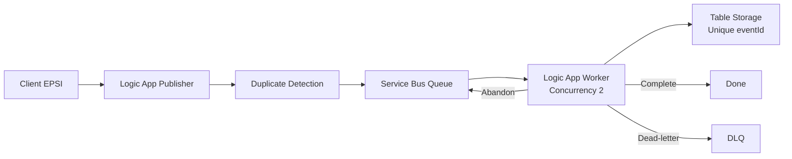

---

# 286. Machine à états simplifiée

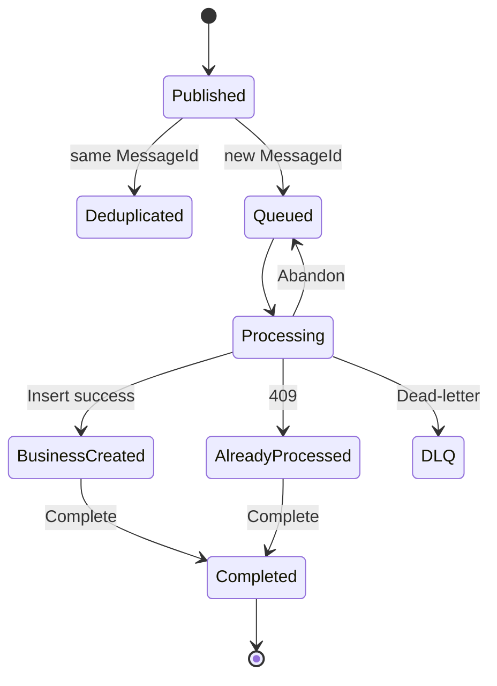

---

# 287. Nettoyage

À la fin du TP :

1. désactivez le worker ;
2. inspectez la DLQ ;
3. supprimez le Resource Group si l’enseignant l’autorise.

---

# 288. Pourquoi supprimer le Resource Group ?

Le TP utilise :

- Service Bus Standard ;
- Storage ;
- Logic Apps.

Ne laissez pas les ressources inutilisées.

---

# 289. Vérifier avant suppression

Ouvrez :

```text
rg-tp5-idempotence-si
```

Assurez-vous qu’il ne contient que les ressources du TP.

---

# 290. Supprimer

```text
Delete resource group
```

---

## Équivalent Azure CLI - optionnel

```bash
az group delete \
  --name rg-tp5-idempotence-si \
  --yes
```

---

# 291. Tips de fin de TP

Retenez :

1. **Un double envoi et une redélivrance sont deux problèmes différents.**
2. **Duplicate Detection protège les envois par Message Id.**
3. **Duplicate Detection nécessite Standard ou Premium.**
4. **Elle doit être activée lors de la création de l’entité.**
5. **La fenêtre par défaut est de 10 minutes.**
6. **Duplicate Detection ne remplace pas l’idempotence consumer.**
7. **eventId représente ici l’opération métier.**
8. **transportMessageId représente l’identité du message Service Bus.**
9. **PartitionKey + RowKey doivent être uniques dans Table Storage.**
10. **Insert Entity détecte naturellement un doublon par 409.**
11. **N’utilisez pas Upsert pour cette démonstration d’idempotence.**
12. **Un 409 duplicate doit être traité comme déjà fait.**
13. **Complete le message déjà traité.**
14. **Abandon une erreur technique temporaire.**
15. **Dead-letter une erreur permanente.**
16. **Concurrency Control doit protéger le système aval mais ne remplace pas l’idempotence.**
17. **Get puis Insert peut créer une race condition.**
18. **L’unicité doit être arbitrée atomiquement.**
19. **Retry action et redelivery broker ne sont pas identiques.**
20. **Nettoyez les ressources du TP.**

---

# 292. Checklist finale

- [ ] J’ai créé un Resource Group dédié.
- [ ] J’ai créé un namespace Service Bus **Standard**.
- [ ] J’ai créé `maintenance-processing`.
- [ ] J’ai activé Duplicate Detection à la création.
- [ ] J’ai configuré la fenêtre à 10 minutes.
- [ ] J’ai configuré Lock Duration à 1 minute.
- [ ] J’ai configuré Max Delivery Count à 3.
- [ ] J’ai créé un Storage Account.
- [ ] J’ai créé la table `ProcessedEvents`.
- [ ] J’ai créé `la-tp5-producteur`.
- [ ] J’ai activé sa Managed Identity.
- [ ] J’ai attribué Data Sender.
- [ ] J’ai créé le trigger HTTP.
- [ ] J’ai activé Schema Validation.
- [ ] J’ai créé `Build_Event`.
- [ ] J’ai utilisé `transportMessageId` comme Message Id.
- [ ] J’ai ajouté Correlation Id.
- [ ] J’ai testé Duplicate Detection.
- [ ] J’ai créé `la-tp5-worker`.
- [ ] J’ai activé sa Managed Identity.
- [ ] J’ai attribué Data Receiver.
- [ ] J’ai attribué Storage Table Data Contributor.
- [ ] J’ai utilisé Peek-Lock.
- [ ] J’ai activé Concurrency Control.
- [ ] J’ai configuré la concurrence à 2.
- [ ] J’ai créé Parse JSON.
- [ ] J’ai utilisé Insert Entity (V2).
- [ ] J’ai utilisé `PartitionKey = maintenance`.
- [ ] J’ai utilisé `RowKey = eventId`.
- [ ] J’ai géré le 409 EntityAlreadyExists.
- [ ] J’ai traité le duplicate avec Complete.
- [ ] J’ai traité les autres erreurs techniques avec Abandon.
- [ ] J’ai testé `success`.
- [ ] J’ai testé `retry_once`.
- [ ] J’ai testé `complete_failure_once`.
- [ ] J’ai testé `permanent_error`.
- [ ] J’ai observé Delivery Count.
- [ ] J’ai observé plusieurs runs concurrents.
- [ ] J’ai envoyé plusieurs Message Id avec le même eventId.
- [ ] Une seule entité métier a été créée.
- [ ] Je sais expliquer la race condition Get puis Insert.
- [ ] Je sais expliquer Duplicate Detection.
- [ ] Je sais expliquer l’idempotence.
- [ ] Je sais distinguer eventId et Message Id.
- [ ] Je sais expliquer les Retry Policies.
- [ ] J’ai inspecté la DLQ.
- [ ] J’ai nettoyé les ressources.

---

# 293. Résumé final

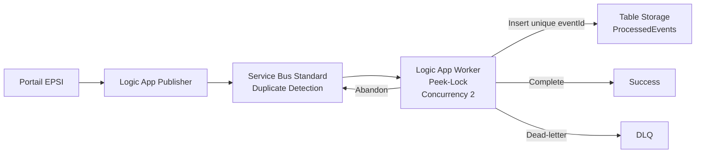

Le point essentiel du TP5 est :

> **La déduplication de transport et l’idempotence métier ne résolvent pas le même problème. Service Bus Duplicate Detection protège contre certains envois répétés grâce au Message Id, tandis que le consumer idempotent garantit qu’une même opération métier ne produit qu’un seul effet, même en cas de redélivrance, de republication ou de concurrence.**

---

# 294. Références Microsoft

Documentation utile :

- **Duplicate Detection Service Bus** :  
  `https://learn.microsoft.com/azure/service-bus-messaging/duplicate-detection`

- **Activer Duplicate Detection** :  
  `https://learn.microsoft.com/azure/service-bus-messaging/enable-duplicate-detection`

- **Prévenir perte et double traitement** :  
  `https://learn.microsoft.com/azure/service-bus-messaging/service-bus-message-loss-and-duplicates`

- **Logic Apps avec Service Bus** :  
  `https://learn.microsoft.com/azure/connectors/connectors-create-api-servicebus`

- **Service Bus connector reference** :  
  `https://learn.microsoft.com/azure/logic-apps/connectors/built-in/reference/servicebus/`

- **Dead-Letter Queues** :  
  `https://learn.microsoft.com/azure/service-bus-messaging/service-bus-dead-letter-queues`

- **Trigger concurrency Logic Apps** :  
  `https://learn.microsoft.com/azure/logic-apps/logic-apps-workflow-actions-triggers`

- **Gestion des erreurs et Retry Policies Logic Apps** :  
  `https://learn.microsoft.com/azure/logic-apps/error-exception-handling`

- **Azure Table Storage connector** :  
  `https://learn.microsoft.com/connectors/azuretables/`

- **Insert Entity Table Storage** :  
  `https://learn.microsoft.com/rest/api/storageservices/insert-entity`

- **Table Storage error codes** :  
  `https://learn.microsoft.com/rest/api/storageservices/table-service-error-codes`

- **Storage Table Data Contributor** :  
  `https://learn.microsoft.com/azure/role-based-access-control/built-in-roles/storage`

- **Autoriser l’accès Table Storage avec Entra ID** :  
  `https://learn.microsoft.com/azure/storage/tables/authorize-access-azure-active-directory`

- **Scope RBAC Table Storage** :  
  `https://learn.microsoft.com/azure/storage/tables/assign-azure-role-data-access`

- **Managed Identity dans Logic Apps** :  
  `https://learn.microsoft.com/azure/logic-apps/authenticate-with-managed-identity`

- **Azure CLI Service Bus Queue** :  
  `https://learn.microsoft.com/cli/azure/servicebus/queue`

- **Azure CLI Storage Entity** :  
  `https://learn.microsoft.com/cli/azure/storage/entity`

- **Azure for Students** :  
  `https://learn.microsoft.com/azure/education-hub/about-azure-for-students`

- **Tarification Service Bus** :  
  `https://azure.microsoft.com/pricing/details/service-bus/`

- **Tarification Logic Apps** :  
  `https://azure.microsoft.com/pricing/details/logic-apps/`

- **Tarification Storage** :  
  `https://azure.microsoft.com/pricing/details/storage/`
