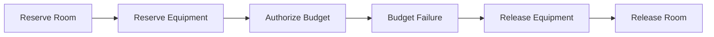
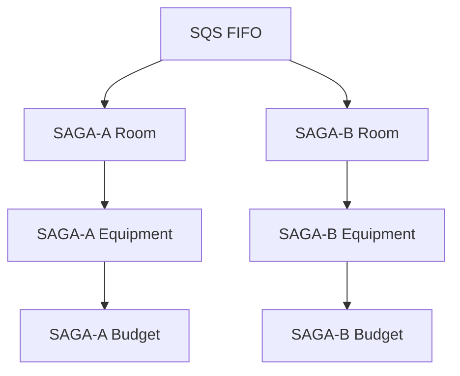
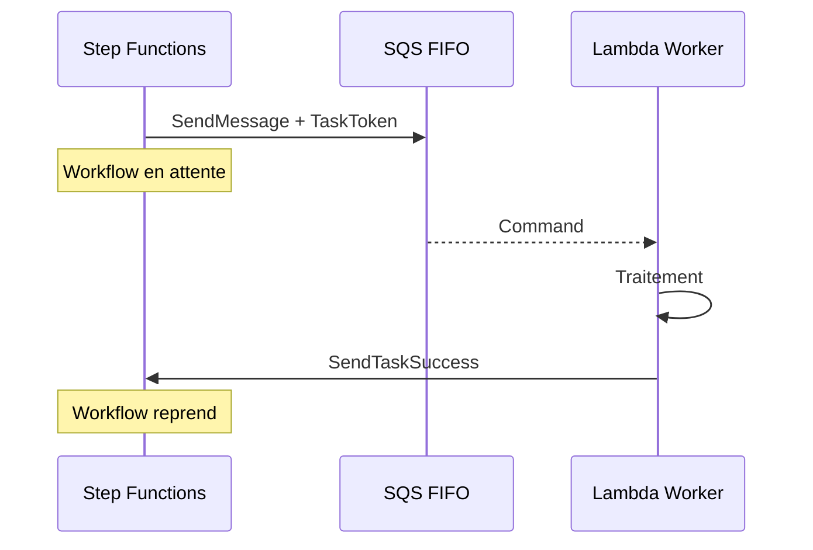
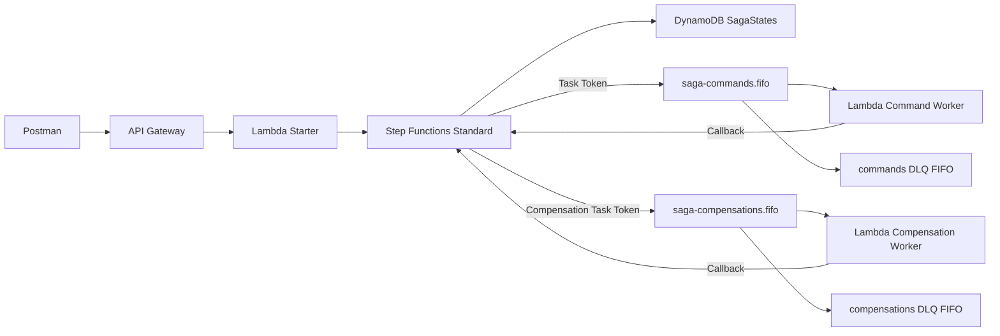
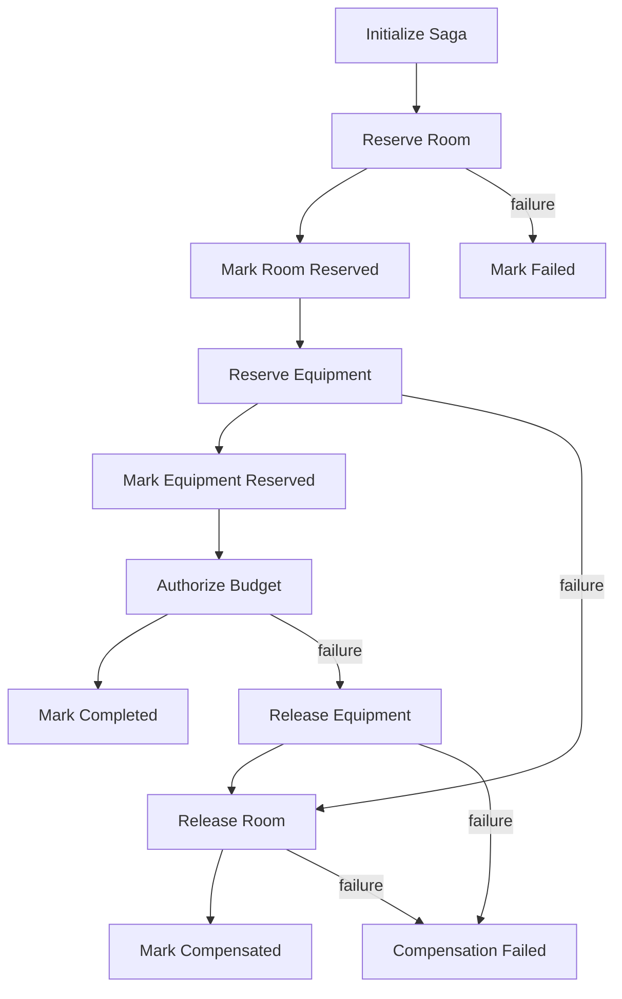
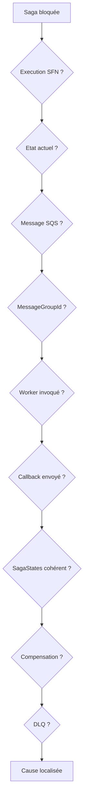
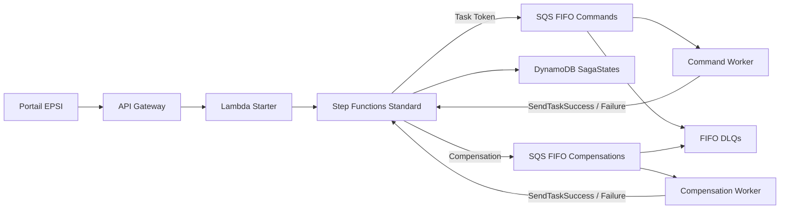

# TP 6 - Saga orchestrée avec AWS Step Functions, SQS FIFO, callbacks et compensations - EPSI

**Niveau :** *avancé / projet de synthèse*  
**Durée indicative :** *4 h à 5 h*  
**Mode principal :** **Console AWS**  
**Mode secondaire :** *AWS CLI, uniquement en option et à titre de comparaison*  
**Architecture :** **API Gateway HTTP API**, **AWS Lambda**, **AWS Step Functions Standard**, **Amazon SQS FIFO**, **Task Token Callback**, **Amazon DynamoDB**, **Retry / Catch / Wait**, **Dead-Letter Queues**, **CloudWatch Logs** et **IAM**  
**Public visé :** *étudiants EPSI disposant d’un compte AWS personnel, d’un compte AWS Free Tier ou d’un environnement AWS fourni par l’établissement.*

---

# 1. Objectifs du TP

À la fin de ce TP, vous devez être capables de :

- expliquer le **pattern Saga** ;
- distinguer **orchestration** et **choreography** ;
- comprendre une **transaction compensable** ;
- comprendre une **transaction pivot** ;
- comprendre une **transaction retryable** ;
- créer une **Step Functions Standard State Machine** ;
- utiliser **Retry**, **Catch**, **BackoffRate**, **MaxAttempts** et **JitterStrategy** ;
- comprendre un **Wait state** ;
- créer des **SQS FIFO queues** ;
- utiliser `MessageGroupId = sagaId` ;
- utiliser `MessageDeduplicationId` ;
- comprendre l’ordre par message group ;
- lancer plusieurs sagas indépendantes en parallèle ;
- créer des **FIFO Dead-Letter Queues** ;
- configurer une **Redrive Policy** ;
- utiliser le pattern **`.waitForTaskToken`** ;
- utiliser **SendTaskSuccess** et **SendTaskFailure** ;
- comprendre le rôle du **Task Token** ;
- utiliser **DynamoDB** pour stocker l’état durable de Saga ;
- stocker `STARTED`, `ROOM_RESERVED`, `EQUIPMENT_RESERVED`, `COMPLETED`, `COMPENSATING`, `COMPENSATED`, `FAILED`, `COMPENSATION_FAILED` ;
- exécuter les compensations dans l’**ordre inverse** ;
- comprendre pourquoi une compensation peut elle-même échouer ;
- comprendre pourquoi les participants doivent rester **idempotents** ;
- diagnostiquer une Saga avec l’historique Step Functions ;
- utiliser AWS CLI uniquement comme *équivalent optionnel*.

---

# 2. Position du TP6 dans la progression

Le TP1 AWS a introduit :

```text
API Gateway
Lambda
SQS
Consumer
```

Le TP2 AWS a ajouté :

```text
Transformation
Normalisation
Routage
Plusieurs queues
```

Le TP3 AWS a ajouté :

```text
SNS
Publish/Subscribe
Filter Policies
Fan-out
```

Le TP5 AWS a ajouté :

```text
Idempotence
DynamoDB
Partial Batch Response
DLQ
Concurrence
```

Le TP6 assemble ces notions autour de :

```text
Saga
orchestration
FIFO
callbacks
retry
compensation
état durable
```

---

# 3. Scénario métier

EPSI veut automatiser la préparation d’une intervention technique importante.

Trois opérations doivent être coordonnées :

```text
1. réserver une salle technique
2. réserver le matériel nécessaire
3. autoriser le budget
```

Chaque opération peut appartenir à un SI différent :

```text
Planning
Inventory
Finance
```

---

# 4. Pourquoi une Saga ?

Nous ne pouvons pas supposer qu’une transaction SQL globale couvre tous les systèmes.

Le **pattern Saga** décompose donc le processus en plusieurs transactions locales :

```text
ReserveRoom
ReserveEquipment
AuthorizeBudget
```

Si une étape échoue, les étapes déjà validées sont compensées.

---

# 5. Exemple de compensation

Si :

```text
Salle réservée
Matériel réservé
Budget refusé
```

nous devons faire :

```text
ReleaseEquipment
ReleaseRoom
```



---

# 6. Pourquoi Step Functions Standard ?

Nous choisissons un **Standard Workflow** car une Saga doit être :

- durable ;
- auditable ;
- visualisable ;
- potentiellement longue.

Un Standard Workflow conserve son état entre les transitions et fournit un historique détaillé.

---

# 7. Pourquoi SQS FIFO ?

Le TP6 Azure utilisait les **Service Bus Sessions** pour ordonner les messages d’une même saga.

L’équivalent pédagogique côté AWS est :

```text
SQS FIFO
MessageGroupId = sagaId
```

Dans une FIFO queue, les messages d’un même groupe sont traités strictement dans l’ordre.

---

# 8. Parallélisme entre sagas



`SAGA-A` et `SAGA-B` peuvent progresser en parallèle, mais chaque groupe reste ordonné.

---

# 9. Callback avec Task Token

Step Functions va envoyer une commande dans SQS et inclure un **Task Token**.

Le workflow attendra ensuite que le worker appelle :

```text
SendTaskSuccess
```

ou :

```text
SendTaskFailure
```



---

# 10. Architecture générale



---

# 11. Ressources du TP

```text
SQS FIFO
saga-commands.fifo
saga-commands-dlq.fifo
saga-compensations.fifo
saga-compensations-dlq.fifo

DynamoDB
SagaStates

Lambda
lambda-tp6-starter
lambda-tp6-command-worker
lambda-tp6-compensation-worker

Step Functions
sfn-tp6-maintenance-saga

API Gateway
api-tp6-saga-epsi

Route
POST /sagas
```

---

# 12. Etat de Saga

La table DynamoDB contiendra notamment :

```text
STARTED
ROOM_RESERVED
EQUIPMENT_RESERVED
COMPLETED
COMPENSATING
COMPENSATED
FAILED
COMPENSATION_FAILED
```

Partition key :

```text
sagaId
```

---

# 13. Scénarios d’erreur

L’entrée API contient :

```text
failAt
transientAt
transientMode
```

`failAt` :

```text
none
room
equipment
budget
```

`transientAt` :

```text
none
room
equipment
budget
```

`transientMode` :

```text
once
always
```

---

# 14. Payload de départ

```json
{
  "sagaId": "SAGA-001",
  "incidentId": "INC-6001",
  "campus": "EPSI",
  "failAt": "none",
  "transientAt": "none",
  "transientMode": "once"
}
```

---

# 15. Etapes normales

```text
RESERVE_ROOM
RESERVE_EQUIPMENT
AUTHORIZE_BUDGET
```

Compensations :

```text
RELEASE_EQUIPMENT
RELEASE_ROOM
```

---

# 16. Retry Step Functions

Une erreur temporaire sera renvoyée sous la forme :

```text
TemporaryError
```

Exemple de Retry :

```json
{
  "ErrorEquals": [
    "TemporaryError"
  ],
  "IntervalSeconds": 5,
  "MaxAttempts": 2,
  "BackoffRate": 2,
  "MaxDelaySeconds": 20,
  "JitterStrategy": "FULL"
}
```

---

# 17. Pourquoi du jitter ?

Sans jitter, de nombreuses sagas peuvent retenter au même instant.

`FULL` répartit les retries dans l’intervalle disponible.

---

# 18. Erreur permanente

Le worker renverra :

```text
PermanentBusinessError
```

Step Functions utilisera ensuite :

```text
Catch
```

pour déclencher la récupération ou la compensation.

---

# 19. SQS FIFO et déduplication

Une FIFO queue utilise :

```text
MessageDeduplicationId
```

Deux messages utilisant le même identifiant dans la fenêtre de déduplication peuvent être considérés comme doublons.

Pour un **retry volontaire**, nous voulons une nouvelle tentative.

Nous utiliserons donc :

```text
States.UUID()
```

pour créer un nouvel identifiant de déduplication à chaque envoi.

---

# 20. FIFO DLQ

Une queue source FIFO doit utiliser une DLQ **FIFO**.

Nous aurons donc deux DLQ séparées :

```text
commands DLQ
compensations DLQ
```

---


# 21. Etape 1 - Créer saga-commands-dlq.fifo

Dans la console AWS :

```text
SQS
Create queue
```

Type :

```text
FIFO
```

Nom :

```text
saga-commands-dlq.fifo
```

Laissez **Content-based deduplication** désactivée.

Créez la queue.

---

# 22. Etape 2 - Créer saga-commands.fifo

Type :

```text
FIFO
```

Nom :

```text
saga-commands.fifo
```

Visibility timeout :

```text
60 seconds
```

Configurez :

```text
Dead-letter queue
saga-commands-dlq.fifo
```

Maximum receives :

```text
5
```

---

# 23. Etape 3 - Créer saga-compensations-dlq.fifo

Même principe :

```text
FIFO
saga-compensations-dlq.fifo
```

---

# 24. Etape 4 - Créer saga-compensations.fifo

Type :

```text
FIFO
```

Nom :

```text
saga-compensations.fifo
```

Visibility timeout :

```text
60 seconds
```

DLQ :

```text
saga-compensations-dlq.fifo
```

Maximum receives :

```text
5
```

---

## AWS CLI - optionnel

```bash
CMD_DLQ_URL=$(aws sqs create-queue \
  --queue-name saga-commands-dlq.fifo \
  --attributes FifoQueue=true \
  --region eu-west-3 \
  --query QueueUrl \
  --output text)
```

Récupérer son ARN :

```bash
CMD_DLQ_ARN=$(aws sqs get-queue-attributes \
  --queue-url "$CMD_DLQ_URL" \
  --attribute-names QueueArn \
  --region eu-west-3 \
  --query Attributes.QueueArn \
  --output text)
```

---

# 25. Vérification

Vous devez disposer de :

```text
saga-commands.fifo
saga-commands-dlq.fifo
saga-compensations.fifo
saga-compensations-dlq.fifo
```

---

# 26. Etape 5 - Créer DynamoDB SagaStates

Dans :

```text
DynamoDB
Create table
```

Table name :

```text
SagaStates
```

Partition key :

```text
sagaId
```

Type :

```text
String
```

Capacity :

```text
On-demand
```

pour simplifier.

---

## AWS CLI - optionnel

```bash
aws dynamodb create-table \
  --table-name SagaStates \
  --attribute-definitions AttributeName=sagaId,AttributeType=S \
  --key-schema AttributeName=sagaId,KeyType=HASH \
  --billing-mode PAY_PER_REQUEST \
  --region eu-west-3
```

---

# 27. Exemple d’item SagaStates

```json
{
  "sagaId": "SAGA-001",
  "incidentId": "INC-6001",
  "status": "STARTED",
  "currentStep": "RESERVE_ROOM",
  "roomReserved": false,
  "equipmentReserved": false,
  "budgetAuthorized": false,
  "lastError": ""
}
```

---

# 28. Etape 6 - IAM du Command Worker

Créez :

```text
role-tp6-command-worker
```

Trusted entity :

```text
Lambda
```

Ajoutez :

```text
AWSLambdaBasicExecutionRole
```

Ajoutez une inline policy pour :

```text
sqs:ReceiveMessage
sqs:DeleteMessage
sqs:GetQueueAttributes
```

sur :

```text
saga-commands.fifo
```

Ajoutez aussi :

```text
states:SendTaskSuccess
states:SendTaskFailure
states:SendTaskHeartbeat
```

---

# 29. Pourquoi SendTaskHeartbeat ?

Le TP ne l’utilise pas obligatoirement, mais un participant long peut signaler à Step Functions :

```text
je suis encore en train de travailler
```

---

# 30. Etape 7 - lambda-tp6-command-worker

Runtime :

```text
Python 3.x
```

Role :

```text
role-tp6-command-worker
```

Utilisez ce code :

```python
import json
from datetime import datetime, timezone

import boto3
from botocore.exceptions import ClientError


sfn = boto3.client("stepfunctions")


STEP_TO_FLAG = {
    "RESERVE_ROOM": "room",
    "RESERVE_EQUIPMENT": "equipment",
    "AUTHORIZE_BUDGET": "budget",
}


def callback_success(task_token, payload):
    # Retourne le résultat à la Task Step Functions en attente.
    sfn.send_task_success(
        taskToken=task_token,
        output=json.dumps(
            payload,
            ensure_ascii=False,
        ),
    )


def callback_failure(
    task_token,
    error_name,
    cause,
):
    # Retourne une erreur typée afin que Retry/Catch
    # puisse prendre la bonne décision.
    sfn.send_task_failure(
        taskToken=task_token,
        error=error_name,
        cause=json.dumps(
            cause,
            ensure_ascii=False,
        ),
    )


def lambda_handler(event, context):
    for record in event.get("Records", []):
        body = json.loads(
            record["body"]
        )

        # Le Task Token relie cette commande au Task
        # Step Functions qui attend une réponse.
        task_token = body["taskToken"]

        saga_id = body["sagaId"]
        step = body["step"]

        # RetryCount vient du Context Step Functions.
        retry_count = int(
            body.get("retryCount", 0)
        )

        fail_at = body.get(
            "failAt",
            "none",
        )

        transient_at = body.get(
            "transientAt",
            "none",
        )

        transient_mode = body.get(
            "transientMode",
            "once",
        )

        logical_step = STEP_TO_FLAG[
            step
        ]

        print(
            json.dumps(
                {
                    "level": "INFO",
                    "message": "COMMAND_RECEIVED",
                    "sagaId": saga_id,
                    "step": step,
                    "retryCount": retry_count,
                    "sqsMessageId": record["messageId"],
                    "messageGroupId": (
                        record["attributes"].get(
                            "MessageGroupId"
                        )
                    ),
                    "lambdaRequestId": (
                        context.aws_request_id
                    ),
                }
            )
        )

        try:
            # Erreur permanente simulée.
            if fail_at == logical_step:
                callback_failure(
                    task_token,
                    "PermanentBusinessError",
                    {
                        "sagaId": saga_id,
                        "step": step,
                        "reason": (
                            "SIMULATED_PERMANENT_FAILURE"
                        ),
                    },
                )
                continue

            # Erreur temporaire.
            transient_matches = (
                transient_at == logical_step
            )

            should_fail_temporarily = (
                transient_matches
                and (
                    transient_mode == "always"
                    or retry_count == 0
                )
            )

            if should_fail_temporarily:
                callback_failure(
                    task_token,
                    "TemporaryError",
                    {
                        "sagaId": saga_id,
                        "step": step,
                        "retryCount": retry_count,
                        "reason": (
                            "SIMULATED_TEMPORARY_FAILURE"
                        ),
                    },
                )
                continue

            # Succès simulé du participant.
            callback_success(
                task_token,
                {
                    "sagaId": saga_id,
                    "step": step,
                    "status": "SUCCESS",
                    "retryCount": retry_count,
                    "processedAt": (
                        datetime.now(
                            timezone.utc
                        ).isoformat()
                    ),
                    "workerRequestId": (
                        context.aws_request_id
                    ),
                },
            )

        except ClientError as exc:
            # Une erreur ici signifie par exemple que
            # le callback n'a pas pu être envoyé.
            print(
                json.dumps(
                    {
                        "level": "ERROR",
                        "message": "CALLBACK_FAILED",
                        "sagaId": saga_id,
                        "step": step,
                        "error": str(exc),
                    }
                )
            )
            raise

    return {
        "processed": len(
            event.get("Records", [])
        )
    }
```

Déployez.

---

# 31. Ajouter le trigger SQS FIFO

Dans la Lambda :

```text
Add trigger
SQS
```

Queue :

```text
saga-commands.fifo
```

Batch size :

```text
1
```

---

# 32. Pourquoi Batch Size 1 ?

Pour rendre visible :

- l’ordre FIFO ;
- un callback par commande ;
- la relation entre message et Task Token.

---

# 33. Etape 8 - IAM Compensation Worker

Créez :

```text
role-tp6-compensation-worker
```

avec :

- `AWSLambdaBasicExecutionRole` ;
- Receive/Delete/GetQueueAttributes sur `saga-compensations.fifo` ;
- `states:SendTaskSuccess` ;
- `states:SendTaskFailure` ;
- `states:SendTaskHeartbeat`.

---

# 34. Etape 9 - lambda-tp6-compensation-worker

Code :

```python
import json
from datetime import datetime, timezone

import boto3
from botocore.exceptions import ClientError


sfn = boto3.client("stepfunctions")


def lambda_handler(event, context):
    for record in event.get(
        "Records",
        [],
    ):
        body = json.loads(
            record["body"]
        )

        task_token = body[
            "taskToken"
        ]

        saga_id = body[
            "sagaId"
        ]

        step = body[
            "step"
        ]

        compensation_fail_at = (
            body.get(
                "compensationFailAt",
                "none",
            )
        )

        logical_step = {
            "RELEASE_EQUIPMENT": "equipment",
            "RELEASE_ROOM": "room",
        }[step]

        print(
            json.dumps(
                {
                    "level": "INFO",
                    "message": (
                        "COMPENSATION_RECEIVED"
                    ),
                    "sagaId": saga_id,
                    "step": step,
                    "sqsMessageId": (
                        record["messageId"]
                    ),
                    "messageGroupId": (
                        record[
                            "attributes"
                        ].get(
                            "MessageGroupId"
                        )
                    ),
                    "lambdaRequestId": (
                        context.aws_request_id
                    ),
                }
            )
        )

        try:
            if (
                compensation_fail_at
                == logical_step
            ):
                sfn.send_task_failure(
                    taskToken=task_token,
                    error=(
                        "CompensationPermanentError"
                    ),
                    cause=json.dumps(
                        {
                            "sagaId": saga_id,
                            "step": step,
                            "reason": (
                                "SIMULATED_COMPENSATION_FAILURE"
                            ),
                        }
                    ),
                )
                continue

            sfn.send_task_success(
                taskToken=task_token,
                output=json.dumps(
                    {
                        "sagaId": saga_id,
                        "step": step,
                        "status": (
                            "COMPENSATION_SUCCESS"
                        ),
                        "processedAt": (
                            datetime.now(
                                timezone.utc
                            ).isoformat()
                        ),
                    }
                ),
            )

        except ClientError as exc:
            print(
                json.dumps(
                    {
                        "level": "ERROR",
                        "message": (
                            "COMPENSATION_CALLBACK_FAILED"
                        ),
                        "sagaId": saga_id,
                        "step": step,
                        "error": str(exc),
                    }
                )
            )
            raise

    return {
        "processed": len(
            event.get("Records", [])
        )
    }
```

Ajoutez un trigger sur :

```text
saga-compensations.fifo
```

Batch size :

```text
1
```

---


# 35. Etape 10 - IAM de la State Machine

Créez :

```text
role-tp6-saga-state-machine
```

Trusted service :

```text
Step Functions
```

Autorisations nécessaires :

```text
sqs:SendMessage
```

sur :

```text
saga-commands.fifo
saga-compensations.fifo
```

et :

```text
dynamodb:PutItem
dynamodb:UpdateItem
dynamodb:GetItem
```

sur :

```text
SagaStates
```

---

# 36. Pourquoi Step Functions écrit directement DynamoDB ?

Step Functions possède une intégration native avec DynamoDB.

Nous évitons donc de créer une Lambda supplémentaire juste pour :

```text
mettre à jour l'état de la Saga
```

---

# 37. Etape 11 - Créer la State Machine

Dans :

```text
Step Functions
Create state machine
```

Choisissez :

```text
Workflow Studio
Standard
```

Nom :

```text
sfn-tp6-maintenance-saga
```

Query language :

```text
JSONPath
```

---

# 38. Pourquoi JSONPath ?

Nous allons utiliser :

```text
$$.Task.Token
$$.State.RetryCount
$$.Execution.StartTime
States.UUID()
```

---

# 39. Structure générale de la Saga



---

# 40. Etape 12 - Définition ASL

Dans le code ci-dessous, remplacez :

```text
COMMAND_QUEUE_URL
COMPENSATION_QUEUE_URL
```

par les vraies URLs.

```json
{
  "Comment": "EPSI TP6 - Saga maintenance",
  "StartAt": "InitializeSaga",
  "States": {
    "InitializeSaga": {
      "Type": "Task",
      "Resource": "arn:aws:states:::dynamodb:putItem",
      "Parameters": {
        "TableName": "SagaStates",
        "Item": {
          "sagaId": {
            "S.$": "$.sagaId"
          },
          "incidentId": {
            "S.$": "$.incidentId"
          },
          "campus": {
            "S.$": "$.campus"
          },
          "status": {
            "S": "STARTED"
          },
          "currentStep": {
            "S": "RESERVE_ROOM"
          },
          "roomReserved": {
            "BOOL": false
          },
          "equipmentReserved": {
            "BOOL": false
          },
          "budgetAuthorized": {
            "BOOL": false
          },
          "lastError": {
            "S": ""
          },
          "updatedAt": {
            "S.$": "$$.Execution.StartTime"
          }
        },
        "ConditionExpression": "attribute_not_exists(sagaId)"
      },
      "ResultPath": null,
      "Next": "ReserveRoom"
    },

    "ReserveRoom": {
      "Type": "Task",
      "Resource": "arn:aws:states:::sqs:sendMessage.waitForTaskToken",
      "HeartbeatSeconds": 120,
      "Parameters": {
        "QueueUrl": "COMMAND_QUEUE_URL",
        "MessageBody": {
          "taskToken.$": "$$.Task.Token",
          "sagaId.$": "$.sagaId",
          "incidentId.$": "$.incidentId",
          "step": "RESERVE_ROOM",
          "retryCount.$": "$$.State.RetryCount",
          "failAt.$": "$.failAt",
          "transientAt.$": "$.transientAt",
          "transientMode.$": "$.transientMode"
        },
        "MessageGroupId.$": "$.sagaId",
        "MessageDeduplicationId.$": "States.UUID()"
      },
      "Retry": [
        {
          "ErrorEquals": [
            "TemporaryError"
          ],
          "IntervalSeconds": 5,
          "MaxAttempts": 2,
          "BackoffRate": 2,
          "MaxDelaySeconds": 20,
          "JitterStrategy": "FULL"
        }
      ],
      "Catch": [
        {
          "ErrorEquals": [
            "States.ALL"
          ],
          "ResultPath": "$.error",
          "Next": "MarkFailedAtRoom"
        }
      ],
      "ResultPath": "$.roomResult",
      "Next": "MarkRoomReserved"
    },

    "MarkRoomReserved": {
      "Type": "Task",
      "Resource": "arn:aws:states:::dynamodb:updateItem",
      "Parameters": {
        "TableName": "SagaStates",
        "Key": {
          "sagaId": {
            "S.$": "$.sagaId"
          }
        },
        "UpdateExpression": "SET #s = :status, #c = :step, roomReserved = :t, updatedAt = :u",
        "ExpressionAttributeNames": {
          "#s": "status",
          "#c": "currentStep"
        },
        "ExpressionAttributeValues": {
          ":status": {
            "S": "ROOM_RESERVED"
          },
          ":step": {
            "S": "RESERVE_EQUIPMENT"
          },
          ":t": {
            "BOOL": true
          },
          ":u": {
            "S.$": "$$.State.EnteredTime"
          }
        }
      },
      "ResultPath": null,
      "Next": "ReserveEquipment"
    },

    "ReserveEquipment": {
      "Type": "Task",
      "Resource": "arn:aws:states:::sqs:sendMessage.waitForTaskToken",
      "HeartbeatSeconds": 120,
      "Parameters": {
        "QueueUrl": "COMMAND_QUEUE_URL",
        "MessageBody": {
          "taskToken.$": "$$.Task.Token",
          "sagaId.$": "$.sagaId",
          "incidentId.$": "$.incidentId",
          "step": "RESERVE_EQUIPMENT",
          "retryCount.$": "$$.State.RetryCount",
          "failAt.$": "$.failAt",
          "transientAt.$": "$.transientAt",
          "transientMode.$": "$.transientMode"
        },
        "MessageGroupId.$": "$.sagaId",
        "MessageDeduplicationId.$": "States.UUID()"
      },
      "Retry": [
        {
          "ErrorEquals": [
            "TemporaryError"
          ],
          "IntervalSeconds": 5,
          "MaxAttempts": 2,
          "BackoffRate": 2,
          "MaxDelaySeconds": 20,
          "JitterStrategy": "FULL"
        }
      ],
      "Catch": [
        {
          "ErrorEquals": [
            "States.ALL"
          ],
          "ResultPath": "$.error",
          "Next": "MarkCompensatingFromEquipment"
        }
      ],
      "ResultPath": "$.equipmentResult",
      "Next": "MarkEquipmentReserved"
    },

    "MarkEquipmentReserved": {
      "Type": "Task",
      "Resource": "arn:aws:states:::dynamodb:updateItem",
      "Parameters": {
        "TableName": "SagaStates",
        "Key": {
          "sagaId": {
            "S.$": "$.sagaId"
          }
        },
        "UpdateExpression": "SET #s = :status, #c = :step, equipmentReserved = :t, updatedAt = :u",
        "ExpressionAttributeNames": {
          "#s": "status",
          "#c": "currentStep"
        },
        "ExpressionAttributeValues": {
          ":status": {
            "S": "EQUIPMENT_RESERVED"
          },
          ":step": {
            "S": "AUTHORIZE_BUDGET"
          },
          ":t": {
            "BOOL": true
          },
          ":u": {
            "S.$": "$$.State.EnteredTime"
          }
        }
      },
      "ResultPath": null,
      "Next": "AuthorizeBudget"
    },

    "AuthorizeBudget": {
      "Type": "Task",
      "Resource": "arn:aws:states:::sqs:sendMessage.waitForTaskToken",
      "HeartbeatSeconds": 120,
      "Parameters": {
        "QueueUrl": "COMMAND_QUEUE_URL",
        "MessageBody": {
          "taskToken.$": "$$.Task.Token",
          "sagaId.$": "$.sagaId",
          "incidentId.$": "$.incidentId",
          "step": "AUTHORIZE_BUDGET",
          "retryCount.$": "$$.State.RetryCount",
          "failAt.$": "$.failAt",
          "transientAt.$": "$.transientAt",
          "transientMode.$": "$.transientMode"
        },
        "MessageGroupId.$": "$.sagaId",
        "MessageDeduplicationId.$": "States.UUID()"
      },
      "Retry": [
        {
          "ErrorEquals": [
            "TemporaryError"
          ],
          "IntervalSeconds": 5,
          "MaxAttempts": 2,
          "BackoffRate": 2,
          "MaxDelaySeconds": 20,
          "JitterStrategy": "FULL"
        }
      ],
      "Catch": [
        {
          "ErrorEquals": [
            "States.ALL"
          ],
          "ResultPath": "$.error",
          "Next": "MarkCompensatingFromBudget"
        }
      ],
      "ResultPath": "$.budgetResult",
      "Next": "MarkCompleted"
    },

    "MarkCompleted": {
      "Type": "Task",
      "Resource": "arn:aws:states:::dynamodb:updateItem",
      "Parameters": {
        "TableName": "SagaStates",
        "Key": {
          "sagaId": {
            "S.$": "$.sagaId"
          }
        },
        "UpdateExpression": "SET #s = :status, #c = :step, budgetAuthorized = :t, updatedAt = :u",
        "ExpressionAttributeNames": {
          "#s": "status",
          "#c": "currentStep"
        },
        "ExpressionAttributeValues": {
          ":status": {
            "S": "COMPLETED"
          },
          ":step": {
            "S": "NONE"
          },
          ":t": {
            "BOOL": true
          },
          ":u": {
            "S.$": "$$.State.EnteredTime"
          }
        }
      },
      "ResultPath": null,
      "Next": "SagaSucceeded"
    },

    "MarkFailedAtRoom": {
      "Type": "Task",
      "Resource": "arn:aws:states:::dynamodb:updateItem",
      "Parameters": {
        "TableName": "SagaStates",
        "Key": {
          "sagaId": {
            "S.$": "$.sagaId"
          }
        },
        "UpdateExpression": "SET #s = :status, #c = :step, lastError = :e, updatedAt = :u",
        "ExpressionAttributeNames": {
          "#s": "status",
          "#c": "currentStep"
        },
        "ExpressionAttributeValues": {
          ":status": {
            "S": "FAILED"
          },
          ":step": {
            "S": "NONE"
          },
          ":e": {
            "S": "ROOM_RESERVATION_FAILED"
          },
          ":u": {
            "S.$": "$$.State.EnteredTime"
          }
        }
      },
      "ResultPath": null,
      "Next": "SagaFailed"
    },

    "MarkCompensatingFromEquipment": {
      "Type": "Task",
      "Resource": "arn:aws:states:::dynamodb:updateItem",
      "Parameters": {
        "TableName": "SagaStates",
        "Key": {
          "sagaId": {
            "S.$": "$.sagaId"
          }
        },
        "UpdateExpression": "SET #s = :status, #c = :step, lastError = :e, updatedAt = :u",
        "ExpressionAttributeNames": {
          "#s": "status",
          "#c": "currentStep"
        },
        "ExpressionAttributeValues": {
          ":status": {
            "S": "COMPENSATING"
          },
          ":step": {
            "S": "RELEASE_ROOM"
          },
          ":e": {
            "S": "EQUIPMENT_RESERVATION_FAILED"
          },
          ":u": {
            "S.$": "$$.State.EnteredTime"
          }
        }
      },
      "ResultPath": null,
      "Next": "ReleaseRoom"
    },

    "MarkCompensatingFromBudget": {
      "Type": "Task",
      "Resource": "arn:aws:states:::dynamodb:updateItem",
      "Parameters": {
        "TableName": "SagaStates",
        "Key": {
          "sagaId": {
            "S.$": "$.sagaId"
          }
        },
        "UpdateExpression": "SET #s = :status, #c = :step, lastError = :e, updatedAt = :u",
        "ExpressionAttributeNames": {
          "#s": "status",
          "#c": "currentStep"
        },
        "ExpressionAttributeValues": {
          ":status": {
            "S": "COMPENSATING"
          },
          ":step": {
            "S": "RELEASE_EQUIPMENT"
          },
          ":e": {
            "S": "BUDGET_AUTHORIZATION_FAILED"
          },
          ":u": {
            "S.$": "$$.State.EnteredTime"
          }
        }
      },
      "ResultPath": null,
      "Next": "ReleaseEquipment"
    },

    "ReleaseEquipment": {
      "Type": "Task",
      "Resource": "arn:aws:states:::sqs:sendMessage.waitForTaskToken",
      "HeartbeatSeconds": 120,
      "Parameters": {
        "QueueUrl": "COMPENSATION_QUEUE_URL",
        "MessageBody": {
          "taskToken.$": "$$.Task.Token",
          "sagaId.$": "$.sagaId",
          "step": "RELEASE_EQUIPMENT",
          "compensationFailAt.$": "$.compensationFailAt"
        },
        "MessageGroupId.$": "$.sagaId",
        "MessageDeduplicationId.$": "States.UUID()"
      },
      "Retry": [
        {
          "ErrorEquals": [
            "TemporaryError"
          ],
          "IntervalSeconds": 5,
          "MaxAttempts": 2,
          "BackoffRate": 2
        }
      ],
      "Catch": [
        {
          "ErrorEquals": [
            "States.ALL"
          ],
          "ResultPath": "$.compensationError",
          "Next": "MarkCompensationFailed"
        }
      ],
      "ResultPath": "$.releaseEquipmentResult",
      "Next": "MarkEquipmentReleased"
    },

    "MarkEquipmentReleased": {
      "Type": "Task",
      "Resource": "arn:aws:states:::dynamodb:updateItem",
      "Parameters": {
        "TableName": "SagaStates",
        "Key": {
          "sagaId": {
            "S.$": "$.sagaId"
          }
        },
        "UpdateExpression": "SET equipmentReserved = :f, #c = :step, updatedAt = :u",
        "ExpressionAttributeNames": {
          "#c": "currentStep"
        },
        "ExpressionAttributeValues": {
          ":f": {
            "BOOL": false
          },
          ":step": {
            "S": "RELEASE_ROOM"
          },
          ":u": {
            "S.$": "$$.State.EnteredTime"
          }
        }
      },
      "ResultPath": null,
      "Next": "ReleaseRoom"
    },

    "ReleaseRoom": {
      "Type": "Task",
      "Resource": "arn:aws:states:::sqs:sendMessage.waitForTaskToken",
      "HeartbeatSeconds": 120,
      "Parameters": {
        "QueueUrl": "COMPENSATION_QUEUE_URL",
        "MessageBody": {
          "taskToken.$": "$$.Task.Token",
          "sagaId.$": "$.sagaId",
          "step": "RELEASE_ROOM",
          "compensationFailAt.$": "$.compensationFailAt"
        },
        "MessageGroupId.$": "$.sagaId",
        "MessageDeduplicationId.$": "States.UUID()"
      },
      "Retry": [
        {
          "ErrorEquals": [
            "TemporaryError"
          ],
          "IntervalSeconds": 5,
          "MaxAttempts": 2,
          "BackoffRate": 2
        }
      ],
      "Catch": [
        {
          "ErrorEquals": [
            "States.ALL"
          ],
          "ResultPath": "$.compensationError",
          "Next": "MarkCompensationFailed"
        }
      ],
      "ResultPath": "$.releaseRoomResult",
      "Next": "MarkCompensated"
    },

    "MarkCompensated": {
      "Type": "Task",
      "Resource": "arn:aws:states:::dynamodb:updateItem",
      "Parameters": {
        "TableName": "SagaStates",
        "Key": {
          "sagaId": {
            "S.$": "$.sagaId"
          }
        },
        "UpdateExpression": "SET #s = :status, #c = :step, roomReserved = :f, equipmentReserved = :f, updatedAt = :u",
        "ExpressionAttributeNames": {
          "#s": "status",
          "#c": "currentStep"
        },
        "ExpressionAttributeValues": {
          ":status": {
            "S": "COMPENSATED"
          },
          ":step": {
            "S": "NONE"
          },
          ":f": {
            "BOOL": false
          },
          ":u": {
            "S.$": "$$.State.EnteredTime"
          }
        }
      },
      "ResultPath": null,
      "Next": "SagaCompensated"
    },

    "MarkCompensationFailed": {
      "Type": "Task",
      "Resource": "arn:aws:states:::dynamodb:updateItem",
      "Parameters": {
        "TableName": "SagaStates",
        "Key": {
          "sagaId": {
            "S.$": "$.sagaId"
          }
        },
        "UpdateExpression": "SET #s = :status, #c = :step, lastError = :e, updatedAt = :u",
        "ExpressionAttributeNames": {
          "#s": "status",
          "#c": "currentStep"
        },
        "ExpressionAttributeValues": {
          ":status": {
            "S": "COMPENSATION_FAILED"
          },
          ":step": {
            "S": "MANUAL_INTERVENTION"
          },
          ":e": {
            "S": "COMPENSATION_FAILED"
          },
          ":u": {
            "S.$": "$$.State.EnteredTime"
          }
        }
      },
      "ResultPath": null,
      "Next": "SagaCompensationFailed"
    },

    "SagaSucceeded": {
      "Type": "Succeed"
    },

    "SagaFailed": {
      "Type": "Fail",
      "Error": "SagaFailed",
      "Cause": "Saga failed before compensation was required."
    },

    "SagaCompensated": {
      "Type": "Fail",
      "Error": "SagaCompensated",
      "Cause": "Business goal failed but previous effects were compensated."
    },

    "SagaCompensationFailed": {
      "Type": "Fail",
      "Error": "SagaCompensationFailed",
      "Cause": "Compensation requires manual intervention."
    }
  }
}
```

---

# 41. Pourquoi SagaCompensated est un Fail state ?

Nous voulons distinguer :

```text
objectif métier atteint
```

de :

```text
objectif métier non atteint mais état compensé
```

Vous pouvez choisir une autre convention dans un vrai SI.

---

# 42. Vérifier les placeholders

Remplacez :

```text
COMMAND_QUEUE_URL
COMPENSATION_QUEUE_URL
```

avant de sauvegarder.

---

# 43. RetryCount

Le workflow passe :

```text
$$.State.RetryCount
```

au worker.

Cela permet de simuler :

```text
temporary once
```

puis succès au retry suivant.

---

# 44. MessageDeduplicationId unique

Chaque Task utilise :

```text
States.UUID()
```

Cela évite que la FIFO queue supprime un retry volontaire comme doublon.

---


# 45. Etape 13 - IAM du Starter

Créez :

```text
role-tp6-starter
```

Ajoutez :

```text
AWSLambdaBasicExecutionRole
```

et :

```text
states:StartExecution
```

sur la state machine.

---

# 46. Etape 14 - lambda-tp6-starter

Variable d’environnement :

```text
STATE_MACHINE_ARN
```

Code :

```python
import json
import os

import boto3
from botocore.exceptions import ClientError


sfn = boto3.client(
    "stepfunctions"
)

STATE_MACHINE_ARN = os.environ[
    "STATE_MACHINE_ARN"
]

REQUIRED_FIELDS = {
    "sagaId",
    "incidentId",
    "campus",
    "failAt",
    "transientAt",
    "transientMode",
}

ALLOWED_LOCATIONS = {
    "none",
    "room",
    "equipment",
    "budget",
}

ALLOWED_TRANSIENT_MODES = {
    "once",
    "always",
}


def response(status_code, payload):
    return {
        "statusCode": status_code,
        "headers": {
            "content-type": "application/json"
        },
        "body": json.dumps(
            payload,
            ensure_ascii=False,
        ),
    }


def lambda_handler(event, context):
    try:
        body = json.loads(
            event.get("body")
            or "{}"
        )
    except json.JSONDecodeError:
        return response(
            400,
            {
                "error": "INVALID_JSON"
            },
        )

    missing = sorted(
        field
        for field in REQUIRED_FIELDS
        if field not in body
        or body[field] == ""
    )

    if missing:
        return response(
            400,
            {
                "error": (
                    "MISSING_REQUIRED_FIELDS"
                ),
                "fields": missing,
            },
        )

    if body["failAt"] not in ALLOWED_LOCATIONS:
        return response(
            400,
            {
                "error": "INVALID_FAIL_AT"
            },
        )

    if (
        body["transientAt"]
        not in ALLOWED_LOCATIONS
    ):
        return response(
            400,
            {
                "error": "INVALID_TRANSIENT_AT"
            },
        )

    if (
        body["transientMode"]
        not in ALLOWED_TRANSIENT_MODES
    ):
        return response(
            400,
            {
                "error": (
                    "INVALID_TRANSIENT_MODE"
                )
            },
        )

    saga_input = {
        "sagaId": body["sagaId"],
        "incidentId": body[
            "incidentId"
        ],
        "campus": body["campus"],
        "failAt": body["failAt"],
        "transientAt": body[
            "transientAt"
        ],
        "transientMode": body[
            "transientMode"
        ],
        "compensationFailAt": (
            "none"
        ),
    }

    try:
        execution = sfn.start_execution(
            stateMachineArn=(
                STATE_MACHINE_ARN
            ),
            name=body["sagaId"],
            input=json.dumps(
                saga_input,
                ensure_ascii=False,
            ),
        )

    except sfn.exceptions.ExecutionAlreadyExists:
        return response(
            409,
            {
                "status": (
                    "SAGA_ALREADY_EXISTS"
                ),
                "sagaId": body[
                    "sagaId"
                ],
            },
        )

    except ClientError as exc:
        print(
            json.dumps(
                {
                    "level": "ERROR",
                    "message": (
                        "START_EXECUTION_FAILED"
                    ),
                    "error": str(exc),
                }
            )
        )

        return response(
            502,
            {
                "status": (
                    "ORCHESTRATOR_ERROR"
                )
            },
        )

    return response(
        202,
        {
            "status": "SAGA_STARTED",
            "sagaId": body["sagaId"],
            "executionArn": execution[
                "executionArn"
            ],
        },
    )
```

Déployez.

---

# 47. Pourquoi `name = sagaId` ?

Cela crée une protection supplémentaire contre le démarrage concurrent de la même Saga.

Avec un Standard Workflow, `StartExecution` possède un comportement idempotent pour une exécution en cours ayant le même nom et le même input.

---

# 48. Attention aux noms d’exécution

Après la fin d’une exécution, la réutilisation immédiate du même nom peut produire :

```text
ExecutionAlreadyExists
```

Utilisez donc des `sagaId` uniques dans le TP.

---

# 49. Etape 15 - API Gateway

Créez :

```text
HTTP API
```

Nom :

```text
api-tp6-saga-epsi
```

Integration :

```text
lambda-tp6-starter
```

Route :

```text
POST /sagas
```

Stage :

```text
$default
```

---

# 50. Test 1 - Saga Success

```json
{
  "sagaId": "SAGA-SUCCESS-1",
  "incidentId": "INC-6101",
  "campus": "EPSI",
  "failAt": "none",
  "transientAt": "none",
  "transientMode": "once"
}
```

Attendu :

```text
202 Accepted
```

---

# 51. Observer Step Functions

Dans :

```text
Step Functions
sfn-tp6-maintenance-saga
Executions
```

ouvrez :

```text
SAGA-SUCCESS-1
```

Vous devez voir :

```text
InitializeSaga
ReserveRoom
MarkRoomReserved
ReserveEquipment
MarkEquipmentReserved
AuthorizeBudget
MarkCompleted
SagaSucceeded
```

---

# 52. Observer DynamoDB

Item :

```text
SAGA-SUCCESS-1
```

Attendu :

```text
status = COMPLETED
roomReserved = true
equipmentReserved = true
budgetAuthorized = true
```

---

# 53. Test 2 - Failure Room

```json
{
  "sagaId": "SAGA-FAIL-ROOM",
  "incidentId": "INC-6102",
  "campus": "EPSI",
  "failAt": "room",
  "transientAt": "none",
  "transientMode": "once"
}
```

Attendu :

```text
ReserveRoom
PermanentBusinessError
MarkFailedAtRoom
FAILED
```

Aucune compensation n’est nécessaire.

---

# 54. Test 3 - Failure Equipment

```json
{
  "sagaId": "SAGA-FAIL-EQ",
  "incidentId": "INC-6103",
  "campus": "EPSI",
  "failAt": "equipment",
  "transientAt": "none",
  "transientMode": "once"
}
```

Attendu :

```text
ReserveRoom
ReserveEquipment failure
ReleaseRoom
COMPENSATED
```

---

# 55. Test 4 - Failure Budget

```json
{
  "sagaId": "SAGA-FAIL-BUDGET",
  "incidentId": "INC-6104",
  "campus": "EPSI",
  "failAt": "budget",
  "transientAt": "none",
  "transientMode": "once"
}
```

Attendu :

```text
ReserveRoom
ReserveEquipment
AuthorizeBudget failure
ReleaseEquipment
ReleaseRoom
COMPENSATED
```

---

# 56. Vérifier l’ordre inverse

Dans l’historique Step Functions :

```text
ReleaseEquipment
```

doit précéder :

```text
ReleaseRoom
```

---

# 57. Test 5 - Temporary Once

```json
{
  "sagaId": "SAGA-RETRY-EQ",
  "incidentId": "INC-6105",
  "campus": "EPSI",
  "failAt": "none",
  "transientAt": "equipment",
  "transientMode": "once"
}
```

Première tentative :

```text
retryCount = 0
TemporaryError
```

Deuxième tentative :

```text
retryCount = 1
SUCCESS
```

Etat final :

```text
COMPLETED
```

---

# 58. Test 6 - Temporary Always

```json
{
  "sagaId": "SAGA-RETRY-ALWAYS",
  "incidentId": "INC-6106",
  "campus": "EPSI",
  "failAt": "none",
  "transientAt": "budget",
  "transientMode": "always"
}
```

Après les retries :

```text
Catch
ReleaseEquipment
ReleaseRoom
COMPENSATED
```

---

# 59. Pourquoi Step Functions Retry est l’équivalent AWS naturel du retry différé ?

Il permet de gérer directement :

- délai ;
- nombre de tentatives ;
- backoff ;
- jitter ;
- transition vers Catch.

Nous n’avons donc pas besoin de republier manuellement un message planifié comme dans le TP6 Azure.

---

# 60. Bonus - Wait State explicite

Ajoutez un état :

```json
{
  "Type": "Wait",
  "Seconds": 30,
  "Next": "ReserveEquipment"
}
```

Utilisez-le uniquement pour comprendre la différence entre :

```text
Retry automatique
```

et :

```text
attente métier explicite
```

---

# 61. Test 7 - Compensation Failure

Démarrez directement une exécution Step Functions avec :

```json
{
  "sagaId": "SAGA-COMP-FAIL",
  "incidentId": "INC-6110",
  "campus": "EPSI",
  "failAt": "budget",
  "transientAt": "none",
  "transientMode": "once",
  "compensationFailAt": "equipment"
}
```

Attendu :

```text
ReleaseEquipment
CompensationPermanentError
MarkCompensationFailed
```

DynamoDB :

```text
status = COMPENSATION_FAILED
currentStep = MANUAL_INTERVENTION
```

---

# 62. Pourquoi une intervention humaine ?

Une compensation peut laisser le SI :

```text
partiellement compensé
```

Un opérateur doit alors vérifier l’état réel des systèmes.

---

# 63. Test 8 - Plusieurs Sagas

Lancez rapidement :

```text
SAGA-PAR-A
SAGA-PAR-B
SAGA-PAR-C
```

Les messages utilisent :

```text
MessageGroupId = sagaId
```

Les sagas peuvent donc progresser en parallèle.

---

# 64. Vérifier MessageGroupId

Dans CloudWatch Logs du worker :

```text
messageGroupId
```

doit être égal au `sagaId`.

---

# 65. FIFO et ordre

Messages du même group :

```text
strictement ordonnés
```

Messages de groups différents :

```text
peuvent être traités en parallèle
```

---

# 66. Test 9 - Message sans MessageGroupId

Sur une FIFO queue, un SendMessage sans MessageGroupId échoue.

C’est une différence importante avec une Standard Queue.

---

# 67. MessageDeduplicationId

Il sert à :

```text
dédupliquer
```

MessageGroupId sert à :

```text
ordonner
```

Ne confondez pas les deux.

---

# 68. Debug - Retry supprimé comme doublon

Symptôme :

```text
Step Functions retente
mais aucun nouveau message n'arrive
```

Vérifiez :

```text
MessageDeduplicationId
```

Dans notre ASL :

```text
States.UUID()
```

génère une nouvelle valeur.

---

# 69. Debug - toutes les sagas se bloquent derrière une seule

Cause possible :

```text
même MessageGroupId pour tous les messages
```

Utilisez :

```text
MessageGroupId = sagaId
```

---

# 70. Debug - Step Functions reste en attente

Vérifiez :

1. message SQS présent ;
2. trigger Lambda Enabled ;
3. logs worker ;
4. `states:SendTaskSuccess` ;
5. `states:SendTaskFailure` ;
6. Task Token ;
7. Heartbeat timeout.

---

# 71. Debug - AccessDenied callback

Vérifiez le rôle du worker.

Actions :

```text
states:SendTaskSuccess
states:SendTaskFailure
```

---

# 72. Debug - Step Functions ne peut pas envoyer dans SQS

Vérifiez le rôle de la State Machine :

```text
sqs:SendMessage
```

---

# 73. Debug - TaskDoesNotExist

Un Task Token peut être :

- expiré ;
- déjà consommé ;
- associé à une Task déjà terminée.

---

# 74. Important - ne loguez pas le Task Token

Le token permet de terminer une Task Step Functions.

Il ne doit pas apparaître inutilement dans les logs.

---

# 75. Callback réussi puis worker crash

Scénario :

```text
SendTaskSuccess réussit
Lambda plante avant retour final
SQS redélivre
```

Le second callback peut échouer car le token est déjà consommé.

Cela montre que même les participants d’une Saga doivent rester **idempotents**.

---

# 76. Amélioration possible

Gérez explicitement :

```text
TaskDoesNotExist
TaskTimedOut
InvalidToken
```

et transformez certains cas en :

```text
duplicate callback ignored
```

plutôt qu’en retry infini.

---

# 77. Debug - état DynamoDB incohérent

Comparez :

```text
Step Functions Execution History
```

et :

```text
SagaStates
```

---

# 78. Pourquoi stocker SagaStates ?

Step Functions conserve l’historique d’orchestration.

DynamoDB fournit :

```text
un état métier simple à interroger
```

par d’autres applications.

---

# 79. Transaction distribuée

La Saga ne fournit pas un :

```text
rollback SQL global
```

Elle fournit :

```text
continuation
compensation
cohérence éventuelle
```

---

# 80. Compensation et audit

Une compensation ne doit pas forcément effacer toute trace.

Exemple :

```text
réservation créée
puis annulée
```

peut être préférable à :

```text
aucune trace historique
```

---

# 81. DLQ Commands

La queue :

```text
saga-commands-dlq.fifo
```

isole les commandes que le worker ne peut pas traiter correctement.

---

# 82. DLQ Compensation

La queue :

```text
saga-compensations-dlq.fifo
```

est encore plus critique.

Une compensation en DLQ peut signifier :

```text
état métier partiellement récupéré
```

---

# 83. Test DLQ Worker Crash

Ajoutez temporairement avant le callback :

```python
raise RuntimeError(
    "SIMULATED_WORKER_CRASH"
)
```

Après plusieurs réceptions, le message peut atteindre la DLQ.

---

# 84. Mais le Task Token peut expirer

Un message redrivé plus tard peut contenir un token déjà invalide.

Ne supposez pas qu’un simple DLQ Redrive suffit à reprendre toute Saga callback.

---

# 85. Stratégie de reprise

En production, vous pouvez :

- analyser la state machine ;
- créer une nouvelle commande ;
- redémarrer une étape ;
- utiliser Step Functions redrive lorsque le scénario est compatible ;
- déclencher une intervention humaine.

---

# 86. StartExecution et idempotence

Le starter utilise :

```text
name = sagaId
```

Cela aide à empêcher deux exécutions concurrentes avec la même identité.

---

# 87. Attention au cycle de vie des noms

N’utilisez pas le même sagaId encore et encore dans les tests.

Préférez :

```text
SAGA-001
SAGA-002
SAGA-003
```

---

# 88. Bonus - participant idempotent

Créez une table :

```text
ParticipantOperations
```

Partition key :

```text
operationId
```

où :

```text
operationId = sagaId + step
```

Avant un effet externe, faites un PutItem conditionnel :

```text
attribute_not_exists(operationId)
```

Vous réutilisez directement le TP5.

---

# 89. Pourquoi l’idempotence reste nécessaire ?

Un Standard Workflow exécute son orchestration durablement, mais un participant externe peut encore :

- recevoir une redélivrance SQS ;
- perdre sa réponse ;
- envoyer deux callbacks ;
- appliquer deux fois un effet externe.

---

# 90. Retry vs compensation

**Retry** :

```text
je pense que l'action peut réussir plus tard
```

**Compensation** :

```text
j'abandonne cette trajectoire métier
et j'annule les effets précédents
```

---

# 91. Transaction pivot

Dans ce scénario pédagogique :

```text
AuthorizeBudget
```

est la dernière transaction normale.

Une fois qu’elle réussit :

```text
la Saga est COMPLETED
```

---

# 92. Scopes d’erreurs conceptuels

Step Functions remplace le modèle Try/Catch classique par :

```text
Retry
Catch
Choice
Fail
Succeed
```

---

# 93. Retry avancé

Vous pouvez distinguer :

```text
TemporaryError
States.Timeout
States.TaskFailed
PermanentBusinessError
```

avec plusieurs retriers/catchers.

---

# 94. Exemple de Catch plus précis

```json
"Catch": [
  {
    "ErrorEquals": [
      "PermanentBusinessError"
    ],
    "Next": "BusinessCompensation"
  },
  {
    "ErrorEquals": [
      "States.Timeout"
    ],
    "Next": "TechnicalRecovery"
  },
  {
    "ErrorEquals": [
      "States.ALL"
    ],
    "Next": "UnknownFailure"
  }
]
```

---

# 95. Wait for Human Approval

Le Task Token peut aussi servir à :

```text
attendre une validation humaine
```

Par exemple avant le budget.

---

# 96. Bonus Human Approval

Ajoutez :

```text
MANAGER_APPROVAL
```

Step Functions envoie un token à un système d’approbation.

Le workflow attend jusqu’à :

```text
SendTaskSuccess
```

ou :

```text
SendTaskFailure
```

---

# 97. Attention sécurité Task Token

Ne placez pas le token dans une URL publique non sécurisée.

---

# 98. CloudWatch Logs

Activez les logs des Lambda.

Vous pouvez aussi activer les logs Step Functions selon les besoins.

---

# 99. Identifiants à suivre

| Identifiant | Rôle |
|---|---|
| `sagaId` | identité métier de Saga |
| Execution Name | exécution Step Functions |
| SQS `MessageId` | message technique |
| `MessageGroupId` | groupe FIFO |
| `MessageDeduplicationId` | déduplication FIFO |
| Task Token | callback |
| Lambda RequestId | invocation worker |

---

# 100. Exercice guidé - Saga Success

Vérifiez :

```text
Step Functions = SUCCEEDED
DynamoDB = COMPLETED
```

---

# 101. Exercice guidé - Failure Room

Vérifiez :

```text
FAILED
```

sans compensation.

---

# 102. Exercice guidé - Failure Equipment

Vérifiez :

```text
ReleaseRoom
COMPENSATED
```

---

# 103. Exercice guidé - Failure Budget

Vérifiez :

```text
ReleaseEquipment
ReleaseRoom
COMPENSATED
```

---

# 104. Exercice guidé - Temporary Once

Vérifiez :

```text
TemporaryError
Retry
SUCCESS
```

---

# 105. Exercice guidé - Temporary Always

Vérifiez :

```text
retries épuisés
Catch
compensation
```

---

# 106. Exercice guidé - Plusieurs groupes

Lancez :

```text
SAGA-A
SAGA-B
SAGA-C
```

et comparez les timestamps des workers.

---

# 107. Exercice guidé - Compensation Failure

Forcez :

```text
compensationFailAt = equipment
```

et vérifiez :

```text
COMPENSATION_FAILED
```

---

# 108. Exercice guidé - Worker Crash

Faites échouer le worker avant callback et observez :

- SQS retry ;
- receive count ;
- DLQ ;
- Step Functions timeout.

---

# 109. CLI - Start Execution

```bash
aws stepfunctions start-execution \
  --state-machine-arn "$STATE_MACHINE_ARN" \
  --name SAGA-CLI-1 \
  --input '{
    "sagaId":"SAGA-CLI-1",
    "incidentId":"INC-CLI-1",
    "campus":"EPSI",
    "failAt":"none",
    "transientAt":"none",
    "transientMode":"once",
    "compensationFailAt":"none"
  }' \
  --region eu-west-3
```

---

# 110. CLI - lister les exécutions

```bash
aws stepfunctions list-executions \
  --state-machine-arn "$STATE_MACHINE_ARN" \
  --region eu-west-3 \
  --output table
```

---

# 111. CLI - historique

```bash
aws stepfunctions get-execution-history \
  --execution-arn EXECUTION_ARN \
  --region eu-west-3
```

---

# 112. CLI - DynamoDB

```bash
aws dynamodb get-item \
  --table-name SagaStates \
  --key '{
    "sagaId":{
      "S":"SAGA-CLI-1"
    }
  }' \
  --region eu-west-3
```

---

# 113. CLI - queues

```bash
aws sqs list-queues \
  --queue-name-prefix saga- \
  --region eu-west-3
```

---

# 114. CLI - backlog Commands

```bash
aws sqs get-queue-attributes \
  --queue-url "$CMD_URL" \
  --attribute-names \
    ApproximateNumberOfMessages \
    ApproximateNumberOfMessagesNotVisible \
  --region eu-west-3
```

---

# 115. Debug méthodique



---

# 116. Checklist debug par sagaId

1. ouvrir Step Functions ;
2. identifier l’état actif ;
3. lire l’Execution Event History ;
4. vérifier queue Commands ;
5. vérifier `MessageGroupId` ;
6. vérifier CloudWatch du worker ;
7. vérifier callback ;
8. vérifier DynamoDB ;
9. vérifier queue Compensation ;
10. vérifier les DLQ.

---

# 117. Question 1

Pourquoi utiliser Step Functions Standard ?

**Réponse :**

Pour orchestrer durablement un processus multi-étapes avec historique, retries, catches et compensations.

---

# 118. Question 2

Pourquoi `MessageGroupId = sagaId` ?

**Réponse :**

Pour garantir l’ordre des commandes d’une même Saga tout en permettant à différentes Sagas d’être traitées en parallèle.

---

# 119. Question 3

Pourquoi utiliser un Task Token ?

**Réponse :**

Pour découpler Step Functions du participant asynchrone et permettre à l’orchestrateur d’attendre explicitement le résultat du worker.

---

# 120. Question 4

Pourquoi le `MessageDeduplicationId` change-t-il sur un retry ?

**Réponse :**

Parce qu’un retry est une nouvelle tentative volontaire et ne doit pas être supprimé par la déduplication FIFO.

---

# 121. Question 5

Pourquoi les compensations sont-elles dans une autre FIFO queue ?

**Réponse :**

Pour séparer les flux normaux des flux de récupération et disposer d’une DLQ, de permissions et d’un monitoring indépendants.

---

# 122. Question 6

Pourquoi Retry et Catch sont-ils complémentaires ?

**Réponse :**

Retry traite les erreurs susceptibles de disparaître. Catch choisit une autre trajectoire lorsque le retry ne suffit pas.

---

# 123. Question 7

Pourquoi une compensation peut-elle échouer ?

**Réponse :**

Parce qu’elle dépend elle aussi de composants distribués qui peuvent être indisponibles ou refuser l’opération.

---

# 124. Question 8

Pourquoi conserver SagaStates ?

**Réponse :**

Pour exposer un état métier durable et simple à consulter par le reste du SI.

---

# 125. Question 9

Pourquoi l’idempotence reste-t-elle importante ?

**Réponse :**

Parce que les participants externes, SQS et les callbacks peuvent subir des redélivrances ou des réponses répétées même si l’orchestrateur est durable.

---

# 126. Question 10

Pourquoi Saga n’est-elle pas un rollback global ?

**Réponse :**

Parce qu’elle utilise des transactions locales et des compensations, avec une cohérence éventuelle.

---

# 127. A retenir

1. **Step Functions orchestre.**
2. **SQS FIFO ordonne par sagaId.**
3. **Task Token permet un callback asynchrone.**
4. **Retry gère le transitoire.**
5. **Catch déclenche la récupération.**
6. **Les compensations sont généralement inverses.**
7. **Une compensation peut échouer.**
8. **DynamoDB expose l’état métier.**
9. **Les participants doivent rester idempotents.**
10. **Une DLQ callback contenant un token expiré ne peut pas toujours être redrivée aveuglément.**

---

# 128. Nettoyage

À la fin :

- désactivez les Event Source Mappings ;
- inspectez les DLQ ;
- supprimez API Gateway ;
- supprimez les Lambda ;
- supprimez la State Machine ;
- supprimez les queues SQS ;
- supprimez `SagaStates` ;
- supprimez les rôles du TP si vous les avez créés.

**Ne supprimez jamais un rôle EPSI partagé.**

---

# 129. CLI cleanup

```bash
aws stepfunctions delete-state-machine \
  --state-machine-arn "$STATE_MACHINE_ARN" \
  --region eu-west-3
```

```bash
aws dynamodb delete-table \
  --table-name SagaStates \
  --region eu-west-3
```

---

# 130. Checklist finale

- [ ] J’ai créé les deux FIFO queues métier.
- [ ] J’ai créé les deux FIFO DLQ.
- [ ] J’ai configuré les Redrive Policies.
- [ ] J’ai créé `SagaStates`.
- [ ] J’ai créé le Command Worker.
- [ ] Le Command Worker peut envoyer les callbacks.
- [ ] J’ai créé le Compensation Worker.
- [ ] J’ai créé le rôle Step Functions.
- [ ] J’ai créé une State Machine **Standard**.
- [ ] J’ai utilisé JSONPath.
- [ ] J’ai utilisé `$$.Task.Token`.
- [ ] J’ai utilisé `$$.State.RetryCount`.
- [ ] J’ai utilisé `States.UUID()`.
- [ ] J’ai utilisé `MessageGroupId = sagaId`.
- [ ] J’ai utilisé un `MessageDeduplicationId` unique.
- [ ] J’ai implémenté ReserveRoom.
- [ ] J’ai implémenté ReserveEquipment.
- [ ] J’ai implémenté AuthorizeBudget.
- [ ] J’ai implémenté Retry.
- [ ] J’ai utilisé BackoffRate.
- [ ] J’ai utilisé JitterStrategy.
- [ ] J’ai utilisé Catch.
- [ ] J’ai implémenté ReleaseEquipment.
- [ ] J’ai implémenté ReleaseRoom.
- [ ] J’ai respecté l’ordre inverse des compensations.
- [ ] J’ai stocké l’état dans DynamoDB.
- [ ] J’ai créé le Starter Lambda.
- [ ] J’ai créé API Gateway.
- [ ] J’ai testé une Saga réussie.
- [ ] J’ai testé un échec Room.
- [ ] J’ai testé un échec Equipment.
- [ ] J’ai testé un échec Budget.
- [ ] J’ai testé Temporary Once.
- [ ] J’ai testé Temporary Always.
- [ ] J’ai testé plusieurs Sagas en parallèle.
- [ ] J’ai observé les MessageGroupId.
- [ ] J’ai observé RetryCount.
- [ ] J’ai inspecté l’historique Step Functions.
- [ ] J’ai inspecté DynamoDB.
- [ ] J’ai inspecté les DLQ.
- [ ] Je sais expliquer Saga.
- [ ] Je sais expliquer orchestration vs choreography.
- [ ] Je sais expliquer Task Token.
- [ ] Je sais expliquer FIFO MessageGroupId.
- [ ] Je sais expliquer MessageDeduplicationId.
- [ ] Je sais expliquer Retry et Catch.
- [ ] Je sais expliquer pourquoi l’idempotence reste nécessaire.
- [ ] J’ai nettoyé les ressources.

---

# 131. Résumé final



Le point essentiel du TP6 est :

> **Une Saga orchestrée coordonne plusieurs transactions locales sans transaction globale. Step Functions conserve la logique d’orchestration, SQS FIFO ordonne les commandes par sagaId, le Task Token découple l’orchestrateur des participants, Retry et Catch gèrent les erreurs, et les compensations ramènent le SI vers un état métier cohérent lorsqu’une étape échoue.**

---

# 132. Références AWS

- **Saga patterns** :  
  `https://docs.aws.amazon.com/prescriptive-guidance/latest/cloud-design-patterns/saga-patterns.html`

- **AWS Step Functions** :  
  `https://docs.aws.amazon.com/step-functions/latest/dg/welcome.html`

- **Standard vs Express** :  
  `https://docs.aws.amazon.com/step-functions/latest/dg/choosing-workflow-type.html`

- **Retry et Catch** :  
  `https://docs.aws.amazon.com/step-functions/latest/dg/concepts-error-handling.html`

- **Wait state** :  
  `https://docs.aws.amazon.com/step-functions/latest/dg/state-wait.html`

- **Service integration patterns** :  
  `https://docs.aws.amazon.com/step-functions/latest/dg/connect-to-resource.html`

- **SQS avec Step Functions** :  
  `https://docs.aws.amazon.com/step-functions/latest/dg/connect-sqs.html`

- **Context object** :  
  `https://docs.aws.amazon.com/step-functions/latest/dg/input-output-contextobject.html`

- **Intrinsic functions** :  
  `https://docs.aws.amazon.com/step-functions/latest/dg/intrinsic-functions.html`

- **DynamoDB avec Step Functions** :  
  `https://docs.aws.amazon.com/step-functions/latest/dg/connect-ddb.html`

- **SQS FIFO ordering** :  
  `https://docs.aws.amazon.com/AWSSimpleQueueService/latest/SQSDeveloperGuide/FIFO-queues-understanding-logic.html`

- **MessageGroupId** :  
  `https://docs.aws.amazon.com/AWSSimpleQueueService/latest/SQSDeveloperGuide/using-messagegroupid-property.html`

- **FIFO identifiers** :  
  `https://docs.aws.amazon.com/AWSSimpleQueueService/latest/SQSDeveloperGuide/sqs-fifo-queue-message-identifiers.html`

- **Dead-Letter Queues** :  
  `https://docs.aws.amazon.com/AWSSimpleQueueService/latest/SQSDeveloperGuide/sqs-dead-letter-queues.html`

- **DLQ Redrive** :  
  `https://docs.aws.amazon.com/AWSSimpleQueueService/latest/SQSDeveloperGuide/sqs-configure-dead-letter-queue-redrive.html`

- **AWS Free Tier** :  
  `https://aws.amazon.com/free/`

- **Step Functions Pricing** :  
  `https://aws.amazon.com/step-functions/pricing/`

- **SQS Pricing** :  
  `https://aws.amazon.com/sqs/pricing/`

- **DynamoDB Pricing** :  
  `https://aws.amazon.com/dynamodb/pricing/`
