# TP 6 - Saga orchestrée, Service Bus Sessions, compensation et retry différé - EPSI

**Niveau :** *avancé / projet de synthèse*  
**Durée indicative :** *4 h à 5 h*  
**Mode principal :** **Portail Azure**  
**Mode secondaire :** *Azure CLI, uniquement en option et à titre de comparaison*  
**Architecture :** **Azure Logic Apps Consumption**, **Azure Service Bus Standard**, **Sessions FIFO**, **Peek-Lock**, **Scheduled Messages**, **Azure Table Storage**, **Saga**, **Compensation**, **DLQ**, **Managed Identity** et **RBAC**  
**Public visé :** *étudiants EPSI disposant d’un compte Azure personnel, Azure for Students ou d’un abonnement Azure fourni par l’établissement.*

---

# 1. Objectifs du TP

À la fin de ce TP, vous devez être capables de :

- expliquer le **pattern Saga** ;
- distinguer **orchestration** et **choreography** ;
- comprendre une **transaction compensable** ;
- comprendre une **transaction pivot** ;
- comprendre une **transaction retryable** ;
- créer une queue Azure Service Bus avec **Sessions** ;
- comprendre pourquoi les **Sessions nécessitent Standard ou Premium** ;
- comprendre que les Sessions doivent être activées **à la création** ;
- utiliser un **Session Id** ;
- regrouper les messages d’une même saga ;
- garantir un traitement ordonné par `sagaId` ;
- lancer plusieurs sagas indépendantes en parallèle ;
- utiliser **Peek-Lock** ;
- utiliser **Complete** ;
- utiliser **Dead-letter** ;
- utiliser **ScheduledEnqueueTimeUtc** ;
- mettre en place un **retry différé** sans boucle immédiate ;
- stocker l’état d’une saga dans **Azure Table Storage** ;
- utiliser **Insert Entity (V2)** ;
- utiliser **Insert or Merge Entity (V2)** ;
- représenter l’état :
  - `STARTED` ;
  - `ROOM_RESERVED` ;
  - `EQUIPMENT_RESERVED` ;
  - `BUDGET_AUTHORIZED` ;
  - `COMPLETED` ;
  - `COMPENSATING` ;
  - `COMPENSATED` ;
  - `FAILED` ;
- comprendre pourquoi les compensations doivent généralement être exécutées dans l’**ordre inverse** ;
- créer une queue de compensation ;
- utiliser un **Session Id identique** pour une même saga ;
- gérer plusieurs étapes :
  - réservation de salle ;
  - réservation d’équipement ;
  - autorisation de budget ;
- simuler des erreurs métier et techniques ;
- distinguer :
  - erreur temporaire ;
  - erreur permanente ;
- limiter le nombre de retries ;
- utiliser une **DLQ** pour les sagas impossibles à traiter ;
- observer les propriétés :
  - Message Id ;
  - Correlation Id ;
  - Session Id ;
  - Delivery Count ;
  - Sequence Number ;
- comprendre le rôle de **Sequence Number** ;
- comprendre le rôle de **Scheduled Enqueue Time** ;
- éviter une boucle infinie lorsqu’un workflow consomme et republie sur le même broker ;
- utiliser les **Scopes** et **Run after** pour structurer un workflow complexe ;
- diagnostiquer une saga en échec ;
- comprendre les limites du pattern Saga ;
- utiliser Azure CLI uniquement comme *équivalent optionnel*.

---

# 2. Position du TP6 dans la progression

Le TP1 a introduit :

```text
Queue
Producteur
Consommateur
```

Le TP2 a ajouté :

```text
Transformation
Normalisation
Routage
```

Le TP3 a ajouté :

```text
Publish/Subscribe
Topics
Subscriptions
Filters
```

Le TP4 a ajouté :

```text
Peek-Lock
Complete
Abandon
Dead-letter
DLQ
```

Le TP5 a ajouté :

```text
Duplicate Detection
Idempotence
Concurrency
Table Storage
```

Le TP6 assemble maintenant ces notions autour d’un processus distribué :

```text
Saga
Sessions
ordre
retry différé
compensation
état durable
```

---

# 3. Problème métier

EPSI veut automatiser la préparation d’une intervention de maintenance importante.

Pour une même demande, trois opérations doivent être effectuées :

```text
1. réserver une salle technique
2. réserver le matériel nécessaire
3. autoriser le budget
```

---

# 4. Pourquoi ce processus est distribué ?

Chaque opération peut appartenir à un système différent :

```text
Planning
Inventory
Budget
```

Chaque système peut :

- réussir ;
- échouer ;
- être temporairement indisponible.

---

# 5. Pourquoi une transaction SQL globale ne convient pas ?

Les trois systèmes n’utilisent pas forcément :

- la même base ;
- le même moteur ;
- le même réseau ;
- le même protocole.

On ne peut donc pas supposer :

```text
BEGIN TRANSACTION
...
COMMIT
```

sur tout le SI.

---

# 6. Pattern Saga

Le pattern **Saga** décompose l’opération globale en plusieurs transactions locales.

Exemple :

```text
Réserver salle
Réserver matériel
Autoriser budget
```

Chaque étape valide sa propre transaction.

---

# 7. En cas d’échec

Si une étape échoue :

```text
les étapes déjà réalisées doivent être compensées
```

---

# 8. Exemple

Si :

```text
Salle réservée
Matériel réservé
Budget refusé
```

alors il faut :

```text
libérer le matériel
libérer la salle
```

---

# 9. Ordre inverse

Les compensations sont généralement exécutées dans l’ordre inverse.

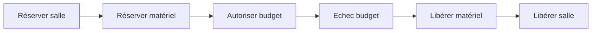

---

# 10. Pourquoi l’ordre inverse ?

Parce que chaque étape peut dépendre de l’état créé par l’étape précédente.

On annule donc :

```text
la dernière modification
puis
la précédente
```

---

# 11. Saga orchestration

Nous utiliserons une approche :

```text
orchestrée
```

Un workflow central connaît :

- l’état de la saga ;
- l’étape en cours ;
- la prochaine étape ;
- la compensation à lancer.

---

# 12. Orchestration et choreography

## Orchestration

```text
un composant central coordonne
```

## Choreography

```text
chaque participant réagit aux événements
sans contrôleur central unique
```

---

# 13. Pourquoi orchestration dans ce TP ?

Parce que le workflow devient plus facile à :

- visualiser ;
- expliquer ;
- diagnostiquer ;
- compenser.

---

# 14. Architecture générale

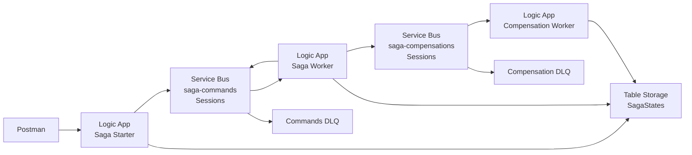

---

# 15. Ressources du TP

Nous allons créer :

```text
Resource Group
rg-tp6-saga-si

Service Bus Namespace Standard
sb-tp6-<initiales>-<nombre>

Queues
saga-commands
saga-compensations

Storage Account
sttp6<initiales><nombre>

Table
SagaStates

Logic Apps
la-tp6-starter
la-tp6-worker
la-tp6-compensation
```

---

# 16. Service Bus Standard obligatoire

Les **Sessions** ne sont pas supportées en Basic.

Il faut :

```text
Standard
```

ou :

```text
Premium
```

---

# 17. Sessions à la création

Point important :

```text
une queue créée sans sessions
ne peut pas être transformée plus tard en queue à sessions
```

Vous devez choisir correctement dès la création.

---

# 18. Pourquoi utiliser Sessions ?

Nous voulons garantir que tous les messages d’une même saga :

```text
sagaId = SAGA-123
```

sont traités :

```text
dans l'ordre
```

---

# 19. Session Id

Chaque message de la saga aura :

```text
Session Id = sagaId
```

---

# 20. Exemple

```text
SAGA-A
RESERVE_ROOM
RESERVE_EQUIPMENT
AUTHORIZE_BUDGET
```

et :

```text
SAGA-B
RESERVE_ROOM
RESERVE_EQUIPMENT
AUTHORIZE_BUDGET
```

---

# 21. Parallélisme entre sagas

SAGA-A et SAGA-B peuvent avancer en parallèle.

Mais à l’intérieur de SAGA-A :

```text
l'ordre doit être conservé
```

---

# 22. Sessions et FIFO

Service Bus Sessions permettent le traitement ordonné d’une séquence de messages associée au même Session Id.

---

# 23. Diagramme

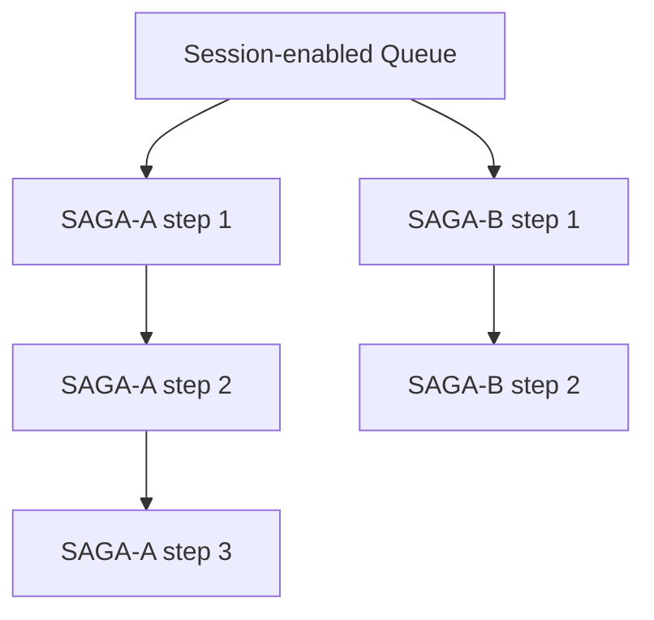

---

# 24. Etat durable de la saga

Nous stockerons l’état dans :

```text
Azure Table Storage
SagaStates
```

---

# 25. Clé de table

```text
PartitionKey = saga
RowKey = sagaId
```

---

# 26. Exemple d’entité

```json
{
  "PartitionKey": "saga",
  "RowKey": "SAGA-123",
  "status": "STARTED",
  "roomReserved": false,
  "equipmentReserved": false,
  "budgetAuthorized": false,
  "retryCount": 0,
  "failAt": "none",
  "transientAt": "none"
}
```

---

# 27. Pourquoi un état durable ?

Si Logic Apps redémarre :

```text
la saga ne doit pas oublier ce qui est déjà fait
```

---

# 28. Etapes principales

```text
RESERVE_ROOM
RESERVE_EQUIPMENT
AUTHORIZE_BUDGET
```

---

# 29. Compensations

```text
RELEASE_EQUIPMENT
RELEASE_ROOM
```

---

# 30. Pas de compensation budget

Dans ce scénario :

```text
AUTHORIZE_BUDGET
```

est considéré comme la dernière étape.

Si elle réussit :

```text
la saga est COMPLETED
```

---

# 31. Transaction pivot

Dans la théorie Saga, une transaction **pivot** est un point de non-retour.

Dans notre scénario pédagogique :

```text
AUTHORIZE_BUDGET
```

joue le rôle de dernière étape de validation.

---

# 32. Transactions compensables

```text
RESERVE_ROOM
RESERVE_EQUIPMENT
```

peuvent être compensées par :

```text
RELEASE_ROOM
RELEASE_EQUIPMENT
```

---

# 33. Retryable transaction

Une erreur temporaire peut être rejouée.

Nous allons utiliser :

```text
ScheduledEnqueueTimeUtc
```

pour faire un retry différé.

---

# 34. Pourquoi pas Abandon immédiat ?

Abandon peut provoquer une redélivrance rapidement.

Pour certains services indisponibles :

```text
retenter immédiatement 10 fois
```

est inutile.

---

# 35. Retry différé

Nous allons faire :

```text
erreur temporaire
Complete message actuel
planifier nouveau message à +30 secondes
```

---

# 36. Diagramme retry différé

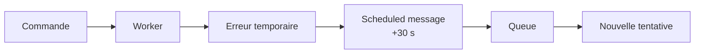

---

# 37. Pourquoi Complete le message actuel ?

Parce que nous créons explicitement :

```text
une nouvelle tentative planifiée
```

Nous ne voulons pas :

```text
le retry broker immédiat
plus
le retry planifié
```

---

# 38. Limite de retries

Nous utiliserons :

```text
maxRetry = 2
```

---

# 39. Après deux retries

Si l’erreur temporaire persiste :

```text
la saga entre en compensation
```

---

# 40. Scénarios de test

Le starter reçoit :

```text
failAt
transientAt
```

Valeurs possibles :

```text
none
room
equipment
budget
```

---

# 41. failAt

Erreur métier permanente.

Exemple :

```text
failAt = budget
```

---

# 42. transientAt

Erreur temporaire.

Exemple :

```text
transientAt = equipment
```

---

# 43. Payload starter

```json
{
  "sagaId": "SAGA-001",
  "incidentId": "INC-6001",
  "campus": "EPSI",
  "failAt": "none",
  "transientAt": "none"
}
```

---

# 44. Étape 1 - Créer le Resource Group

Dans :

```text
Resource groups
```

cliquez :

```text
Create
```

Nom :

```text
rg-tp6-saga-si
```

---

## Équivalent Azure CLI - optionnel

```bash
az group create \
  --name rg-tp6-saga-si \
  --location westeurope
```

---

# 45. Étape 2 - Créer Service Bus Standard

Recherchez :

```text
Service Bus
```

Créez :

```text
sb-tp6-...
```

Pricing tier :

```text
Standard
```

---

## Équivalent Azure CLI - optionnel

```bash
az servicebus namespace create \
  --resource-group rg-tp6-saga-si \
  --name sb-tp6-xx-12345 \
  --location westeurope \
  --sku Standard
```

---

# 46. Étape 3 - Créer saga-commands

Créez une queue :

```text
saga-commands
```

Activez :

```text
Sessions
```

---

# 47. Paramètres

```text
Requires Session = Yes
Lock Duration = 1 minute
Max Delivery Count = 5
```

---

# 48. Pourquoi Max Delivery Count 5 ?

Le TP utilise surtout des retries planifiés.

Mais nous gardons une protection broker en cas d’erreur non gérée.

---

# 49. Étape 4 - Créer saga-compensations

Créez :

```text
saga-compensations
```

Activez également :

```text
Sessions
```

---

# 50. Pourquoi les compensations ont aussi une session ?

Pour garantir :

```text
RELEASE_EQUIPMENT
avant
RELEASE_ROOM
```

pour une même saga.

---

## Équivalent CLI - optionnel

```bash
az servicebus queue create \
  --resource-group rg-tp6-saga-si \
  --namespace-name sb-tp6-xx-12345 \
  --name saga-commands \
  --enable-session true \
  --lock-duration PT1M \
  --max-delivery-count 5

az servicebus queue create \
  --resource-group rg-tp6-saga-si \
  --namespace-name sb-tp6-xx-12345 \
  --name saga-compensations \
  --enable-session true \
  --lock-duration PT1M \
  --max-delivery-count 5
```

---

# 51. Vérifier sessions CLI

```bash
az servicebus queue show \
  --resource-group rg-tp6-saga-si \
  --namespace-name sb-tp6-xx-12345 \
  --name saga-commands \
  --query '{
    name:name,
    sessions:requiresSession,
    lockDuration:lockDuration,
    maxDelivery:maxDeliveryCount
  }' \
  --output json
```

---

# 52. Étape 5 - Créer Storage Account

Créez un Storage Account :

```text
sttp6xx12345
```

SKU :

```text
Standard_LRS
```

---

# 53. Étape 6 - Créer SagaStates

Dans le Storage Account :

```text
Storage Browser
Tables
```

créez :

```text
SagaStates
```

---

## CLI - optionnel

```bash
az storage account create \
  --name sttp6xx12345 \
  --resource-group rg-tp6-saga-si \
  --location westeurope \
  --sku Standard_LRS \
  --kind StorageV2

az storage table create \
  --name SagaStates \
  --account-name sttp6xx12345 \
  --auth-mode login
```

---

# 54. Étape 7 - Créer la-tp6-starter

Créez une Logic App Consumption :

```text
la-tp6-starter
```

---

# 55. Managed Identity

Activez :

```text
System assigned
```

---

# 56. RBAC Starter Service Bus

Attribuez :

```text
Azure Service Bus Data Sender
```

sur :

```text
saga-commands
```

---

# 57. RBAC Starter Storage

Attribuez :

```text
Storage Table Data Contributor
```

sur le Storage Account.

---

# 58. Trigger HTTP Starter

Ajoutez :

```text
When a HTTP request is received
```

Method :

```text
POST
```

---

# 59. Schema Starter

```json
{
  "type": "object",
  "properties": {
    "sagaId": {
      "type": "string",
      "minLength": 1
    },
    "incidentId": {
      "type": "string",
      "minLength": 1
    },
    "campus": {
      "type": "string",
      "minLength": 1
    },
    "failAt": {
      "type": "string",
      "enum": [
        "none",
        "room",
        "equipment",
        "budget"
      ]
    },
    "transientAt": {
      "type": "string",
      "enum": [
        "none",
        "room",
        "equipment",
        "budget"
      ]
    }
  },
  "required": [
    "sagaId",
    "incidentId",
    "campus",
    "failAt",
    "transientAt"
  ],
  "additionalProperties": false
}
```

---

# 60. Activer Schema Validation

Dans les settings du trigger :

```text
Schema Validation = On
```

---

# 61. Étape 8 - Créer l’état initial

Ajoutez :

```text
Azure Table Storage
Insert Entity (V2)
```

Table :

```text
SagaStates
```

---

# 62. Entité initiale

```json
{
  "PartitionKey": "saga",
  "RowKey": "SAGA-001",
  "incidentId": "INC-6001",
  "campus": "EPSI",
  "status": "STARTED",
  "currentStep": "RESERVE_ROOM",
  "roomReserved": false,
  "equipmentReserved": false,
  "budgetAuthorized": false,
  "retryCount": 0,
  "failAt": "none",
  "transientAt": "none",
  "updatedAt": "UTC"
}
```

---

# 63. Valeurs dynamiques

```text
PartitionKey
saga
```

```text
RowKey
sagaId
```

```text
incidentId
triggerBody.incidentId
```

---

# 64. Pourquoi Insert et non Upsert ?

Le même `sagaId` ne doit pas démarrer deux sagas différentes.

Un deuxième starter avec le même RowKey doit provoquer un conflit.

---

# 65. Bonus idempotence starter

Comme dans le TP5 :

```text
409 EntityAlreadyExists
```

peut être traité comme :

```text
SAGA_ALREADY_EXISTS
```

---

# 66. Étape 9 - Construire le premier command

Ajoutez :

```text
Compose
```

Nom :

```text
Build_First_Command
```

---

# 67. Body

```json
{
  "sagaId": "@{triggerBody()?['sagaId']}",
  "incidentId": "@{triggerBody()?['incidentId']}",
  "step": "RESERVE_ROOM",
  "attempt": 0
}
```

---

# 68. Send message

Ajoutez :

```text
Service Bus
Send message
```

Queue :

```text
saga-commands
```

---

# 69. Session Id

Dans les paramètres avancés :

```text
Session Id
```

utilisez :

```text
sagaId
```

---

# 70. Message Id

Utilisez :

```text
concat(sagaId, '-RESERVE_ROOM-0')
```

---

# 71. Correlation Id

Utilisez :

```text
sagaId
```

---

# 72. Response

Retournez :

```text
202 Accepted
```

Body :

```json
{
  "status": "SAGA_STARTED",
  "sagaId": "..."
}
```

---

# 73. Workflow Starter

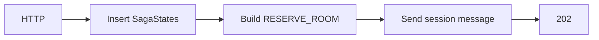

---

# 74. Étape 10 - Créer la-tp6-worker

Créez :

```text
la-tp6-worker
```

---

# 75. Managed Identity Worker

Activez :

```text
System assigned
```

---

# 76. RBAC Worker Service Bus

Le worker doit :

- Receive sur `saga-commands` ;
- Send sur `saga-commands` ;
- Send sur `saga-compensations`.

Pour simplifier le TP, attribuez :

```text
Azure Service Bus Data Receiver
```

et :

```text
Azure Service Bus Data Sender
```

au niveau du namespace.

---

# 77. Production

En production, utilisez des scopes plus précis.

---

# 78. RBAC Worker Storage

Attribuez :

```text
Storage Table Data Contributor
```

sur le Storage Account.

---

# 79. Étape 11 - Trigger session Peek-Lock

Ajoutez le trigger :

```text
When a message is received in a queue (peek-lock)
```

Queue :

```text
saga-commands
```

---

# 80. Session Id

Dans le paramètre Session :

```text
Next Available
```

si cette option est proposée.

---

# 81. Pourquoi Next Available ?

Le connector peut prendre :

```text
la prochaine session disponible
```

sans connaître le `sagaId` à l’avance.

---

# 82. Trigger et ordre

Le receiver obtient le message dans le contexte de sa session.

---

# 83. Métadonnées importantes

Repérez :

- Session Id ;
- Message Id ;
- Correlation Id ;
- Lock Token ;
- Delivery Count ;
- Sequence Number.

---

# 84. Étape 12 - Parse Command

Ajoutez :

```text
Parse JSON
```

Nom :

```text
Parse_Command
```

---

# 85. Schéma

```json
{
  "type": "object",
  "properties": {
    "sagaId": {
      "type": "string"
    },
    "incidentId": {
      "type": "string"
    },
    "step": {
      "type": "string"
    },
    "attempt": {
      "type": "integer"
    }
  },
  "required": [
    "sagaId",
    "incidentId",
    "step",
    "attempt"
  ]
}
```

---

# 86. Étape 13 - Get Saga State

Ajoutez :

```text
Azure Table Storage
Get entity (V2)
```

Table :

```text
SagaStates
```

PartitionKey :

```text
saga
```

RowKey :

```text
sagaId
```

---

# 87. Pourquoi lire l’état avant chaque étape ?

Pour éviter de traiter une commande obsolète.

Exemple :

```text
saga déjà COMPENSATING
mais
une ancienne commande arrive
```

---

# 88. Guard de statut

Ajoutez une Condition :

```text
status = COMPENSATING
ou
status = COMPENSATED
ou
status = FAILED
```

---

# 89. Si saga fermée

Ne réalisez plus l’étape métier.

Faites :

```text
Complete
```

ou :

```text
Dead-letter
```

selon la stratégie choisie.

---

# 90. Choix du TP

Nous ferons :

```text
Complete
```

pour une commande devenue obsolète.

---

# 91. Pourquoi pas DLQ ?

Ce n’est pas une erreur technique.

Le message est devenu sans objet à cause de l’évolution de la saga.

---

# 92. Étape 14 - Switch Step

Ajoutez :

```text
Switch
```

sur :

```text
step
```

Cases :

```text
RESERVE_ROOM
RESERVE_EQUIPMENT
AUTHORIZE_BUDGET
```

---

# 93. Default

Si le step est inconnu :

```text
Dead-letter
```

Reason :

```text
UNKNOWN_SAGA_STEP
```

---

# 94. Structure générale

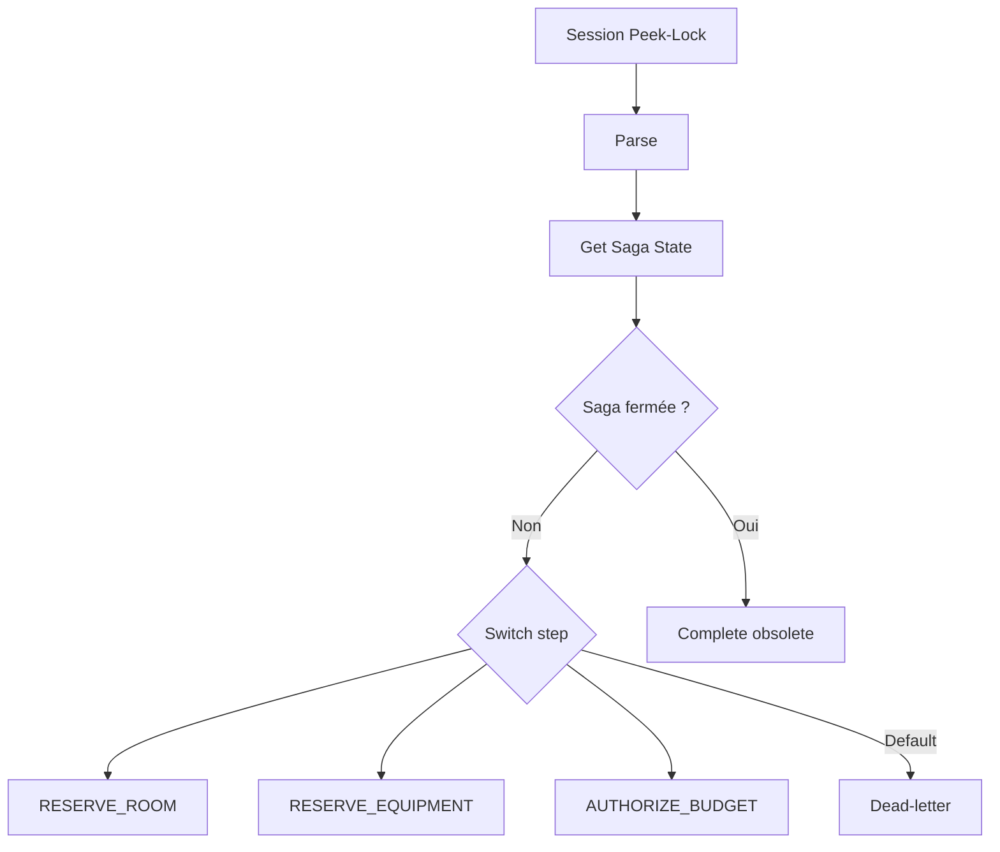

---

# 95. Étape 15 - Fonction de simulation

Dans chaque step, nous allons vérifier :

```text
failAt
transientAt
```

stockés dans SagaStates.

---

# 96. failAt

Si :

```text
failAt = room
```

pendant `RESERVE_ROOM` :

```text
erreur métier permanente
```

---

# 97. transientAt

Si :

```text
transientAt = room
```

et `attempt < 2` :

```text
retry différé
```

---

# 98. Une fois max retry atteint

Si :

```text
attempt >= 2
```

alors :

```text
échec définitif
compensation
```

---

# 99. RESERVE_ROOM - succès

Si aucune erreur :

mettez à jour SagaStates :

```text
status = ROOM_RESERVED
roomReserved = true
currentStep = RESERVE_EQUIPMENT
retryCount = 0
updatedAt = utcNow()
```

---

# 100. Mise à jour Table

Utilisez :

```text
Insert or Merge Entity (V2)
```

---

# 101. Pourquoi Insert or Merge ?

L’entité existe déjà.

Nous voulons modifier seulement certaines propriétés.

---

# 102. Envoyer next step

Construisez :

```json
{
  "sagaId": "...",
  "incidentId": "...",
  "step": "RESERVE_EQUIPMENT",
  "attempt": 0
}
```

---

# 103. Session Id next step

Toujours :

```text
sagaId
```

---

# 104. Complete message ROOM

Après :

```text
Update state
Send next command
```

faites :

```text
Complete
```

---

# 105. Ordre recommandé

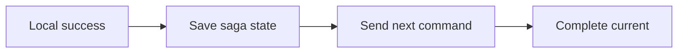

---

# 106. Attention

Dans un vrai système, l’ordre entre :

```text
mise à jour état
et
publication next command
```

pose un problème de cohérence.

---

# 107. Pourquoi ?

Un crash entre les deux peut laisser :

```text
état mis à jour
mais
next command non envoyé
```

---

# 108. Pattern Outbox

Une solution plus robuste serait :

```text
Transactional Outbox
```

Nous en parlerons en fin de TP.

---

# 109. Pour le TP

Nous acceptons cette simplification afin de nous concentrer sur :

- Saga ;
- Sessions ;
- compensation.

---

# 110. RESERVE_ROOM - permanent failure

Si :

```text
failAt = room
```

aucune étape précédente n’est à compenser.

---

# 111. Mise à jour

```text
status = FAILED
currentStep = NONE
lastError = ROOM_RESERVATION_REJECTED
```

---

# 112. Complete

Puis :

```text
Complete
```

le message.

---

# 113. Pourquoi pas DLQ ?

Une erreur métier permanente attendue :

```text
n'est pas forcément une erreur technique du broker
```

Nous terminons proprement la saga avec :

```text
FAILED
```

---

# 114. RESERVE_ROOM - erreur temporaire

Si :

```text
transientAt = room
attempt < 2
```

planifiez un retry.

---

# 115. Build Retry

```json
{
  "sagaId": "...",
  "incidentId": "...",
  "step": "RESERVE_ROOM",
  "attempt": 1
}
```

---

# 116. ScheduledEnqueueTimeUtc

Dans l’action Send message :

```text
ScheduledEnqueueTimeUtc
```

utilisez :

```text
addSeconds(utcNow(), 30)
```

---

# 117. Session Id

Toujours :

```text
sagaId
```

---

# 118. Message Id retry

Utilisez par exemple :

```text
concat(sagaId, '-RESERVE_ROOM-', string(attempt + 1))
```

---

# 119. Save retry state

Mettez à jour :

```text
status = RETRY_WAIT
currentStep = RESERVE_ROOM
retryCount = attempt + 1
```

---

# 120. Complete current message

Puis :

```text
Complete
```

---

# 121. Pourquoi Scheduled Message ?

Service Bus garde le message caché jusqu’à la date programmée.

---

# 122. Ce n’est pas un Delay Logic Apps

Avec un Delay :

```text
le workflow reste en attente
```

Avec Scheduled Message :

```text
le message est confié au broker
le run actuel peut se terminer
```

---

# 123. Avantage

C’est mieux adapté à :

```text
retry distribué différé
```

---

# 124. TTL et scheduled messages

Le TTL d’un message planifié commence à compter à partir de son moment d’enqueue logique.

---

# 125. RESERVE_EQUIPMENT - succès

Mettez à jour :

```text
status = EQUIPMENT_RESERVED
equipmentReserved = true
currentStep = AUTHORIZE_BUDGET
retryCount = 0
```

---

# 126. Envoyer AUTHORIZE_BUDGET

Message :

```json
{
  "sagaId": "...",
  "incidentId": "...",
  "step": "AUTHORIZE_BUDGET",
  "attempt": 0
}
```

---

# 127. Complete current

Après send :

```text
Complete
```

---

# 128. RESERVE_EQUIPMENT - permanent failure

A cette étape :

```text
roomReserved = true
```

Il faut compenser :

```text
RELEASE_ROOM
```

---

# 129. Etat

Mettez :

```text
status = COMPENSATING
currentStep = RELEASE_ROOM
lastError = EQUIPMENT_RESERVATION_REJECTED
```

---

# 130. Envoyer compensation

Queue :

```text
saga-compensations
```

Body :

```json
{
  "sagaId": "...",
  "step": "RELEASE_ROOM",
  "order": 1
}
```

---

# 131. Session Id compensation

```text
sagaId
```

---

# 132. Complete command courant

Puis :

```text
Complete
```

---

# 133. RESERVE_EQUIPMENT - temporary failure

Même principe que room :

```text
attempt < 2
scheduled retry +30 s
```

---

# 134. Après retry max

Si toujours en erreur :

```text
COMPENSATING
RELEASE_ROOM
```

---

# 135. AUTHORIZE_BUDGET - succès

Mettez à jour :

```text
status = COMPLETED
budgetAuthorized = true
currentStep = NONE
updatedAt = utcNow()
```

---

# 136. Complete

Puis :

```text
Complete
```

---

# 137. Saga terminée

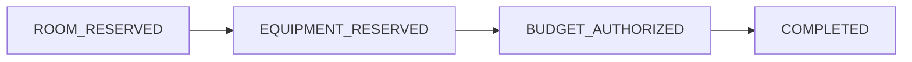

---

# 138. AUTHORIZE_BUDGET - permanent failure

A ce stade :

```text
roomReserved = true
equipmentReserved = true
```

Il faut compenser :

```text
RELEASE_EQUIPMENT
puis
RELEASE_ROOM
```

---

# 139. Ordre des messages compensation

Envoyez d’abord :

```text
RELEASE_EQUIPMENT
```

puis :

```text
RELEASE_ROOM
```

---

# 140. Même Session Id

Les deux utilisent :

```text
sagaId
```

---

# 141. Sessions et ordre compensation

La queue session-enabled garantit le traitement ordonné de cette séquence pour la saga.

---

# 142. Etat

```text
status = COMPENSATING
currentStep = RELEASE_EQUIPMENT
lastError = BUDGET_REJECTED
```

---

# 143. Complete AUTHORIZE_BUDGET

Puis :

```text
Complete
```

---

# 144. AUTHORIZE_BUDGET - temporary failure

Planifiez :

```text
AUTHORIZE_BUDGET
attempt + 1
+30 secondes
```

---

# 145. Après max retry

Déclenchez :

```text
RELEASE_EQUIPMENT
RELEASE_ROOM
```

---

# 146. Etape 16 - Créer la-tp6-compensation

Créez :

```text
la-tp6-compensation
```

---

# 147. Managed Identity

Activez :

```text
System assigned
```

---

# 148. RBAC

Attribuez :

```text
Azure Service Bus Data Receiver
```

sur `saga-compensations`.

Attribuez :

```text
Storage Table Data Contributor
```

sur le Storage Account.

---

# 149. Trigger session

Utilisez :

```text
When a message is received in a queue (peek-lock)
```

Queue :

```text
saga-compensations
```

Session :

```text
Next Available
```

---

# 150. Parse compensation

Schéma :

```json
{
  "type": "object",
  "properties": {
    "sagaId": {
      "type": "string"
    },
    "step": {
      "type": "string"
    },
    "order": {
      "type": "integer"
    }
  },
  "required": [
    "sagaId",
    "step",
    "order"
  ]
}
```

---

# 151. Get Saga State

Lisez :

```text
SagaStates
PartitionKey = saga
RowKey = sagaId
```

---

# 152. Switch compensation

Cases :

```text
RELEASE_EQUIPMENT
RELEASE_ROOM
```

---

# 153. RELEASE_EQUIPMENT

Mettez à jour :

```text
equipmentReserved = false
currentStep = RELEASE_ROOM
updatedAt = utcNow()
```

---

# 154. Complete compensation equipment

Après update :

```text
Complete
```

---

# 155. RELEASE_ROOM

Mettez à jour :

```text
roomReserved = false
status = COMPENSATED
currentStep = NONE
updatedAt = utcNow()
```

---

# 156. Complete room

Puis :

```text
Complete
```

---

# 157. Etat final compensation

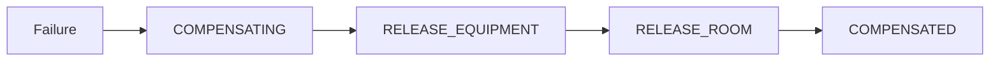

---

# 158. Pourquoi COMPENSATED et non FAILED ?

`FAILED` signifie :

```text
la saga n'a pas atteint son objectif
```

`COMPENSATED` signifie :

```text
les effets déjà réalisés ont été annulés
```

---

# 159. On peut garder les deux informations

Exemple :

```text
status = COMPENSATED
lastError = BUDGET_REJECTED
```

---

# 160. Etape 17 - Premier test success

Envoyez :

```json
{
  "sagaId": "SAGA-SUCCESS-1",
  "incidentId": "INC-6101",
  "campus": "EPSI",
  "failAt": "none",
  "transientAt": "none"
}
```

---

# 161. Résultat attendu

Etat final :

```text
COMPLETED
```

---

# 162. Propriétés finales

```text
roomReserved = true
equipmentReserved = true
budgetAuthorized = true
```

---

# 163. Run sequence

Vous devez observer trois runs worker :

```text
RESERVE_ROOM
RESERVE_EQUIPMENT
AUTHORIZE_BUDGET
```

---

# 164. Correlation

Chaque message utilise :

```text
Correlation Id = sagaId
Session Id = sagaId
```

---

# 165. Etape 18 - Test fail room

```json
{
  "sagaId": "SAGA-FAIL-ROOM",
  "incidentId": "INC-6102",
  "campus": "EPSI",
  "failAt": "room",
  "transientAt": "none"
}
```

---

# 166. Attendu

```text
FAILED
roomReserved = false
equipmentReserved = false
budgetAuthorized = false
```

---

# 167. Aucune compensation

Puisque rien n’a été réservé.

---

# 168. Etape 19 - Test fail equipment

```json
{
  "sagaId": "SAGA-FAIL-EQ",
  "incidentId": "INC-6103",
  "campus": "EPSI",
  "failAt": "equipment",
  "transientAt": "none"
}
```

---

# 169. Flux attendu

```text
RESERVE_ROOM
success

RESERVE_EQUIPMENT
failure

RELEASE_ROOM
```

---

# 170. Etat final

```text
COMPENSATED
roomReserved = false
equipmentReserved = false
```

---

# 171. Etape 20 - Test fail budget

```json
{
  "sagaId": "SAGA-FAIL-BUDGET",
  "incidentId": "INC-6104",
  "campus": "EPSI",
  "failAt": "budget",
  "transientAt": "none"
}
```

---

# 172. Flux attendu

```text
RESERVE_ROOM
RESERVE_EQUIPMENT
AUTHORIZE_BUDGET failure
RELEASE_EQUIPMENT
RELEASE_ROOM
```

---

# 173. Etat final

```text
COMPENSATED
```

---

# 174. Vérifier ordre compensation

Dans Run History :

```text
RELEASE_EQUIPMENT
```

doit précéder :

```text
RELEASE_ROOM
```

pour la même session.

---

# 175. Etape 21 - Test transient equipment

```json
{
  "sagaId": "SAGA-RETRY-EQ",
  "incidentId": "INC-6105",
  "campus": "EPSI",
  "failAt": "none",
  "transientAt": "equipment"
}
```

---

# 176. Première tentative equipment

```text
attempt = 0
```

Planifie :

```text
attempt = 1
+30 secondes
```

---

# 177. Deuxième tentative

```text
attempt = 1
```

Planifie :

```text
attempt = 2
+30 secondes
```

---

# 178. Troisième tentative

```text
attempt = 2
```

Le retry max est atteint.

---

# 179. Comportement du TP

Nous considérons :

```text
erreur temporaire devenue persistante
```

Donc :

```text
COMPENSATING
RELEASE_ROOM
```

---

# 180. Variante pédagogique

Vous pouvez décider que :

```text
transientAt
```

n’échoue que la première fois.

Dans ce cas :

```text
attempt >= 1
```

devient succès.

---

# 181. Recommandation

Pour observer à la fois retry et succès :

modifiez la règle en :

```text
transientAt correspond
ET
attempt = 0
```

puis succès à `attempt = 1`.

---

# 182. Deux modes d’exercice

## Mode A

```text
temporary_once
```

pour montrer un retry réussi.

## Mode B

```text
temporary_always
```

pour montrer l’épuisement des retries.

---

# 183. Etape 22 - Ajouter transientMode

Bonus :

```json
{
  "transientMode": "once"
}
```

ou :

```text
always
```

---

# 184. Scheduled messages

Un message planifié n’est pas visible par le consumer avant :

```text
ScheduledEnqueueTimeUtc
```

---

# 185. Vérifier Scheduled message

Dans Service Bus Explorer, vous pouvez observer les messages planifiés selon les capacités de l’interface.

---

# 186. Sequence Number

Service Bus attribue un :

```text
Sequence Number
```

à chaque message accepté.

---

# 187. A quoi sert-il ?

C’est un identifiant interne unique broker.

Il reflète aussi l’ordre d’arrivée dans l’entité.

---

# 188. Sequence Number et Session Id

**Sequence Number** :

ordre global d’arrivée dans l’entité.

**Session Id** :

groupe logique sur lequel nous voulons un traitement ordonné.

---

# 189. Ne pas utiliser Sequence Number comme sagaId

Le sagaId est :

```text
une identité métier
```

Le Sequence Number est :

```text
une métadonnée broker
```

---

# 190. Etape 23 - Lancer plusieurs sagas

Envoyez rapidement :

```text
SAGA-A
SAGA-B
SAGA-C
```

---

# 191. Attendu

Les différentes sagas peuvent être entrelacées dans le temps.

---

# 192. Mais pour SAGA-A

L’ordre doit rester :

```text
ROOM
EQUIPMENT
BUDGET
```

---

# 193. Diagramme

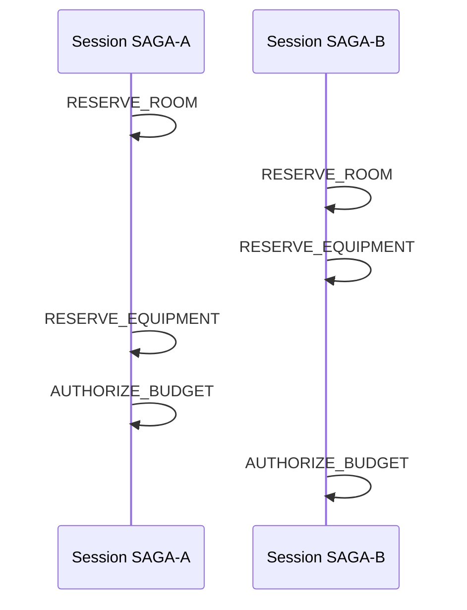

Les sagas s’intercalent.

L’ordre interne reste cohérent.

---

# 194. Etape 24 - Debug session

Erreur :

```text
No session available
```

ou :

```text
session locked by another receiver
```

peut apparaître dans certains scénarios.

---

# 195. Cause

Une session peut être verrouillée par un receiver.

---

# 196. Vérifier

- Session Id ;
- trigger ;
- session active ;
- plusieurs consumers ;
- lock de session.

---

# 197. Renew Session

Le connector Service Bus propose des opérations de :

```text
Renew lock on the session
```

pour les scénarios longs.

---

# 198. Pas obligatoire

Notre TP garde des traitements courts.

---

# 199. Etape 25 - Debug message sans Session Id

Une queue avec :

```text
Requires Session = true
```

attend des messages avec :

```text
Session Id
```

---

# 200. Symptôme

Un Send message mal configuré peut échouer.

---

# 201. Vérification

Dans toutes les actions Send vers :

```text
saga-commands
saga-compensations
```

renseignez :

```text
Session Id = sagaId
```

---

# 202. Debug ordre incorrect

Vérifiez :

```text
même Session Id
```

pour toutes les étapes de la saga.

---

# 203. Debug deux sagaId identiques

Deux starters avec le même sagaId doivent être bloqués par l’entité Table initiale si vous utilisez Insert.

---

# 204. Debug retry immédiat

Vérifiez :

```text
ScheduledEnqueueTimeUtc
```

et non un simple Send immédiat.

---

# 205. Expression retry

```text
addSeconds(utcNow(), 30)
```

---

# 206. Debug Scheduled UTC

Service Bus attend une date UTC.

Utilisez :

```text
utcNow()
```

et les fonctions temporelles Logic Apps.

---

# 207. Debug loop infinie

Le worker consomme :

```text
saga-commands
```

et publie également :

```text
saga-commands
```

---

# 208. Risque

Un workflow qui republie sans condition peut créer :

```text
une boucle infinie
```

---

# 209. Protection du TP

Le Switch autorise seulement :

```text
RESERVE_ROOM
RESERVE_EQUIPMENT
AUTHORIZE_BUDGET
```

et chaque succès publie une étape strictement suivante.

---

# 210. Fin du workflow

```text
AUTHORIZE_BUDGET success
```

ne republie rien.

---

# 211. Limite retry

Les retries ont :

```text
attempt
```

et une limite stricte.

---

# 212. Règle de sécurité

Ne créez jamais :

```text
Send same step
sans compteur
sans limite
```

---

# 213. Debug état incohérent

Exemple :

```text
status = EQUIPMENT_RESERVED
roomReserved = false
```

---

# 214. Vérifiez

- mises à jour Table ;
- propriétés Merge ;
- ordre des actions ;
- compensation.

---

# 215. Etags et concurrence

Table Storage peut également utiliser :

```text
ETag
```

pour gérer la concurrence optimiste.

---

# 216. Dans ce TP

Les Sessions réduisent la concurrence **à l’intérieur d’une même saga**.

Nous n’utilisons donc pas ETag comme mécanisme principal.

---

# 217. Pourquoi le sujet reste important ?

Une autre application pourrait modifier la même entité SagaStates.

---

# 218. Production

On pourrait combiner :

```text
Session Id
ETag
idempotence
```

---

# 219. Etape 26 - Compensation qui échoue

Une compensation peut elle-même échouer.

C’est un point essentiel du pattern Saga.

---

# 220. Exemple

```text
RELEASE_EQUIPMENT
échoue
```

---

# 221. Que faire ?

Le message de compensation peut :

- être retenté ;
- finir en DLQ ;
- déclencher une intervention humaine.

---

# 222. Dans le TP

Configurez :

```text
Max Delivery Count = 5
```

sur la queue compensation.

---

# 223. Erreur technique compensation

Utilisez :

```text
Abandon
```

ou laissez le run échouer selon le scénario.

---

# 224. Erreur permanente compensation

Utilisez :

```text
Dead-letter
```

Reason :

```text
COMPENSATION_FAILED
```

---

# 225. Etat Saga

Mettez :

```text
status = COMPENSATION_FAILED
```

---

# 226. Pourquoi c’est critique ?

Une saga peut rester :

```text
partiellement compensée
```

---

# 227. Intervention humaine

Un opérateur doit parfois corriger :

- l’état externe ;
- la DLQ ;
- l’état de saga.

---

# 228. Saga n’est pas un rollback magique

Une compensation :

```text
n'est pas forcément l'inverse exact au niveau physique
```

---

# 229. Exemple

Réserver une salle :

```text
reservation créée
```

Compenser :

```text
annulation créée
```

Ce n’est pas forcément :

```text
effacer toute trace
```

---

# 230. Audit

En production, gardez un historique.

---

# 231. Bonus - SagaEvents

Créez une queue :

```text
saga-events
```

---

# 232. Chaque transition publie

```text
SAGA_STARTED
ROOM_RESERVED
EQUIPMENT_RESERVED
BUDGET_AUTHORIZED
COMPENSATION_STARTED
ROOM_RELEASED
COMPLETED
COMPENSATED
```

---

# 233. Pourquoi ?

Pour :

- audit ;
- monitoring ;
- reporting ;
- observabilité.

---

# 234. Bonus - Topic

Vous pouvez remplacer :

```text
saga-events queue
```

par un Topic avec :

```text
sub-audit
sub-ops
sub-reporting
```

Cela réutilise le TP3.

---

# 235. Bonus - Duplicate Detection

Activez Duplicate Detection sur :

```text
saga-commands
```

si vous voulez combiner avec le TP5.

---

# 236. Message Id déterministe

Exemple :

```text
sagaId-step-attempt
```

---

# 237. Avantage

Si le sender republie accidentellement exactement la même commande :

```text
le broker peut la dédupliquer
```

---

# 238. Attention retry

Le retry doit avoir un Message Id différent si vous voulez qu’il soit considéré comme :

```text
une nouvelle tentative volontaire
```

---

# 239. Donc

```text
SAGA-1-EQUIPMENT-0
SAGA-1-EQUIPMENT-1
SAGA-1-EQUIPMENT-2
```

---

# 240. Bonus - TTL

Un command peut avoir :

```text
Time To Live
```

---

# 241. Exemple

Une réservation devenue inutile après :

```text
10 minutes
```

peut expirer.

---

# 242. Attention scheduled + TTL

Pour un scheduled message, la durée TTL commence à partir de son enqueue logique.

---

# 243. Bonus - Dead-letter on expiration

Vous pouvez configurer une entité pour :

```text
dead-letter les messages expirés
```

---

# 244. Pourquoi ?

Pour auditer :

```text
les commandes devenues trop anciennes
```

---

# 245. Scopes et Run After

Pour structurer le worker :

créez des Scopes :

```text
Try_Step
Handle_Transient
Handle_Permanent
Finalize
```

---

# 246. Pourquoi Scopes ?

Un workflow complexe devient plus lisible.

---

# 247. Run after

Vous pouvez exécuter une action après :

```text
Succeeded
Failed
Skipped
TimedOut
```

---

# 248. Exemple

```text
Handle_Failure
```

peut être configuré pour s’exécuter après :

```text
Try_Step Failed
TimedOut
```

---

# 249. Attention

Dans le TP, les erreurs métier simulées sont souvent gérées par Conditions.

Les vraies erreurs connector peuvent être gérées par :

```text
Run after
```

---

# 250. Pattern Try / Catch / Finally

Logic Apps n’utilise pas directement ces mots.

Mais on peut reproduire :

```text
Try Scope
Catch Scope
Finally Scope
```

---

# 251. Diagramme

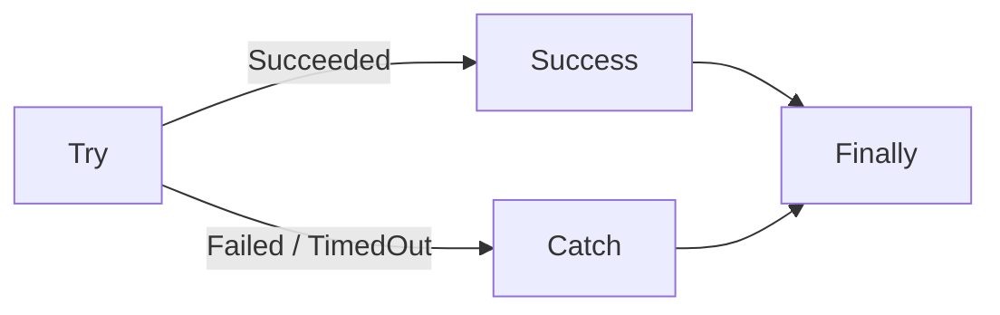

---

# 252. Bonus - circuit breaker conceptuel

Si un système externe est indisponible depuis longtemps :

```text
retenter chaque message
```

peut aggraver le problème.

---

# 253. Circuit Breaker

Un circuit breaker peut :

```text
ouvrir le circuit
refuser temporairement les appels
laisser le service récupérer
```

---

# 254. Ce TP ne construit pas un circuit breaker complet

Mais le retry différé prépare cette notion.

---

# 255. Bonus - état Circuit

Table :

```text
CircuitStates
```

avec :

```text
service
state
failureCount
openUntil
```

---

# 256. Si OPEN

Au lieu d’appeler le service :

```text
planifier retry après openUntil
```

---

# 257. Saga + circuit breaker

C’est un pattern fréquent dans les SI distribués avancés.

---

# 258. Outbox Pattern

Nous avons identifié un risque :

```text
état sauvegardé
mais
next message non publié
```

---

# 259. Transactional Outbox

Le pattern Outbox consiste à enregistrer :

```text
changement métier
et
événement à publier
```

dans la même transaction locale.

---

# 260. Un worker séparé publie ensuite

```text
les événements Outbox
```

---

# 261. Pourquoi c’est plus robuste ?

On évite la fenêtre :

```text
DB commit réussi
broker send échoué
```

---

# 262. Limite Azure Table Storage

Pour une vraie Outbox robuste, il faut bien concevoir :

- la partition ;
- la transaction locale ;
- le publisher ;
- l’idempotence.

---

# 263. Ce sera une extension possible du projet final

---

# 264. Debug - Session Id absent

Symptôme :

```text
Send message échoue
```

ou message non traité.

Vérifiez :

```text
Session Id
```

dans les paramètres avancés.

---

# 265. Debug - mauvaise queue

Vérifiez :

```text
saga-commands
```

vs :

```text
saga-compensations
```

---

# 266. Debug - Room réservé deux fois

Vérifiez :

- saga state ;
- step ;
- retry attempt ;
- Duplicate Detection si activée ;
- idempotence participant.

---

# 267. Debug - compensation dans mauvais ordre

Vérifiez :

- ordre d’envoi ;
- même Session Id ;
- queue session-enabled.

---

# 268. Debug - retry jamais visible

Vérifiez :

```text
ScheduledEnqueueTimeUtc
```

et l’heure UTC.

---

# 269. Debug - retry apparaît tout de suite

Vous avez probablement renseigné :

```text
mauvais champ
```

ou utilisé un Send normal sans Scheduled UTC.

---

# 270. Debug - saga reste RETRY_WAIT

Vérifiez que :

- scheduled message a été envoyé ;
- Message Id est unique ;
- Session Id existe ;
- worker est activé.

---

# 271. Debug - saga reste COMPENSATING

Vérifiez :

- backlog compensation ;
- compensation worker ;
- RBAC Receiver ;
- Session lock ;
- DLQ compensation.

---

# 272. Debug - 403 Table Storage

Vérifiez :

```text
Storage Table Data Contributor
```

sur l’identité du workflow.

---

# 273. Debug - 403 Service Bus

Vérifiez :

```text
Data Sender
Data Receiver
```

selon le workflow.

---

# 274. Debug - lock perdu

Un traitement trop long peut dépasser :

```text
Lock Duration
```

---

# 275. Solutions

- traitement plus court ;
- Renew Lock ;
- architecture asynchrone ;
- lock duration adapté.

---

# 276. Debug - polling lent

Le connecteur Service Bus managé utilise un modèle de polling.

Un léger délai peut être normal.

---

# 277. Debug - modification du workflow non prise en compte

Dans certains cas :

```text
désactivez la Logic App
modifiez
réactivez
```

si le trigger garde une ancienne configuration pendant quelques minutes.

---

# 278. Debug méthodique

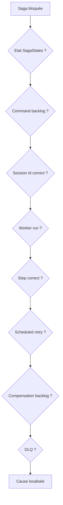

---

# 279. Checklist debug saga

Pour un sagaId donné :

1. ouvrir `SagaStates` ;
2. lire `status` ;
3. lire `currentStep` ;
4. lire `retryCount` ;
5. vérifier queue commands ;
6. vérifier queue compensations ;
7. vérifier DLQ ;
8. vérifier Run History ;
9. vérifier Session Id ;
10. vérifier Correlation Id.

---

# 280. Question 1

Pourquoi utiliser un Session Id égal au sagaId ?

**Réponse :**

Pour regrouper les messages d’une même saga et garantir leur traitement ordonné.

---

# 281. Question 2

Pourquoi différentes sagas peuvent-elles avancer en parallèle ?

**Réponse :**

Parce qu’elles utilisent des Session Id différents.

---

# 282. Question 3

Pourquoi les compensations sont-elles envoyées dans une autre queue ?

**Réponse :**

Pour séparer clairement :

```text
flux normal
```

et :

```text
flux de récupération
```

---

# 283. Question 4

Pourquoi utiliser ScheduledEnqueueTimeUtc pour le retry ?

**Réponse :**

Pour laisser le broker attendre jusqu’au moment du retry, sans garder un workflow actif inutilement.

---

# 284. Question 5

Pourquoi Complete le message avant le retry planifié ?

**Réponse :**

Parce qu’une nouvelle tentative dédiée a été créée. Garder l’ancien message en retry broker provoquerait deux mécanismes de retry concurrents.

---

# 285. Question 6

Pourquoi ne pas retry indéfiniment ?

**Réponse :**

Parce qu’un service durablement indisponible pourrait provoquer :

- coûts ;
- backlog ;
- charge ;
- bruit ;
- blocage.

---

# 286. Question 7

Pourquoi la compensation peut-elle échouer ?

**Réponse :**

Parce qu’elle appelle elle aussi des composants distribués qui peuvent être indisponibles ou refuser l’opération.

---

# 287. Question 8

Une compensation remet-elle forcément le système exactement dans son état initial ?

**Réponse :**

Non.

Elle doit produire un état métier cohérent, mais elle peut laisser une trace historique de ce qui s’est passé.

---

# 288. Question 9

Pourquoi stocker SagaStates ?

**Réponse :**

Pour connaître durablement l’avancement, reprendre après incident et diagnostiquer le processus.

---

# 289. Question 10

Pourquoi le TP identifie-t-il un risque entre update Table et Send next command ?

**Réponse :**

Parce que ces deux opérations ne forment pas une transaction atomique distribuée. Un crash entre les deux peut créer un état incohérent.

---

# 290. Exercice guidé 1 - Saga succès

Lancez :

```text
SAGA-EX-1
```

sans erreur.

Vérifiez :

```text
COMPLETED
```

---

# 291. Exercice guidé 2 - Failure room

Vérifiez :

```text
FAILED
```

sans compensation.

---

# 292. Exercice guidé 3 - Failure equipment

Vérifiez :

```text
RELEASE_ROOM
COMPENSATED
```

---

# 293. Exercice guidé 4 - Failure budget

Vérifiez :

```text
RELEASE_EQUIPMENT
RELEASE_ROOM
COMPENSATED
```

---

# 294. Exercice guidé 5 - Retry différé

Provoquez un transient sur :

```text
equipment
```

et observez un message planifié.

---

# 295. Exercice guidé 6 - Deux sagas simultanées

Lancez :

```text
SAGA-PAR-A
SAGA-PAR-B
```

rapidement.

---

# 296. Attendu

Les runs peuvent s’entrelacer.

L’ordre de chaque saga reste cohérent.

---

# 297. Exercice guidé 7 - compensation error

Simulez une erreur lors de :

```text
RELEASE_EQUIPMENT
```

---

# 298. Attendu

Après retries :

```text
DLQ compensation
status COMPENSATION_FAILED
```

---

# 299. Exercice guidé 8 - unknown step

Envoyez manuellement dans Service Bus Explorer :

```text
step = SOMETHING_UNKNOWN
```

avec Session Id valide.

---

# 300. Attendu

```text
Dead-letter
UNKNOWN_SAGA_STEP
```

---

# 301. Exercice guidé 9 - message sans Session Id

Essayez avec Service Bus Explorer.

Observez le comportement d’une queue qui exige les sessions.

---

# 302. Exercice guidé 10 - Scheduled + TTL

Planifiez un message à :

```text
+60 s
```

avec un TTL adapté.

Observez son activation.

---

# 303. Bonus - audit topic

Créez :

```text
saga-events
```

Topic Standard.

Subscriptions :

```text
sub-audit
sub-ops
```

---

# 304. Bonus - filters

`sub-ops` :

```sql
status IN ('FAILED', 'COMPENSATION_FAILED')
```

---

# 305. Bonus - observabilité

Publiez dans le topic à chaque transition.

---

# 306. Bonus - correlationId

Utilisez partout :

```text
Correlation Id = sagaId
```

---

# 307. Bonus - Application Insights

Avec Logic Apps Standard ou une architecture plus riche, vous pouvez centraliser davantage la télémétrie.

Ce n’est pas obligatoire dans ce TP.

---

# 308. Azure Monitor

Vous pouvez créer des alertes sur :

- Active Messages ;
- Dead-letter Messages ;
- Logic App failures.

---

# 309. Alerte utile

```text
Dead-letter message count > 0
```

---

# 310. Pourquoi ?

Une DLQ non vide doit généralement être investiguée.

---

# 311. Bonus - session state

Service Bus Sessions peuvent aussi associer un état de session côté broker dans certains SDKs.

Dans ce TP :

```text
nous utilisons Table Storage
```

pour rendre l’état facilement observable par les étudiants.

---

# 312. Pourquoi Table Storage est pédagogique ?

Vous pouvez voir directement :

- status ;
- currentStep ;
- flags ;
- retryCount.

---

# 313. Limite

Ce n’est pas forcément le choix final pour toutes les architectures de production.

---

# 314. Coûts

Le TP6 utilise :

- Service Bus Standard ;
- Logic Apps Consumption ;
- Storage Account.

Supprimez les ressources à la fin.

---

# 315. Nettoyage

Désactivez :

```text
la-tp6-worker
la-tp6-compensation
```

---

# 316. Inspectez les DLQ

Avant suppression :

```text
saga-commands DLQ
saga-compensations DLQ
```

---

# 317. Vérifiez SagaStates

Regardez quelques sagas :

```text
COMPLETED
COMPENSATED
FAILED
```

---

# 318. Supprimer Resource Group

```text
rg-tp6-saga-si
```

---

## CLI - optionnel

```bash
az group delete \
  --name rg-tp6-saga-si \
  --yes
```

---

# 319. Tips de fin de TP

Retenez :

1. **Une Saga coordonne plusieurs transactions locales.**
2. **Une compensation n’est pas un rollback SQL global.**
3. **Les compensations s’exécutent souvent dans l’ordre inverse.**
4. **Service Bus Sessions permettent de regrouper et ordonner des messages liés.**
5. **Sessions nécessitent Standard ou Premium.**
6. **Les sessions doivent être activées lors de la création de l’entité.**
7. **Session Id peut être égal au sagaId.**
8. **Différentes sessions peuvent être traitées en parallèle.**
9. **Peek-Lock reste important pour la fiabilité.**
10. **ScheduledEnqueueTimeUtc permet un retry différé.**
11. **Un retry planifié doit être borné.**
12. **Ne mélangez pas retry broker immédiat et retry planifié sans stratégie.**
13. **SagaStates rend le workflow observable et reprenable.**
14. **Une compensation peut elle-même échouer.**
15. **Une DLQ compensation est donc nécessaire.**
16. **Correlation Id doit suivre la saga.**
17. **Sequence Number est une métadonnée broker, pas un identifiant métier.**
18. **Une boucle consume/send sur la même queue doit être strictement contrôlée.**
19. **Scopes et Run after structurent les erreurs complexes.**
20. **Le pattern Outbox traite une faiblesse importante de l’orchestration message + stockage.**

---

# 320. Checklist finale

- [ ] J’ai créé un Resource Group dédié.
- [ ] J’ai créé Service Bus Standard.
- [ ] J’ai créé `saga-commands`.
- [ ] J’ai activé Sessions sur `saga-commands`.
- [ ] J’ai créé `saga-compensations`.
- [ ] J’ai activé Sessions sur `saga-compensations`.
- [ ] J’ai configuré Lock Duration.
- [ ] J’ai configuré Max Delivery Count.
- [ ] J’ai créé un Storage Account.
- [ ] J’ai créé `SagaStates`.
- [ ] J’ai créé `la-tp6-starter`.
- [ ] J’ai activé sa Managed Identity.
- [ ] J’ai attribué Data Sender.
- [ ] J’ai attribué Storage Table Data Contributor.
- [ ] J’ai créé l’état initial de saga.
- [ ] J’ai envoyé `RESERVE_ROOM`.
- [ ] J’ai utilisé Session Id = sagaId.
- [ ] J’ai utilisé Correlation Id = sagaId.
- [ ] J’ai créé `la-tp6-worker`.
- [ ] J’ai utilisé un trigger Peek-Lock.
- [ ] J’ai utilisé une session `Next Available`.
- [ ] J’ai parsé le command.
- [ ] J’ai lu SagaStates.
- [ ] J’ai ajouté un guard de statut.
- [ ] J’ai créé le Switch par step.
- [ ] J’ai implémenté `RESERVE_ROOM`.
- [ ] J’ai implémenté `RESERVE_EQUIPMENT`.
- [ ] J’ai implémenté `AUTHORIZE_BUDGET`.
- [ ] J’ai utilisé Insert or Merge Entity.
- [ ] J’ai envoyé le next command.
- [ ] J’ai utilisé Complete.
- [ ] J’ai implémenté un retry différé.
- [ ] J’ai utilisé ScheduledEnqueueTimeUtc.
- [ ] J’ai limité le nombre de retries.
- [ ] J’ai créé `la-tp6-compensation`.
- [ ] J’ai implémenté `RELEASE_EQUIPMENT`.
- [ ] J’ai implémenté `RELEASE_ROOM`.
- [ ] J’ai respecté l’ordre inverse des compensations.
- [ ] J’ai testé une saga complète.
- [ ] J’ai testé un échec room.
- [ ] J’ai testé un échec equipment.
- [ ] J’ai testé un échec budget.
- [ ] J’ai testé un retry temporaire.
- [ ] J’ai testé plusieurs sagas en parallèle.
- [ ] J’ai vérifié les Session Id.
- [ ] J’ai vérifié les Correlation Id.
- [ ] J’ai inspecté Sequence Number.
- [ ] J’ai inspecté Delivery Count.
- [ ] J’ai inspecté les DLQ.
- [ ] Je sais expliquer orchestration vs choreography.
- [ ] Je sais expliquer transaction compensable.
- [ ] Je sais expliquer transaction pivot.
- [ ] Je sais expliquer retryable transaction.
- [ ] Je sais expliquer pourquoi une compensation peut échouer.
- [ ] Je sais expliquer le risque entre Save State et Send Next.
- [ ] Je sais expliquer le pattern Outbox.
- [ ] J’ai nettoyé les ressources.

---

# 321. Résumé final

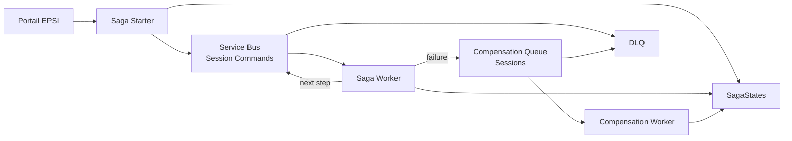

Le point essentiel du TP6 est :

> **Une Saga permet de coordonner un processus distribué sans transaction globale. Azure Service Bus Sessions conservent l’ordre des messages d’une même saga, les messages planifiés permettent les retries différés et les transactions de compensation permettent de ramener le SI vers un état cohérent lorsqu’une étape échoue.**

---

# 322. Références Microsoft

Documentation utile :

- **Saga pattern** :  
  `https://learn.microsoft.com/azure/architecture/patterns/saga`

- **Compensating Transaction pattern** :  
  `https://learn.microsoft.com/azure/architecture/patterns/compensating-transaction`

- **Service Bus Sessions** :  
  `https://learn.microsoft.com/azure/service-bus-messaging/message-sessions`

- **Activer les Sessions** :  
  `https://learn.microsoft.com/azure/service-bus-messaging/enable-message-sessions`

- **Service Bus connector Logic Apps** :  
  `https://learn.microsoft.com/azure/connectors/connectors-create-api-servicebus`

- **Service Bus managed connector reference** :  
  `https://learn.microsoft.com/connectors/servicebus-1/`

- **Scheduled Messages et Sequence Number** :  
  `https://learn.microsoft.com/azure/service-bus-messaging/message-sequencing`

- **Message expiration et TTL** :  
  `https://learn.microsoft.com/azure/service-bus-messaging/message-expiration`

- **Dead-Letter Queues** :  
  `https://learn.microsoft.com/azure/service-bus-messaging/service-bus-dead-letter-queues`

- **Logic Apps error handling et Run after** :  
  `https://learn.microsoft.com/azure/logic-apps/error-exception-handling`

- **Logic Apps workflow actions et triggers** :  
  `https://learn.microsoft.com/azure/logic-apps/logic-apps-workflow-actions-triggers`

- **Azure Table Storage connector** :  
  `https://learn.microsoft.com/connectors/azuretables/`

- **Azure Service Bus Explorer** :  
  `https://learn.microsoft.com/azure/service-bus-messaging/explorer`

- **Azure CLI Service Bus Queue** :  
  `https://learn.microsoft.com/cli/azure/servicebus/queue`

- **Azure CLI Storage Entity** :  
  `https://learn.microsoft.com/cli/azure/storage/entity`

- **Azure for Students** :  
  `https://learn.microsoft.com/azure/education-hub/about-azure-for-students`

- **Tarification Service Bus** :  
  `https://azure.microsoft.com/pricing/details/service-bus/`

- **Tarification Logic Apps** :  
  `https://azure.microsoft.com/pricing/details/logic-apps/`

- **Tarification Storage** :  
  `https://azure.microsoft.com/pricing/details/storage/`
